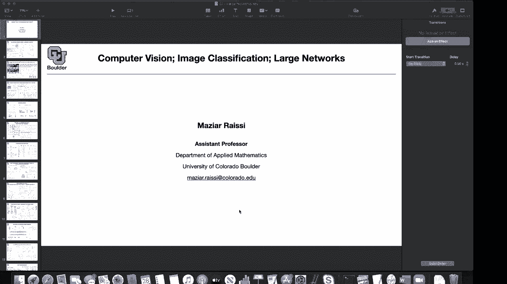
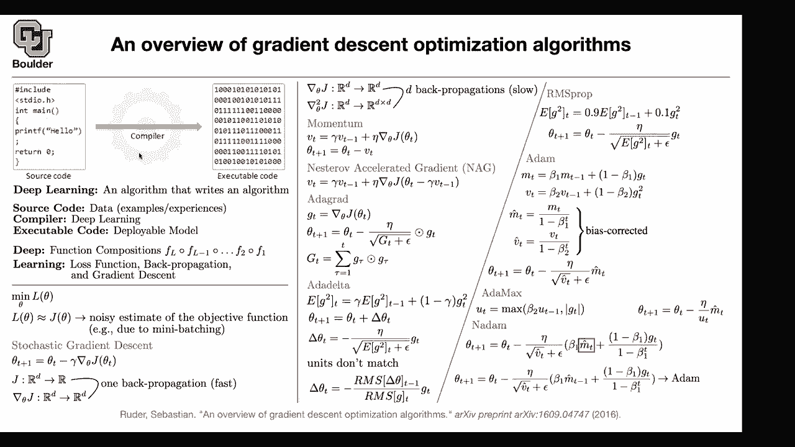

# 3：L2.1- 梯度下降算法 [续] 🚀




在本节课中，我们将继续深入学习梯度下降算法及其变种。我们将探讨如何解决AdaGrad算法在训练后期过早停止的问题，并介绍几种自适应学习率优化方法，包括RMSprop、Adam、AdaMax和Nadam。这些算法是现代深度学习训练中的核心工具，理解它们的工作原理对于构建和优化神经网络至关重要。

## 回顾与问题引入

上一节我们讨论了深度学习和随机梯度下降。我们提到由于二阶方法计算成本高，不适用于深度神经网络。因此我们转而研究一阶优化方法，并介绍了动量法。

本节中，我们来看看如何加速动量法，并探讨如何使学习率自适应。一种方法是观察历史梯度的累积，这就是AdaGrad算法。但AdaGrad的问题是梯度平方和会持续增长，导致训练后期学习率过小，算法可能在达到真正最小值前就过早停止。

## 指数移动平均

为了解决AdaGrad的问题，我们可以考虑最近历史的平均值，而不是所有历史梯度的总和。一种高效的方法是使用指数移动平均，它只需存储一个数或一组数（向量）并持续更新。

指数移动平均的公式为：
```
v_t = β * v_{t-1} + (1 - β) * g_t^2
```
其中 `v_t` 是当前估计，`β` 是衰减率（通常接近1，如0.9），`g_t` 是当前梯度。

这种方法有两个好处：梯度通常有噪声，移动平均可以起到去噪作用；同时它能使学习率自适应。

## 从AdaGrad到AdaDelta

我们可以用 `Δθ_t` 来表示参数更新量。对于AdaGrad，更新规则可以写为：
```
Δθ_t = -η / √(G_t + ε) * g_t
```
其中 `G_t` 是历史梯度平方和。

但这里存在量纲问题。如果参数 `θ` 的单位是米，梯度 `g` 的单位是米/秒，那么 `Δθ` 的单位也应该是米。然而在AdaGrad的公式中，量纲并不匹配。

AdaDelta算法的提出者通过引入对 `Δθ` 本身的指数移动平均来解决这个问题。他们不仅对梯度平方进行移动平均，也对参数更新量进行移动平均。更新规则变为：
```
Δθ_t = - RMS[Δθ]_{t-1} / RMS[g]_t * g_t
```
其中 `RMS[·]` 表示均方根。这样，算法甚至不再需要手动设置学习率 `η`。

## RMSprop算法

大约在同一时期，Jeffrey Hinton提出了一种非常相似的算法，称为RMSprop。其更新规则为：
```
E[g^2]_t = γ E[g^2]_{t-1} + (1 - γ) g_t^2
θ_{t+1} = θ_t - η / √(E[g^2]_t + ε) * g_t
```
通常 `γ` 取值为0.9。RMSprop与AdaDelta非常相似，主要区别在于RMSprop需要指定学习率 `η`，而AdaDelta不需要。

以下是RMSprop的核心步骤：
1.  计算梯度平方的指数移动平均。
2.  用学习率除以该平均值的平方根来缩放梯度。
3.  用缩放后的梯度更新参数。

## Adam算法：结合动量和自适应学习率

之前的算法（AdaGrad、AdaDelta、RMSprop）只有自适应学习率，没有动量。Adam算法将两者结合起来。

Adam同时维护两个移动平均：
1.  梯度的一阶矩（均值）估计 `m_t`，引入动量。
2.  梯度的二阶矩（未中心化的方差）估计 `v_t`，用于自适应学习率。

其更新公式如下：
```
m_t = β1 * m_{t-1} + (1 - β1) * g_t
v_t = β2 * v_{t-1} + (1 - β2) * g_t^2
```
然后进行偏差校正，因为 `m_t` 和 `v_t` 初始为0，在训练初期会有偏差：
```
m̂_t = m_t / (1 - β1^t)
v̂_t = v_t / (1 - β2^t)
```
最后进行参数更新：
```
θ_{t+1} = θ_t - η / (√v̂_t + ε) * m̂_t
```
通常 `β1=0.9`, `β2=0.999`, `η=0.001`。

## AdaMax与Nadam变种

在Adam的同一篇论文中，还提出了AdaMax算法。它使用无穷范数（L∞）来代替Adam中的L2范数，更新规则中的 `v_t` 变为：
```
u_t = max(β2 * u_{t-1}, |g_t|)
```
这是一个逐元素取最大值操作。这样做的好处是无需添加 `ε` 来防止除零错误，因为 `u_t` 始终大于零。

Nadam算法则是在Adam中引入了Nesterov动量的思想，即“向前看一步”。它与Adam的区别在于，在计算更新方向时，使用了当前时刻的偏差校正估计 `m̂_t`，而不是上一时刻的。

## 算法选择与实际应用

一个常见的问题是，不同优化算法的选择有多重要？例如，AdaMax的结果会与RMSprop有显著不同吗？

答案是肯定的。不同的深度神经网络架构（如RNN、CNN、全连接网络）对优化算法的反应可能不同。目前社区没有就“最佳”算法达成绝对共识，Adam及其变种因其良好的性能常常被作为默认选择。

以下是选择优化算法时的一些考虑：
*   **Adam**：通常是良好的默认起点，结合了动量和自适应学习率。
*   **SGD with Momentum**：如果数据集和模型非常标准，有时调优好的带动量SGD可能获得更好的最终精度。
*   **RMSprop/AdaDelta**：在循环神经网络（RNN）中表现良好。
*   具体选择需要通过实验验证。

所有这些方法都是随机的，因为它们都基于小批量数据计算梯度。Adam是随机动量方法，Nadam是随机Nesterov动量方法。

## 总结

本节课中我们一起学习了梯度下降算法的几种高级变种。我们从AdaGrad的问题出发，引出了使用指数移动平均的AdaDelta和RMSprop算法。接着，我们学习了结合动量和自适应学习率的Adam算法，并了解了其变种AdaMax和Nadam。

这些优化算法是深度学习的“编译器”，是训练神经网络的核心工具。理解它们的原理和差异，将帮助你在阅读论文、使用框架（如TensorFlow或PyTorch）和实际构建模型时做出更明智的选择。本课程后续将更侧重于应用，但掌握这些基础算法对于深入理解深度学习至关重要。



