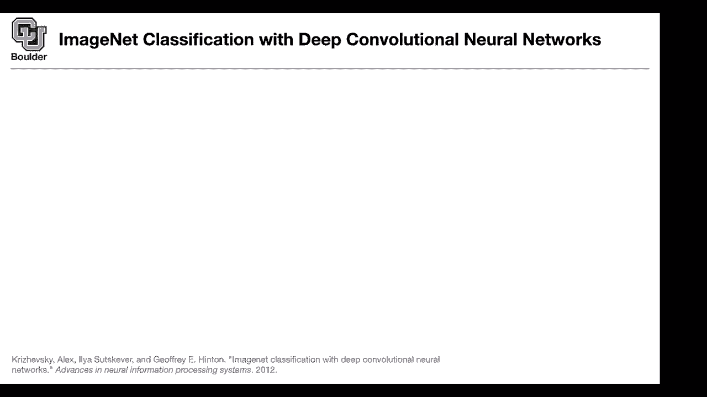
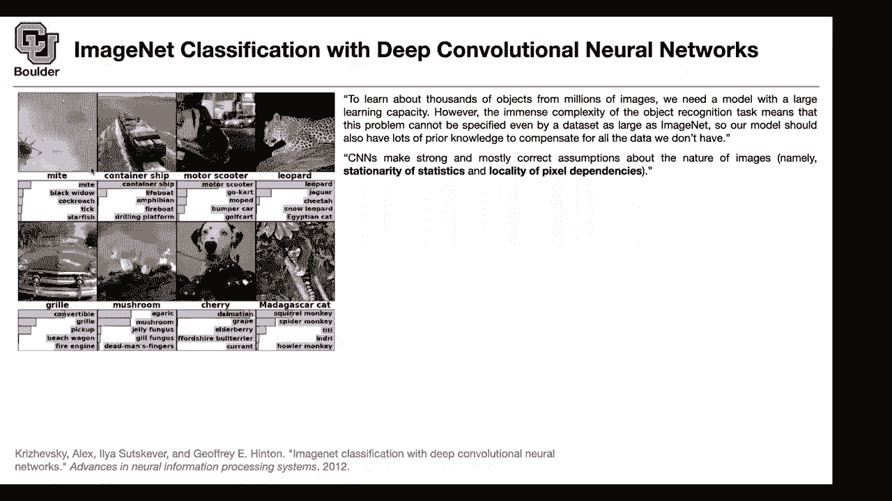
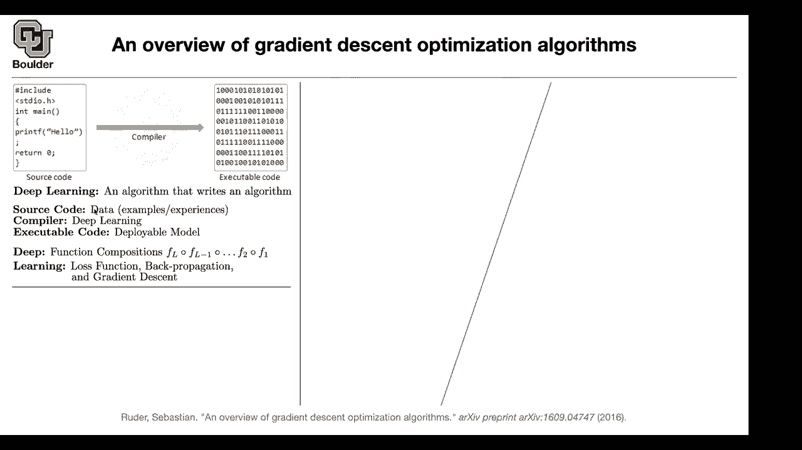

# 4：L2.2 - AlexNet 🚀

在本节课中，我们将学习现代深度学习领域的奠基性论文——AlexNet。我们将了解它如何解决图像分类问题，并深入探讨其核心架构与工作原理。

## 概述

深度学习在历史上曾有过不同的名称。在1985年左右，神经网络研究曾一度兴盛，但由于当时缺乏足够的计算能力来训练这些复杂的深度网络，该领域随后沉寂。只有少数研究者，如Geoffrey Hinton和Yann LeCun（专注于卷积神经网络），仍在坚持。而随着AlexNet这篇论文的出现，该领域得以复兴，并正式更名为“深度学习”。

## 图像分类任务 🖼️

我们将从一个具体的应用开始，并会持续探讨一段时间。假设有人给我们一张图片，算法需要判断它属于1000个类别中的哪一个。

以下是模型预测的一些示例。模型会输出一个概率分布，例如，它可能以某个概率判断图片是“螨虫”，以另一个概率判断是“黑寡妇蜘蛛”、“蟑螂”、“蜱虫”或“海星”。红色标注的是真实的类别。

你会遇到的类别包括：螨虫、集装箱船、摩托车、睡莲等等。我们的目标是编写一个能进行此类分类的算法。

## 从验证码到深度学习 🤖

你们中可能有人用过Google Scholar，有时会弹出一个窗口要求你“证明你是人类”。他们通常会问：“请选出所有包含交通灯的图片”。为什么这能测试你是否是人类？他们实际上是在利用一个分类算法。计算机擅长解决算法性问题，但在当时，它们并不擅长解决对人类来说很简单的事情，比如区分睡莲和摩托车。因此，我们将从这个挑战开始。

## 论文引言与核心思想 💡

这里引用论文（实际上是Geoffrey Hinton的话）中的一段话：“要从数百万张图像中学习数千个物体（这里指的是ImageNet数据集，包含数百万张图片和1000个物体类别），我们需要一个具有强大学习能力的模型。” 这很合理，因为数据量巨大，模型需要有足够的容量来“记忆”数据。

然而，物体识别任务的巨大复杂性意味着这个问题无法被完全“规定”出来。因此，我们的模型必须融入**先验知识**。深度学习之所以有效，并非偶然。你不能只是随机地向模型扔进数百万张图片。你必须对“先验”有明智的设计。

卷积神经网络（CNNs）对图像的本质做出了强有力且基本正确的假设。例如，图像的统计特性是**平稳的**（stationary）。这意味着，你在这里使用的一个滤波器，可以应用到所有相似的图像区域。此外，一个像素更依赖于其邻近的像素，而不是远处的像素。因此，CNNs的假设在很大程度上是正确的。

## 图像与模型输入输出 🔄

首先，什么是图像？图像是一个**张量**（tensor），张量是矩阵的泛化。具体来说，一个图像张量可能是 224（宽）x 224（高）x 3（通道：红、绿、蓝）。组合这三个通道就得到了我们看到的颜色。

模型的输出是一个在1000个物体类别上的**概率分布**。这些类别就是螨虫、集装箱船、摩托车等。因此，所有输出概率之和必须为1，且每个概率都大于等于0。

**输入**：图像（224x224x3的张量）
**输出**：概率向量（1000维，和为1）

图像进入算法，概率分布输出。中间发生的过程是一系列的**卷积**和**池化**操作。

## 卷积操作详解 🧮

什么是卷积？你有一个**核**（kernel），例如尺寸是11x11。由于图像有3个通道，所以核的维度是11x11x3。你把这个核乘以图像上对应的一个窗口（逐点相乘），然后求和，这就得到了一个数字。本质上，这是滤波器与图像局部区域的**内积**。

然后，你持续滑动这个窗口遍历整个图像，这将填充出输出的一个“切片”。接着，你会有其他滤波器（例如48个）。这意味着你的滤波器组维度是 11 x 11 x 3 x 48。这个滤波器组会帮助你生成下一个张量。

## 池化与网络结构 📉

我们希望不断缩小图像的尺寸，而不是一直处理224x224的大图。实现这一目标的方法是**池化**，例如最大池化（max pooling）或平均池化（average pooling）。AlexNet使用的是最大池化。

之后，会进行另一次卷积，如此反复。直到最后，你会得到一个**全连接层**（dense layer），这基本上是将最后剩下的三维张量“展平”成一个一维向量。剩下的部分就是一些线性组合。

在当时，由于GPU计算能力有限，他们不得不将神经网络分成两个部分。这是第一篇深度学习论文，他们使用了两个GPU，一个负责网络的一部分，另一个负责另一部分。这两部分是独立的，但在某些层它们会进行通信（如图中所示）。这有助于增加神经网络的容量，因为他们希望构建一个大型模型。

## 从1x1卷积理解核心运算 🧠

理解1x1卷积有助于理解输入。输入X的维度是 H x W x C（高度、宽度、通道数）。例如，这里是224 x 224 x 3。输出将是 H x W x F（F是新的通道数）。对于1x1卷积，你是在每个像素点（一个C维向量）上进行操作。你有一组权重，可以将维度从C变换到F（例如从3维变到48维），这本质上就是向量（或矩阵）乘法。输出是另一个像素点（但维度变了）。

你可以把后面看到的全连接层都看作是1x1卷积。那么，如何将其推广到3x3卷积呢？一旦理解了3x3，你就可以推广到任何核尺寸。

## 3x3卷积公式化表示 📐

假设我们想知道3x3卷积在某个像素点的输出。我们取一个3x3的窗口（在AlexNet第一层是11x11）。窗口中的每个点都是一个像素，其维度是C（例如3维或48维）。与1x1卷积类似，你可以通过乘以一个矩阵来改变维度（从C到F）。但这里，你有9个像素点，因此你需要9个不同的矩阵（权重）。这就是3x3卷积的主要操作。

用公式简要表示（忽略偏置项）：
对于输出位置 `(i, j)` 的每个通道 `f`：
`output(i, j, f) = sum_{dx=-1}^{1} sum_{dy=-1}^{1} sum_{c=1}^{C} input(i+dx, j+dy, c) * weight(dx, dy, c, f)`
其中，`dx, dy` 遍历-1到1，表示3x3邻域。

## 损失函数与训练 🎯

模型的参数是这些权重和偏置（统称为 θ）。我们的目标是什么？我们希望最大化训练数据的似然。具体来说，给定一张图片（例如螨虫的图片）及其对应的标签，我们希望最大化模型预测该标签的概率。

更常见的是最大化其对数似然，或者在机器学习中，我们习惯将其取负号并最小化，这就是**负对数似然损失**（交叉熵损失）。

损失函数公式：
`L(θ) = - (1/N) * sum_{n=1}^{N} log( p(y_n | x_n; θ) )`
其中，`p(y_n | x_n; θ)` 是模型对第n个样本预测其真实标签 `y_n` 的概率。

一个关键点是，由于输出是概率分布，当你增加某个类别的概率时，其他类别的概率必须相应减少，因为所有概率之和必须为1。

我们使用之前学过的方法（如梯度下降）来训练模型。

## 性能表现与意义 📊

最终，AlexNet的方法以巨大优势击败了所有之前不使用神经网络的模型。在深度学习兴起之前，人们大部分时间都花在手工设计**特征**上。而AlexNet展示了端到端学习特征的强大能力。

关于性能表格的说明：表格中的数字代表**错误率**（error rate）。
*   **Top-1错误率**：模型预测概率最高的类别如果不是真实类别，则计为错误。这是一个更严格的指标。
*   **Top-5错误率**：模型预测概率前五的类别中只要包含真实类别，则算正确。显然，Top-5错误率更低。
表格显示，CNN（AlexNet）方法的错误率远低于其他传统方法。

## 架构细节问答与扩展 💭

**关于池化**：最大池化操作是在每个通道上独立进行的。它在一个窗口（例如5x5）内取最大值，从而显著降低特征图的高度和宽度维度，但**不改变通道数**（例如保持48维）。边界处理（当窗口超出图像范围时）通过**填充**（padding，例如补零）或调整**步长**（stride）来解决。

**关于网络深度与参数**：从3通道到48通道，再到128通道，这是通过不同数量的卷积滤波器实现的。例如，第二层使用128个5x5的滤波器，将输入从48通道变换到128通道。

**关于网络结构的通用性**：AlexNet的卷积操作本身与输入图像大小无关。但是，固定的全连接层要求输入尺寸是确定的（如224x224）。对于任意尺寸的图像，通常需要进行**缩放**或**裁剪**以匹配输入尺寸。现代网络设计（如全局平均池化）可以更好地处理可变尺寸输入。

**关于模型结构设计**：AlexNet的结构选择（如层数、滤波器大小、池化策略）部分受限于当时的GPU内存和算力（例如使用两个GPU并行）。其背后的直觉包括：利用图像的**平稳性**（权重共享）、**局部性**（像素依赖附近像素）和**平移不变性**（物体稍微移动仍是同一物体）。池化操作有助于实现一定程度的平移不变性。如今，网络结构的设计有更系统的研究和直觉，我们将在课程后续深入探讨。

**关于数据质量**：深度学习非常依赖于数据质量。如果模型在“樱桃”图片上出错，可能需要检查并“清洗”数据集，例如移除有歧义的样本或补充更多相关样本。数据是模型性能的基石。

**关于自动化网络结构搜索**：学习网络结构本身（如滤波器大小、层数）属于**自动化机器学习**的范畴，本课程后续也会涉及。

## 总结

本节课中，我们一起学习了深度学习复兴的标志——AlexNet。我们了解了它如何解决ImageNet图像分类任务，其核心在于**卷积**和**池化**操作，这些操作巧妙地融入了图像的空间先验知识。我们探讨了其网络架构、输入输出表示、损失函数以及它如何通过端到端训练大幅超越传统方法。AlexNet的成功为现代深度学习的发展铺平了道路。