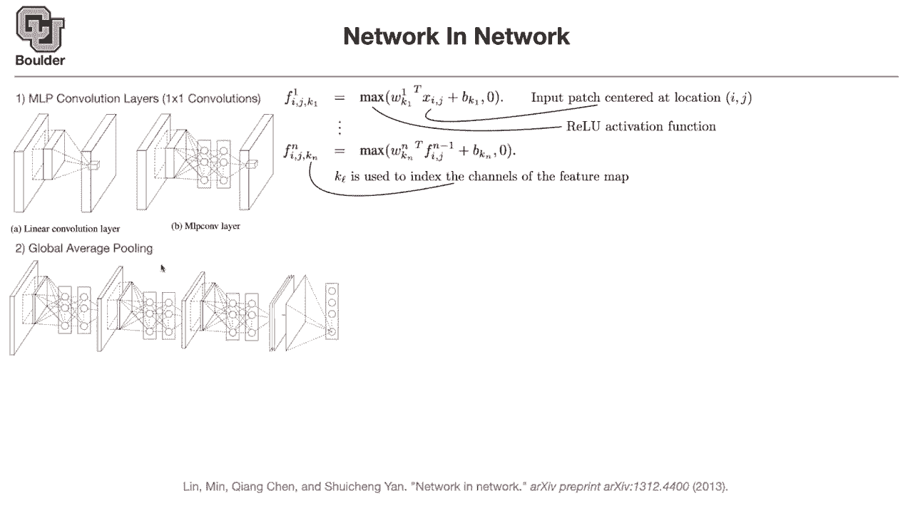
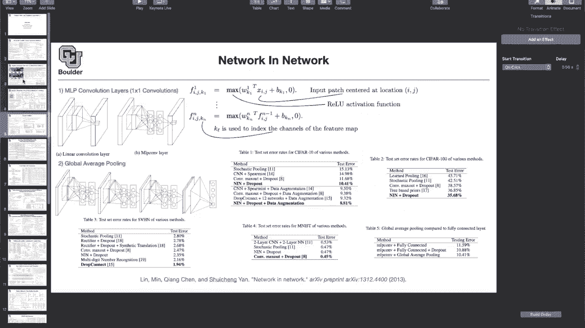
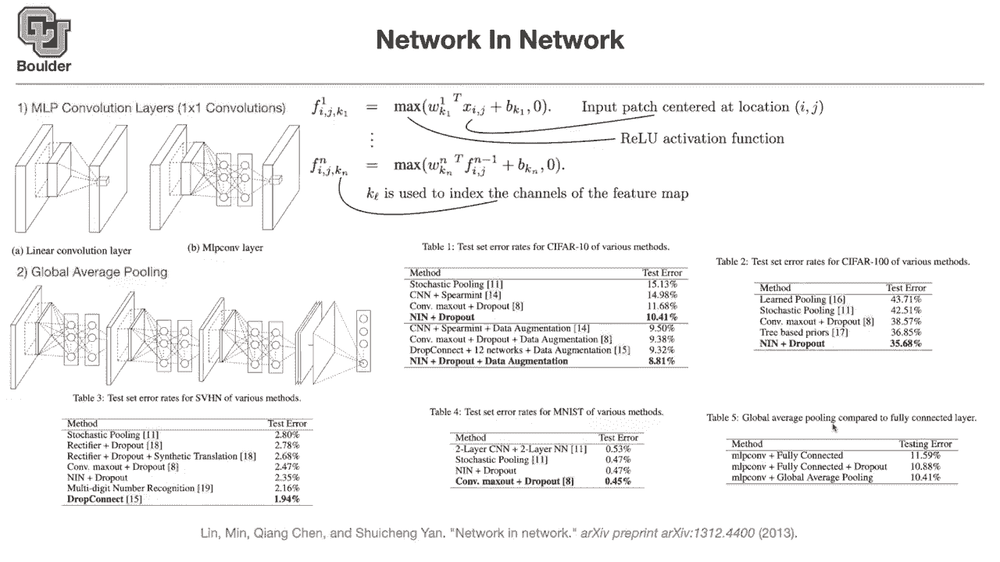

# 7：L4.1 - 网络中的网络 [续] 🧠

## 概述

在本节课中，我们将继续学习“网络中的网络”这一经典架构。我们将深入探讨其核心组件——1x1卷积和全局平均池化，理解它们的工作原理、优势，并查看其在基准数据集上的表现。

---

## 1x1卷积与全局平均池化回顾

上一节我们介绍了Dropout，并开始讨论“网络中的网络”架构。

该论文首次系统性地引入并使用了1x1卷积。自此之后，许多研究者在工作中出于各种原因开始广泛使用1x1卷积。

该架构的设计初衷是在网络中嵌入子网络，并希望实现全连接的效果。作者在撰写论文时注意到，如果在卷积层后放置多层感知机，最终效果等同于1x1卷积。

此外，他们还引入了**全局平均池化**，并用以替换了AlexNet等架构末端的全连接层。他们提出，无需使用全连接层，只需对每个通道的像素值进行平均，就能得到最终用于分类的特征向量。

全局平均池化的一个显著优点是，它使得整个网络结构**独立于输入图像的分辨率**。卷积操作是局部的，滤波器在图像上滑动，其本身不依赖于输入图像的大小。而全连接层的问题在于，它需要固定的输入尺寸，以便在展平后得到特定维度的向量（例如2048维）。全局平均池化完美地解决了这个问题。

以下是关于1x1卷积的图示说明：

1x1卷积的输入是一个张量，具有高度、宽度和通道数。输出保持相同的高度和宽度，但通过矩阵乘法将通道数从C变换为F。这个操作是逐点进行的。

---

## 关于核心概念的问答

以下是针对1x1卷积和全局平均池化的一些常见问题解答。

**问：1x1卷积是否只是用一个常数对矩阵进行缩放？**

答：不是。1x1卷积实际上是一个跨通道的线性组合（矩阵乘法）。它接收一个具有C个通道的输入，并应用F个不同的1x1滤波器，从而输出一个具有F个通道的新特征图。公式可以表示为：
`输出[b, i, j, f] = sum_c (输入[b, i, j, c] * 权重[c, f]) + 偏置[f]`
其中`b`是批次索引，`(i, j)`是空间位置，`c`是输入通道，`f`是输出通道。

**问：最后的池化层必须使用平均池化吗？可以使用最大池化吗？**

答：对于最终的全局池化层，**必须使用全局平均池化**。因为这是一个全局操作，如果使用全局最大池化，你只会保留每个通道的最大值，这会丢失大量信息。而平均操作能聚合所有空间位置的信息，产生更稳定、更具代表性的特征向量，尤其适用于分类任务。

---

## 模型性能与数据集结果

“网络中的网络”论文报告了在多个数据集上的结果。

在CIFAR-10数据集上（图像分辨率为32x32，共10个类别），结合了Dropout的“网络中的网络”架构取得了**10.41%的错误率**。如果在此基础上增加数据增强技术，测试错误率通常会进一步下降。

CIFAR-100与CIFAR-10类似，但包含100个类别。类别越多，分类任务越困难。随机猜测的基线错误率在CIFAR-10上是90%（正确率10%），在CIFAR-100上是99%（正确率1%），而在ImageNet（1000类）上则更具挑战性。

下表展示了该模型与其他方法在不同数据集上的对比（数据来源于原论文）：

| 数据集 | 网络中的网络+Dropout 错误率 | 备注 |
| :--- | :--- | :--- |
| CIFAR-10 | 10.41% | 可结合数据增强 |
| CIFAR-100 | - | 参考原论文 |
| SVHN | - | DropConnect方法在该数据集上表现最佳 |
| MNIST | - | 常用于快速验证新想法 |

这些较小的数据集常被用于快速验证新想法，确认有效后再在像ImageNet这样的大规模数据集上进行测试。

---

## 全局平均池化的正则化效应

全局平均池化不仅可以处理可变尺寸的输入，还起到**正则化**的作用。

你可以将带有Dropout的全连接层替换为全局平均池化。实验表明，这样做通常能进一步降低测试错误率。这意味着全局平均池化不仅提供了结构上的灵活性，还能帮助防止模型过拟合，提升其泛化能力。

---

## 总结

本节课我们一起深入学习了“网络中的网络”架构的两个核心创新：**1x1卷积**和**全局平均池化**。我们明白了1x1卷积如何进行跨通道的信息整合与降维，也了解了全局平均池化如何替代全连接层，使网络摆脱输入尺寸的限制并同时提供正则化效果。最后，我们查看了该模型在标准数据集上的性能表现。理解这些概念对于掌握现代卷积网络的设计思想至关重要。