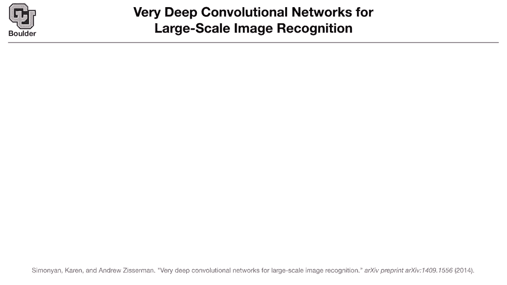
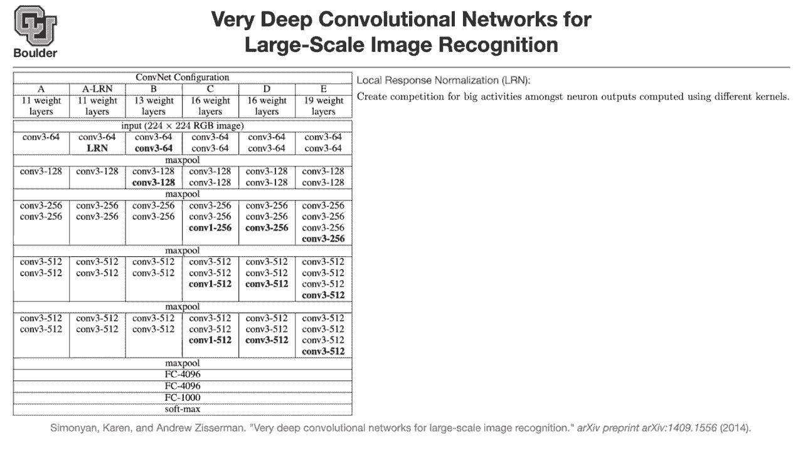
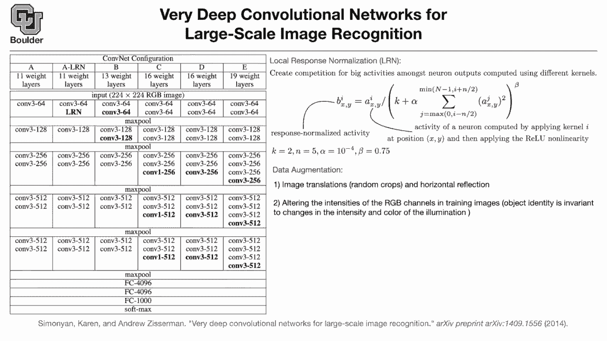

# 8：L4.2 - VGG-16 与 VGG-19 详解 🧠



在本节课中，我们将学习 VGG-16 和 VGG-19 这两个经典的卷积神经网络架构。我们将了解它们的设计理念、核心结构、训练技巧以及一些重要的辅助技术。

## 📖 概述：VGG 网络的设计哲学

VGG 网络，全称是“用于大规模图像识别的深度卷积网络”。在学习了 AlexNet 之后，VGG 网络提出了一个核心观点：**使用更小的卷积核（3x3）并构建更深的网络**，其效果优于使用更大的卷积核（如 11x11 或 5x5）。


上图是论文中常见的网络结构示意图。VGG 论文的精髓在于，它证明了通过堆叠多个 3x3 卷积层，可以达到与大卷积核相同的感受野，同时网络更深、参数效率更高。

## 🔍 核心概念：小卷积核的优势

上一节我们介绍了 VGG 网络的设计理念，本节中我们来看看其核心的数学原理。

VGG 网络的关键创新是使用连续的 3x3 卷积来替代大卷积核。例如，**两个堆叠的 3x3 卷积层，其有效感受野等同于一个 5x5 的卷积层**。

用公式描述其感受野的计算：
*   一个 3x3 卷积的感受野是 3x3。
*   两个堆叠的 3x3 卷积，第二个卷积的每个单元“看到”的是第一个卷积输出的 3x3 区域，而这个区域对应原始输入的 5x5 区域。因此，总感受野为 5x5。

所以，与其使用 5x5 或 7x7 的大卷积核，VGG 选择坚持使用 3x3 卷积，并通过堆叠它们来构建更深的网络。

**关于参数数量的说明**：有同学可能会问，两个 3x3 卷积的参数数量（2 * 3 * 3 * C_in * C_out）与一个 5x5 卷积（5 * 5 * C_in * C_out）并不相同，因此它们并不完全等价。这个观点是正确的。VGG 论文强调的是它们在**感受野上的等价性**，而非参数或计算的完全一致。在连续的小卷积之间通常还会加入非线性激活函数（如 ReLU），这能增加模型的表达能力。因此，虽然参数不同，但通过堆叠小卷积核获得与大卷积核相近的感受野，同时引入更多非线性，是 VGG 成功的关键。



## 🏗️ 网络架构详解

了解了小卷积核的原理后，我们来看看 VGG 网络的具体配置。论文中提出了多种不同深度的配置。

网络的输入是 224x224 的 RGB 图像，因此输入维度 `X` 为 `[224, 224, 3]`。网络主体由连续的卷积层（3x3）和池化层（2x2 Max Pooling）构成，最后连接全连接层和 Softmax 分类器。VGG 网络没有使用全局平均池化，这是当时论文的常见做法。

以下是论文中研究的不同配置（A, A-LRN, B, C, D, E）：


**计算网络深度**：通常只计算带有参数的层（即权重层），例如卷积层和全连接层。最大池化层、ReLU激活函数等不计入深度。

*   **配置 A**：一个基础配置。
*   **配置 A-LRN**：在 A 的基础上加入了局部响应归一化（LRN），旨在研究 LRN 的效果。
*   **配置 B**：在 A 的基础上增加了卷积层，共有 13 个权重层。
*   **配置 C**：在 B 的基础上，使用了少量的 1x1 卷积。
*   **配置 D（VGG-16）**：这是最常用的配置，使用连续的 3x3 卷积，共有 16 个权重层。
*   **配置 E（VGG-19）**：更深的版本，共有 19 个权重层。

图像经过网络时，每次进行步长为 2 的 Max Pooling 操作后，空间分辨率（宽和高）会减半，而通道数则会增加。这种设计使得网络在提取高层次特征的同时，逐步压缩空间信息并增加特征维度。

## ⚙️ 关键技术：局部响应归一化（LRN）

在介绍了网络结构后，我们来看一个来自 AlexNet 并被 VGG 研究的技术：局部响应归一化。

LRN 的全称是局部响应归一化。它的灵感来源于生物视觉系统中的侧抑制机制，旨在在相邻的特征通道之间创建一种“竞争”关系。

其计算公式如下：



```
b_{x,y}^i = a_{x,y}^i / (k + α * Σ_{j=max(0, i-n/2)}^{min(N-1, i+n/2)} (a_{x,y}^j)^2)^β
```

其中：
*   `a_{x,y}^i` 是第 `i` 个通道在位置 `(x, y)` 处的神经元激活值。
*   `N` 是通道总数。
*   `n` 是用于归一化的局部邻域通道数。
*   `k`, `α`, `β` 是超参数。

**核心思想**：如果一个通道 `j` 在某个位置的激活值很高，那么为了保持通道 `i` 的相对激活水平，`a_{x,y}^i` 也需要相应提高。这就在相邻通道间引入了竞争。在卷积网络中，空间上相邻的像素通过卷积核进行交互，但不同特征通道之间默认是独立的。LRN 提供了一种让相邻通道间也能相互影响的方式。

然而，VGG 论文通过对比配置 A 和 A-LRN 发现，LRN 并未带来显著的性能提升。因此，在之后的图像分类网络中，LRN 逐渐被弃用。但理解这个概念仍有价值，因为类似的归一化思想（如层归一化、实例归一化）在生成对抗网络和循环神经网络等领域以不同的形式重新出现。

## 🛠️ 重要技巧：数据增强

由于即使像 ImageNet 这样拥有 120 万张图像的大型数据集，对于复杂的视觉任务来说仍然不够，因此数据增强技术至关重要。它能“免费”扩大数据集规模，防止模型过拟合。

以下是 VGG 和 AlexNet 中使用的几种主要数据增强方法：

1.  **随机裁剪与水平翻转**：这是最常用且几乎被所有论文采用的方法。从原始图像（短边缩放至 256 像素）中随机裁剪出 224x224 的区域，并进行随机的水平翻转。这模拟了物体在图像中的位置变化和镜像对称性。

2.  **颜色扰动**：物体识别应不受光照颜色和强度变化的影响。通过对 RGB 通道的强度进行主成分分析（PCA）并添加扰动来模拟这种变化。
    *   具体操作：计算训练集所有像素 RGB 值的 3x3 协方差矩阵，得到特征值和特征向量。然后，对每个训练图像，在每个像素的 RGB 值上添加一个随机扰动，该扰动由特征向量和以特征值为方差的高斯噪声生成。

3.  **尺度抖动**：主要用于测试阶段以提升模型鲁棒性。将测试图像缩放到多种不同尺寸（例如，短边在 `[S_min, S_max]` 范围内），分别输入网络进行预测，最后对多个尺度的预测结果取平均作为最终输出。

**如何选择数据增强方法？** 这通常取决于数据集的大小和任务的复杂性。如果数据集相对较小，则需要更激进的数据增强来防止过拟合。对于 ImageNet 级别的任务，随机裁剪和水平翻转是基础，颜色扰动和尺度抖动也能带来稳定提升。在实践中，这些方法常常组合使用。

## 🚀 训练策略

VGG 是非常深的网络，在当时一些现代训练技巧（如批归一化）还未普及时，其训练策略也值得借鉴。

他们采用了一种**渐进式训练**或“预热”策略：
1.  首先训练较浅的配置 A，因为它的深度较浅，更容易训练收敛。
2.  然后，使用训练好的配置 A 的权重，去初始化更深网络（如配置 B）对应层的权重。新添加的层则进行随机初始化。
3.  接着，用这个初始化好的网络进行完整的训练（微调）。
4.  重复这个过程，逐步训练出 VGG-16 和 VGG-19。

这种策略本质上是一种**迁移学习**，将浅层网络学到的通用特征迁移到深层网络中，作为深层网络训练的起点，有效加速了训练并提升了稳定性。

## 📝 总结

本节课中我们一起学习了 VGG-16 和 VGG-19 网络。

*   **核心贡献**：提出了使用**小尺寸卷积核（3x3）堆叠**来构建深度网络的设计范式，在保持感受野的同时增加了网络深度和非线性。
*   **网络结构**：学习了从配置 A 到 E 的演变，其中 **VGG-16（配置 D）** 和 **VGG-19（配置 E）** 最为著名和常用。
*   **关键技术**：探讨了**局部响应归一化（LRN）** 的原理及其在实践中的效果（后被弃用）。
*   **实践技巧**：深入了解了**数据增强**的多种方法（随机裁剪、翻转、颜色扰动、尺度抖动）及其重要性。
*   **训练方法**：介绍了**渐进式训练/迁移学习**策略，用于高效训练深度网络。

VGG 网络以其简洁统一的结构，证明了深度对于视觉表征学习的重要性，为后续更复杂的网络设计奠定了坚实的基础。