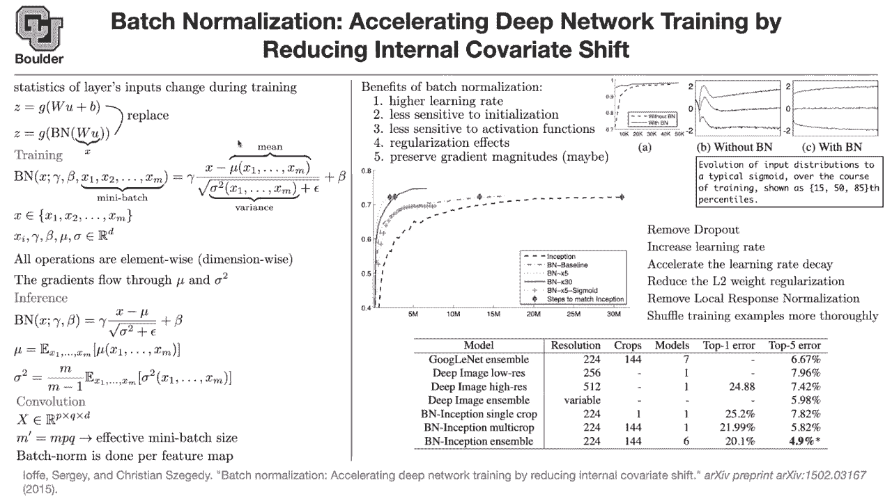

# 12：L6.1 - 批标准化 [续] 🧠 📚

在本节课中，我们将继续深入学习批标准化技术。上一节我们介绍了协变量偏移的概念以及批标准化的基本思想。本节中，我们将详细探讨批标准化在卷积神经网络中的应用、其带来的具体好处，并通过实验数据直观展示其效果。

## 📖 概述

批标准化是一种用于深度神经网络训练的技术，旨在缓解内部协变量偏移问题。它通过规范化每一层输入的分布，使得网络训练更稳定、更快速，并对超参数（如学习率、初始化）的设定不那么敏感。

## 🔍 批标准化回顾

上一节我们介绍了协变量偏移的含义，它本质上是指每一层输入数据统计特性的变化。

我们提出使用批标准化来减轻这种影响。批标准化包含两个部分：训练阶段和测试阶段。

在训练阶段，由于允许随机性，操作是随机的，因为你使用的是小批量数据。

我们取一个小批量数据，计算该批次的均值，并从输入 `x`（即该特定层的输入）中减去该均值，再除以标准差。这里的 `epsilon` 是一个很小的常数，用于防止除以零。

但如果你只做这些，会遇到麻烦，因为进入激活函数的所有数据都将具有零均值和单位方差。

为了抵消这种影响，你需要乘以 `gamma`（它充当你的标准差），然后加上一个偏置 `beta`（它充当你的均值）。这些参数将是可学习的。

每个操作都是逐元素进行的。需要注意的一点是，损失函数的梯度会流经 `mu` 和 `sigma`，因此批标准化在某种程度上预见了参数变化时会发生的情况。

在测试阶段，特别是在推理时，你需要使用一个确定的数值或向量，使其不依赖于小批量数据。这就是为什么在训练期间，你需要保持均值和方差的移动平均值。基本上，`mu` 就是那个移动平均的均值，`sigma` 就是那个移动平均的方差。

## 🖼️ 卷积神经网络中的批标准化

以上是针对全连接网络的情况，针对输入的线性组合（`u` 是输入，`w` 乘以 `u` 得到 `x`）。在卷积神经网络的情况下，输入 `x` 将具有 `p` 个像素的宽度、`q` 个像素的高度和 `d` 个通道。

以下是具体操作步骤：

你取小批量的大小 `m`，以及所有像素位置。所有这些都将成为你的数据。你的小批量的有效尺寸增加了。

然后你在这些数据上计算均值和标准差。基本上，批标准化是在每个特征图上进行的，即针对特征图的每个维度。

你不仅在小批量图像数量上进行求和以计算均值和方差，还在像素级别上进行跨像素的求和。

这会给你均值和标准差，它们将是一个 `d` 维向量（而不是 `p * q * d` 维）。然后，你在这里看到的减法、除法等操作将被“广播”到整个数据上。

对于那些了解 Python 的人来说，如果你从一个矩阵中减去一个向量，那么该向量将扩展成与你的 `x` 大小相同的矩阵，然后进行逐元素减法或除法。这就是广播的概念。

## ✅ 批标准化的好处

批标准化带来了多方面的好处：

*   **允许更高的学习率**：由于处理了协变量偏移，并且激活函数的输入不会出现极端值，因此可以使用更大的学习率加速训练。
*   **降低对初始化的敏感性**：无论权重和偏置如何初始化，批标准化都会减去均值和方差，使得网络对初始参数的选择不那么敏感。
*   **降低对激活函数选择的敏感性**：现在输入到激活函数 `g` 的数据大多集中在零附近，数值不会变得过大。例如，对于 Sigmoid 激活函数，它将保持在近似线性的区域，而不会进入饱和的非线性部分，从而避免了梯度消失。
*   **具有一定的正则化效果**：由于每次小批量数据的均值和方差不同，这为网络引入了一定的随机性，其效果类似于 Dropout。
*   **保持梯度幅度**：这可能需要进一步研究，需要仔细推导梯度公式来验证。

## 📊 效果展示

为了理解协变量偏移的概念，首先看看批标准化的好处。这是在 MNIST 数据集上训练一个简单神经网络的结果。

这是不使用批标准化的结果，这是使用批标准化的结果。可以看到，收敛速度要快得多。Y 轴是测试数据上的准确率，这实际上是泛化误差。

为了展示协变量偏移的概念，特定激活函数 `g` 的输入（例如，在本例中是 `w*u`）的统计分布可以被绘制出来。

我们在这里绘制的是其统计分布（例如中位数、上四分位数、下四分位数）在训练过程中的变化。可以看到，没有批标准化时，分布变化剧烈且不对称。但在批标准化之后，激活函数的输入大多时间集中在零附近，分布稳定。这基本上是一种绘制分布的方式。

这就是协变量偏移。通过批标准化，你移除了协变量偏移。

这是 Inception 网络（即 GoogleNet）的结果。X 轴是训练步数，Y 轴是准确率。红色虚线所做的唯一改变就是引入了批标准化，它已经将所需的训练量减少了一半以上。

然后是使用 5 倍更大学习率的批标准化，收敛更快。接着是使用 30 倍学习率的批标准化，收敛速度极快。

为了验证批标准化对激活函数不敏感的 claim，他们将激活函数改为 Sigmoid，得到了图中所示的结果。蓝色菱形表示达到 Inception 模型准确率所需的迭代次数。批标准化的好处非常明显。

## 🔧 实施细节与讨论

`beta` 和 `gamma` 是可学习的参数。在密集层中，每个输出神经元都有其自己的 `beta` 和 `gamma` 标量。这里的符号是向量化的，`beta` 和 `gamma` 是与偏置 `b` 大小相同的向量。

你的 `beta` 扮演了 `b` 的角色，因为当你减去均值后，原始的偏置 `b` 实际上就消失了。

批标准化的一个缺点是，如果批量大小 `m` 为 1，则无法使用，因为单个样本的标准差为零。

批标准化似乎是一种独立于网络的外部正则化技术。实际上，在批标准化的论文中，他们使用 Inception 模型并取得了巨大改进。

他们所做的改变包括：
*   **完全移除了 Dropout**：因为批标准化本身就起到了正则化的作用。
*   **提高了学习率**：这意味着他们不需要等待太长的训练时间。
*   **加速了学习率衰减**：他们在训练过程中更快地降低了学习率。
*   **减少了 L2 权重衰减**：他们进一步降低了权重衰减的参数。
*   **移除了局部响应归一化**：在批标准化之后，大多数分类网络不再使用 LRN。
*   **更彻底地打乱训练样本**：样本越随机、越独立，网络学习越快。

关于批量大小的敏感性，通常的做法是选择尽可能大的批量大小，以使其适应 GPU 内存。具体的敏感性取决于模型。

## 🏆 实验结果

在 ImageNet 数据集上，原始的 Inception 模型（使用 7 个模型集成和每张图像 144 个裁剪）的 Top-5 错误率是 5.82。而使用批标准化模型集成后，错误率降低到了 4.9，这是一个巨大的提升。

这表明批标准化非常强大，并且易于实现。它已经集成在大多数神经网络框架中，你只需要添加一个批标准化层即可。

在实践中，你通常会在每个卷积层或密集层之后放置一个批标准化层。不过，靠近输入的初始卷积层可能不需要，因为输入图像通常已经进行了归一化（减去均值）。

关于批标准化层是放在最大池化层之前还是之后，这有影响，最佳位置将在后续的论文中讨论。目前常见的做法是放在卷积层之后。

## 🎯 总结

本节课中，我们一起深入学习了批标准化技术。我们回顾了其原理，探讨了在卷积神经网络中的具体应用方式，并详细列出了它带来的诸多好处，如允许更高的学习率、降低对初始化和激活函数的敏感性等。通过实验数据的对比，我们直观地看到了批标准化在加速收敛和提升最终性能方面的显著效果。我们还讨论了实施中的一些细节和最佳实践。批标准化已成为现代深度神经网络中一项至关重要且广泛应用的技术。