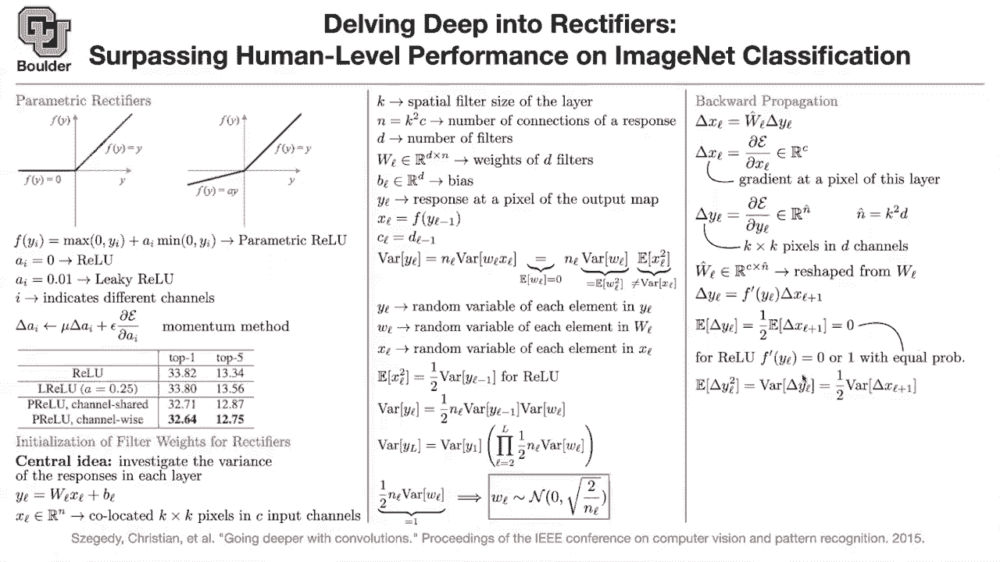
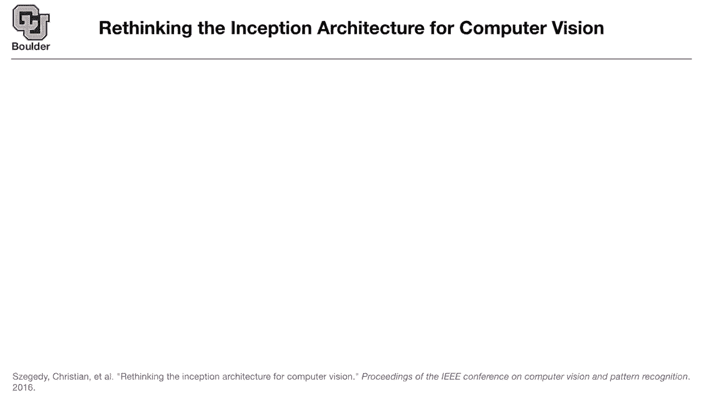

# 14：L7.1 - Kaiming参数初始化 [续] 🔧

在本节课中，我们将继续学习卷积神经网络中参数初始化的方法，特别是当激活函数为修正线性单元（ReLU）及其变体时。我们将深入探讨如何通过控制前向传播和反向传播中信号的方差，来避免梯度消失或爆炸的问题，从而确保网络能够有效训练。

---

## 前向传播中的方差分析 🧮

上一节我们讨论了ReLU激活函数。右侧图中的 `u` 是一个参数值，你可以让参数 `ai` 依赖于通道或滤波器。这意味着每个滤波器都将对应一个你想要学习的不同激活函数。我们得出的结论是，这确实能略微提升准确率并降低错误率。

那么问题来了，当激活函数是ReLU时，我们该如何初始化滤波器？我们说过，我们将观察每一层响应的方差，这将帮助我们找到初始化这些参数的思路。

通常，偏置项会被初始化为零，所以我们知道如何初始化它。我们知道，权重 `w` 将用一个均值为零的分布（很可能是正态分布）来初始化，我们需要找出合适的方差。

我们决定将所有元素展平。我们取图像的一个 `k x k` 窗口，这个窗口将有 `k²` 个像素，并且它们有 `c` 个通道。例如，第一层是红绿蓝三通道，其他层可能有47个通道。我们将所有元素展平，放入一个长向量中，`n` 基本上就是 `k² * c`，这是一个响应的连接数。

`d` 是你拥有的滤波器数量，它对应于下一层的像素维度（不是像素数量，而是每个像素向量的维度）。然后我们说，卷积本质上就是矩阵向量乘法。偏置项 `b` 我们将初始化为零。

那么这一层如何与上一层关联呢？它们通过一个激活函数相关联。基本上，你输入的线性组合的输出会经过一个非线性函数（在本例中是ReLU），然后得到 `xl`，即下一层（或根据索引是当前层）的输入。输出层的滤波器大小与当前层的通道数相匹配，这就是它们关联的方式。所以，`n` 必须与 `l` 或 `c_l` 和 `d_l` 相关，但为了记号的简便，我只使用 `n`，它就是 `k² * c`。`d` 是滤波器数量，但这些都是按层计算的。如果你想非常严谨，就需要一直保留索引 `l`。

然后，思路是观察响应的方差，即 `yl` 的方差。我们知道 `yl` 是输出的一个元素，因此有一个分布。`wl` 是你的权重矩阵的一个元素。我们希望知道如何独立地初始化它们。所以，你的 `w` 的每个条目都将被独立初始化，它们将是独立同分布的。

但这里有一个对 `n` 的求和。在进行矩阵向量乘法时，需要对 `n` 求和，然后你对向量的条目求和，本质上是一个点积，这就是为什么你会得到 `nl` 出来。然后你有 `wl * xl` 的方差。我希望你花时间查看了两个随机变量乘积的方差公式。如果你搜索一下，这个公式就会出现。我们只是写下 `wl*xl` 的方差，作为 `wl` 的方差和 `xl` 平方的期望值。

我们知道我们希望初始化权重，使其均值为零，我们将假设这一点。因此，方差等于随机变量平方的期望值。基本上，二阶矩就是你的方差。如果这是真的，那么初始化就很容易，你只需用 `sqrt(1/nl)` 来初始化。

`xl` 是 `yl-1` 的非线性函数。`xl²` 是 `yl-1` 方差的一半。所以一半时间是零，另一半时间与你的变量相同。因此，对于ReLU，你得到的是其一半。现在你继续代入这个公式，替换它，这就是你得到的结果：

`方差(yl) = 1/2 * nl * 方差(wl) * 方差(yl-1)`

到目前为止清楚吗？有任何问题吗？

现在你对所有层都这样做。基本上，`y2` 的方差等于 `y1` 的方差乘以该时刻的因子。然后你迭代进行，这将给你最后一层的方差等于第一层输入的方差，然后乘以这些 `1/2` 和 `方差(wl)` 的乘积。

正如上一节提到的，乘以许多数字的问题是，它要么会爆炸，要么会趋近于零。如果爆炸，意味着你的输出变得巨大，然后失控。如果消失，你总是得到一个常数，总是得到零。

为了避免这种情况，有人知道我们需要做什么吗？我们想要避免爆炸。是的，Jacob给出了正确答案：你想让所有相乘的数字都接近1。所以我们要做的是，假设这个乘积为1，或者尽可能接近1。这将给出你的初始化方法。

如果你的方差乘以一个数必须等于1，那么你的权重的方差必须是 `2 / nl`，这来自这部分。然后标准差将是 `sqrt(2 / nl)`。

所以，这是使用ReLU激活函数的卷积神经网络正确的初始化方式。到目前为止有任何问题吗？

在这项工作之前，人们只使用一个恒定的标准差。这样做的问题是，这个公式不成立，方差要么爆炸，要么趋近于零。因此，方差必须依赖于你的滤波器大小和输入通道数。基本上，它取决于滤波器大小和输入通道数。

但这还不是全部。当你前向传播通过神经网络时，事情可能会出错。当你进行反向传播、计算导数时，也会出现问题。这会导致梯度爆炸或梯度消失。如果你的梯度爆炸，那么你总是在优化空间中跳跃。如果你的梯度消失，那么你就有零梯度，没有学习发生，所以你总是会卡在起点，没有学习会发生。因此，反向传播很重要。

---

## 反向传播中的方差分析 🔄

让我们看看在反向传播过程中会发生什么。

`Δxl` 将是损失函数对输入 `xl`（输入中的一个像素）的导数。它等于 `ŵl` 乘以损失对输出 `y` 的导数。这些只是导数：损失对输入像素的导数，损失对输出的导数。`ŵl` 来自 `wl`，通过重塑它，可能是转置，然后基本上左右翻转你的滤波器（镜像）。关于这部分我有个问题，因为我简要地看过卷积神经网络的反向传播，但没理解那部分。也许一个简单的入门教科书会涉及这些细节。我在网上分享了链接，我想第一节链接是针对1x1卷积的，那是针对全连接层的。你可以拿那个然后尝试扩展它，但很简单。你所做的是取 `yl` 的导数，即损失对 `yl` 的导数，然后如果你展开这些求和，你会看到 `wl` 如何与 `ŵl` 相关。你只需要展开它，对所有条目求和，然后取损失对这个像素的导数，看看会发生什么。但一切都来自于对这个式子求导，这是链式法则。如果像素是1x1，如果你的窗口是1x1，那么你知道损失对 `xl` 的导数将是 `wl` 的转置乘以 `yl` 的导数（基本上是损失对 `yl` 的导数）。但现在你有很多其他像素，所以有另一个求和。这必须与转置这个 `wl` 有关。我不想深入这个复杂的机制，因为这本身就需要一页幻灯片。但我认为你们可以在家完成，这不是火箭科学，只是求导和使用链式法则。

现在我们在做什么？我们观察一个像素，取损失对该像素的导数。每个像素在 `R^c` 中，有 `c` 个通道。同样的事情会发生在损失上，它将在 `R^c` 中。这些只是梯度，梯度将与你的变量（这里是 `xl`）具有相同的维度。所以那只是一个像素，然后那个像素将受到输出的像素的影响，输出将有 `d` 个维度。`n̂` 将是 `k² * d`，类似于 `n` 是 `k² * c`。`n̂` 将是 `k² * d`。正如我所说，`ŵl` 你将通过重塑 `w` 得到。为了确保至少在大局上是正确的，这是 `c x n̂`，将是 `c * k² * d`。让我们记住这个数字，然后回到这里。`w` 是 `d * k² * c` 个数字。所以你至少有相同数量的数字，这会让你感到一些安慰，认为事情是正确的。但最终，发生的只是 `w` 的重塑。所以你在对通道进行转置，然后左右翻转你的滤波器（镜像）。这就是你进行反向传播的方式。事情是线性的，我相信如果你在纸上写出求和，你会看到这种关系。这实际上是一个非常好的练习，我强烈推荐。到目前为止有任何问题吗？

好的，那么当你有激活函数时会发生什么？你需要看看这个公式，并将其向前移动一层。所以 `x_{l+1} = f(yl)`。现在你取损失对 `x_{l+1}` 的导数，写下链式法则，然后得到你激活函数的导数乘以你输入的导数（基本上你现在是反向思考）。但这来自于这个公式并写下链式法则：`x_{l+1} = f(yl)`。现在你写下损失对 `x_{l+1}` 的导数，由于链式法则，你的激活函数的导数会出来，然后是损失对 `yl` 的导数。所以这个公式来自于这里和链式法则。这是另一个练习，更仔细地写下来。

所以现在我们状态良好，我们知道事情是如何通过非线性函数和这些线性操作反向传播损失的。线性操作以这种方式发生，你所做的只是权重的重塑。非线性函数的导数出来了。很多人认为反向传播只是链式法则，但它不止于此。有人能告诉我吗？所以我们只是重塑，这来自于链式法则。是的，这只是链式法则。它比链式法则更多。为什么它快？你接近了。你们知道“记忆化”这个概念吗？不是“记忆”，而是“记忆化”。我希望我写对了。有点像是在记忆你在前向传播时做的一些操作。所以当你通过神经网络进行前向传播时，你计算了一堆东西，比如在这里你计算 `yl`，在这里你计算 `xl`。没有必要重新计算它们，你只需记住 `yl` 的值。为什么你记住它？基本上你把它存储在内存中。为什么你记住它？因为在这里，当你进行反向传播时，你只需要从内存中读取，这就是为什么事情很快。其余部分只是标量向量乘法和矩阵向量乘法，所以它将和你的前向传播一样快。否则，你将需要每次计算 `yl`，这是低效的。清楚了吗？所以它是缓存。反向传播有两个要点，为什么它好：一个是链式法则（从数学角度），另一个是从实现角度，计算机实际看到和做的是这个记忆化的概念。所以反向传播是记忆化加链式法则。好的，这是一个很好的插曲，我们打开了一个括号，现在关闭它。

让我们继续看看损失对 `yl` 的导数的期望值。这里的导数要么是0，要么是1，概率相等，并且独立于其他变量。这意味着它的期望值是 `1/2` 乘以 `Δx_{l+1}` 的期望值，并且我们知道 `Δx_{l+1}` 的期望值是零（它们将具有零均值）。现在我们可以看看二阶矩，它等价于方差。再次，我们利用它要么是0要么是1且概率相等的事实，这将给你 `1/2` 乘以另一个变量的方差。所以这个 `1/2` 项出现了，无论在你进行前向传播还是反向传播时。

现在你把它代回去。实际上，你取 `Δx` 的方差，这里有一个大小为 `n̂l` 的求和，然后是 `wl` 的方差，因为我们知道 `ŵl` 和 `wl` 有相同的条目，所以它只是 `wl`，而不是 `ŵl`。然后它将是 `Δy` 的方差。然后我们将使用这个公式并将其代入 `wl` 的方差，这就是你得到的。然后你基本上向后进行，你知道 `Δx2` 的方差与 `Δx3` 的方差相关，依此类推，你进行迭代。

同样，这里的这个条目必须接近1，这将给你另一种方法。结果信息是，你可以使用 `n̂l` 或 `nl` 来初始化。但事实证明，最终这些只会相差一个常数。如果你使用这个公式，那么你前向传播输出的方差将与这个方差相差一个常数，而常数没有意义，所以它不会爆炸或消失。`n̂l` 是什么？`n̂l` 是 `k² * d`，而 `nl` 是 `k² * c`，这些是不同的数字。`n̂l` 是一个与 `nl` 不同的数字。这回答了你的问题吗？好的，完美。

所以你可以使用 `n̂l` 来初始化，也可以使用 `nl` 来初始化。最终，这不太重要，无论是在前向传播还是反向传播中，事情都不会爆炸或消失。现在我们做了很多工作才到达这里。你可以做同样的代数运算，并为使用参数化ReLU的情况得出正确的初始化方法。当你进行这些代数运算时，你将得到最终的方程。

所以，如果你使用参数化ReLU，你的公式中会出现 `1 + a²`。如果 `a` 是零，你就回到ReLU，这两个公式与我们在这里发现的公式相同。所以这里的大局信息是什么？我想我们深入了很多细节，但现在让我们回过头来看看大局。

大局是：激活函数在初始化时很重要。初始化不是一项简单的任务。初始化很重要，激活函数很重要。问题来自于前向传播或反向传播中，当你将许多数字或矩阵相乘时，事情要么会爆炸，要么会消失，你希望事情表现良好。我想这是本课程中最技术性的一页幻灯片，但经历这些细节是一个很好的练习。最终，你从这篇论文中要记住的是这两点：如何初始化，以及你将使用这个公式来初始化你的神经网络。但如果你改变了激活函数，那么你必须小心。

有任何问题吗？我们学到了很多好技术：一是我们了解了ReLU，这些是深度学习文献中的重大进步。在ReLU之前，事情不收敛，表现不佳。我们还了解了批归一化，以及如何正确初始化我们的神经网络。这些都是重大进步，没有这些，训练神经网络将非常困难。好的，如果没有问题，让我们进入下一个主题。

Leaky ReLU 会改变初始化吗？Leaky ReLU 类似于参数化ReLU，但那些参数固定为一个常数，比如0.01。但公式与之前的类似。是的，我可以，这是你将用于参数化ReLU的公式，这个参数是通道依赖的。这回答了你的问题吗？

你会在不同的层使用不同的激活函数吗？实际上，让我们看看二元分类器的最终激活函数。最终的激活函数将是Sigmoid，因为你希望事情变成概率。所以对于最后一层，你使用不同的激活函数。如果你考虑这个参数化ReLU，这是一个很好的问题：那将如何影响初始化？如果只有一层改变，它不会影响，因为梯度不会爆炸或消失，或者你的前向传播不会爆炸或消失。问题出现在当你多次这样做，并且你的网络很深时，那么你将许多数字相乘，事情可能会消失或爆炸。这回答了你的问题吗？好的。

---

## 总结 📝

本节课中，我们一起深入学习了Kaiming初始化方法。我们了解到，为了确保深度神经网络的有效训练，必须仔细初始化权重，以控制前向传播和反向传播过程中信号的方差。核心在于避免梯度消失或爆炸问题。对于使用ReLU及其变体（如Leaky ReLU、参数化ReLU）的网络，我们推导出了权重的初始化方差应为 `2 / n`（前向）或 `2 / n̂`（反向），其中 `n` 和 `n̂` 分别与输入连接数和输出连接数相关。正确的初始化是成功训练深度模型的关键步骤之一。