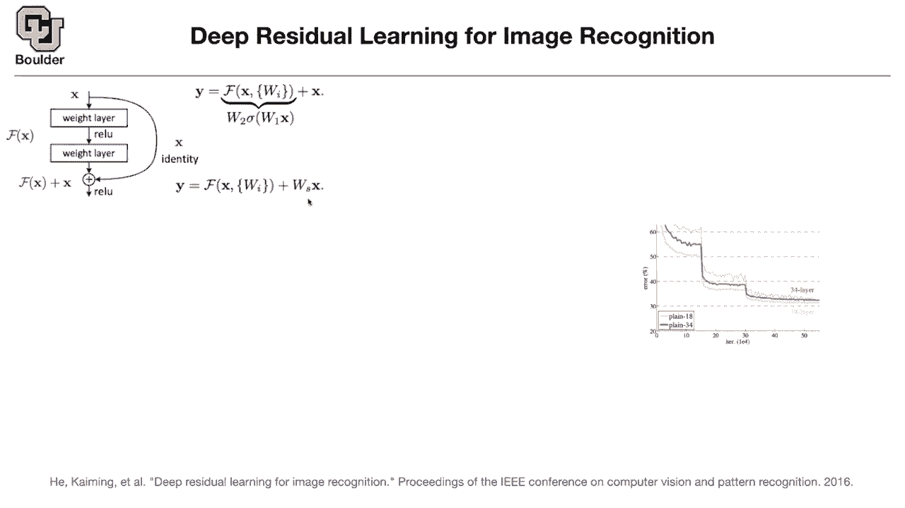
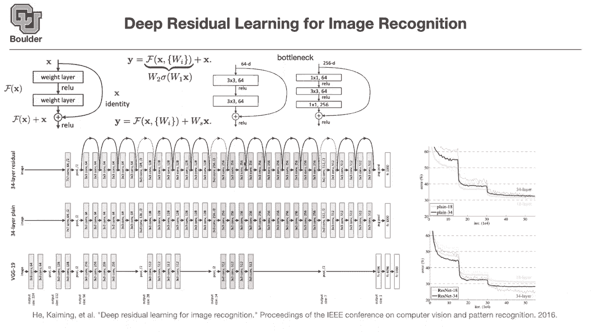

# 17：L8.2 - ResNet 🧠

## 概述

在本节课中，我们将要学习深度残差学习，也就是著名的 ResNet。我们将深入探讨其核心思想、工作原理以及它为何能解决深度神经网络训练中的关键问题。

---

## 深度网络的困境

上一节我们介绍了构建更深网络以提升性能的趋势。理论上，网络越深，参数越多，感受野越大，学习能力应该越强。

但在实践中，当实现一个18层网络和一个34层网络时，会出现一个反直觉的现象。34层的更深网络在训练集和验证集上的错误率反而比18层的网络更高。

**公式表示：**
假设浅层网络错误率为 `E_s`，深层网络错误率为 `E_d`。我们预期 `E_d < E_s`，但实际观察到 `E_d > E_s`。

这引发了思考：是网络没有正确训练，还是梯度方面出现了奇怪的问题？

---

## 残差学习的思想

为了解决上述问题，ResNet 论文提出了一个核心思想：也许可以让网络学会“忽略”某些层，如果它不需要使用它们的话。

其实现方式是增加一个**快捷连接**，将一个层的输入直接传递到后面几层。如果网络发现通过那些复杂的非线性层学习很困难，它就可以选择主要走这条捷径。

**代码描述一个残差块：**
```python
# 假设输入为 x
# F(x) 代表几层卷积和非线性变换
# 输出 y = F(x) + x
def residual_block(x):
    identity = x
    out = conv1(x)
    out = relu(out)
    out = conv2(out)
    # ... 可能还有更多层
    out = out + identity  # 快捷连接
    out = relu(out)
    return out
```

这意味着，一个名义上34层深的网络，通过优化，可能实际上只等效于使用了7层。网络在训练初期可能主要使用快捷路径，随着遇到更复杂的样本，再逐渐利用更复杂的网络部分。

---

## 维度匹配与1x1卷积

一个关键问题是：当快捷连接的输入和输出维度不同时，无法直接相加。

以下是解决方法：
*   **维度相同**：直接使用恒等映射，即 `y = F(x) + x`。
*   **维度不同**：使用 **1x1 卷积** 来调整输入的维度，使其与 `F(x)` 的输出维度匹配。此时，快捷连接变为 `y = F(x) + W_s * x`，其中 `W_s` 是1x1卷积的权重矩阵。

1x1卷积在这里的作用是进行维度的升维或降维。

---



## 从VGG到ResNet的架构变化

ResNet的构建基于修改经典的VGG网络。主要变化包括：
*   将初始的大卷积核（如7x7）替换为更小的堆叠卷积。
*   在网络中大量增加层数。
*   用全局平均池化替代全连接层。
*   最关键的是，在整个网络中系统地添加了之前提到的残差快捷连接。

虚线连接的残差块表示该处使用了带1x1卷积的快捷连接以匹配维度。

---

## 效果验证与“深度残差”的含义

引入残差连接后，深层网络（如34层）的性能终于超过了浅层网络（如18层），符合了我们的理论预期。

为什么叫“深度残差学习”？
*   **深度**：因为网络确实非常深，达到了34、50甚至152层。
*   **残差**：因为网络学习的是目标值 `H(x)` 与输入 `x` 之间的残差 `F(x) = H(x) - x`。网络只需学习这个残差部分，这通常比学习完整的映射更容易。

一个巧妙之处在于，网络可以自行决定“有效深度”。如果某些残差块中的 `F(x)` 学习到的权重趋近于零，那么该块就基本被短路了。这相当于网络在训练过程中自动进行了深度的选择。

---



## 瓶颈结构

为了降低计算成本，ResNet（特别是50层及以上的版本）引入了**瓶颈结构**。

以下是其设计：
在一个残差块中，不再直接进行高维度的卷积。而是先通过1x1卷积将通道数减少（例如从256降到64），然后进行便宜的3x3卷积，最后再用1x1卷积将通道数升回原维度。这大大减少了计算量。

**公式描述瓶颈块：**
`输出 = Conv1x1( ReLU( Conv3x3( ReLU( Conv1x1(输入) ) ) ) ) + 快捷连接(输入)`

---

## 总结

本节课中我们一起学习了 ResNet 的核心思想。我们了解到，单纯的增加网络深度会遇到退化问题。ResNet 通过引入残差快捷连接，让网络能够以恒等映射为基线，只学习必要的残差部分，从而成功训练了极深的网络。我们还学习了其架构细节，包括维度匹配的解决方案、瓶颈结构的设计，以及它如何让网络动态调整其有效深度。ResNet 是深度学习发展中的一个里程碑，其思想影响了后续的许多网络架构设计。