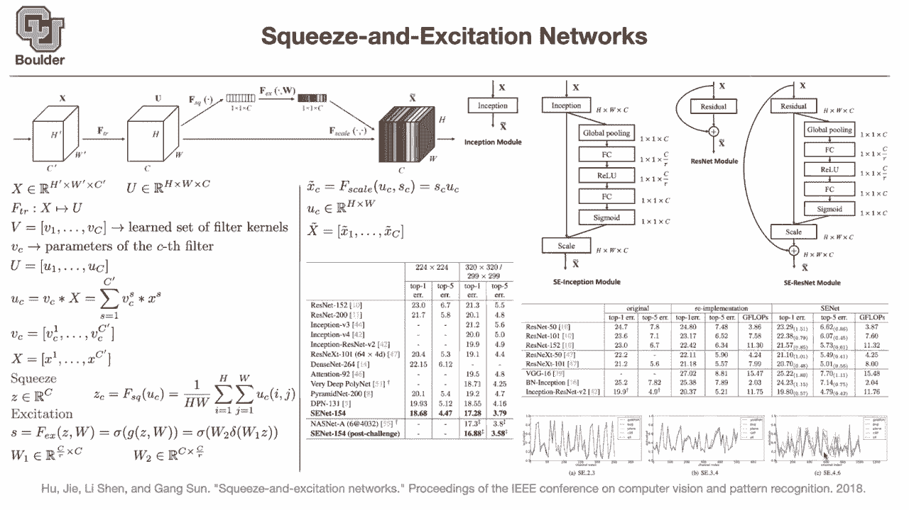

# 23：L11 - 压缩与激活网络 (Squeeze-and-Excitation Networks) 🧠

在本节课中，我们将学习一种名为“压缩与激活网络”的架构。该网络在ImageNet挑战赛中取得了优异的成绩，其核心思想非常巧妙。我们将详细解析其组成部分：压缩、激活和缩放，并了解如何将其作为构建模块集成到不同的神经网络中。

## 📊 网络概述

压缩与激活网络是一个可以嵌入到神经网络中的构建模块。它包含一个变换操作，将输入张量映射为输出张量。该模块主要由三部分组成：压缩部分、激活部分和缩放部分。这些操作通常放置在卷积或其他运算之后。

上一节我们介绍了该模块的整体概念，本节中我们将深入其数学细节。

## 📝 符号定义与卷积视角

首先，我们定义一些符号。输入张量记为 **X**，其维度为高度(H)、宽度(W)和通道数(C')。经过变换 **F_tr** 后，我们得到输出张量 **U**，其维度为 H x W x C。

我们可以从另一个视角理解卷积操作。将卷积核视为一组滤波器 **V = [v_1, v_2, ..., v_C]**。每个滤波器 **v_c** 用于生成输出 **U** 的一个通道 **u_c**。具体计算方式如下：

**u_c = v_c * X**

其中，`*` 表示卷积运算。每个滤波器 **v_c** 本身可以分解为针对每个输入通道的子滤波器：**v_c = [v_{c,1}, v_{c,2}, ..., v_{c,C'}]**。因此，卷积本质上是这些子滤波器与输入对应通道的局部窗口进行内积求和的过程。

## 🔍 压缩操作

压缩操作的核心是全局平均池化。它对输出 **U** 的每个通道进行空间维度上的压缩，生成一个通道描述符向量 **z**。该向量的第c个元素计算公式为：

**z_c = F_sq(u_c) = (1/(H*W)) * Σ_{i=1}^{H} Σ_{j=1}^{W} u_c(i, j)**

这个操作将每个 H x W 的特征图压缩成一个单一的标量值，从而得到一个 C 维的向量 **z**。它聚合了全局空间信息。

## ⚡ 激活操作

激活操作旨在捕获通道间的依赖关系。它通过一个简单的门控机制（类似于注意力机制）来实现。具体步骤如下：

1.  首先，通过一个全连接层 **W1** 对压缩后的向量 **z** 进行降维变换，通常会将维度从 C 减少到 C/r（r 是缩减比率）。
2.  然后，应用一个 ReLU 非线性激活函数 **δ**。
3.  接着，通过另一个全连接层 **W2** 将维度恢复回 C。
4.  最后，使用 Sigmoid 函数将输出值映射到 [0, 1] 区间。

整个过程可以表示为：

**s = F_ex(z, W) = σ(g(z, W)) = σ(W_2 * δ(W_1 * z))**

这里，生成的 **s** 是一个 C 维向量，每个元素可以看作是对应通道的“重要性”权重。

## ⚖️ 缩放操作

缩放操作将激活步骤学习到的通道权重应用到原始特征图 **U** 上。具体来说，对于第 c 个通道，将特征图 **u_c** 与标量权重 **s_c** 相乘：

**X̃_c = F_scale(u_c, s_c) = s_c · u_c**

这相当于对每个通道的特征图进行重新校准，网络借此学会强调信息丰富的特征，抑制不那么有用的特征。

## 🔗 集成到现有网络

压缩与激活模块的通用性很强，可以方便地集成到各种网络架构中。

以下是集成到Inception模块的示例：
*   在Inception模块完成其固有变换 **F_tr** 得到 **U** 后。
*   将 **U** 输入到SE模块（依次进行压缩、激活、缩放）。
*   得到重新校准后的特征 **X̃** 作为该模块的最终输出。

以下是集成到残差网络（ResNet）的示例：
*   在残差分支完成非线性变换得到 **U** 后。
*   将 **U** 输入到SE模块进行处理。
*   将SE模块的输出与原始的快捷连接（输入X）相加，形成最终的残差块输出。

## 📈 性能表现

SE模块在多个经典网络上都带来了显著的性能提升。例如，在ImageNet数据集上：
*   ResNet-50 添加SE模块后，top-1错误率从23.85%降至22.38%。
*   ResNeXt-50 添加SE模块后，top-1错误率从22.38%降至21.57%。

关键优势在于，SE模块以极小的计算开销（仅增加约10%的FLOPs）换来了可观的精度提升，因为它只增加了全局池化和小型全连接层。

## 👁️ 可视化理解

通过可视化激活后各通道的权重（即向量 **s**），我们可以观察网络在不同深度对输入图像的“关注点”。
*   在浅层网络中，不同类别图像激活的通道模式差异不大。
*   随着网络加深，激活模式变得更具判别性。例如，网络在处理“金鱼”和“锅”的图像时，会在不同的通道上产生高激活，这表明深层网络学会了针对不同语义特征选择性地强调特定通道。

## 💡 总结

本节课我们一起学习了压缩与激活网络（SENet）的核心思想。我们详细剖析了其三个核心操作：
1.  **压缩**：通过全局平均池化聚合空间信息，生成通道级统计量。
2.  **激活**：通过一个包含降维和恢复维度的全连接层学习通道间的非线性关系，输出每个通道的权重。
3.  **缩放**：将学习到的通道权重作为注意力系数，对原始特征通道进行重新校准。

SE模块是一种轻量级、通用性强的注意力机制，能够以较低的计算成本显著提升卷积神经网络的性能。它通过让网络自适应地调整通道特征的重要性，增强了模型的表征能力。