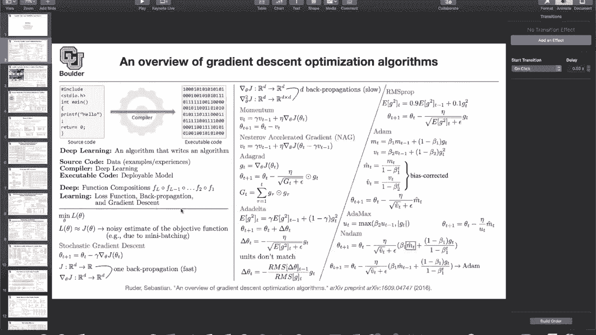
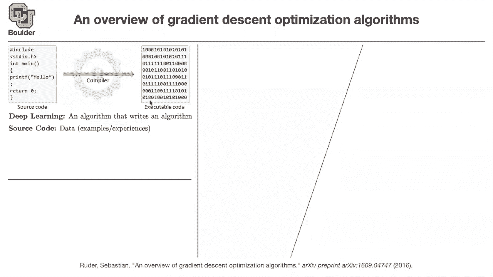
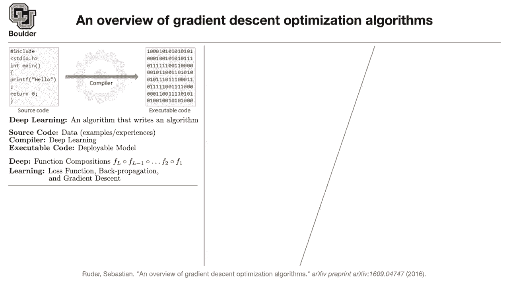

# 26：L14.1 - 小型神经网络 🧠

在本节课中，我们将要学习小型神经网络的重要性及其设计动机。我们将探讨为什么在深度学习应用中，模型的效率和可部署性与其准确性同等重要。

在开始之前，我们先回顾一下本课程第一节课中介绍过的一张幻灯片。

让我们试着回忆一下关于深度学习的一般性论述。

深度学习的发展主要由计算机科学家推动。

这背后是有原因的。计算机科学家的思维方式是：先有源代码，然后编译源代码，最终得到一个可执行代码，也就是一个程序或插件。

这个程序可以被实际应用，例如放在浏览器中进行语言翻译，或将语音转换为文本等。

但对于深度学习以及某些问题来说，手工编写代码来完成这些任务非常复杂。

例如，将语音转换为文本，或者识别一张图片中的内容，这些任务都非常复杂。

对于任何人来说，为这些任务编写源代码都极具挑战性。

在深度学习中，源代码就是你的数据。深度学习本质上是一种编写算法的算法，它就像一个编译器。

我想强调这一点：**源代码就是你的数据**。因此，数据中存在的任何缺陷，最终都会传递到你的可执行代码中。

如果你的源代码，也就是你的数据，存在偏见，例如偏向某个特定性别，或者数据中男性图像远多于女性图像。

那么通过“编译器”（即深度学习算法），这种偏见就会被翻译到你的可执行代码中。

因此，你的可执行代码将具有相同的偏见和缺陷。

昨晚我读了一份非常有趣的报告，它让我很兴奋，因为它能帮助我证明这个观点。

你们可能知道CIFAR-10和CIFAR-100数据集。

这些数据集是“Tiny Images”数据集的子集。该数据集已于6月29日被撤下，因为其类别标签中包含了一些贬损性词汇。

报告指出，他们采用了自动化的数据收集流程，直接从WordNet下载数据作为类别标签。

该数据的另一个问题是，图像尺寸仅为30x32像素，人类肉眼很难看清图像实际代表什么。

这里的核心信息是：**如果你的数据存在性别偏见，你的算法最终也会是性别偏见的。如果你的数据存在任何其他偏见，你的算法也会继承这些偏见。**

如果你的数据是种族主义的，那么你的深度学习算法也会是种族主义的。任何形式的偏见都会从数据传递到算法。

这是需要牢记的一点。是的，我们学习算法，它们令人兴奋，设计算法也很有趣，但最终，**数据至关重要**。

目前，一个新兴的研究领域正在兴起，那就是关于深度学习中的偏见，以及如何避免和减轻这些偏见。

我不确定CIFAR-10和CIFAR-100数据集本身是否存在问题，但它们很可能也受到了污染。

从第一张幻灯片中，我们还能学到另一个道理：最终，你希望得到一个可执行代码。

这个可执行代码就是你想实际部署的模型。你可能想把它放在你的主页、网站上。

你们知道Amazon Go吗？我想他们在旧金山和纽约有分店。

当你进入商店后，拿走想要的商品，然后直接离开，你的手机和银行账户就会自动完成扣款。

这是计算机视觉的一个应用。他们必须检测到你，检测到商品，一旦识别出商品，他们就知道价格，剩下的就是巧妙的算法和实际应用。

所以最终，你将拥有一个可部署的模型，并希望在实践中部署它。

这个可部署的模型需要运行速度快。如果你处理的是实时视频流，那么你的图像分类器或物体检测器，也就是你的卷积神经网络，必须反应非常迅速，必须实时运行。

因为最终目标是，你希望将模型部署在手机上，部署在无人机上，部署在机器人上。无论从深度学习框架中产生的是什么算法，它们都必须能够快速行动。

是的，你会在强大的GPU上训练它们，但最终，这些模型需要被部署在FPGA、CPU，甚至是更小尺寸的GPU上。

现在我们已经达成了共识，明白了为什么小型网络很重要。“小型”或许更好的说法是“高效”，但有一篇论文叫“EfficientNet”，我不希望你们混淆，以为所有内容都是关于EfficientNet的。

所以，小型网络的意义在于，能够将它们部署在计算能力较弱的资源上。

小型网络还有其他优势吗？你能说说它们通常有哪些更好的特性吗？

关于“小型”，我指的是两个方面。一是计算层面，它们需要快速、敏捷，在浮点运算方面需要高效。另一方面是，它们需要具有合理的内存占用，不应该是参数量巨大的巨型模型。

我不太确定它们是否有更好的收敛特性。现在我们需要考虑的是，我们正在进行多目标优化。

我们的一个目标是让网络尽可能准确。另一个目标是让它们高效。

每当你进行多目标优化时，就会得到一个帕累托前沿。不存在唯一的解决方案，而是一条可能的解决方案曲线。你需要在模型的准确性和计算成本之间进行权衡。

所以我们需要平衡这种权衡。这回答了你的问题吗？

关于收敛性，我想你的问题是它们是否更容易收敛。设计小型网络有多种方法。

我将介绍几篇具有代表性的论文。其中一种方法是，你有一个大模型，然后尝试将大模型中的知识提炼到一个小模型中。还有一些方法是模型剪枝、权重剪枝等。

另一种趋势是从一个小网络开始训练。我想你的问题可能与这类网络更相关。

但这不是唯一的方法。我希望你们从接下来几周的系列讲座中记住的核心信息是：实现小型网络有多种途径，但最终目标都是部署你的神经网络模型并实际使用它。

你们有多少人了解物联网？

是的，其理念是未来将会有许多“物”，这些“物”无论是移动的还是静态的，比如控制家庭温度或家庭运动探测器，未来都将变得智能化。

我想未来已经非常接近了。这些设备大多数将是小型物体，并将连接到互联网，届时我们的互联网规模将会爆炸式增长。

连接到互联网的将不仅仅是人类，我们的汽车、家里的运动探测器都将连接到互联网。

这一切都关乎这些小型设备变得智能。而“智能”的背后，是神经网络在起作用。这些网络需要是小型化的。

在学术界，人们通常忽视深度学习的一点是，在部署时，模型的大小和效率至关重要。

本节课中，我们一起学习了小型神经网络的重要性。我们了解到，数据质量直接决定了模型的质量，任何数据中的偏见都会被算法继承。同时，为了实现模型在资源受限设备上的实际部署，我们需要在模型准确性和计算效率之间进行权衡，这使得设计小型、高效的网络成为深度学习应用中的关键一环。