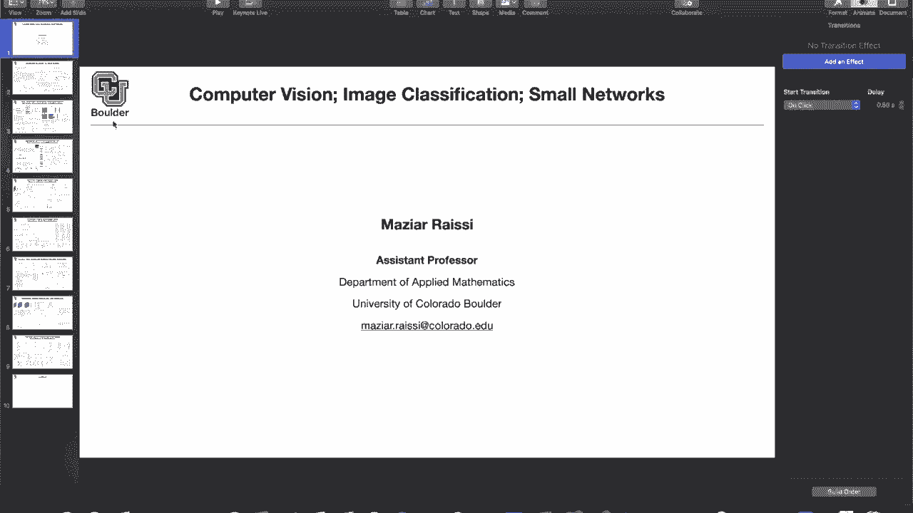
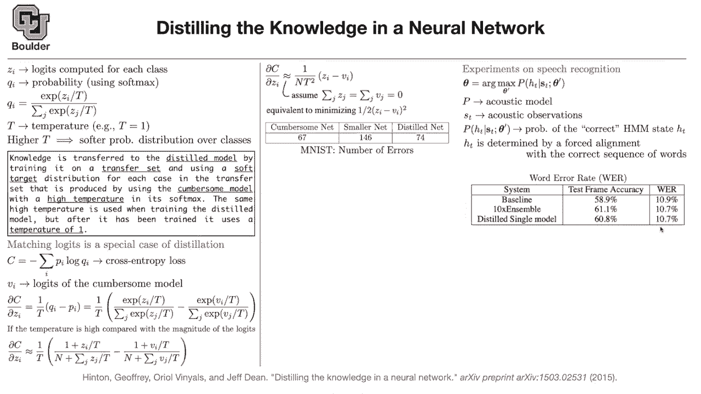

# 27：L14.2 - 知识蒸馏 🧪

在本节课中，我们将要学习**知识蒸馏**的核心概念。这是一种将大型、复杂模型（教师模型）的知识“压缩”到更小、更高效的模型（学生模型）中的技术。我们将从基本思想开始，逐步深入到数学原理和实际应用。

## 核心思想与流程 🧠

上一节我们介绍了模型压缩的需求，本节中我们来看看知识蒸馏的具体做法。

其核心思想是：你首先训练一个大型神经网络或一个神经网络集成，它可以拥有非常高的准确率。训练过程可以消耗大量时间和资源。之后，你需要将这个大模型通过训练获得的知识，转移到一个更小的神经网络中。这个过程不同于一般的知识迁移，它更像是对知识进行“蒸馏”和提炼。

以下是知识蒸馏的基本步骤：

1.  **训练教师模型**：使用充足的时间和资源，训练一个大型、高精度的模型（或模型集成）。
2.  **生成软标签**：使用训练好的教师模型，在原始训练数据（或一个子集，称为“迁移集”）上生成预测。关键点在于，我们不使用“硬”的独热编码标签，而是使用带有“温度”参数的Softmax函数生成的“软”概率分布作为新标签。
3.  **训练学生模型**：使用上一步生成的软标签（以及可能的真实硬标签）来训练一个更小的学生模型。训练时使用与生成软标签时相同的温度参数。
4.  **部署学生模型**：训练完成后，在实际预测和部署时，将温度参数设回1，使用标准的Softmax。

## 温度参数与软标签 🌡️

上一节我们提到了“温度”参数，本节中我们来详细看看它的作用。

首先定义一些符号。令 `z_i` 表示模型对第 `i` 个类别的**逻辑值**，即模型输出的原始分数。逻辑值的范围是负无穷到正无穷。我们通过Softmax函数将其转换为概率。

在知识蒸馏中，我们引入一个温度参数 `T` 来修改Softmax函数：

**公式**：`q_i = exp(z_i / T) / (∑_j exp(z_j / T))`

其中，`q_i` 是第 `i` 个类别的预测概率。

温度 `T` 的作用是控制输出概率分布的“软硬”程度：
*   当 **T = 1** 时，就是标准的Softmax。
*   当 **T 增大** 时，概率分布会变得更“软”、更均匀。各个类别的概率差异会缩小。
*   当 **T 趋近于 0** 时，概率分布会趋近于一个独热编码，即一个类别概率为1，其余为0。

在知识蒸馏中，我们使用较高的温度（例如 T=100）来生成软标签。这样做的好处是，软标签包含了教师模型学到的丰富信息，例如不同类别之间的相似性关系（比如一张图片“有点像猫，也有点像狗”）。学生模型从这些软标签中学习，效果通常比直接从硬标签学习更好。

## 数学原理与直观理解 📐

上一节我们介绍了温度参数的直观作用，本节中我们从数学角度深入理解知识蒸馏。

我们训练学生模型时，使用的损失函数是交叉熵损失，但目标概率 `p_i` 来自教师模型的软标签（由逻辑值 `v_i` 经高温Softmax得到），预测概率 `q_i` 来自学生模型的输出（由逻辑值 `z_i` 经相同高温Softmax得到）。

**公式**：`Loss = - ∑_i p_i * log(q_i)`

通过对该损失函数关于学生模型逻辑值 `z_i` 求导，并在高温假设下进行泰勒展开和近似（同时假设逻辑值均值为0），我们可以得到一个简化的结果：

**公式**：`∂Loss/∂z_i ≈ (1/T^2) * (z_i - v_i)`

这个结果非常有趣！它表明，在高温知识蒸馏下，损失函数关于学生模型逻辑值的梯度，近似正比于学生模型逻辑值 `z_i` 与教师模型逻辑值 `v_i` 的差值。

因此，**知识蒸馏近似等价于让学生模型的逻辑值去匹配教师模型的逻辑值**。这是一种更直接的回归形式的匹配，它解释了为什么软标签比硬标签包含更多有用的监督信息。

## 实验结果与泛化性 📊

上一节我们从理论层面分析了知识蒸馏，本节中我们看看它的实际效果和应用范围。

在MNIST数据集上的实验表明：
*   大型教师模型（ cumbersome model ）在测试集上有67个错误。
*   一个小型模型如果从头开始训练，会产生146个错误。
*   同一个小型模型如果通过知识蒸馏从教师模型学习，错误数显著减少，性能远优于从头训练，虽然仍不及大型教师模型（因其参数更少）。

知识蒸馏的通用性很强，不仅限于图像分类。例如，在语音识别任务中，可以将一个10个模型的集成（ensemble）的知识，蒸馏到一个单一模型中。实验结果显示，蒸馏后的单一模型在词错误率上显著优于基线单一模型，并且接近集成模型的性能。

这证明了知识蒸馏是一种通用的、可应用于不同领域和数据集的有效模型压缩与性能提升方法。

## 总结 ✨

本节课中我们一起学习了知识蒸馏技术。我们从其核心思想出发，讲解了如何通过引入温度参数来生成富含信息的软标签，从而将大型教师模型的知识转移到小型学生模型中。我们从数学上推导了知识蒸馏近似于匹配逻辑值的关系，并展示了其在图像识别和语音识别等不同任务上的有效性和泛化能力。知识蒸馏是获得紧凑、高效且高性能模型的重要工具。