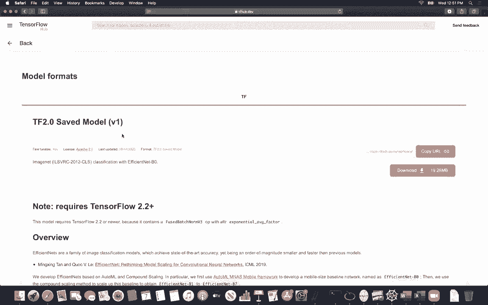
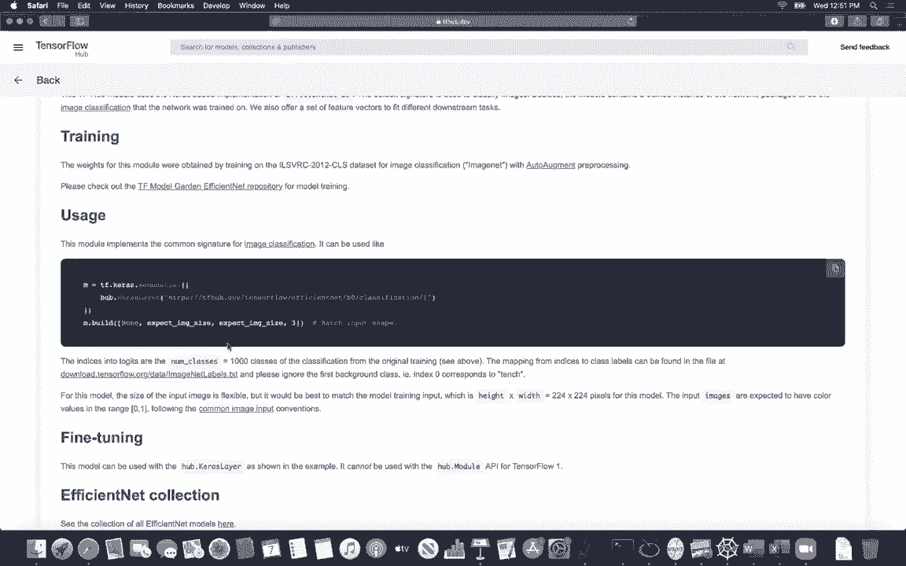
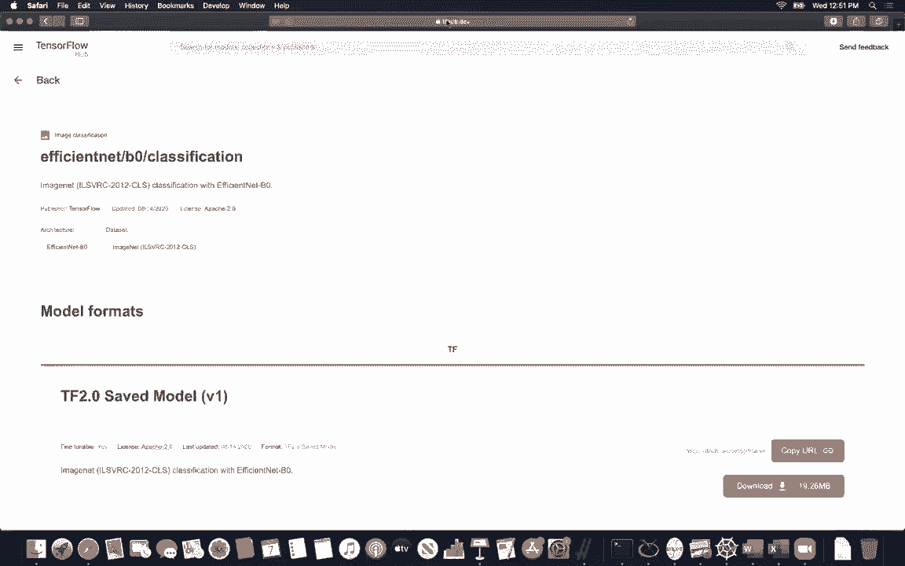
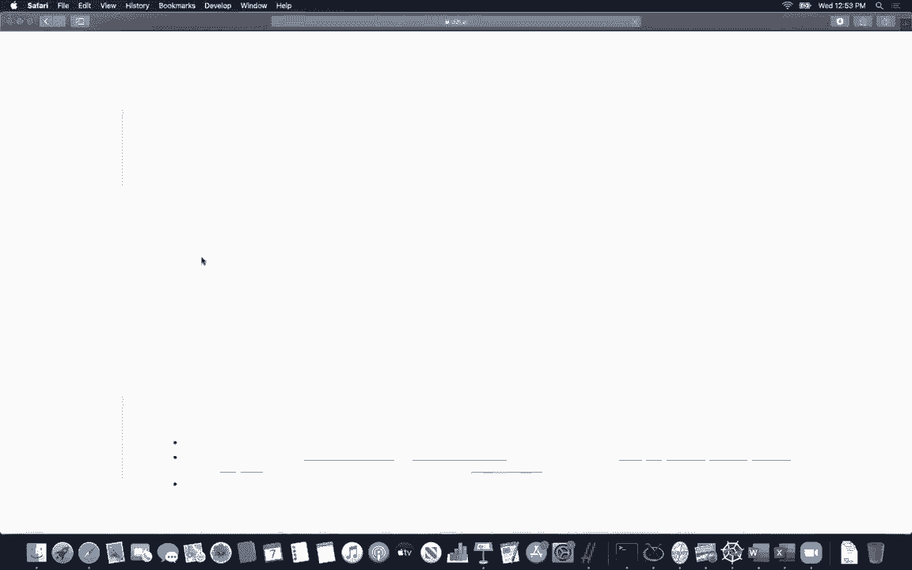
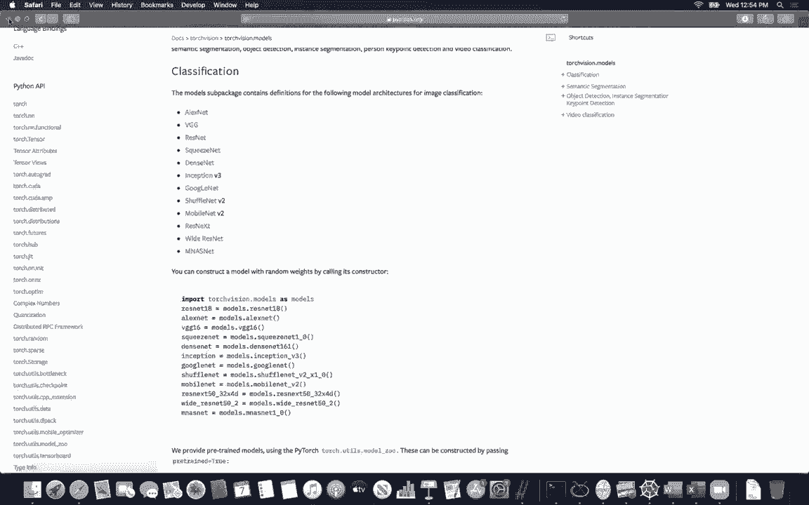
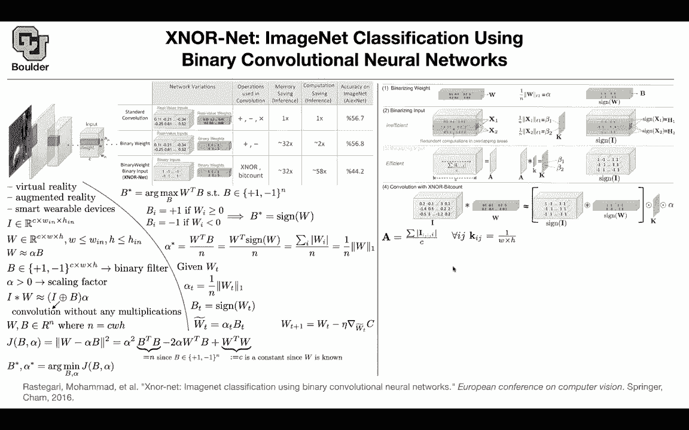

# 33：L18.1 - XNOR网络 [续] 🧠

在本节课中，我们将继续学习XNOR网络，这是一种用于高效神经网络推理的二值化方法。我们将详细探讨如何二值化权重和输入，以及如何在训练和推理过程中应用这些技术。

---

## 概述

上一节我们介绍了XNOR网络的基本概念，本节中我们将深入探讨其数学原理、训练过程以及实现细节。我们将学习如何通过二值化权重和输入来大幅减少模型的内存占用和计算成本。

---

## 二值化权重

我们有一个输入图像，它具有 **C** 个通道、宽度 **W** 和高度 **H**。我们有一组卷积核（权重），其大小为 **w × h**，通道数与输入相同。我们希望用 **α × B** 来近似权重 **W**，其中 **B** 是二值矩阵（元素为 +1 或 -1），**α** 是一个正标量。

**公式**：  
\[
W \approx \alpha B
\]

我们通过最小化 **W** 和 **αB** 之间的距离来找到最优的 **α** 和 **B**。目标函数为：

**公式**：  
\[
J(\alpha, B) = \|W - \alpha B\|^2
\]

展开后得到：
\[
J(\alpha, B) = \alpha^2 B^\top B - 2\alpha W^\top B + W^\top W
\]

由于 **B** 的元素为 ±1，**BᵀB** 等于元素个数 **n**。**WᵀW** 是常数。因此，最小化 **J** 等价于最大化 **WᵀB**。

最优解为：
\[
B^* = \text{sign}(W)
\]
\[
\alpha^* = \frac{1}{n} \|W\|_1
\]

其中 **‖W‖₁** 是 **W** 的 L1 范数。

---

## 训练过程

在训练过程中，我们保持一个全精度权重 **W** 的副本，但在前向传播中使用二值化版本 **W̃**。

以下是训练步骤的详细说明：

在迭代 **t** 时：
1.  计算二值权重：**Bₜ = sign(Wₜ)**
2.  计算缩放因子：**αₜ = (1/n) ‖Wₜ‖₁**
3.  前向传播使用：**W̃ₜ = αₜ Bₜ**
4.  计算损失并反向传播，梯度更新全精度权重 **Wₜ**
5.  进入下一次迭代 **t+1**

这样，训练过程在反向传播中使用全精度权重进行更新，而前向传播则使用高效的二值化近似。

---

## 二值化输入

对输入进行二值化的方法与权重类似。我们同样希望用 **β A** 来近似输入 **X**，其中 **A** 是二值矩阵，**β** 是缩放因子。

**公式**：  
\[
X \approx \beta A
\]

最优解为：
\[
A^* = \text{sign}(X)
\]
\[
\beta^* = \frac{1}{n} \|X\|_1
\]

---

## 高效卷积计算

当我们对输入进行二值化后，卷积操作可以近似为：

**公式**：  
\[
I * W \approx (\text{sign}(I) \circledast \text{sign}(W)) \odot K \alpha
\]

其中：
*   **⊛** 表示XNOR（同或）位运算后接位计数操作。
*   **⊙** 表示逐元素乘法（Hadamard积）。
*   **K** 是一个矩阵，其每个元素是输入对应局部窗口的缩放因子 **β**。
*   **α** 是权重的缩放因子。

**K** 的计算可以通过一个高效的卷积操作完成，避免了为每个滑动窗口重复计算 **β** 的冗余。

---

## 池化层的放置

在二值化网络中，池化层的放置位置需要谨慎考虑。

以下是关键考虑因素：

*   如果在二值化激活（值为 ±1）之后立即进行最大池化，大部分窗口的最大值将是 1，会导致信息大量丢失。
*   建议的顺序是：先进行批归一化（Batch Norm），然后进行二值化激活，接着进行二值化卷积，最后再进行池化。
*   这样，输入到池化层的数据包含了缩放因子 **α** 和 **β**，是实数而非纯粹的 ±1，可以保留更多信息。

---

## 性能收益

XNOR网络能带来显著的性能提升：

*   **内存节省**：模型大小可从 ~1 GB 减少到 ~16 MB。
*   **计算加速**：推理速度可提升数十倍，具体收益取决于网络结构。
*   **硬件友好**：XNOR和位计数操作是硬件支持的基本运算，非常高效。

需要注意的是，二值化通常会带来一定的精度损失，但通过合理的训练技巧，可以在精度和效率之间取得良好平衡。

---

## 学习资源与代码实践

为了深入理解并实现这些概念，查阅现有代码和模型库是非常有效的学习方式。

以下是一些推荐的学习资源：

*   **MXNet GluonCV Model Zoo**：提供了许多预训练模型（如ResNet, MobileNet等）的详细实现和教程。
*   **TensorFlow Hub** 和 **PyTorch Hub**：可以方便地下载和使用各种预训练模型。
*   **官方论文代码**：大多数相关论文都开源了代码，是学习实现细节的最佳资料。
*   **深度学习教科书**：如与MXNet关联的《动手学深度学习》，是课堂知识的很好补充。

通过阅读和运行这些代码，你可以更好地理解二值化网络在实践中的实现细节。

---

## 总结

本节课中我们一起学习了XNOR网络的核心内容。我们掌握了如何通过数学推导将权重和输入二值化，理解了在训练中如何协调全精度权重和二值化前向传播。我们还探讨了高效卷积的计算方法、池化层的正确放置位置，以及XNOR网络带来的巨大内存和计算优势。最后，我们强调了通过查阅开源代码和模型库来深化实践的重要性。