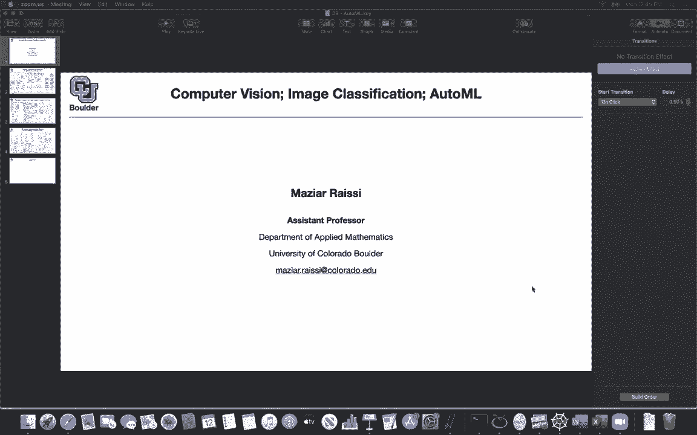
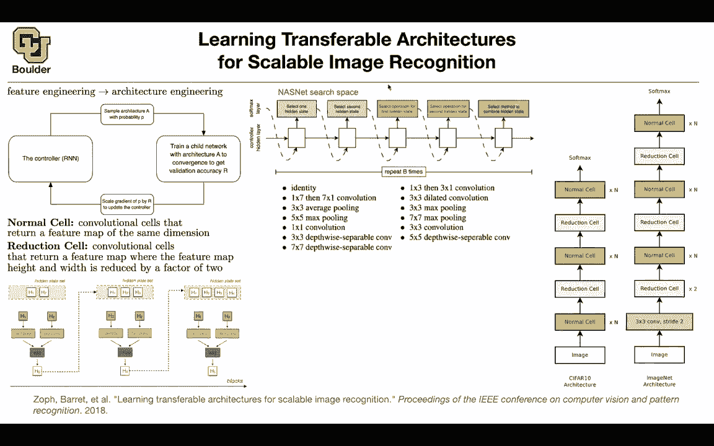

# 39：L20.1 - NASNet 🧠

在本节课中，我们将学习一种名为NASNet的神经网络架构。NASNet的核心思想是使用自动化机器学习（AutoML）技术，让计算机自动搜索和设计高效的神经网络结构，从而减少人工设计架构的工作量。

---

## 概述

在深度学习领域，我们之前已经学习了许多由人工设计的神经网络架构。这些架构有的追求尽可能高的准确率，有的则试图在计算和内存存储方面实现高效。现在，一个自然的问题是：我们能否自动化这个过程？能否让计算机来完成这项艰巨的工作？这正是AutoML的理念，也是我们今天要探讨的内容。

## 从特征工程到架构工程

在深度学习出现之前，无论是计算机视觉、自然语言处理还是语音识别，都需要进行大量的特征工程。例如，在自然语言处理中，人们会使用词袋模型；在计算机视觉中，会使用方向梯度直方图（HOG）特征等。然后，在这些特征上应用逻辑回归或支持向量机等经典机器学习技术。

深度学习改变了这一范式。现在，神经网络可以自动学习特征，无需人工进行复杂的特征工程。然而，随着架构数量的激增，研究重点似乎正从特征工程转向架构工程。这引发了一个新的问题：既然我们可以自动化特征工程，那么能否也自动化架构设计呢？

## 自动化架构搜索的基本思路

人类设计架构时，通常会从一个想法开始，训练模型，然后在验证数据集上调整超参数，最后将结果应用到测试数据中。为了自动化这一过程，我们可以让一个控制器（例如循环神经网络）来采样一个架构。

控制器根据参数化的概率分布 \( p \) 采样一个架构。然后，我们在训练数据上训练该架构，在验证数据上验证，并得到一个验证准确率 \( R \)。这个准确率 \( R \) 将作为反馈，用于更新控制器的参数。具体来说，我们可以使用强化学习来更新控制器。

## 架构搜索的挑战与解决方案

这种方法的一个主要挑战是训练时间。训练一个神经网络已经需要大量时间，更不用说训练成千上万个架构了。然而，由于这个过程是重复性的，我们可以将任务交给机器，只要有足够的资源，机器应该能够完成。

在架构搜索过程中，我们需要定义两种类型的细胞：正常细胞和缩减细胞。

*   **正常细胞**：保持输入和输出的分辨率不变，不进行步幅操作。
*   **缩减细胞**：将输入的高度和宽度减少一半。

我们的目标是设计一个由多个正常细胞和缩减细胞组成的神经网络。首先，在较小的数据集（如CIFAR-10）上搜索最佳细胞结构，然后将找到的最佳细胞结构应用到更大的数据集（如ImageNet）上。

## 正常细胞的结构设计

现在，让我们深入探讨正常细胞的具体结构。正常细胞从两个隐藏状态 \( h_1 \) 和 \( h_2 \) 开始，这两个状态来自前一层。对于第一个操作，我们可以选择对 \( h_1 \) 或 \( h_2 \) 执行不同的操作，例如3x3池化或3x3卷积等。

接下来，我们需要决定如何组合这两个操作的结果，例如通过加法或连接。组合后得到的新状态 \( h_3 \) 将被添加到隐藏状态列表中。然后，我们重复这个过程，每次从当前的隐藏状态列表中选择两个状态，对它们执行操作并组合结果。

我们将这个重复过程进行 \( B \) 次（例如 \( B = 5 \)），每次都需要做出一系列离散选择。这些选择包括：
1.  选择哪两个隐藏状态作为输入。
2.  对每个隐藏状态执行什么操作。
3.  如何组合操作的结果。

由于这些选择是离散的，我们可以使用Softmax函数来参数化每个选择的概率分布，并通过强化学习来优化这些概率。

## 可选择的操作

以下是可供选择的一些操作：
*   恒等映射
*   1x1卷积
*   3x3深度可分离卷积
*   5x5深度可分离卷积
*   7x1后接1x7卷积
*   3x3膨胀卷积
*   3x3最大池化
*   5x5平均池化

## 搜索结果示例

经过训练后，控制器会提出一个正常细胞和一个缩减细胞的最佳结构。以下是一个示例结构：

在这个示例中，我们可以看到网络倾向于选择深度可分离卷积，这是一个高效的操作。同时，网络也使用了恒等映射、平均池化等操作，并通过加法和连接来组合不同状态。

## 总结

本节课我们一起学习了NASNet的基本原理和实现方法。通过自动化机器学习技术，我们可以让计算机自动搜索和设计高效的神经网络架构，从而减少人工设计的工作量。具体来说，我们介绍了如何使用循环神经网络作为控制器，在CIFAR-10数据集上搜索最佳细胞结构，然后将该结构应用到ImageNet等更大数据集上。尽管架构搜索过程计算成本高昂，但通过合理的策略和优化，我们可以找到高效且性能优异的网络架构。