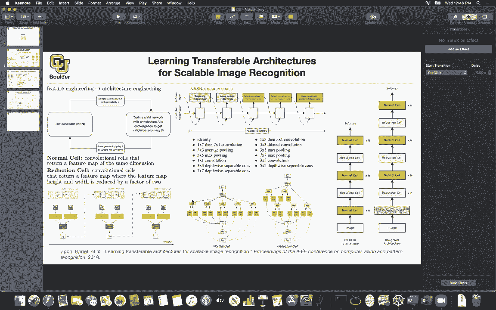
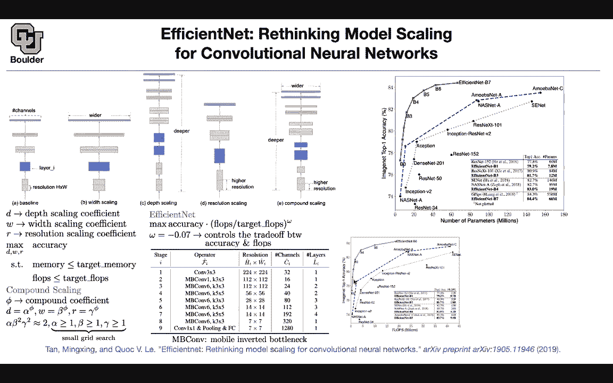
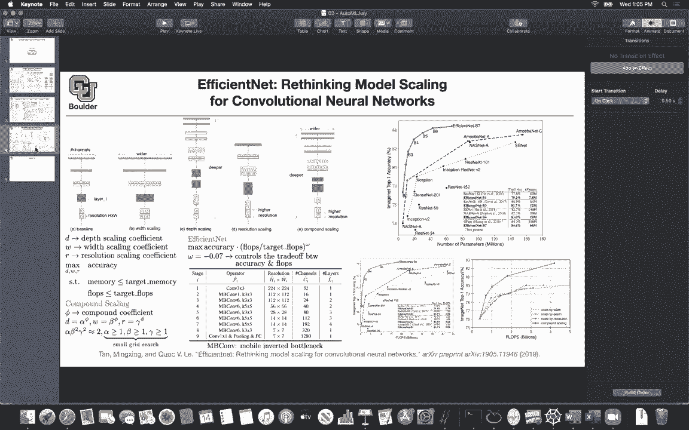

# 41：L21.1 - EfficientNet 🚀

在本节课中，我们将学习 EfficientNet，这是一种通过平衡网络深度、宽度和分辨率来高效提升模型性能的架构设计方法。我们将探讨其背后的核心思想、参数化方法以及如何通过复合缩放系数来优化网络。

---

## 概述

上一节我们介绍了 NASNet 架构及其搜索空间。本节中，我们将看看 EfficientNet 如何通过一种系统化的方法，在深度、宽度和分辨率之间取得平衡，从而在有限的计算资源下实现更高的准确率。

## 自动机器学习背景

在自动机器学习领域，我们通常有一个搜索空间需要优化。优化搜索空间有多种方法，例如随机搜索、遗传算法或贝叶斯优化。这些方法都是无梯度的，因为我们无法直接计算梯度，只能通过评估网络在验证集上的表现来获得反馈。

另一个问题是输入是离散的。例如，我们需要在 3x3 卷积和 5x5 最大池化之间做出选择。

## 网络修改的维度

通常，我们会从一个基线模型开始，并考虑以下几种修改方式：
*   增加分辨率。
*   增加通道数，使网络更宽。
*   增加层数，使网络更深。

以往的研究分别尝试了增加网络宽度或深度。增加深度可以扩大感受野，使最后一层能看到整张图像。而增加分辨率则能提供更多细节。

然而，EfficientNet 的论文指出，在这三种修改之间存在着微妙的平衡。如果只进行其中一种修改，效果不如同时进行所有修改。无论网络变得多深，仍然需要适当增加宽度和分辨率。

## 参数化搜索空间

为了系统地进行缩放，我们引入以下符号：
*   设 **d** 为深度缩放系数。
*   设 **w** 为宽度缩放系数。
*   设 **r** 为分辨率缩放系数。

我们的目标不仅是最大化模型准确率，还要在内存和计算预算的约束下，优化 **d**、**w** 和 **r** 这三个参数。

## 复合缩放系数

该论文引入了一个**复合缩放系数 φ**，用于在 **d**、**w** 和 **r** 之间建立平衡关系。

我们有以下关系式：
`计算成本 ∝ α^1 * β^2 * γ^2`
其中：
*   **α** 对应深度 **d**。
*   **β** 对应宽度 **w**。
*   **γ** 对应分辨率 **r**。

深度增加带来的计算成本是线性的（指数为1），而宽度和分辨率增加带来的计算成本是二次的（指数为2），这是因为涉及矩阵乘法或特征图尺寸的变化。

当 φ = 1 时，对应基线网络的计算成本。我们可以通过在一个较小的数据集和较小的网络上进行网格搜索，来找到最优的 α、β 和 γ 值。

## EfficientNet 的优化目标

直接解决带约束的准确率最大化问题很困难。因此，EfficientNet 转而优化一个单一的目标函数：

`最大化：准确率 * (FLOPS / 目标FLOPS)^ω`

其中，**ω** 是一个用于平衡准确率和计算效率（使 FLOPS 接近目标值）的超参数。通过优化这个目标函数，我们就能找到最优的 α、β 和 γ。

## EfficientNet 基线结构

EfficientNet 的基线结构（B0）始于一个 3x3 卷积层，随后是一系列 MBConv 模块（源自 MobileNetV2 的倒残差瓶颈结构）。通过改变复合系数 φ，我们可以派生出不同规模的模型（如 B1 到 B7），以适应不同的计算设备或性能要求。

## 性能对比

以下是不同网络架构在准确率和参数量上的对比：

*   **人工设计的网络**：如 ResNet, Inception, DenseNet 等，它们构成了一个帕累托前沿。
*   **NAS 发现的网络**：如 NASNet, AmoebaNet，它们将性能边界向左上方推进。
*   **EfficientNet 系列**：通过仅调整一个参数 φ，EfficientNet 模型（B0-B7）在帕累托前沿上取得了更优的位置，即用更少的参数达到了相同或更高的准确率。

实验表明，如果只增加宽度、深度或分辨率中的一项，性能在达到约 80% 准确率后会趋于饱和。而使用复合系数 φ 平衡三者后，性能可以得到持续提升。

例如，与 ResNet-152 或 SENet 相比，EfficientNet 能用少得多的参数量达到相似的准确率。

## 总结

本节课我们一起学习了 EfficientNet 的核心思想。其关键在于认识到需要平衡网络的深度、宽度和分辨率，并通过引入复合缩放系数 φ 来系统化地实现这种平衡。这种方法使得我们能够通过单一参数高效地探索模型设计空间，从而在给定的计算预算下获得最佳性能。这为自动机器学习领域提供了一种强大而优雅的模型缩放范式。