# 43：L22.1- 对抗学习示例 [续] 🧠

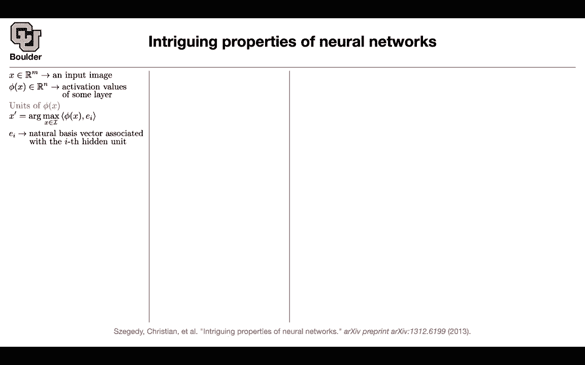

在本节课中，我们将继续探讨神经网络的对抗性示例。我们将回顾上一节提到的神经网络的有趣特性，并深入理解如何通过优化问题来寻找网络的“盲点”，以及这些对抗性示例为何具有跨模型、跨数据的泛化能力。

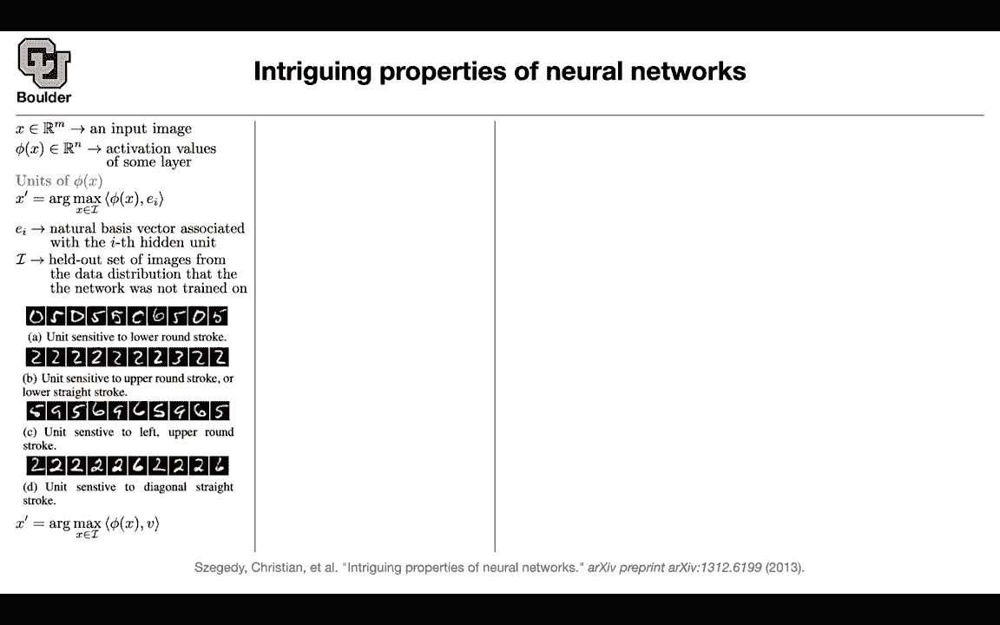

上一节我们介绍了神经网络的两个有趣特性。第一个特性是：**单个神经元或网络学习到的特征本身并不特殊**。

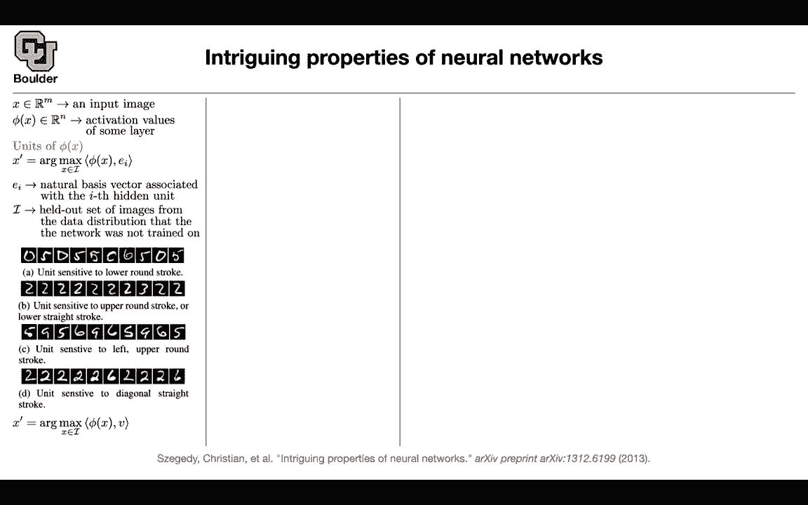

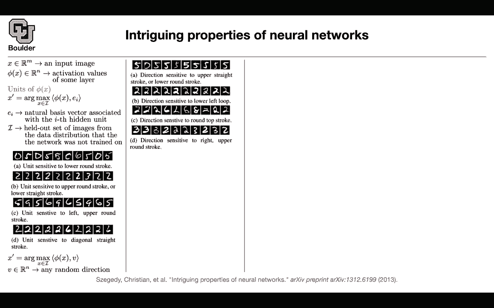

神经网络所张成的空间中的**任何随机方向**都是可解释的。

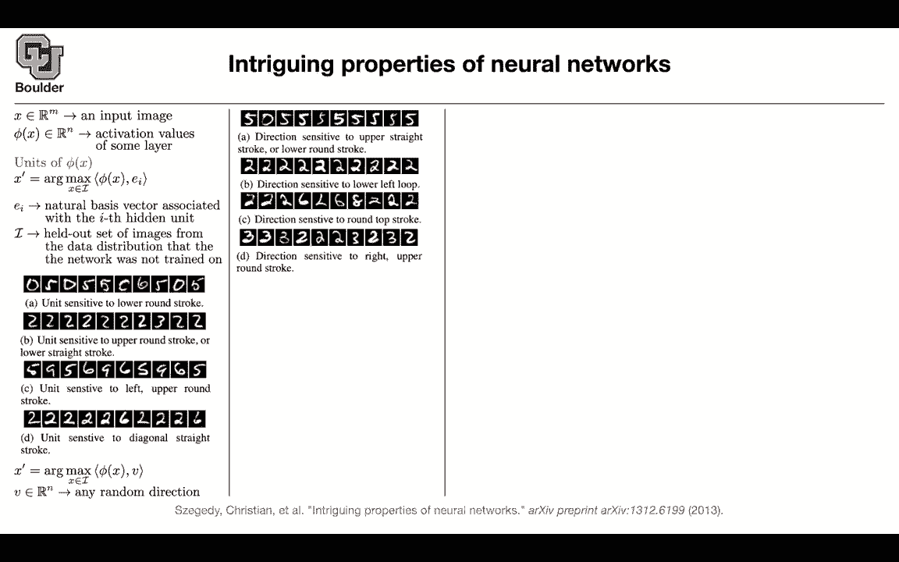

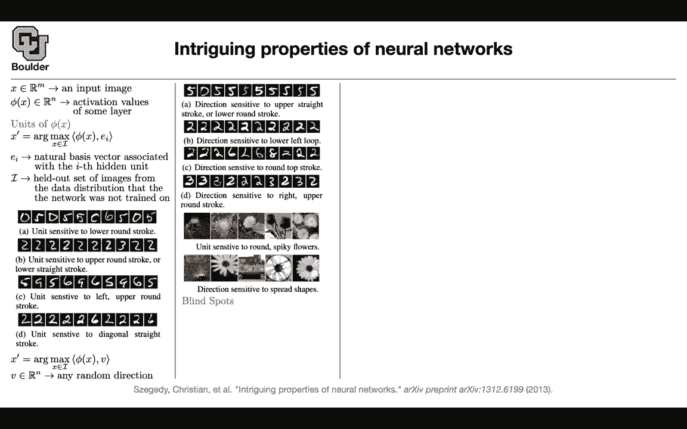

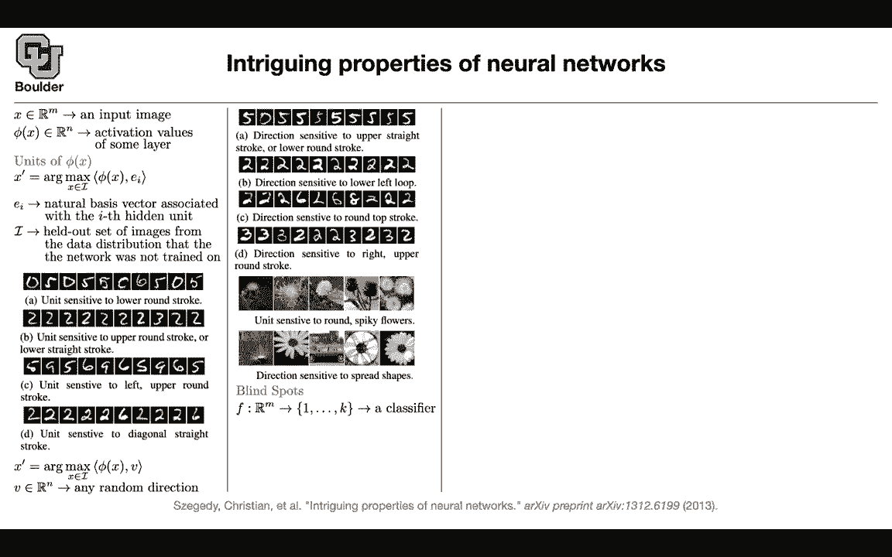

这意味着，你实际上可以开始解释该空间中的任何随机方向。

核心信息是：**整个空间都重要**，而不仅仅是单个神经元。

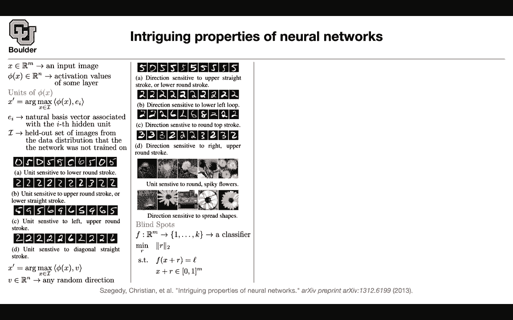

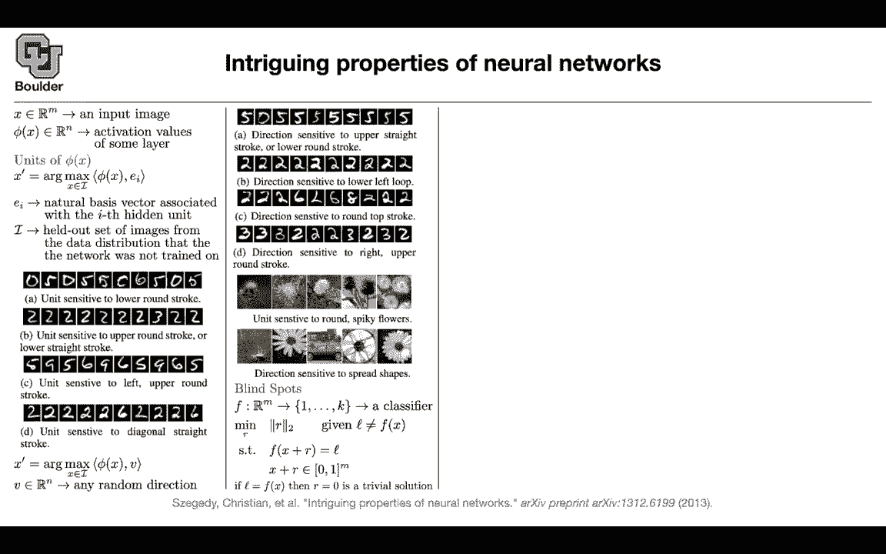

## 🔍 寻找神经网络的盲点

基于上述观察，我们开始探讨神经网络的“盲点”。为了找到这些盲点，我们需要解决一个优化问题。

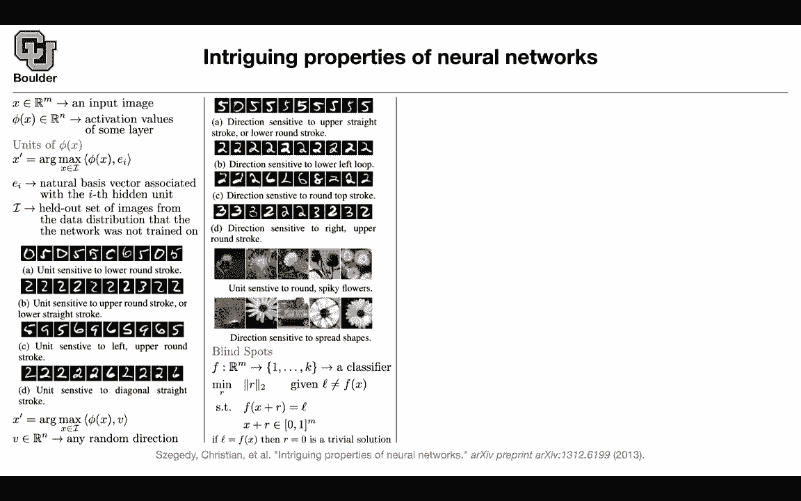

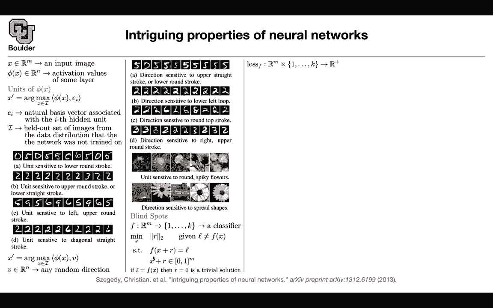

这个问题的目标是：寻找一个与原始图像尽可能接近的新图像，但要求神经网络以100%的错误率对其进行分类。

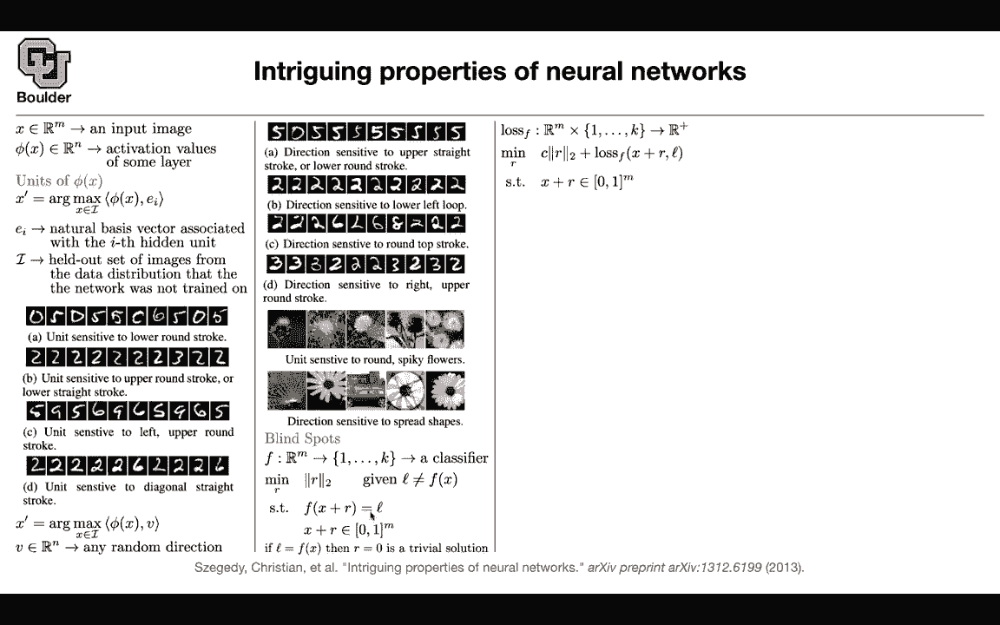

这被称为**定向攻击**。因此，目标标签 `l` 必须不等于原始图像的预测 `f(x)`，否则问题的解就变得平凡了。

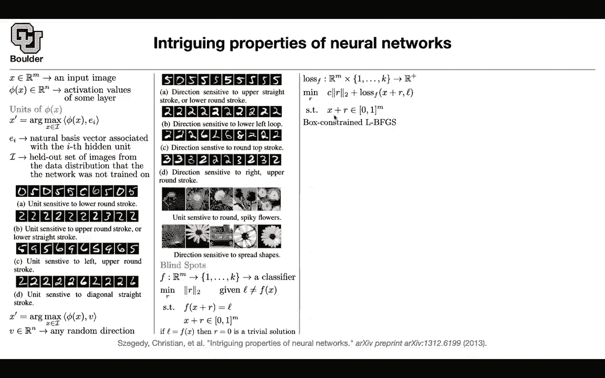

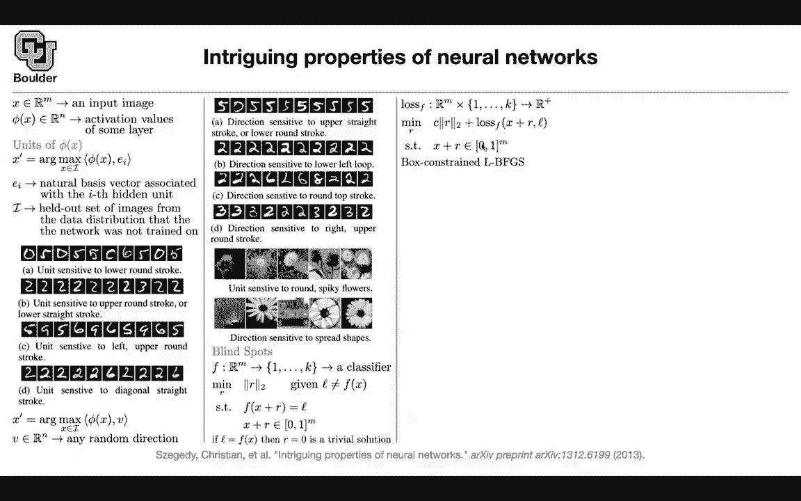

## 🛠️ 优化问题的简化

直接解决上述等式约束问题很困难。因此，我们尝试使用损失函数来构造一个不同的目标函数，以此作为原等式的近似替代。

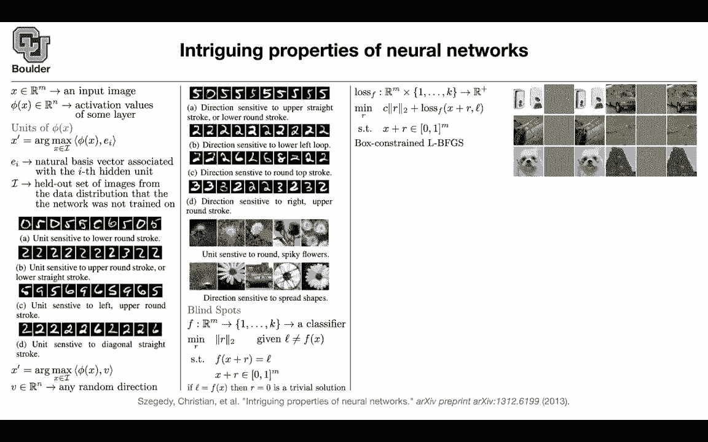

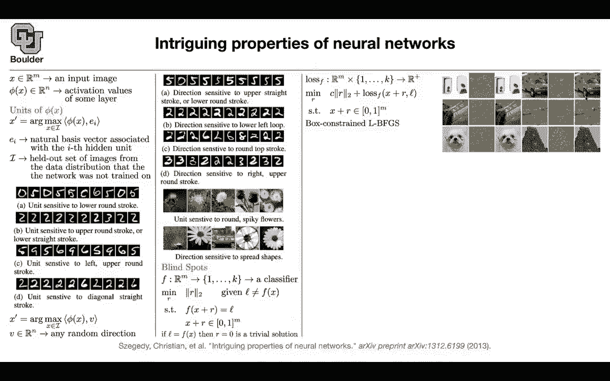

然后，我们可以使用 L-BFGS 等优化算法来解决这个替代问题，但必须加入**边界约束**，因为我们不希望像素值超出归一化后的 [0, 1] 范围。

通过这种方法，我们能够从一张图像开始，为其添加微小的扰动，从而使网络将其错误分类（例如，将一张其他图片分类为“鸵鸟”）。

## 🌐 对抗示例的泛化性

一个可能的批评是：攻击者可能无法获知被攻击网络的内部结构。但事实证明，你可以在自己选择的网络和数据上创建攻击。

以下是关键发现：

*   你找到的扰动不仅会以高概率干扰你有权访问的网络。
*   相同的扰动也极有可能混淆**其他不同的网络**。

这意味着这些对抗性示例具有**跨模型的泛化性**。不仅如此，它们还具有**跨数据的泛化性**。

需要补充一点，这些是训练中的超参数（例如权重衰减系数 `10^{-4}`, `10^{-2}`, `1`）。权重衰减相当于对参数进行 L2 正则化，公式为 `正则化项 = λ * ||θ||^2`。

即使使用不同的正则化强度，甚至不同的网络架构（深度和宽度），你发起的攻击仍然能对其他结构的网络生效。

## 📊 对抗示例的严重性

因此，我们得出一个普遍结论：**对抗性示例往往具有顽固性**，即使对于使用不同超参数训练的模型也是如此。

问题甚至更为严重：即使使用**不同的训练数据集**，这些对抗性示例也能泛化。我们看到，不同结构、在不同数据集上训练的网络，仍然会受到这些对抗性示例的有效攻击。

这不仅仅是随机噪声。与添加具有相同标准差的高斯随机噪声相比，这些通过解决优化问题精心设计的扰动攻击要有效得多。

以下是两个核心结论：

1.  这些对抗性示例在不同训练数据和不同超参数/网络结构间都有效。
2.  正因为这种广泛的泛化能力，它成为了一个严重的问题。

这篇论文的观察开启了一个全新的研究领域，即设计新的攻击方法，并尝试缓解、修复和防御这些攻击。

## 🎯 总结

本节课中，我们一起学习了对抗性示例的核心概念。我们回顾了神经网络的有趣特性，理解了如何通过优化问题构造对抗样本，并重点探讨了对抗样本所具有的强大的跨模型、跨数据集的泛化能力。这种泛化性揭示了深度学习模型潜在的脆弱性，也推动了对抗性机器学习这一重要领域的发展。