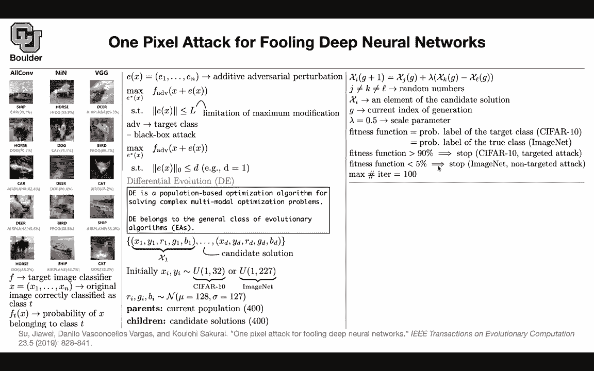

# 49：L25.1 - 单像素攻击 [续] 🎯

在本节课中，我们将继续学习对抗性攻击，重点探讨一种极端的攻击方式——**单像素攻击**。我们将了解其背后的数学原理、实现方法，并分析其在不同数据集上的效果。

上一节我们介绍了白盒攻击与黑盒攻击的区别。本节中，我们来看看一种将攻击推向极致的黑盒攻击方法。

## 单像素攻击概述

一篇有趣的论文指出，攻击可以做到极致：仅需改变图像中的一个像素，就能成功欺骗深度神经网络。

以下是几个攻击示例：

*   将一艘船通过改变一个像素，使其被识别为一辆汽车。
*   将一匹马通过改变一个像素，使其被识别为一只青蛙。
*   将一只猫通过改变一个像素，使其被识别为一只狗。

这些结果令人印象深刻，但其背后的数学原理是什么呢？

## 攻击的数学形式化

我们有一个目标分类器。设原始图像为 **x**，它被正确分类为类别 **t**。我们用 **f_t(x)** 表示图像 **x** 属于类别 **t** 的概率。

我们正在寻找一个加性的对抗性扰动。我们有一个目标类别，称之为 **adv**。我们希望通过向原始图像添加一个微小的扰动，来增加目标类别的概率。

我们关注的是**黑盒攻击**，因此我们无法访问函数 **f**，只能对其进行评估。我们感兴趣的是 **L0 范数**，它本质上是计算被改变的像素数量。在本例中，为了追求极致，我们将 **d** 设为 1，这意味着只允许改变一个像素。

## 优化方法与差分进化

由于这是一个黑盒攻击，且上述最大化问题非常困难（我们无法获取梯度，即使能获取，由于约束条件的存在，这也不是一个易于优化的目标函数），因此我们将使用**差分进化**算法。

差分进化是一种用于解决复杂优化问题的算法，它属于**进化算法**的一种。我们在学习 AutoML 时曾见过一个进化算法的例子（老化进化算法），而这个是差分进化算法。

那么，我们要在哪个空间内搜索解决方案呢？

## 解空间与种群初始化

一个候选解由像素的位置 **(x1, y1)** 和颜色值 **(R, G, B)** 构成。例如，x方向第10个位置，y方向第2个位置，就确定了这个像素。然后我们需要设置其颜色。

以下是初始化种群的步骤：

1.  我们有一个初始种群，例如包含 400 个候选解。
2.  每个候选解由像素的位置和 RGB 值标识。
3.  初始时，我们进行随机采样：
    *   对于像素位置 (x, y)：在图像尺寸范围内（例如 CIFAR-10 是 1 到 32，ImageNet 是 1 到 227）按照均匀分布随机选择两个整数。
    *   对于 RGB 颜色值：按照一个均值和方差设定的正态分布进行采样。

初始种群中的这些候选解将作为第一代“父母”。

## 差分进化的核心步骤

我们将通过“父母”生成“孩子”（新的候选解），并从中选择最优者。差分进化的核心在于如何生成孩子。

以下是生成新一代候选解的公式：

**x_i(g+1) = x_j(g) + λ * (x_k(g) - x_l(g))**

其中：
*   **g** 表示当前世代索引。
*   **i, j, k, l** 是从上一代“父母”中随机选取的三个不同索引。
*   **λ** 是一个缩放参数，论文中设为 0.5。

这个过程就是“变异”，它利用了两个解之间的“差分”来探索新的解空间，因此得名差分进化。我们会进行多轮（例如 100 轮）迭代，不断生成和筛选新的候选解。

## 适应度函数与选择标准

进化算法结合了随机搜索和选择。我们需要一个标准来选择最佳候选解，这个标准就是**适应度函数**。

适应度函数来源于模型的预测概率：
*   对于**有目标攻击**：适应度函数是 **f_adv(x)**，即目标类别的概率。我们的目标是最大化它。当该值超过某个阈值（例如 0.9）时，即可停止优化。
*   对于**无目标攻击**：适应度函数是 **f_t(x)**，即真实类别的概率。我们的目标是最小化它。当该值低于某个阈值时，即可停止优化。

在论文实验中，对 CIFAR-10 数据集采用了有目标攻击，对 ImageNet 数据集采用了无目标攻击。

## 结果分析与讨论

实验表明，仅改变一个像素就能以较高的成功率欺骗网络。例如，可以将狗错误分类为飞机、猫或马等其他类别。

一个自然的疑问是：提高图像分辨率是否会降低此类攻击的有效性？这是一个非常好的问题。论文也研究了这一点。由于 ImageNet 的图像（227x227）比 CIFAR-10（32x32）拥有更多像素，改变单个像素的相对影响力会下降，因此攻击在 ImageNet 上效果会减弱，但这仍然是一个令人印象深刻的结果。

此外，如果允许改变的像素数量增加，攻击的成功率会显著提高。

## 总结

本节课我们一起学习了**单像素攻击**。我们了解了这种极端黑盒攻击的数学定义，其核心挑战在于在仅改变极少数像素的约束下优化一个不可导的目标函数。为此，我们引入了**差分进化**这一进化算法来搜索有效扰动。通过定义**适应度函数**（目标类别的概率），算法能够迭代地找到足以欺骗网络的单像素修改方案。实验证明，即使在现代数据集上，这种攻击也具有一定效力，这揭示了神经网络脆弱性的一面。