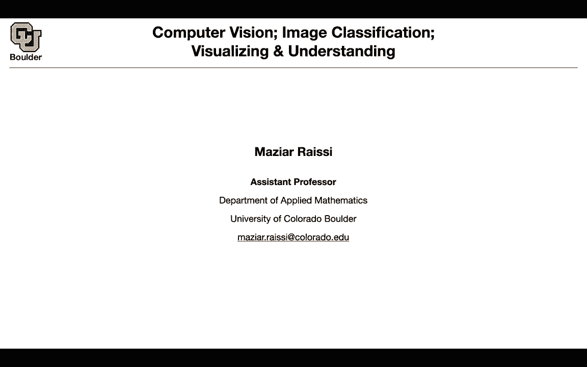
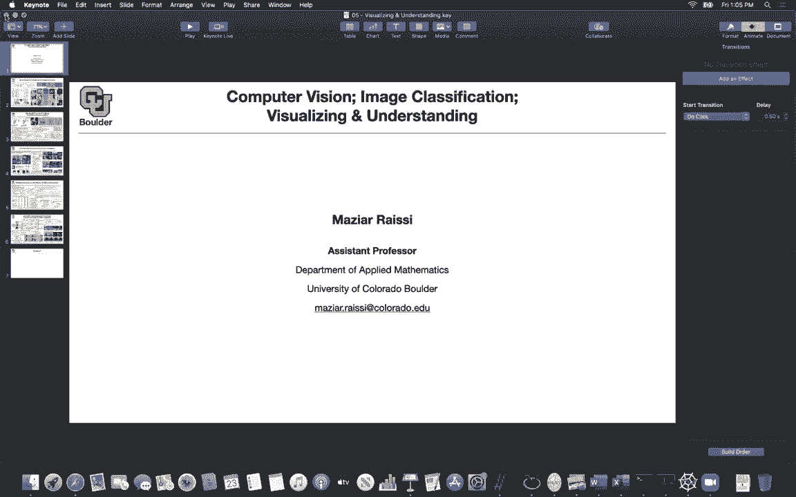
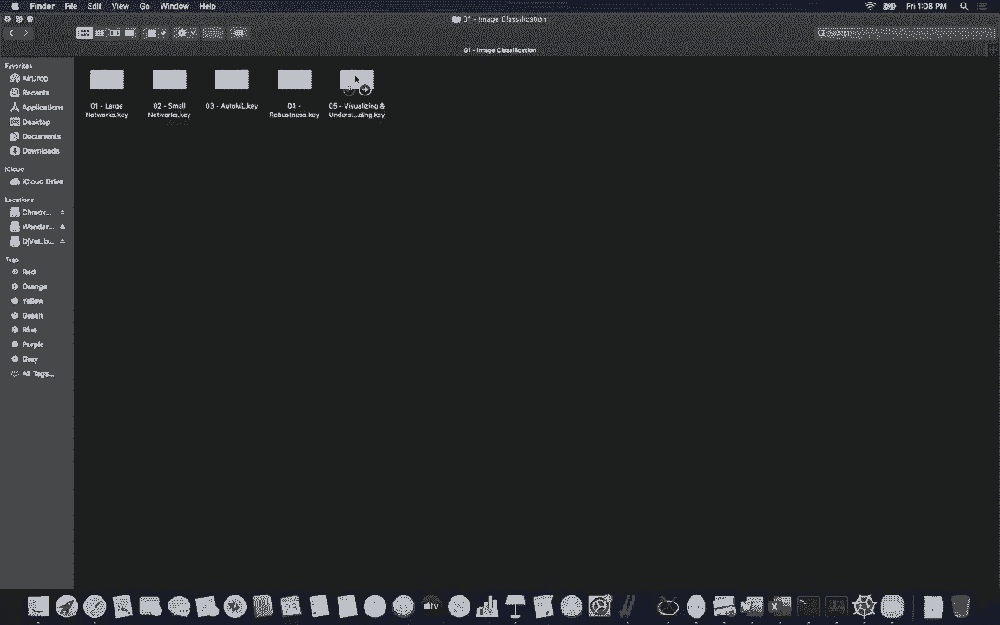
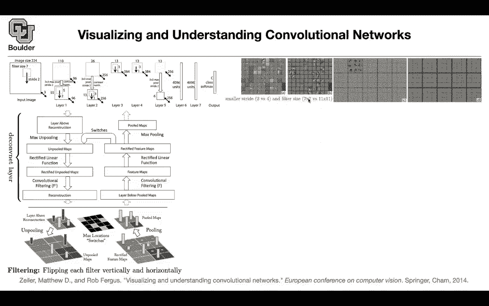

# 50：L25.2 - CNN可视化与理解 📊

在本节课中，我们将学习如何可视化和理解卷积神经网络（CNN）的内部工作机制。我们将回顾深度学习的核心流程，并重点探讨如何通过可视化技术来“打开”神经网络的“黑箱”，理解其决策依据。这对于调试模型、提升模型鲁棒性至关重要。

## 1. 深度学习流程回顾 🔄

在进入具体内容之前，我们先简要回顾一下深度学习的标准流程。

首先，数据是深度学习的源代码。接着，我们设计模型，通常是大型网络。模型的主要目标是最大化准确率。有时，我们也会设计兼顾准确率和效率的模型，以便将其部署到手机、无人机等小型设备上。

模型设计通常由人工完成，但也可以使用AutoML等技术实现自动化。流程如下：从数据开始，设计模型，然后训练模型。训练本质上是使用**随机梯度下降（SGD）**等优化算法进行编译。训练完成后，我们得到可用于生产环境的可执行代码。

然而，要在生产环境中使用，网络必须足够鲁棒，不易受到对抗性攻击，并尽可能少犯错误。如果发现网络在某些特定类型的图像或样本上表现不佳，就需要进行调试。调试需要同时检查数据集和网络内部状态。因此，现在是时候打开这个“黑箱”，尝试理解网络究竟在做什么。

## 2. 可视化网络内部：特征图与反卷积 🔍

理解网络在“看”什么以及如何做出决策非常重要。因此，能够可视化和理解网络的行为是一个关键主题。我们将从一篇开创性的论文开始，该论文首次尝试可视化和理解卷积神经网络。这篇论文基于AlexNet架构，但做了一些改进：将第一层的滤波器大小从11改为7，步长从4改为2。这些改进并非随机，而是通过观察网络和数据后得出的，最终提升了准确率。

那么，如何查看网络中的特征呢？让我们关注网络的上半部分。在一个典型的卷积层中，输入特征图经过卷积、ReLU激活和最大池化操作，得到输出特征图（池化图）。这些池化图分辨率更低，但结构上仍类似于图像，具有高度、宽度和通道数。

为了可视化，我们可以选择最活跃的通道（例如，通过计算激活值之和并选取最大的那个通道），然后尝试将其映射回输入图像空间。由于池化操作降低了分辨率，我们需要一种方法来“上采样”。这里的关键是**最大反池化**操作。

在正向传播进行最大池化时，我们不仅记录池化窗口内的最大值，还记录这些最大值在原图中的位置索引（称为“开关”或 *switches*）。在反向可视化时，我们进行**最大反池化**：利用来自上一层的重建值和存储的“开关”，将值放回正确的位置，其余位置补零。接着，我们进行**反ReLU**操作（确保值非负），然后进行**反卷积**。反卷积操作使用正向卷积滤波器的转置（`f^T`）进行卷积，这相当于正向卷积的逆操作。

这个过程不断重复，直到我们重建出输入图像空间中的激活区域。**整个可视化过程不涉及任何训练**，我们只是利用前向传播中存储的“开关”和已知的卷积滤波器权重，通过一系列逆操作将深层特征激活映射回像素空间。

上一节我们介绍了可视化特征图的基本原理，本节中我们来看看这种方法带来的具体发现和洞见。

## 3. 可视化带来的洞见与网络改进 🛠️

通过可视化第一层和第二层的特征图，研究者有了重要发现。在使用原始AlexNet参数（大滤波器、大步长）时，许多特征图是“死亡”的（激活值极低或为零），且少数特征图主导了激活，导致可视化图像模糊。

然而，当将第一层改为较小的滤波器（7x7）和较小的步长（2）后，“死亡”特征图基本消失，所有特征图都变得活跃且色彩丰富。这表明没有单个特征图过度主导，网络能够学习到更均衡、更丰富的特征。

更重要的是，第二层的特征图开始显示出更清晰的模式（如边缘、纹理），而不是杂乱无章的激活。**可视化特征图帮助研究者诊断并改进了网络结构**。这篇论文之后，许多网络的第一层都采用了步长为2的7x7卷积。

## 4. 深入理解：高层特征与遮挡实验 🎯

我们之前一直在观察网络架构。现在，让我们看看更深层（例如第5层）的可视化结果。深层特征对应更高级、更具判别性的模式。

我们可以找到最强的特征图（即所有像素激活值之和最大的那个通道），并将其通过反卷积网络映射回图像空间。结果显示，对于一张狗的图像，网络最强的激活区域集中在狗的脸部。对于其他类别（如汽车、数字），激活也集中在最具判别性的部位（如车标、数字本身）。

为了验证可视化结果的正确性，论文进行了**遮挡实验**。具体方法是：用一个灰色方块在输入图像上滑动，每次遮挡不同区域，然后观察网络对正确类别的分类概率变化。

实验发现，当遮挡块覆盖狗的脸部时，网络将狗正确分类的概率急剧下降，并可能错误分类为其他类别（如网球）。而当遮挡其他区域时，分类概率保持稳定。这强有力地证实了可视化结果：网络确实主要依赖狗的脸部特征来进行分类决策。

## 5. 总结 📝

本节课中，我们一起学习了卷积神经网络的可视化与理解。

我们首先回顾了深度学习流程，并强调了调试和理解模型内部工作的重要性。接着，我们深入探讨了一种通过**反卷积网络**将深层特征激活映射回输入像素空间的方法。该方法的核心是利用前向传播中存储的**最大池化位置（开关）**和卷积滤波器的**转置**进行**反池化**和**反卷积**操作。

通过可视化，我们发现：
1.  原始AlexNet第一层的大步长和大滤波器会导致许多特征图“死亡”。
2.  减小步长和滤波器尺寸能显著改善特征图的多样性和质量。
3.  深层特征对应高级的、类别特定的模式（如物体局部）。
4.  **遮挡实验**验证了可视化结果，表明网络的决策严重依赖于这些被识别出的关键区域。

理解CNN如何“看到”世界，不仅有助于我们调试和改进模型架构，也是构建更可靠、更可解释的AI系统的重要一步。