# 52：L26.2 - 类激活图教程 🧠

在本节课中，我们将学习类激活图（Class Activation Map, CAM）的概念与原理。这是一种用于卷积神经网络的可视化技术，能够帮助我们理解模型在进行分类决策时，重点关注图像的哪些区域。与之前介绍的方法不同，CAM 无需借助其他模型或额外的边界框标注，即可定位图像中的重要物体区域。

---

## 🎯 核心概念与直觉

上一节我们介绍了通过遮挡部分图像来理解模型关注区域的方法。本节中，我们来看看另一种更通用的可视化技术——类激活图。

类激活图针对特定类别，能够指示卷积神经网络在分类时使用的、具有区分性的图像区域。其核心思想是：通过分析网络最后一层卷积层的特征图，并结合全局平均池化后的权重，生成一张热力图，直观展示模型关注的区域。

例如，在“刷牙”这个分类任务中，类激活图生成的热力图会高亮显示牙刷和嘴巴区域；在“砍树”任务中，则会高亮显示人和电锯。

---

## 🏗️ 工作原理与网络结构

让我们看看类激活图是如何工作的。其流程基于一个经过修改的卷积神经网络结构。

以下是实现类激活图的关键步骤：

1.  **特征提取**：输入图像经过一系列卷积层，最终得到一组特征图。
2.  **全局平均池化**：对最后一层卷积得到的每个特征图进行全局平均池化，将其转换为一个标量值。这一步取代了传统网络（如VGG）末端的全连接层。
3.  **加权求和**：每个标量值会乘以一个对应类别的权重。
4.  **生成热力图**：将这些加权后的特征图进行空间上的组合，并上采样到原始图像尺寸，就得到了类激活图。

具体来说，假设有 `K` 个特征图，对于类别 `c`，其未经过Softmax的得分（logit）`S_c` 可以表示为：

**公式：** `S_c = Σ_k (w_k^c * F_k)`

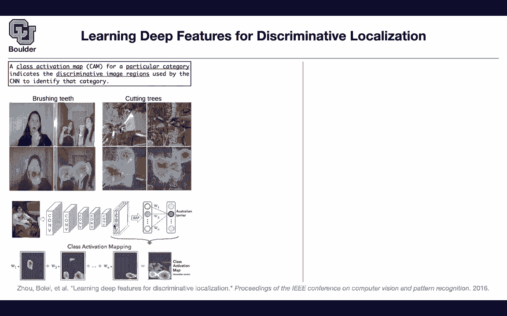

其中，`w_k^c` 是连接第 `k` 个特征图与类别 `c` 的权重，`F_k` 是第 `k` 个特征图经过全局平均池化后的标量值。

---

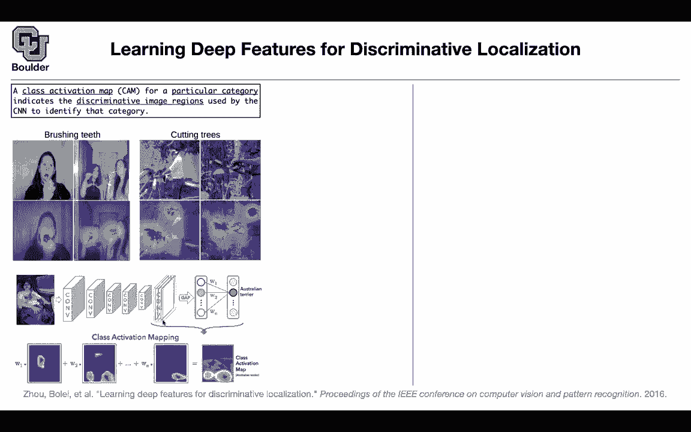

## 📐 数学推导与热力图生成

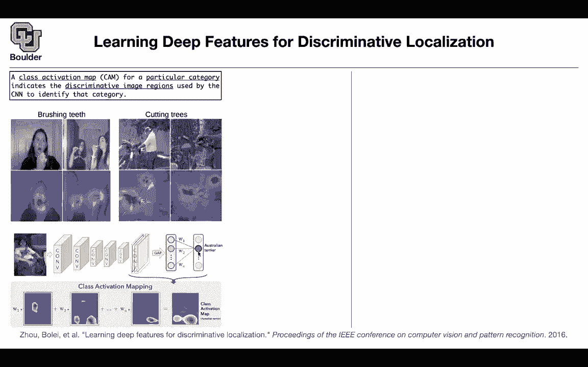

上一部分我们了解了工作流程，现在我们来深入其数学本质，看看热力图 `M_c(x,y)` 是如何从公式中推导出来的。

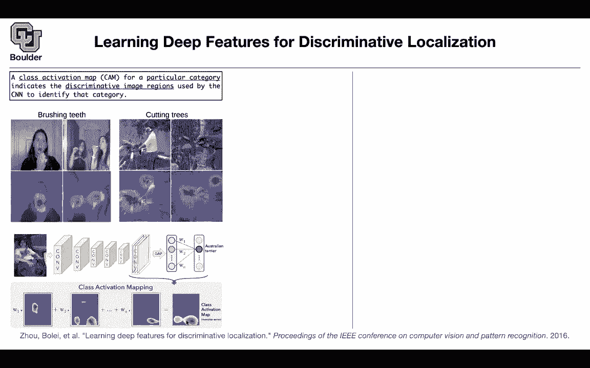

关键在于利用全局平均池化的定义和求和的线性性质。全局平均池化操作 `F_k` 实际上是特征图 `f_k(x,y)` 在所有空间位置 `(x,y)` 上的平均值。

**公式：** `F_k = Σ_{x,y} f_k(x, y)`

将这个定义代入 `S_c` 的公式：

**公式：** `S_c = Σ_k w_k^c * (Σ_{x,y} f_k(x, y))`

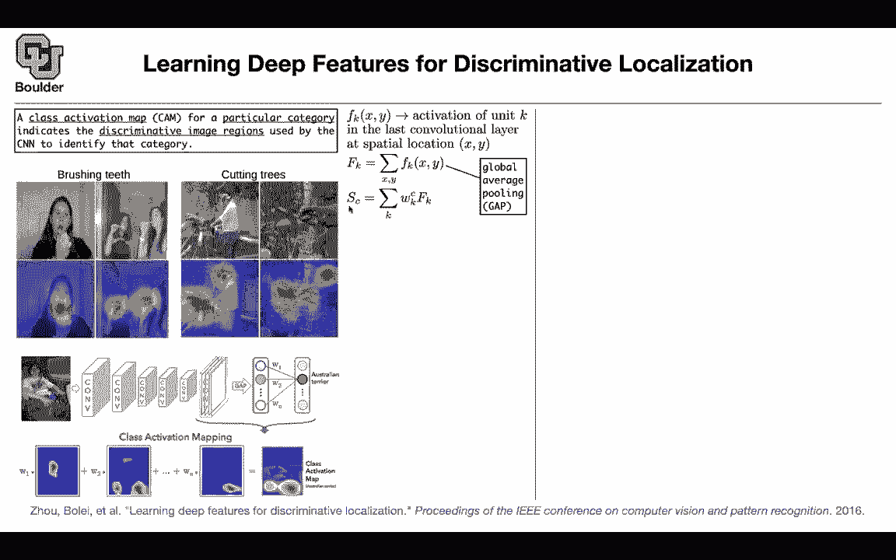

由于求和是线性的，我们可以交换求和顺序：

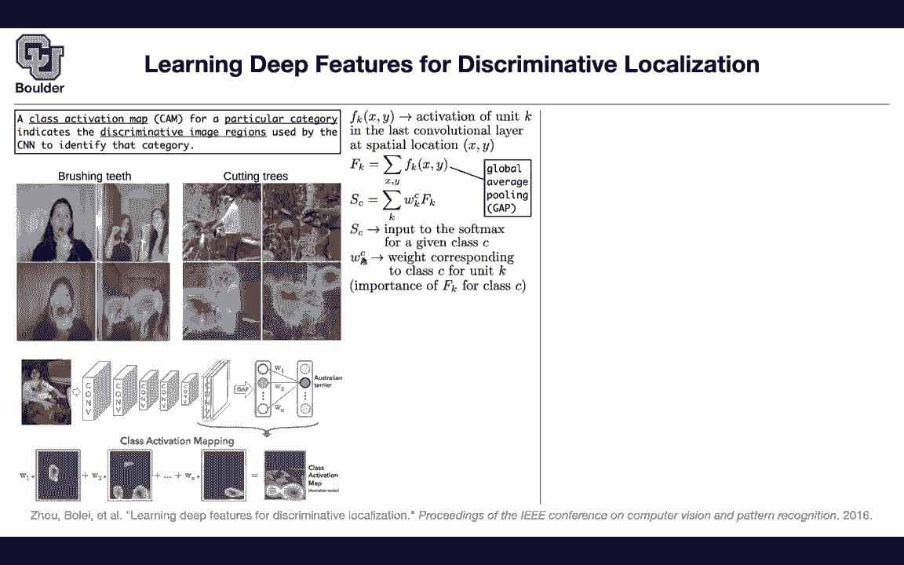

**公式：** `S_c = Σ_{x,y} ( Σ_k w_k^c * f_k(x, y) )`

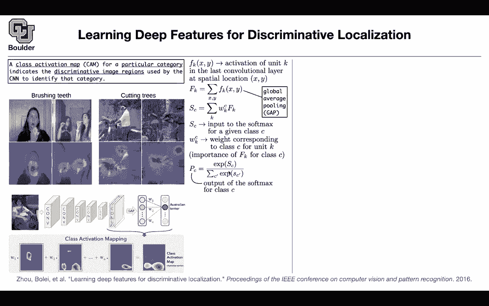

此时，括号内的部分 `Σ_k w_k^c * f_k(x, y)` 对于每个空间位置 `(x,y)` 都是一个值。我们将这个值定义为类别 `c` 在位置 `(x,y)` 的类激活图 `M_c(x,y)`。

**公式：** `M_c(x, y) = Σ_k w_k^c * f_k(x, y)`

最后，将 `M_c(x,y)` 上采样到输入图像的尺寸，就得到了可视化的热力图。它直接表示了在空间网格 `(x,y)` 上的激活对于预测类别 `c` 的重要性。

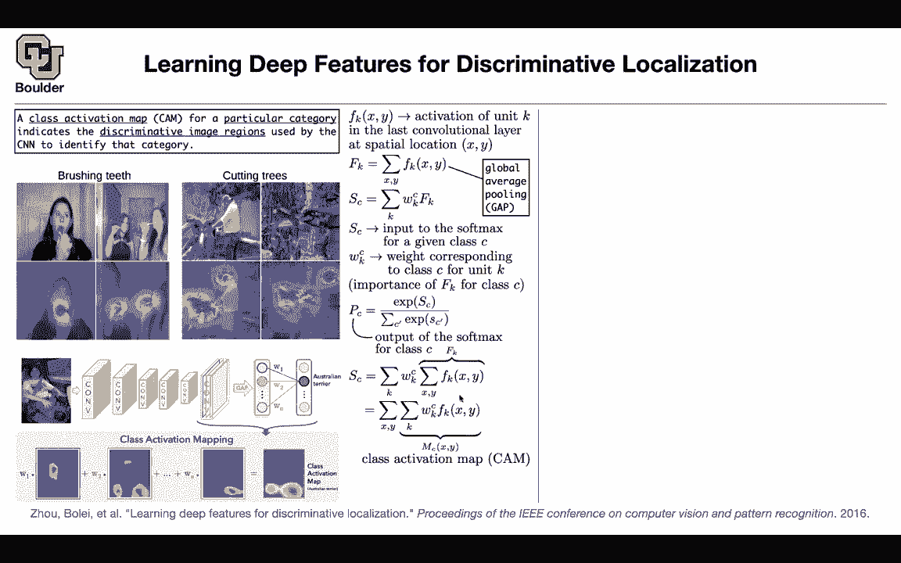

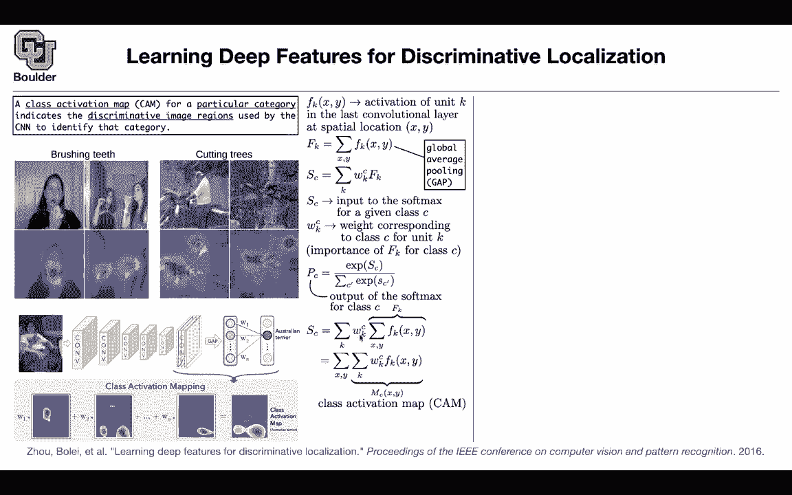

---

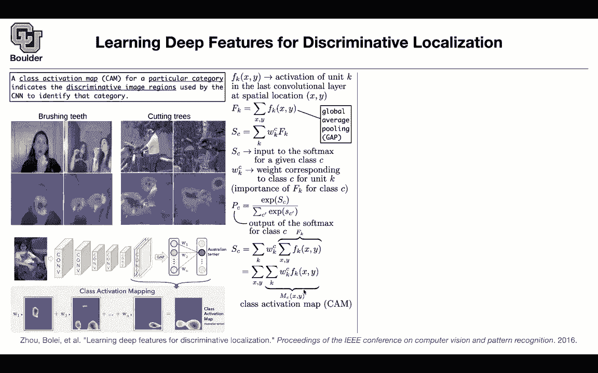

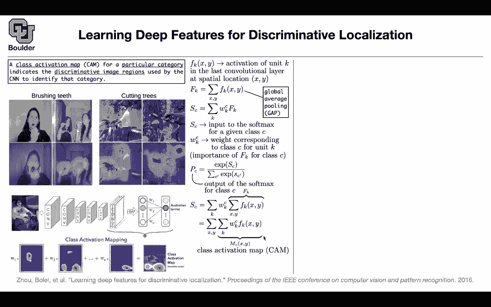

## ✨ 总结

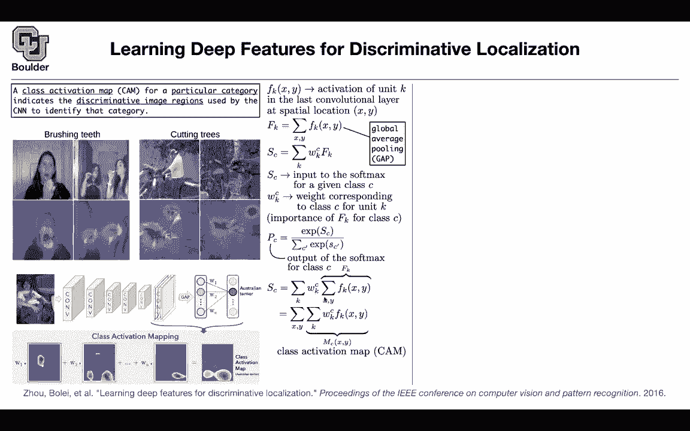

本节课中，我们一起学习了类激活图（CAM）这一强大的CNN可视化工具。

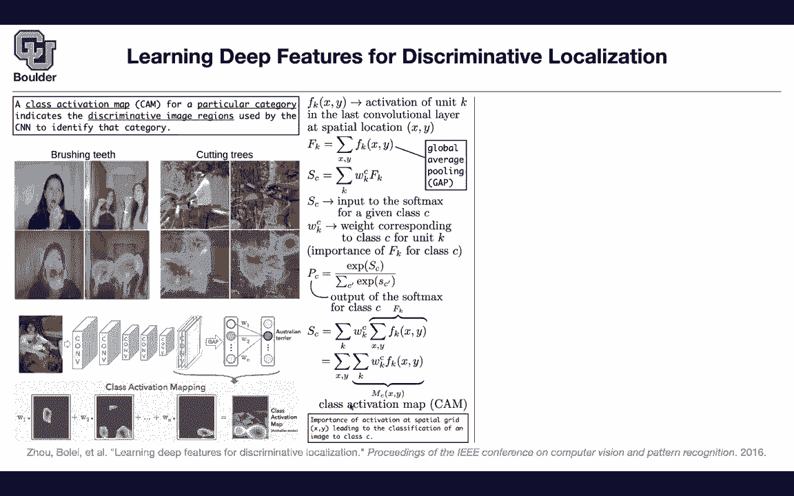

我们了解到：
*   CAM 能够生成热力图，直观展示CNN模型进行图像分类时关注的区域。
*   其实现依赖于用**全局平均池化层**替换网络末端的全连接层，并利用池化后的权重与特征图进行线性组合。
*   从数学上看，CAM 热力图 `M_c(x,y)` 是由类别特定权重 `w_k^c` 与最后一层卷积特征图 `f_k(x,y)` 加权求和而得，它量化了每个空间位置对最终分类决策的贡献。

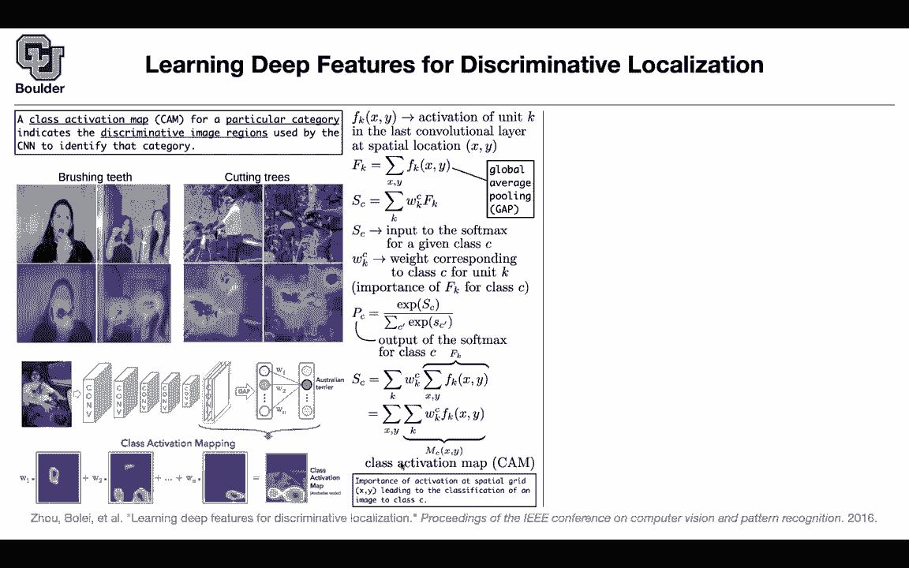

通过CAM，我们可以在没有物体位置标注的情况下，理解模型的决策依据，并定位图像中的关键物体，这对于模型解释和调试非常有价值。

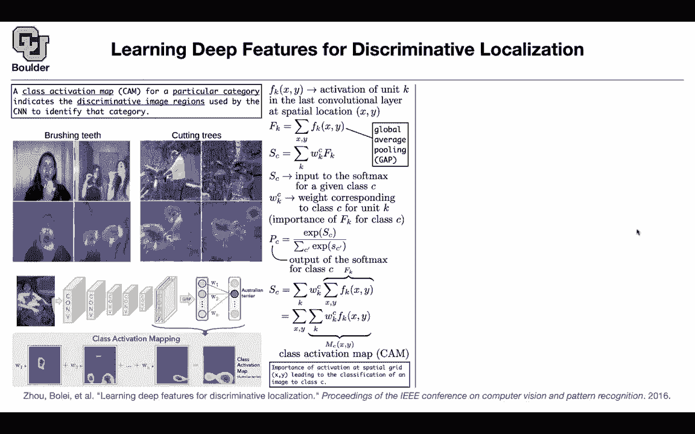

