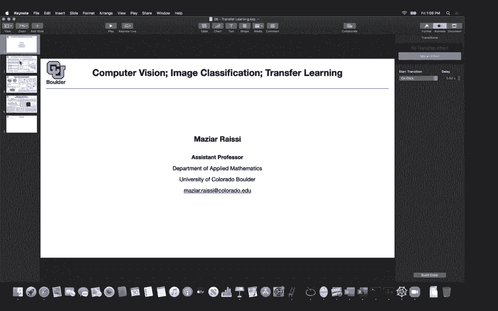
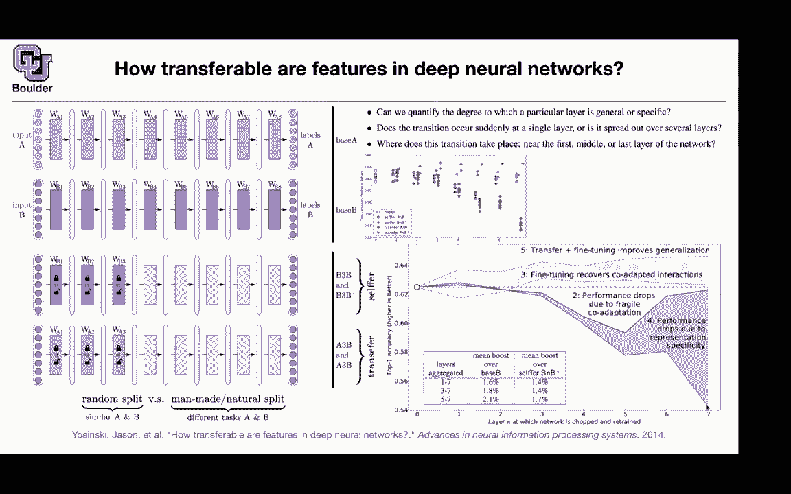

# 57：L28.3 - 迁移学习 🚀

在本节课中，我们将要学习迁移学习（Transfer Learning）的核心概念、工作原理以及如何在实际项目中应用它。迁移学习是一种强大的技术，它允许我们利用在一个任务上训练好的模型知识，来帮助解决另一个相关但不同的任务。

---

## 概述

迁移学习的基本思想是，从一个任务（源任务）中学到的知识可以被应用到另一个任务（目标任务）上。这通常能显著减少训练所需的数据量和计算时间。

上一节我们介绍了模型训练的基础知识，本节中我们来看看如何利用已有的知识来加速新任务的学习过程。

---

## 什么是迁移学习？



迁移学习是指将从一个环境中学到的知识重新应用到另一个新环境中的过程。在机器学习中，这通常意味着使用在一个大型数据集上预训练好的模型，并将其调整用于我们自己的特定任务。

例如，一个在数百万张图像上训练好的图像识别模型，已经学会了识别边缘、纹理、形状等通用特征。我们可以利用这些学到的特征，而不是从头开始训练。

---

## 为什么使用迁移学习？

使用迁移学习主要基于以下几个原因：

1.  **数据不足**：我们的目标任务可能没有足够多的标记数据来训练一个复杂的模型。
2.  **计算资源有限**：训练一个大型深度学习模型需要大量的时间和计算资源（如GPU）。
3.  **提升性能**：利用在大规模数据上预训练的特征，通常能获得比从零训练更好的模型性能，尤其是在数据有限的情况下。

---

## 迁移学习的工作原理

迁移学习通常通过以下步骤实现：

以下是迁移学习的一个典型流程：

1.  **选择预训练模型**：选择一个在大型通用数据集（如ImageNet）上训练好的模型作为起点。
2.  **冻结基础层**：冻结（即固定参数，不参与训练）预训练模型的大部分层。这些层被视为一个“特征提取器”，它们提取的是通用特征。
3.  **添加自定义层**：在预训练模型的顶部，添加一些新的、随机初始化的层。这些层将学习如何将通用特征组合起来解决我们的特定任务。
4.  **训练模型**：
    *   首先，只训练我们新添加的顶层，同时保持预训练模型参数不变。
    *   然后，可以选择性地“解冻”部分预训练模型的深层，并进行微调（Fine-tuning），使模型更好地适应新任务。

这个过程可以用一个简单的代码框架来表示：

```python
# 伪代码示例
base_model = load_pretrained_model()  # 加载预训练模型
freeze_layers(base_model)             # 冻结基础层

# 添加自定义分类层
x = base_model.output
x = Dense(256, activation='relu')(x)
predictions = Dense(num_classes, activation='softmax')(x)

model = Model(inputs=base_model.input, outputs=predictions)

# 先只训练新添加的层
for layer in base_model.layers:
    layer.trainable = False
model.compile(...)
model.fit(...)

# 然后解冻部分层进行微调
unfreeze_some_layers(base_model)
model.compile(...)
model.fit(...)
```



---

## 迁移学习的常见策略

根据源任务和目标任务之间的相似性以及可用数据量，我们可以采用不同的迁移学习策略。

以下是几种常见的策略：

*   **特征提取**：将预训练模型作为固定的特征提取器，只训练新添加的分类器。适用于目标任务数据较少，且与源任务特征相似的情况。
*   **微调**：解冻预训练模型的部分或全部层，与新添加的层一起进行训练。适用于有较多目标任务数据，或目标任务与源任务差异较大的情况。
*   **预训练模型作为初始化**：使用预训练模型的权重作为我们新模型训练的起点，然后在整个新数据集上进行训练。

---

## 总结

本节课中我们一起学习了迁移学习。我们了解了它的核心思想是知识复用，能够有效解决数据不足和训练成本高的问题。我们探讨了其典型的工作流程：选择预训练模型、冻结基础层、添加自定义层并进行分阶段训练。最后，我们还介绍了几种针对不同场景的迁移学习策略。

掌握迁移学习，能让你在资源有限的情况下，依然有能力构建出强大的机器学习模型。