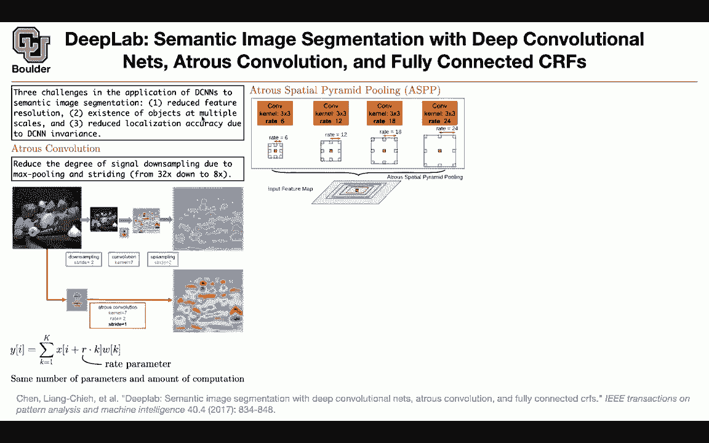
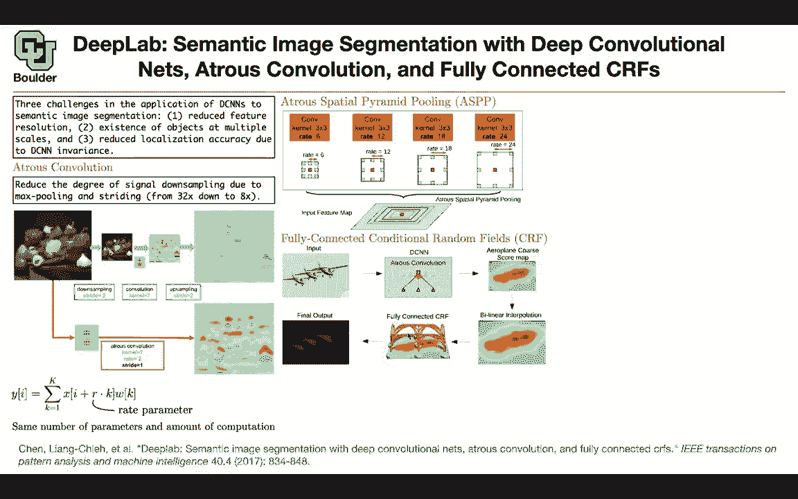
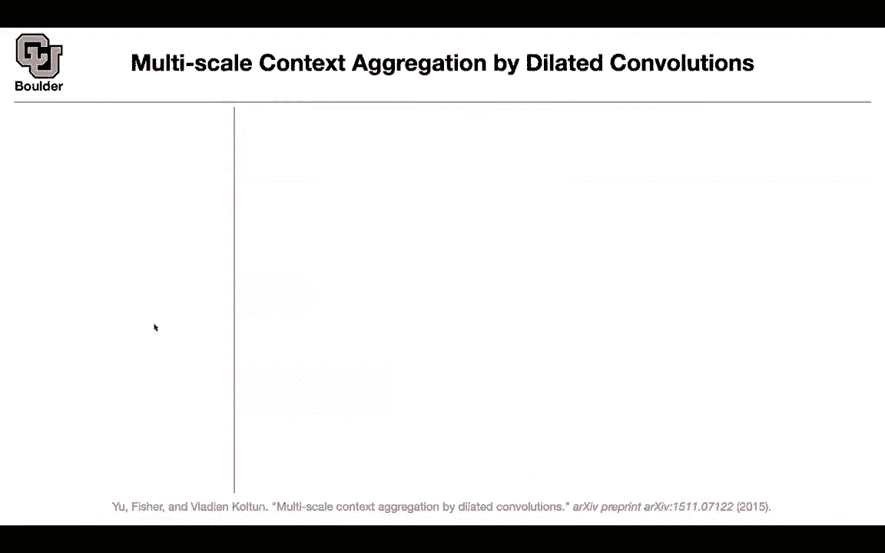

# 64：L31.1 - DeepLab [续] 🧠

在本节课中，我们将继续学习 DeepLab 模型，重点探讨语义分割任务中面临的三大挑战及其解决方案。我们将详细介绍空洞卷积、空间金字塔池化以及条件随机场这三个核心概念，并通过公式和代码示例帮助初学者理解其工作原理。

---

上一节我们介绍了 DeepLab 的基本框架，本节中我们来看看语义分割任务中常见的三个挑战。

第一个挑战是**特征分辨率降低**。当我们希望进行迁移学习时，通常会使用在 ImageNet 上预训练的分类网络。然而，这些网络通常包含步幅（stride）操作，导致特征图尺寸减小。语义分割需要精细的像素级预测，因此特征分辨率降低会损失空间细节。

第二个挑战是**多尺度物体识别**。图像中的物体大小不一，网络需要能够同时识别不同尺度的物体。

第三个挑战是**定位精度损失**。卷积神经网络本身具有平移不变性等特性，这虽然有助于分类，但会降低像素级定位的准确性。

---

## 🕳️ 解决方案一：空洞卷积

为了应对特征分辨率降低的问题，我们可以使用**空洞卷积**。

空洞卷积通过在标准卷积核中插入“空洞”（即零值）来扩大感受野，而无需进行下采样。其核心思想是，在保持参数量和计算量不变的前提下，让每个输出像素能够看到输入图像中更大范围的区域。



以下是空洞卷积的两种理解方式：

1.  **在卷积核中插入零值**：将一个小的卷积核（如 3x3）通过插入零值“膨胀”成一个更大的有效感受野。
2.  **对输入图像进行间隔采样**：等效于保持卷积核大小不变，但对输入特征图进行间隔为 `r` 的采样。这在实现上更高效。



空洞卷积的公式可以描述为：对于输出位置 `i`，其计算涉及输入位置 `i + r * k` 的值，其中 `k` 是卷积核的索引，`r` 是膨胀率（rate）。

```python
# 伪代码示例：使用膨胀率 r=2 的空洞卷积
# 标准 3x3 卷积核，膨胀后等效于 5x5 的感受野，但只计算9个点的加权和
output[x, y] = sum_over_i_j( kernel[i, j] * input[x + r*i, y + r*j] )
```

通过使用空洞卷积，我们可以在不减少特征图尺寸的情况下，获得更大的感受野，从而保留更多空间信息。

---

## 🔺 解决方案二：空间金字塔池化 (ASPP)

为了处理多尺度物体识别问题，DeepLab 采用了**空间金字塔池化**模块。

其核心思想是，并行使用多个具有不同膨胀率的空洞卷积层，以捕获不同尺度的上下文信息。膨胀率越大，感受野越大，越适合捕捉大物体；膨胀率越小，感受野越聚焦，越适合捕捉小物体。

以下是 ASPP 模块的工作流程：

1.  将输入特征图同时送入多个并行分支。
2.  每个分支使用一个不同膨胀率（例如，rate=6, 12, 18, 24）的空洞卷积层。
3.  将所有分支的输出特征图在通道维度上进行拼接（Concatenate）。
4.  最后通过一个 1x1 卷积层进行融合和降维。

这种结构形似金字塔，因此得名。它让网络能够同时“看到”图像的局部细节和全局语境。

---

## 🧩 解决方案三：条件随机场 (CRF)

为了提升分割边界的定位精度，DeepLab 在神经网络预测后引入了一个**全连接条件随机场**作为后处理步骤。

CRF 的目标是对神经网络输出的粗糙概率图进行优化，使得在空间上接近且颜色相似的像素更可能被分配相同的标签。

**数学模型**：
我们有一组像素 `I`，需要为每个像素 `i` 分配一个标签 `x_i`。神经网络的输出为每个像素 `i` 属于各个类别的概率分布 `P(x_i)`。CRF 通过最小化以下能量函数 `E(x)` 来寻找最优的标签分配 `X`：

```
E(x) = ∑_i ψ_u(x_i) + ∑_i<j ψ_p(x_i, x_j)
```

其中：
*   **一元势能 `ψ_u(x_i)`**：鼓励像素 `i` 的标签 `x_i` 与神经网络预测的概率一致。通常定义为 `ψ_u(x_i) = -log P(x_i)`。
*   **二元势能 `ψ_p(x_i, x_j)`**：鼓励空间相邻且颜色相似的像素具有相同标签。其常见形式为：
    ```
    ψ_p(x_i, x_j) = μ(x_i, x_j) * [ w1 * exp( -|p_i - p_j|^2 / (2σ_α^2) - |I_i - I_j|^2 / (2σ_β^2) ) + w2 * exp( -|p_i - p_j|^2 / (2σ_γ^2) ) ]
    ```
    *   `μ(x_i, x_j) = 1` 当 `x_i != x_j`，否则为 `0`。这构成了一个**Potts模型**，仅对标签不同的像素对施加惩罚。
    *   第一项同时考虑像素位置 (`p`) 和颜色 (`I`) 的相似性。
    *   第二项仅考虑像素位置的相似性。
    *   `σ_α`, `σ_β`, `σ_γ`, `w1`, `w2` 是控制各项权重的超参数。

通过迭代优化这个能量函数（通常使用高效的**平均场近似**算法），CRF 能够细化分割边界，得到更清晰、更准确的结果。

---

## 📊 效果与总结

实验结果表明，结合了空洞卷积、ASPP 和 CRF 后处理的 DeepLab 模型，在 Pascal VOC 等数据集上的平均交并比（mIoU）得到了显著提升。CRF 后处理尤其能有效改善物体边界的平滑度和准确性。

本节课中我们一起学习了 DeepLab 为解决语义分割三大挑战而引入的三个核心组件：
1.  **空洞卷积**：在保持分辨率的同时扩大感受野。
2.  **空间金字塔池化 (ASPP)**：并行处理多尺度上下文信息。
3.  **条件随机场 (CRF)**：作为后处理步骤，利用像素间关系优化预测结果。



这些概念不仅是 DeepLab 的基石，也深刻影响了后续的语义分割模型设计。下一节课，我们将基于空洞卷积，继续探索更先进的网络结构。