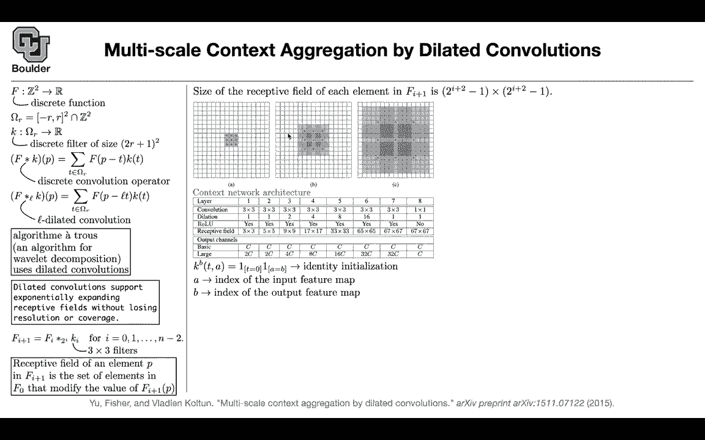

# 65：L31.2 - 扩张卷积 🧠

在本节课中，我们将要学习**扩张卷积**（Dilated Convolution），也称为空洞卷积。这是一种用于多尺度上下文聚合的技术，能够在不增加网络深度或损失分辨率的情况下，显著扩大感受野。我们将从基本概念出发，逐步理解其工作原理、数学定义、在神经网络架构中的应用以及相关的实践技巧。

## 图像与卷积的数学表示

首先，我们需要建立图像和卷积操作的数学表示。一幅图像可以被看作一个**离散函数**。这个函数从像素坐标（二维空间）映射到像素值。像素值可以是单通道的灰度值，也可以是三通道的RGB值。

我们用 **F** 表示这个离散的输入函数，其定义域是像素坐标的整数网格。

接下来，我们定义卷积核。卷积核 **k** 也是一个离散函数，它定义在一个以原点为中心、大小为 `(2r+1) x (2r+1)` 的方形窗口上，其中 **r** 是核的半径。这个窗口的数学表示是 `[-r, r]² ∩ Z²`。

离散卷积操作可以定义为：对于输出图像中的每一个像素点 **p**，其值是通过计算输入函数 **F** 在该点邻域内与卷积核 **k** 的加权和得到的。

用公式表示如下：
`(F * k)(p) = Σ_{t∈[-r, r]²} F(p + t) · k(t)`

这个公式的含义是：为了得到输出在位置 **p** 的值，我们查看输入 **F** 在 **p** 点周围一个窗口内的所有像素，将它们与核 **k** 在对应位置的值相乘，然后求和。

## 什么是扩张卷积？

上一节我们回顾了标准卷积。本节中我们来看看它的一个变体——扩张卷积。

**扩张卷积** 在标准卷积核的元素之间引入了“空洞”（或称为“膨胀率”），从而在不增加参数数量的情况下，扩大卷积核的感受野。

我们可以将扩张卷积视为将标准卷积核的索引 **t** 乘以一个膨胀率 **l**。膨胀率 **l** 决定了采样时跳过的像素数。当 `l=1` 时，就是标准卷积。

扩张卷积的公式可以写作：
`(F *_l k)(p) = Σ_{t∈[-r, r]²} F(p + l·t) · k(t)`

这里，`*_l` 表示膨胀率为 **l** 的扩张卷积操作。通过调整 **l**，我们可以控制卷积核“看到”的输入区域的大小。

## 感受野的指数级扩张

扩张卷积最强大的特性之一是能够实现**感受野的指数级扩张**。

**感受野** 是指网络中某一层特征图上的一个像素点，其值所依赖的原始输入图像上的区域范围。简单来说，就是输出像素能“看到”的输入图像的范围。

以下是利用扩张卷积实现感受野指数级增长的一种典型方式：

*   第一层：使用 `3x3` 卷积，膨胀率 `l = 2⁰ = 1`（即标准卷积）。感受野大小为 `3x3`。
*   第二层：使用 `3x3` 卷积，膨胀率 `l = 2¹ = 2`。感受野扩大。
*   第三层：使用 `3x3` 卷积，膨胀率 `l = 2² = 4`。感受野进一步扩大。
*   第四层：使用 `3x3` 卷积，膨胀率 `l = 2³ = 8`。感受野变得非常大。

通过这种以 `2^i` 为膨胀率的堆叠，仅用少数几层，感受野就能覆盖几乎整个输入图像，同时保持了较高的特征图分辨率。这对于需要捕获全局上下文的视觉任务（如语义分割）非常有利。

## 扩张卷积的网络架构设计

理解了其原理后，我们来看看如何在神经网络中实际应用扩张卷积。

一个典型的多尺度上下文聚合模块可能由多个卷积层堆叠而成，每层的膨胀率按指数增长（例如 1, 2, 4, 8, 16...）。所有卷积核通常保持为 `3x3` 大小。

关于通道数的设计，主要有两种思路：
1.  **基础版**：所有层保持相同的通道数。
2.  **增长版**：通道数逐层翻倍（例如 C, 2C, 4C, 8C...），这可以增加网络的容量。

在计算感受野时，由于层的堆叠是递归的，最终感受野大小会远大于单层卷积核的大小。例如，连续两个 `3x3` 卷积（膨胀率1）的感受野是 `5x5`。当加入膨胀率后，感受野会以更快的速度增长，例如达到 `33x33` 或更大。

## 训练技巧：恒等初始化

在实践中，训练深度网络（包括使用扩张卷积的网络）可能面临梯度消失或爆炸等收敛难题。

一种有效的初始化技巧是**恒等初始化**。这种方法旨在让网络初始状态下的每一层都近似为一个恒等映射，类似于残差连接的思想，有助于梯度在训练初期更顺畅地流动。

具体操作是，对于输入通道数为 **A**、输出通道数为 **B** 的卷积层，将其权重矩阵初始化为：
*   如果 `A == B`，则将权重矩阵的主对角线元素（对应于通道恒等映射）初始化为1，非对角线元素初始化为0。
*   如果 `A != B`，则将整个权重矩阵初始化为0。

这可以用一个指示函数来简洁表示，但核心思想是让网络在开始时尽可能不做改变，从而稳定训练初期。

## 总结与问答

本节课中我们一起学习了扩张卷积的核心概念与应用。

**总结要点如下：**
*   **目的**：扩大感受野以捕获更多全局上下文信息，同时避免因使用步长或池化导致的分辨率损失和网络过深。
*   **原理**：通过在标准卷积核中插入“空洞”来增加其有效覆盖范围。
*   **优势**：用较浅的网络深度即可获得极大的感受野，保持了特征图的空间分辨率。
*   **设计**：通常按指数规律（如1, 2, 4, 8...）堆叠膨胀率，并配合 `3x3` 小卷积核使用。
*   **训练**：采用如恒等初始化等技巧有助于深层网络的稳定训练。

**关于设计选择的问答：**
*   **为什么不直接使用很大的膨胀率（如9）？** 如果第一层就使用过大的膨胀率，会导致卷积核采样点过于稀疏，出现大量“空洞”，从而丢失重要的局部细节信息。逐步增加膨胀率的方式可以在扩大感受野和保留局部信息之间取得更好平衡。
*   **与单纯堆叠标准卷积层的区别？** 要达到相同的感受野，堆叠标准卷积需要更深的网络，这会使训练更困难，并且通常需要引入下采样（导致分辨率降低）。扩张卷积提供了一种更高效的替代方案。