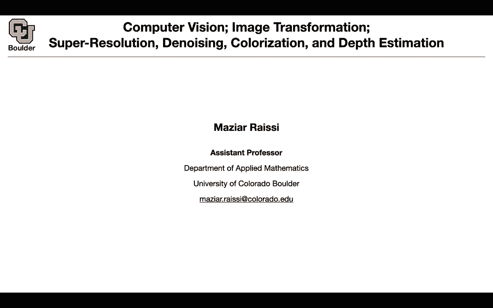
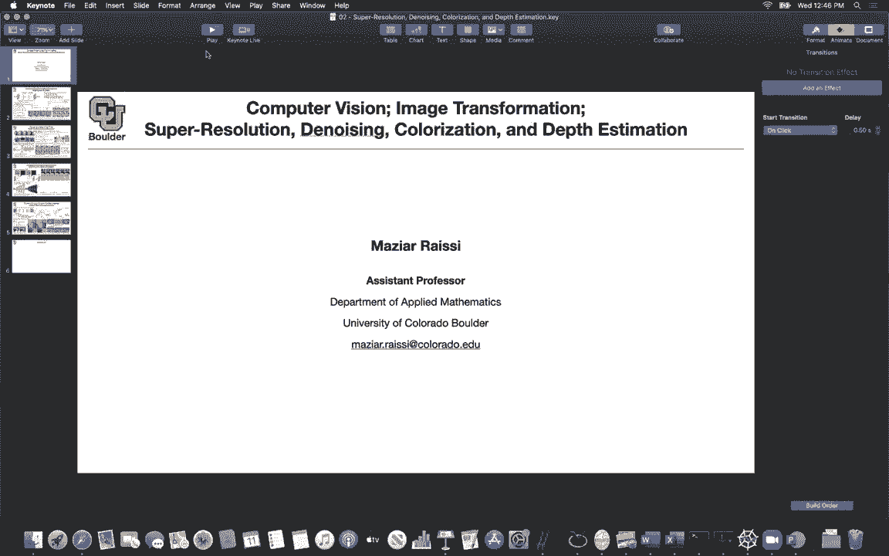
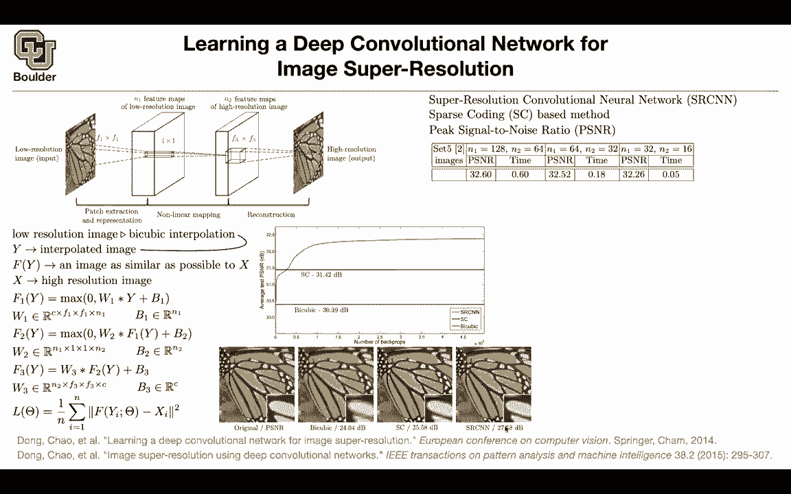

# 70：L33.1 - 超分辨率卷积神经网络 🖼️➡️🖼️



在本节课中，我们将学习如何使用卷积神经网络（CNN）来解决计算机视觉中的经典问题——超分辨率。我们将从一篇开创性的论文开始，了解如何用深度学习的方法将低分辨率图像转换为高分辨率图像。

上一节我们完成了关于语义分割的学习。现在，我们将稍微转变方向，探讨计算机视觉中更经典的问题，例如超分辨率、去噪、着色和深度估计。这些方法在游戏、视频会议和自动驾驶等领域有广泛应用。

## 概述：从传统方法到深度学习

在深度学习出现之前，超分辨率通常采用三步流程：从图像中提取图像块，为这些块创建特征表示，然后通过非线性映射和重建步骤生成高分辨率图像。



这篇论文提出，可以用卷积神经网络来替代上述所有三个步骤。卷积操作本身就能以滑动窗口的方式提取图像块，因此第一步是直接的。特征表示可以通过学习一系列滤波器权重来获得。非线性映射可以通过1x1卷积实现。最后，重建步骤则通过另一个卷积层完成。

## 网络架构与数学描述

首先，我们需要对低分辨率图像进行插值，使其像素数量与输出图像相同。这通常通过双三次插值完成。

设低分辨率图像为 **Y**，经过插值后得到 **Y_interp**。我们的网络是一个非线性函数 **F**，它接收 **Y_interp** 并输出超分辨率图像 **F(Y)**。我们的目标是让 **F(Y)** 尽可能接近真实的高分辨率图像 **X**。

网络结构可以公式化描述如下：

1.  **图像块提取与表示**：这是第一层卷积。
    ```python
    # 伪代码表示
    F1 = ReLU(Conv2D(Y_interp, weights=W1) + bias=B1)
    ```
    其中，滤波器尺寸为 **F1 x F1 x N1**，`N1` 是特征图的数量。

2.  **非线性映射**：通过1x1卷积实现。
    ```python
    F2 = ReLU(Conv2D(F1, weights=W2, kernel_size=1) + bias=B2)
    ```
    这一层将特征图数量变换为 `N2`。

3.  **重建**：最后一层卷积，无激活函数，直接生成高分辨率图像。
    ```python
    F3 = Conv2D(F2, weights=W3) + bias=B3  # 输出即 F(Y)
    ```

整个网络的参数 **θ** 包括所有权重 **W1, W2, W3** 和偏置 **B1, B2, B3**。损失函数是网络输出 **F(Y; θ)** 与真实高分辨率图像 **X** 之间的均方误差（MSE）。

## 数据生成与评估

为这个任务生成数据非常简单。以下是步骤：
*   从高清图像 **X** 开始。
*   通过下采样（例如，丢弃部分像素）生成对应的低分辨率图像 **Y**。
*   这样我们就得到了训练所需的输入-输出对 **(Y, X)**。

该领域常用的评估指标是峰值信噪比（PSNR），其公式与均方误差损失函数高度相关。虽然关于PSNR是否是最佳评估标准存在争论，但它目前仍是主流指标。



## 性能对比

论文中将提出的超分辨率卷积神经网络（SRCNN）与之前的方法进行了比较：
*   **双三次插值**：一种确定性的插值方法，没有优化过程。
*   **稀疏编码**：深度学习出现前的先进方法。

以下是SRCNN在不同网络规模（特征图数量不同）下的PSNR结果示例：
*   网络较小（如特征图较少）：PSNR约为32.26，速度较快。
*   网络较大（如特征图较多）：PSNR可提升至32.6，但计算成本增加。

从定性结果看，SRCNN生成的图像在细节上比双三次插值和稀疏编码方法更清晰、更接近原始高清图像。

## 总结

本节课我们一起学习了如何使用卷积神经网络解决图像超分辨率问题。我们了解了SRCNN的基本架构，它用卷积层替代了传统方法中的图像块提取、特征表示和非线性映射步骤。我们还学习了如何为这项任务生成训练数据，以及如何使用PSNR来评估模型性能。这项技术是许多现代应用（如游戏图形增强、视频会议画质提升）的基础。