# 73：L33.4 - 去噪卷积神经网络 📸

在本节课中，我们将学习一种用于图像去噪的卷积神经网络方法。我们将探讨其核心思想、背后的数学原理，并了解它如何应用于超越高斯噪声的复杂场景。

## 概述

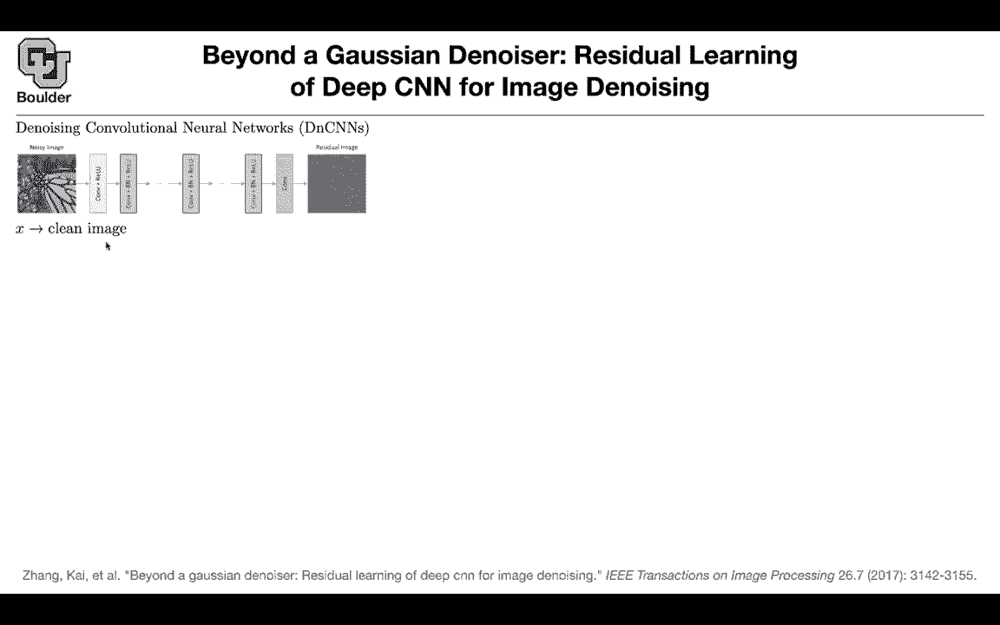

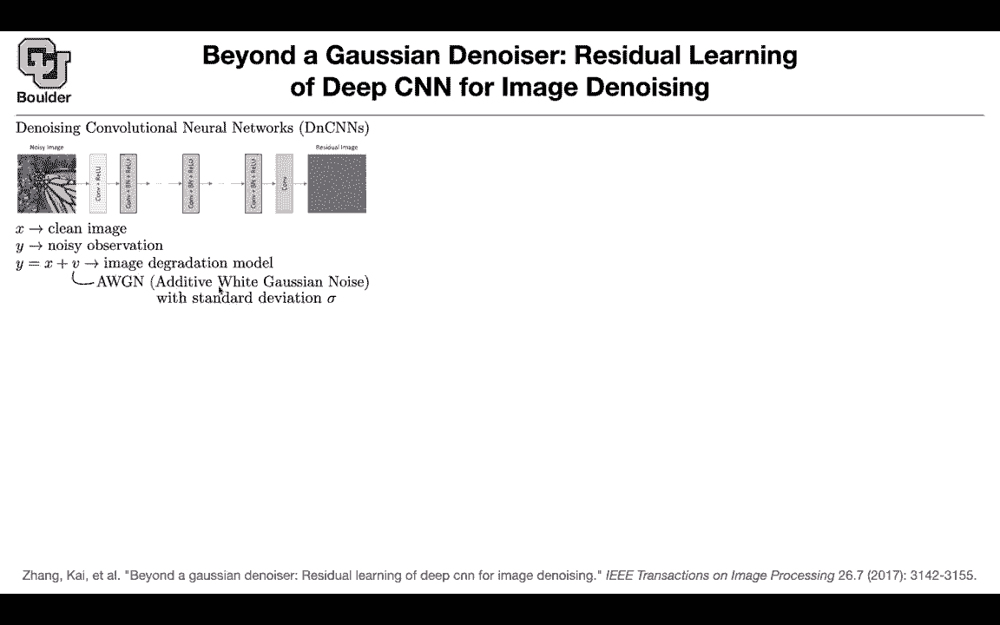

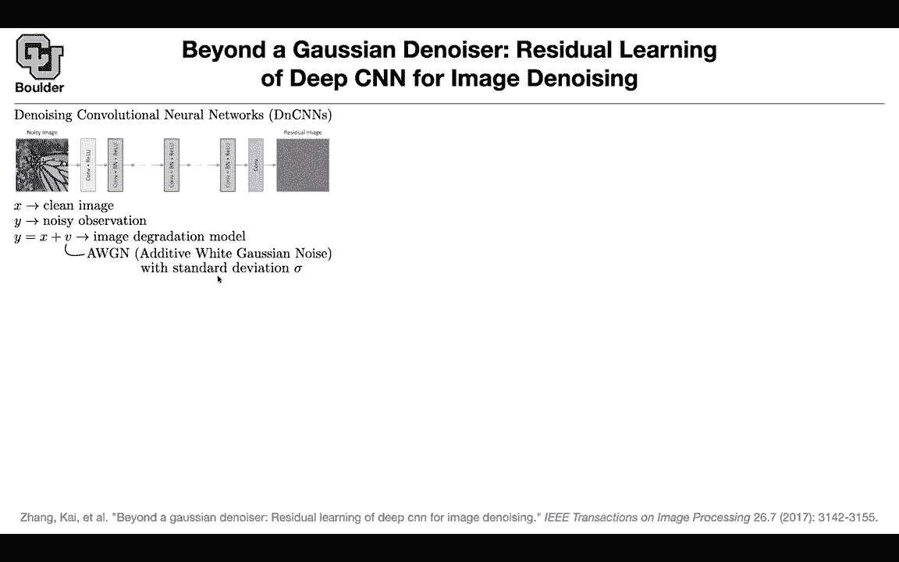

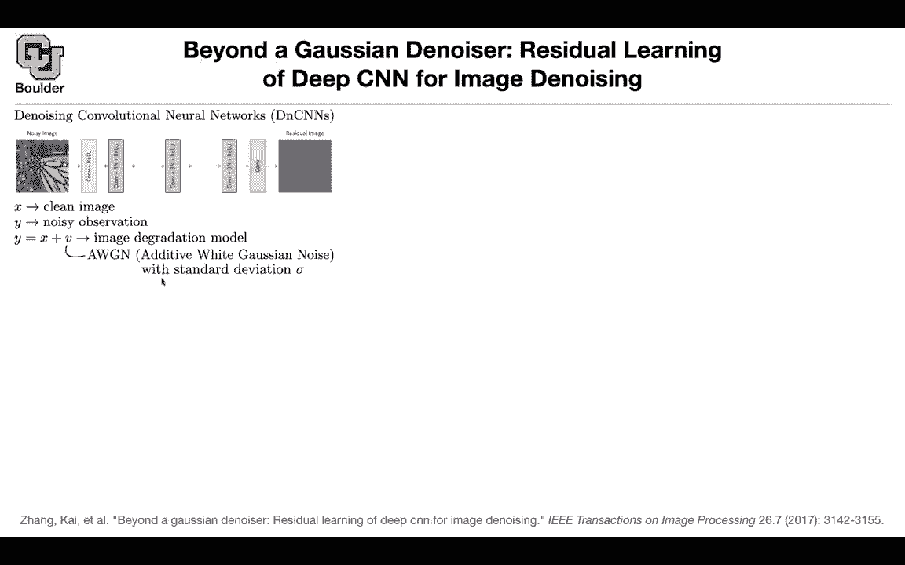

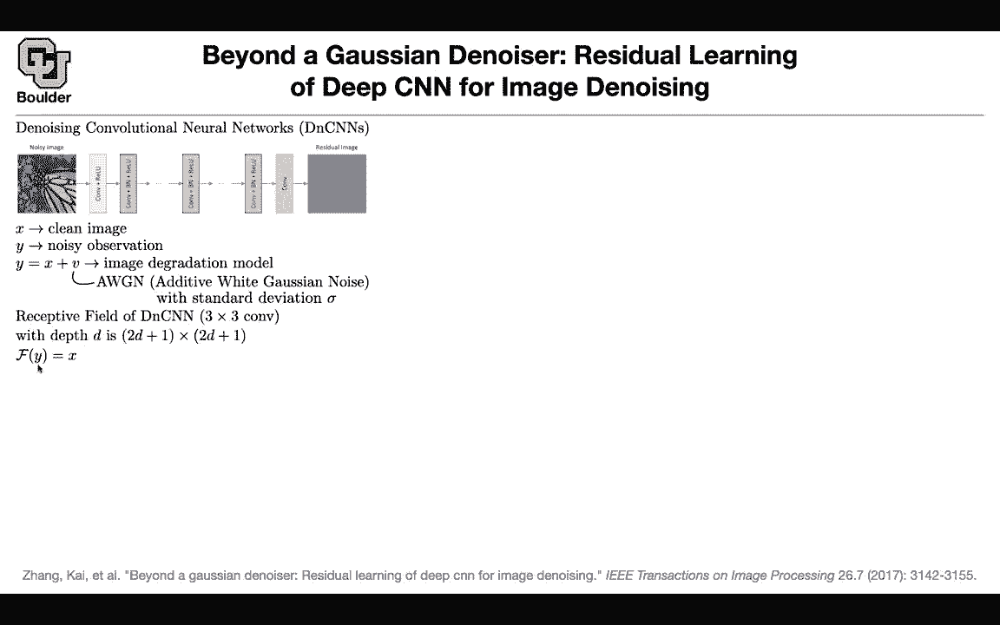

上一节我们讨论了图像去噪的基本概念。本节中，我们将深入探讨一篇具体的论文，其核心思想是学习**残差映射**，而非直接从带噪图像到干净图像的非线性映射。这种方法通常更简单有效。

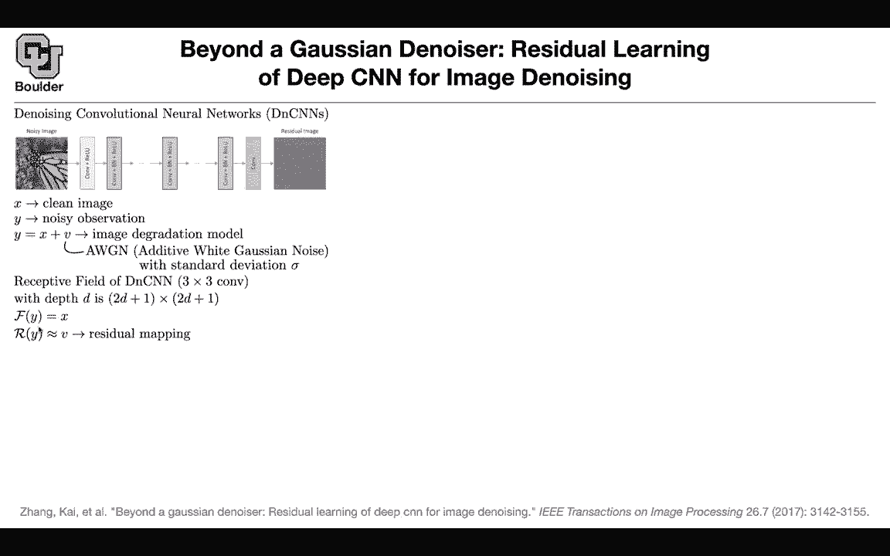

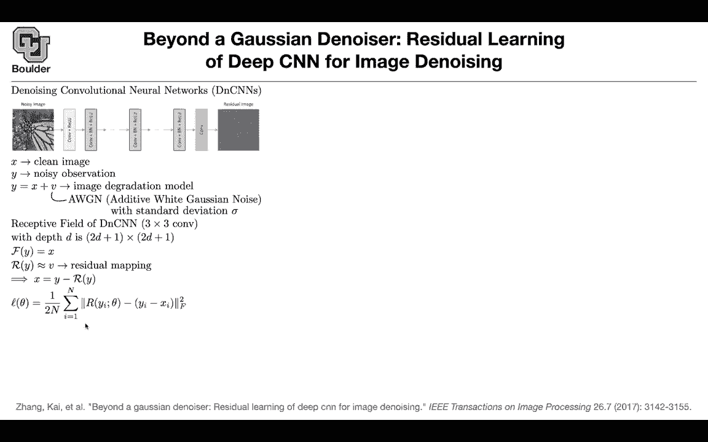

## 核心思想与数学原理

传统的去噪方法试图学习一个从带噪图像 **Y** 到干净图像 **X** 的映射函数 **F**。而本文提出的方法则学习**残差映射**。

假设我们有一个干净图像 **X** 和一个带噪观测 **Y**。噪声可以是加性高斯噪声，但此方法并不局限于此假设。其核心公式如下：

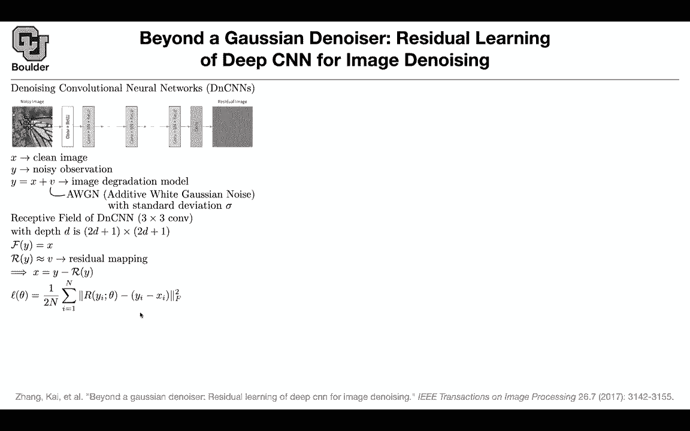

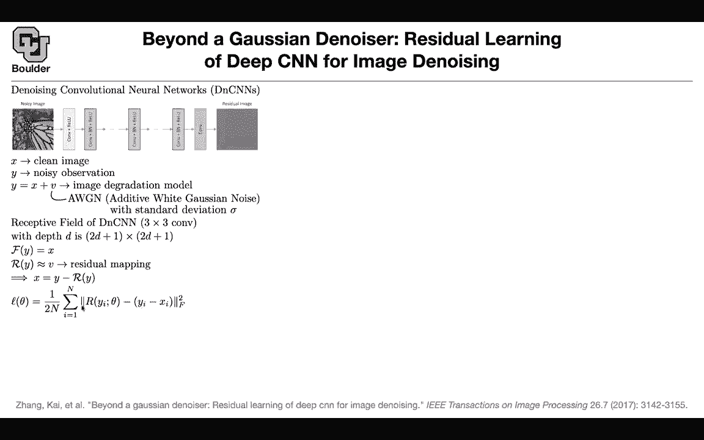

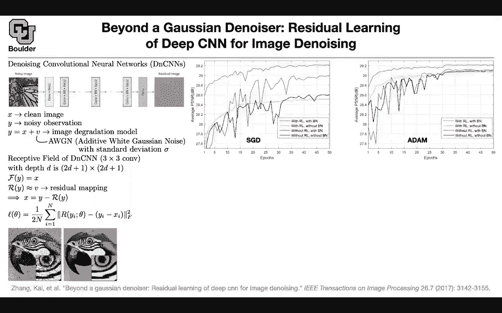

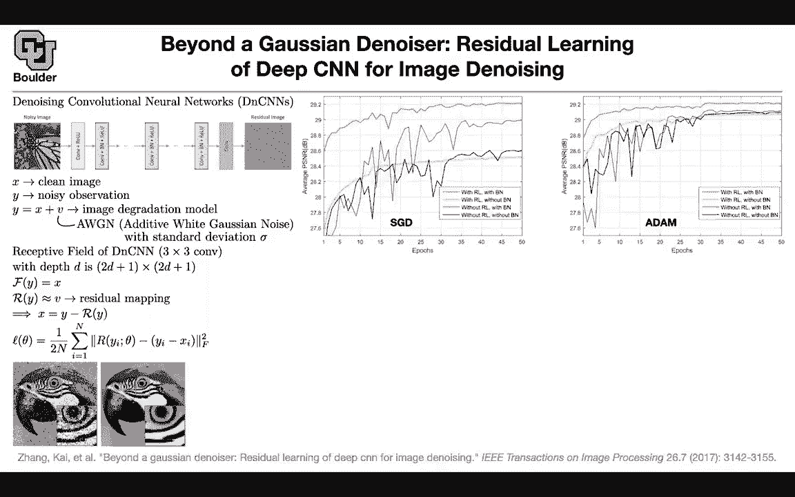

**R = Y - X**

这里，**R** 代表残差图像（即噪声）。网络的目标不再是学习 **F(Y) = X**，而是学习一个映射 **F_R(Y) = R**。得到残差 **R** 后，通过 **X = Y - R** 即可恢复干净图像。

因此，损失函数也相应改变，旨在最小化预测残差与真实残差之间的差异。

## 方法优势与应用

以下是该方法的一些关键优势：

*   **优化器鲁棒性**：该方法对随机梯度下降（SGD）、Adam等优化器的选择不敏感。
*   **超越高斯噪声**：可处理非高斯噪声，例如光线追踪算法产生的噪声。
*   **任务统一性**：在算法看来，去噪、超分辨率和去块效应（Deblocking）在本质上相似，都可以视为“去噪”任务。

如图所示，同一网络可以处理图像上不同区域的高斯噪声、分辨率降低和JPEG压缩伪影，因为网络学习的是适应不同噪声模式的残差。

## 实验分析与讨论

实验表明，使用残差学习（图中“with R”）并结合patch归一化（红色曲线）的方法，在峰值信噪比（PSNR）指标上表现最佳。

关于网络深度与性能的关系图中出现的波动，需要明确这与训练过程中的早停（Early Stopping）不同。该图反映的是**网络架构深度**对最终性能的影响，这种波动可能与权重初始化、随机种子等因素有关，需观察整体趋势。

有同学问到边缘保持的问题。与传统的基于高斯平滑的方法（会模糊边缘）相比，这种基于学习的去噪方法通常在保持图像边缘锐度方面表现更好。

## 网络训练细节问答

以下是针对训练过程中一些现象的问答澄清：

*   **关于激活值为零的特征图**：在某一特定输入下激活值接近零的特征图，并不代表其对应的权重永远失效。当输入批次（Batch）改变时，这些特征图可能会被重新激活。梯度更新取决于权重本身，而非单次的激活值。
*   **关于权重为零**：即使某些权重初始化为零，只要损失函数对该权重的梯度不为零，在训练过程中它就会得到更新，不会永远保持为零。

## 实际应用拓展

该方法具有广泛的实际应用前景：

*   **视频通信**：可用于改善Zoom、Skype等视频通话中因有损压缩导致的模糊或伪影，在接收端对视频流进行实时增强。
*   **计算机图形学**：用于对光线追踪等算法生成的、包含大量噪声的中间图像进行降噪，快速生成高质量最终图像。

## 总结

本节课我们一起学习了基于残差学习的图像去噪卷积神经网络。其核心在于学习噪声残差而非直接映射，这使得网络更易于训练，并能有效处理包括非高斯噪声在内的多种退化类型。我们还探讨了其在超分辨率、去块效应等任务上的通用性，以及在实际场景如视频通信和图形渲染中的应用潜力。