# 83：L38.2 - YOLO 目标检测算法详解 🚀

在本节课中，我们将学习 YOLO（You Only Look Once）目标检测算法。YOLO 是一种单阶段检测器，其核心设计理念是追求高效率与实时性。与追求高精度的两阶段检测器不同，YOLO 从效率出发，旨在实现快速的目标检测。通过本教程，你将理解 YOLO 的基本原理、网络结构、训练过程及其关键设计思想。

---

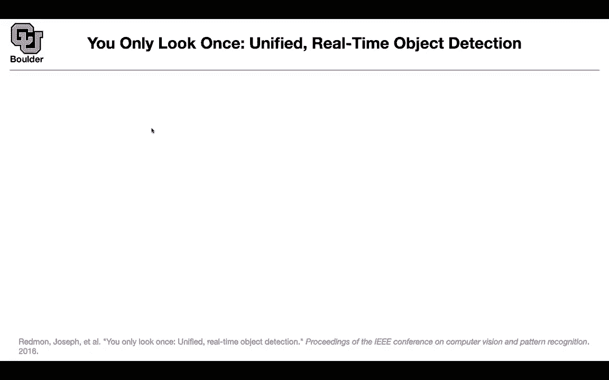

## 🔍 算法概述与核心思想

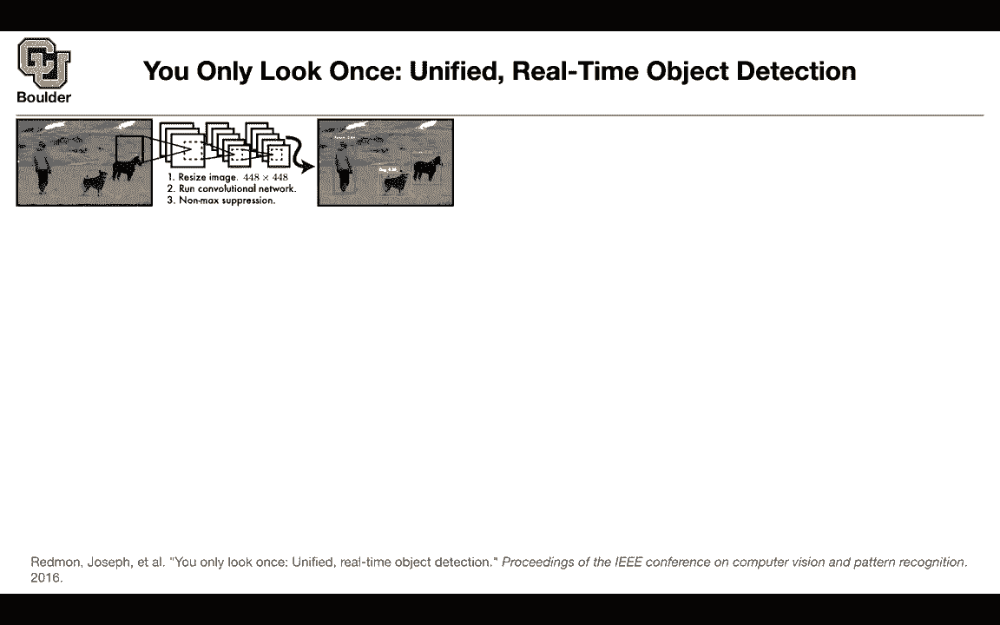

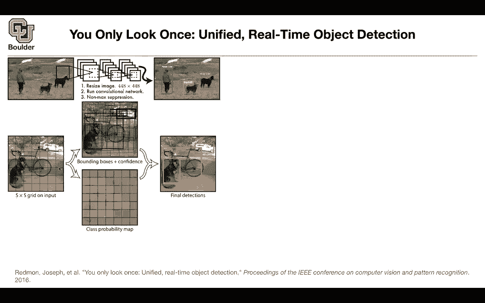

上一节我们提到了目标检测器的不同类型。本节中，我们来看看 YOLO 这一经典的单阶段检测器。YOLO 将目标检测视为一个回归问题，其流程主要分为三步：

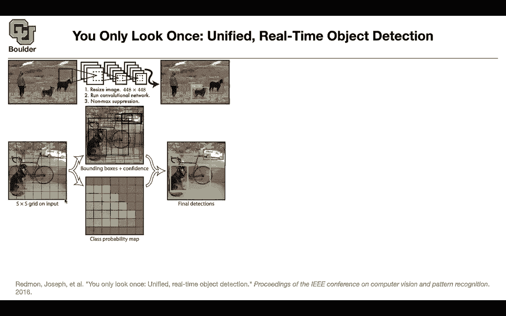

1.  将输入图像调整为固定尺寸。
2.  通过卷积神经网络进行前向传播。
3.  应用非极大值抑制（Non-Maximum Suppression）处理输出。

YOLO 的设计哲学是效率优先，旨在实现实时检测。尽管单阶段与两阶段检测器从不同视角（效率 vs. 精度）出发，但它们的性能正在逐渐趋同。

---

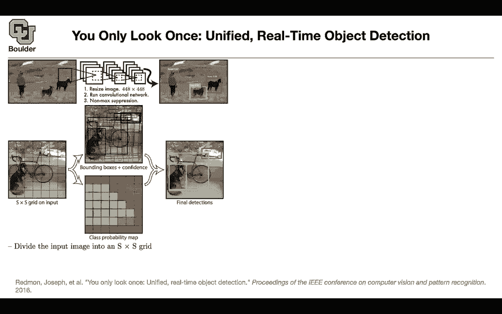

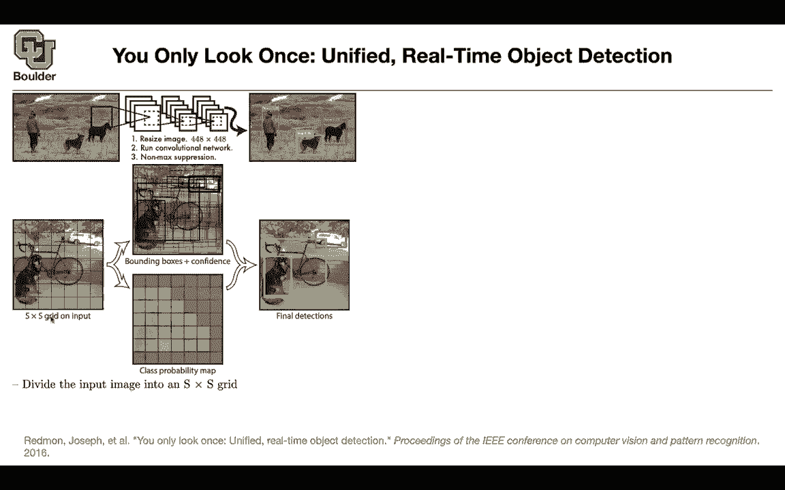

## 📊 网络输出与推理过程

理解了 YOLO 的目标后，本节我们来看看它的具体工作流程。下图是 YOLO 论文中的关键示意图：

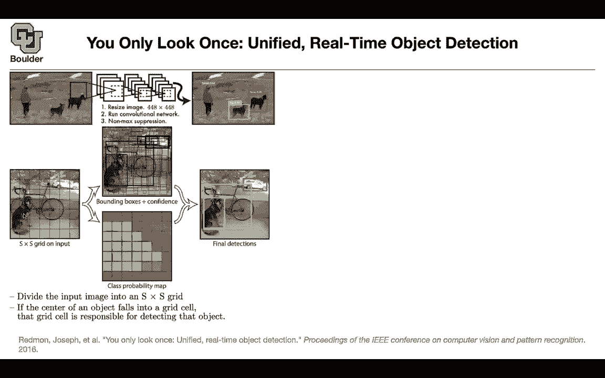

首先，算法将输入图像划分为一个 **S × S** 的网格。每个网格单元负责预测中心点落在该区域内的目标。

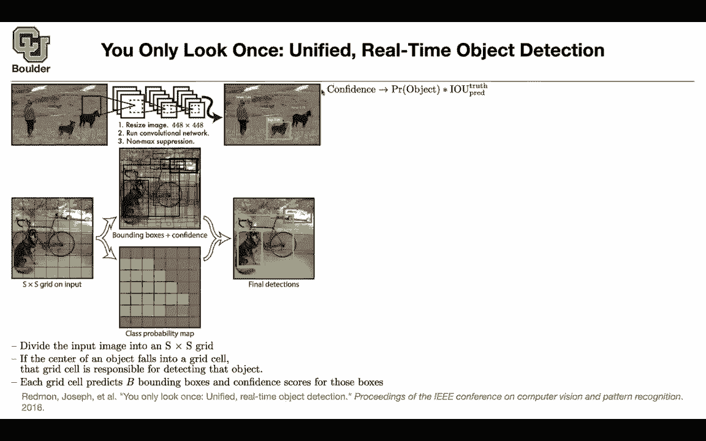

对于每个网格单元，网络会进行两项预测：
*   **边界框与置信度**：预测 B 个边界框及其对应的置信度分数。
*   **类别概率**：预测一个条件类别概率分布。

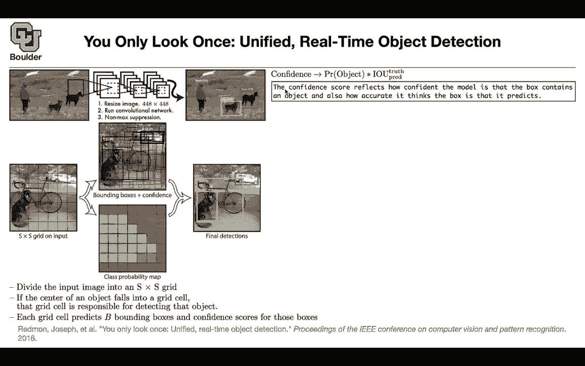

在推理阶段，我们将边界框的置信度与类别概率相乘，从而得到每个边界框针对特定类别的置信度分数。最后，通过阈值过滤和非极大值抑制，输出最终的检测结果。

**公式表示如下：**
`类别特定置信度 = 边界框置信度 × 条件类别概率`

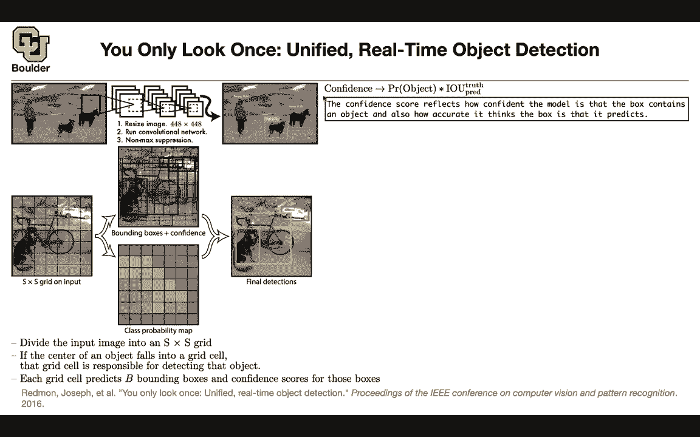

---

## 🏷️ 训练数据的定义

在开始训练之前，我们需要明确如何定义训练数据。YOLO 采用以下规则：

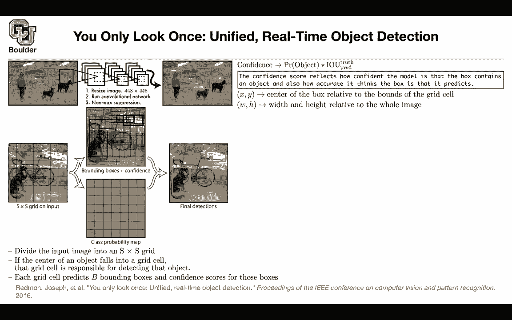

如果某个真实目标（Ground Truth）的中心点落入某个网格单元，则该单元被标记为“正样本”，并负责检测该目标。

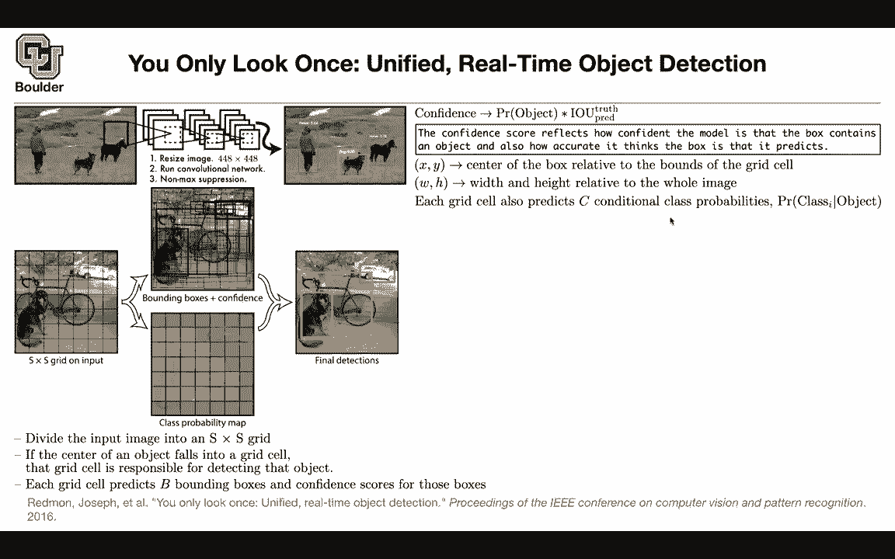

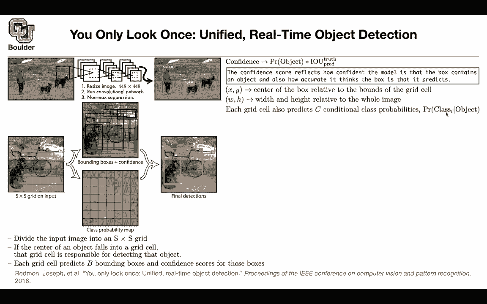

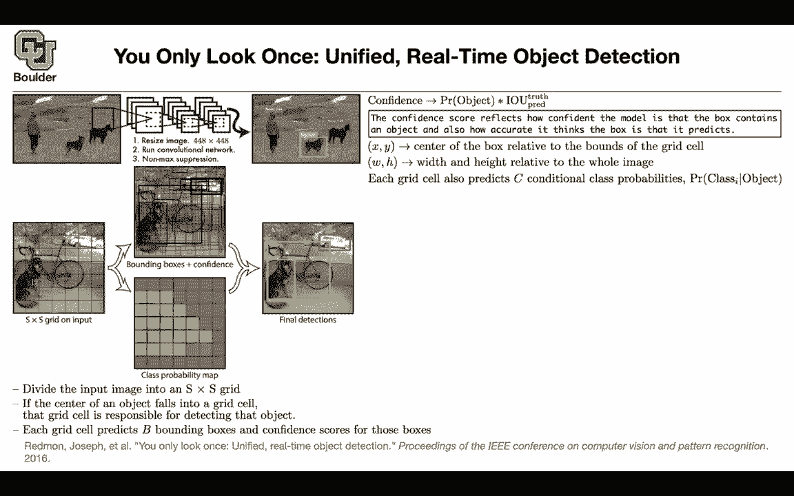

每个网格单元会预测 B 个边界框。每个边界框的预测包含一个**置信度分数**，其训练目标定义为：
`置信度 = Pr(Object) × IOU(预测框, 真实框)`

其中，`Pr(Object)` 表示该框内存在目标的概率，`IOU` 是预测框与真实框的交并比。因此，置信度同时反映了“框内是否有目标”以及“框的位置是否准确”这两方面信息。

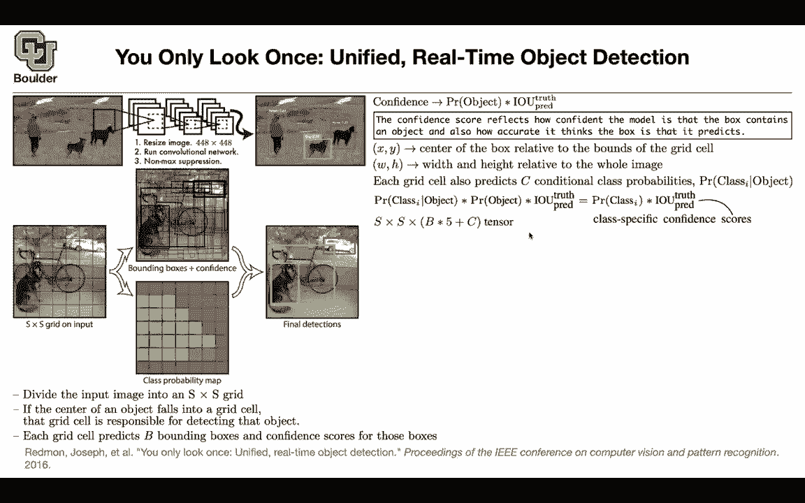

---

## 📐 边界框的回归参数

每个边界框需要回归出具体的定位参数。以下是每个边界框预测的 5 个核心参数：

*   **x, y**: 边界框中心点相对于其所属网格单元左上角的偏移量，值在 0 到 1 之间。
*   **w, h**: 边界框的宽度和高度相对于整个图像尺寸的比例，值也在 0 到 1 之间。
*   **confidence**: 上述定义的置信度分数。

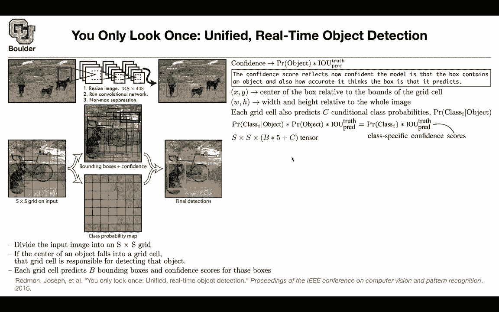

此外，每个网格单元还会预测一组**条件类别概率** `Pr(Class_i | Object)`，即在有目标的前提下，该目标属于各个类别的概率。

将置信度与条件类别概率相乘，即可得到针对每个类别的最终置信度分数，例如“包含狗的概率为 0.85”。

---

## 🧠 网络结构与输出张量

综合以上信息，YOLO 的网络结构设计如下：

网络接收一张输入图像，最终输出一个 **S × S × (B×5 + C)** 的张量。

其中：
*   **S × S** 对应划分的网格数量。
*   **B** 是每个网格预测的边界框数量，每个框有 5 个参数 (x, y, w, h, confidence)。
*   **C** 是数据集的类别总数，每个网格输出一个 C 维的条件类别概率向量。

---

## ⚖️ 损失函数设计

YOLO 将训练完全构建为一个回归问题，使用均方误差损失函数。总损失由以下几部分加权求和构成：

以下是损失函数的各个组成部分：

1.  **边界框中心坐标损失**：计算预测中心点 (x, y) 与真实值的均方误差。仅当网格 i 中存在目标，且第 j 个预测框对该目标负责时，此项才被计入损失。
    `λ_coord * ΣΣ [1_ij^(obj) * ((x_i - x̂_i)^2 + (y_i - ŷ_i)^2)]`

2.  **边界框宽高损失**：对宽度 w 和高度 h 计算均方误差时，先取平方根。这样做是为了平衡大框和小框在损失中的贡献，使网络对小框的偏差更敏感。
    `λ_coord * ΣΣ [1_ij^(obj) * ((√w_i - √ŵ_i)^2 + (√h_i - √ĥ_i)^2)]`

3.  **含目标框的置信度损失**：计算预测置信度与真实 IOU 的均方误差。
    `ΣΣ [1_ij^(obj) * (C_i - Ĉ_i)^2]`

4.  **无目标框的置信度损失**：计算背景框（不包含目标）的置信度损失，其真实值为 0。
    `λ_noobj * ΣΣ [1_ij^(noobj) * (C_i - Ĉ_i)^2]`

5.  **类别概率损失**：计算条件类别概率的均方误差。
    `ΣΣ [1_i^(obj) * Σ (p_i(c) - p̂_i(c))^2]`

**关键点**：损失函数中的 `λ_coord` (通常设为 5) 和 `λ_noobj` (通常小于 1，如 0.5) 是重要的超参数。它们用于平衡不同损失项的比例，因为图像中背景（负样本）远多于目标（正样本），若不降低背景损失的权重，模型训练会倾向于将所有预测都视为背景。

---

## 📉 算法性能与特点

YOLO 算法有其独特的优势与权衡。与 Faster R-CNN 这类两阶段检测器相比：

*   **定位误差**：YOLO 的定位误差相对较高，这导致其准确率（mAP）可能从 71.6 下降至 65.5。
*   **背景误检**：但 YOLO 对背景的误检率更低。Faster R-CNN 有时会将简单背景错误识别为物体，而 YOLO 在这方面表现更好。

这种差异体现了单阶段检测器在追求速度时，在精度上做出的妥协。

---

## 💎 课程总结

本节课中，我们一起学习了 YOLO 目标检测算法的核心内容。

我们首先了解了 YOLO 作为单阶段检测器，其追求实时效率的设计初衷。接着，我们详细剖析了它的工作流程：将图像划分为网格，每个网格预测边界框、置信度及类别概率。

我们深入探讨了其训练数据的定义方式、边界框参数的回归方法，以及复杂的多任务损失函数设计，该函数巧妙地平衡了坐标、置信度和分类损失。最后，我们对比了 YOLO 的优缺点，认识到它在速度与精度之间的权衡。

总而言之，YOLO 通过将检测问题转化为端到端的回归任务，实现了惊人的检测速度，为实时目标检测奠定了基础。其“只看一次”的理念，深刻影响了后续的检测模型发展。