# 84：L39.1 - SSD 目标检测 🎯

在本节课中，我们将学习 SSD（Single Shot MultiBox Detector）目标检测算法。我们将了解 SSD 如何结合 YOLO 的速度与 Faster R-CNN 的精度，并通过多尺度特征图预测大量边界框来实现这一目标。

---

## 关于 YOLO 的回顾与疑问澄清

上一节我们介绍了 YOLO 算法。本节中，我们来看看关于 YOLO 的一些常见疑问。

有同学对 YOLO 论文中“如果物体的中心落入某个网格单元，则该网格单元负责检测该物体”这一描述感到困惑。以下是详细解释：

*   每个网格单元会预测 **B** 个边界框。每个边界框包含 4 个坐标值（x, y, w, h）和一个置信度分数（表示该框内是否存在物体）。
*   同时，每个网格单元还会预测 **C** 个类别的条件概率向量（即给定框内有物体时，该物体属于各个类别的概率）。
*   在推理时，将每个边界框的置信度分数与类别概率向量相乘，得到类别特定的置信度分数，然后进行非极大值抑制（NMS）以去除冗余框。
*   在训练时，需要为每个边界框分配标签。只有那些与真实物体边界框高度重叠（即“负责”该物体）的预测框，才会被用于计算定位和分类损失。大量不包含物体的预测框（负样本）会造成类别不平衡，因此在训练时需要对它们的损失进行降权处理。

这意味着，即使在图像右下角没有物体的网格单元，也会预测 B 个边界框和 C 个类别概率，但它们的置信度分数会很低，最终在 NMS 阶段被过滤掉。

同时，这也意味着 YOLO 每张图像最多只能预测 **S × S × B** 个边界框。

---

## SSD 的核心思想：多尺度与更多预测框

YOLO 的预测框数量限制引出了一个问题：如果我们想观察多个尺度，并希望得到更多预测框，该怎么办？这正是 SSD 算法要解决的问题。

SSD 发表于 2016 年，其目标是结合 YOLO 的速度与 Faster R-CNN 的精度，创造一个既快速又准确的单阶段检测器。

那么，SSD 是如何在 YOLO 的基础上构建的呢？

我们可以从另一个角度理解 YOLO：它将原始图像划分为 S×S 的网格。在网络末端，会得到一个 S×S×30 的特征图，其中每个“像素”（即每个网格单元）负责预测对应的边界框。

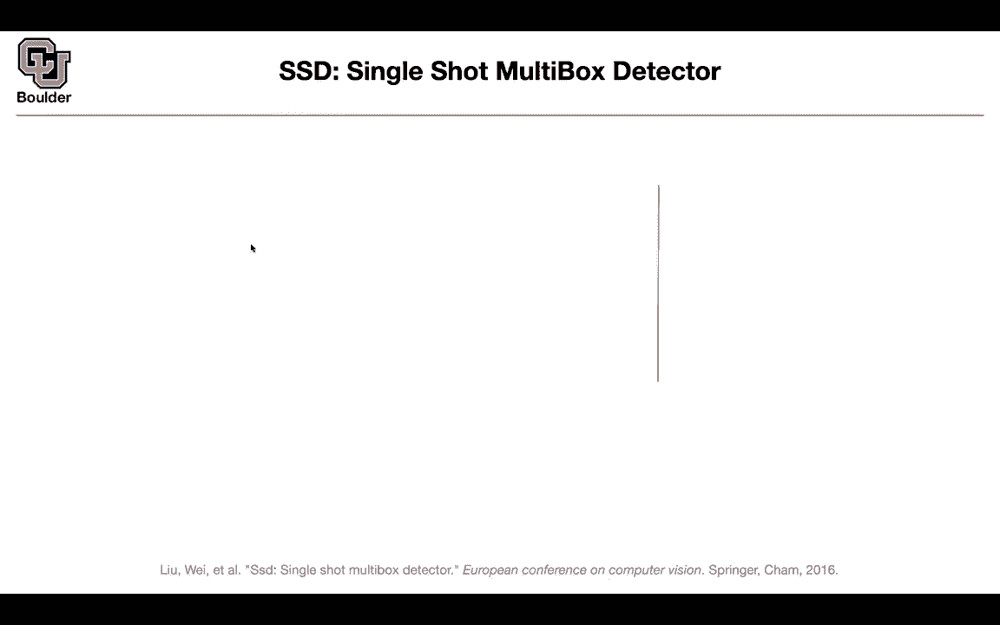

SSD 的核心思想是：**不仅利用网络最后的特征图，还利用网络中不同深度的多个特征图进行预测**。

以下是 SSD 的工作流程：

1.  图像输入一个基础网络（如 VGG16）。
2.  从网络的不同深度抽取多个特征图（例如尺寸为 38×38, 19×19, 10×10, 5×5, 3×3, 1×1）。
3.  在每个特征图的每个空间位置（每个“像素”），都预设一组不同尺度和长宽比的**默认框**（Default Boxes，类似于 Faster R-CNN 中的锚框）。
4.  对于每个默认框，网络会预测两方面内容：
    *   **边界框偏移量**：用于调整默认框的位置和大小，以更好地匹配物体。
    *   **各个类别的置信度**。
5.  将所有特征图上的所有预测框收集起来，进行非极大值抑制，得到最终检测结果。

通过这种方式，SSD 能够预测远多于 YOLO 的边界框数量（例如 8732 个），并且由于在不同尺度的特征图上进行预测，它对于不同大小的物体都有更好的检测能力。

---

## SSD 的预测框数量计算

SSD 预测的边界框总数是如何得出的呢？以下是计算过程：

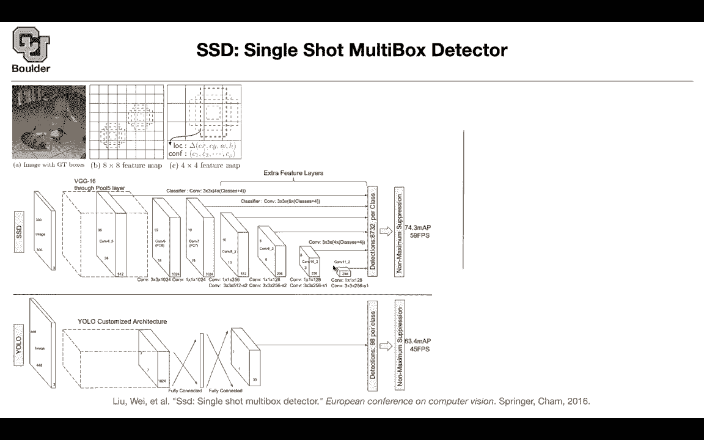

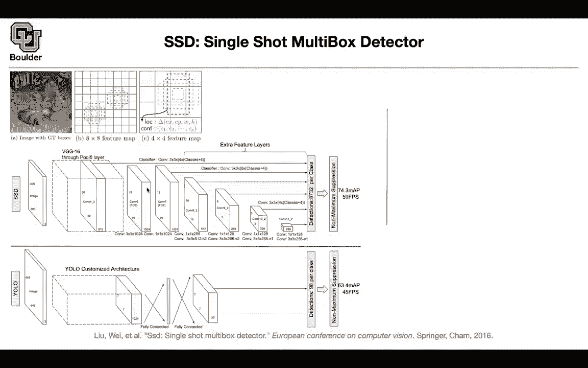

假设我们使用 6 个特征图进行预测，每个特征图每个位置预测的默认框数量（K）不同：
*   38×38 特征图：K=4 → 4 × 38 × 38 = 5776 个框
*   19×19 特征图：K=6 → 6 × 19 × 19 = 2166 个框
*   10×10 特征图：K=6 → 6 × 10 × 10 = 600 个框
*   5×5 特征图：K=6 → 6 × 5 × 5 = 150 个框
*   3×3 特征图：K=4 → 4 × 3 × 3 = 36 个框
*   1×1 特征图：K=4 → 4 × 1 × 1 = 4 个框

将所有框数相加：5776 + 2166 + 600 + 150 + 36 + 4 = **8732 个框**

---

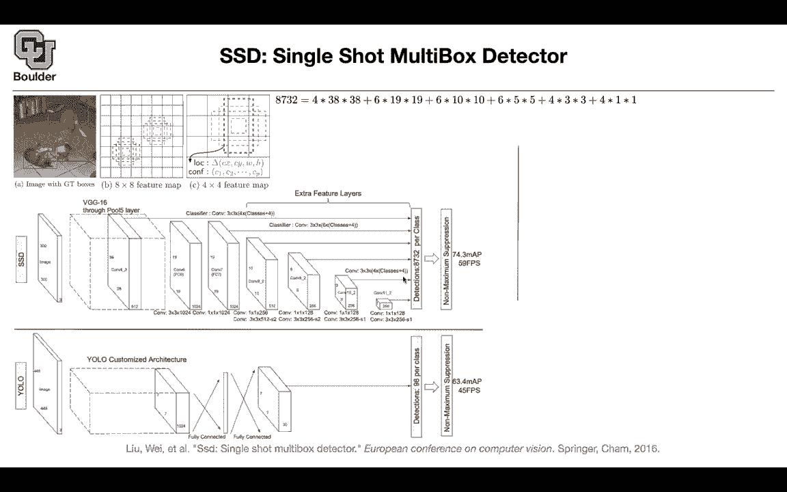

## SSD 的损失函数

SSD 的损失函数由两部分组成：定位损失（Localization Loss）和置信度损失（Confidence Loss）。

总损失函数公式如下：
```
L(x, c, l, g) = (1/N) * ( L_conf(x, c) + α * L_loc(x, l, g) )
```
其中：
*   **N** 是与真实框匹配的默认框的数量。
*   **L_conf** 是置信度损失（分类损失），使用交叉熵损失函数。
*   **L_loc** 是定位损失（回归损失），使用 Smooth L1 损失函数。
*   **α** 是用于平衡两项损失的权重参数。

**Smooth L1 损失** 对异常值不那么敏感，它在零点附近使用 L2 损失（平滑），在远离零点时使用 L1 损失（线性增长），这比单纯的 L2 损失更稳健。

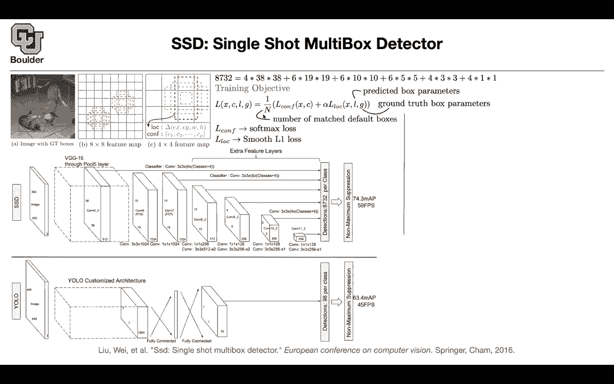

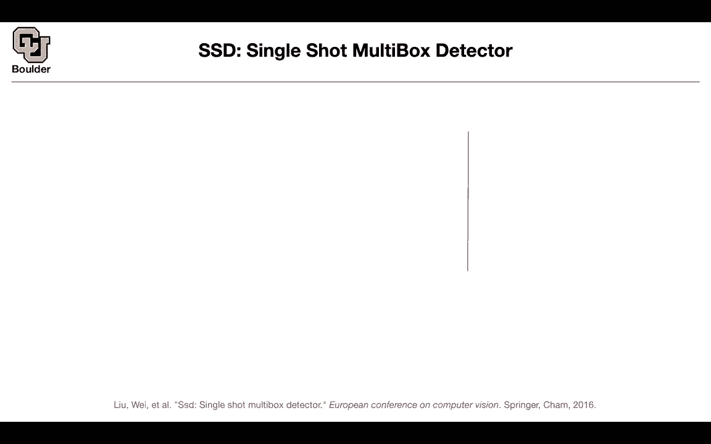

定位损失计算的是预测框（l）与真实框（g）之间的参数差异。与 YOLO 类似，为了平衡不同大小框的损失贡献，有时会对宽度（w）和高度（h）进行开方处理。

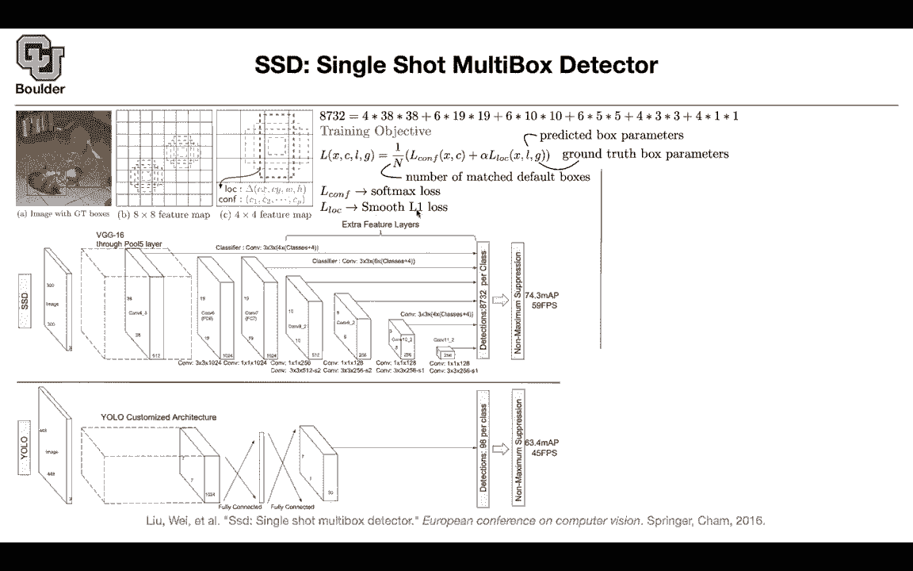

---

## 默认框的尺度和长宽比

默认框是 SSD 的重要组成部分。它们的尺度和长宽比是如何设定的呢？

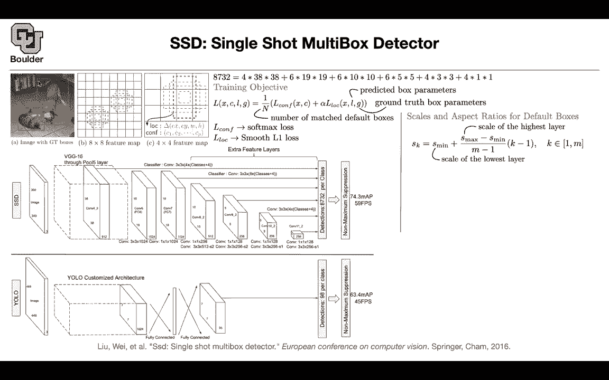

**尺度（Scale）**：
*   设定一个最小尺度（如 0.2）和一个最大尺度（如 0.9）。
*   对于不同层的特征图，其对应的默认框尺度在这两个值之间线性插值得到。
*   浅层特征图（分辨率高）对应小尺度，用于检测小物体。
*   深层特征图（分辨率低）对应大尺度，用于检测大物体。

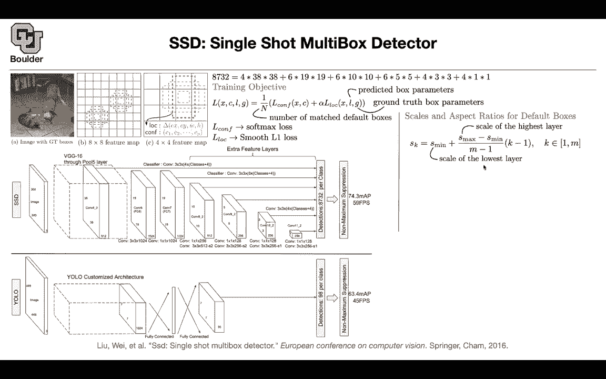

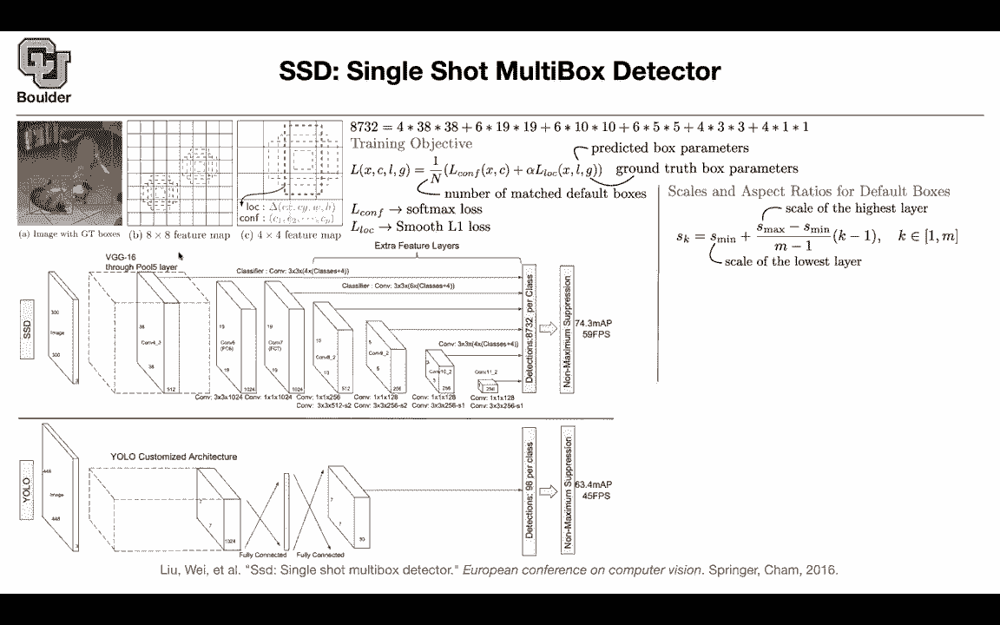

**长宽比（Aspect Ratio）**：
通常选择一组比例，例如：`ar ∈ {1, 2, 3, 1/2, 1/3}`。
对于一个给定的尺度和长宽比，默认框的宽度和高度计算如下：
```
w = scale * sqrt(ar)
h = scale / sqrt(ar)
```
当长宽比为 1 时，会额外增加一个尺度为 `scale' = sqrt(scale * scale_next)` 的默认框。

在某些层（如 1×1 和 3×3 的特征图），可能会省略 `3` 和 `1/3` 这两种极端的长宽比，主要是为了减少计算量，因为这些尺度下的物体可能不需要如此多的框形状变化。

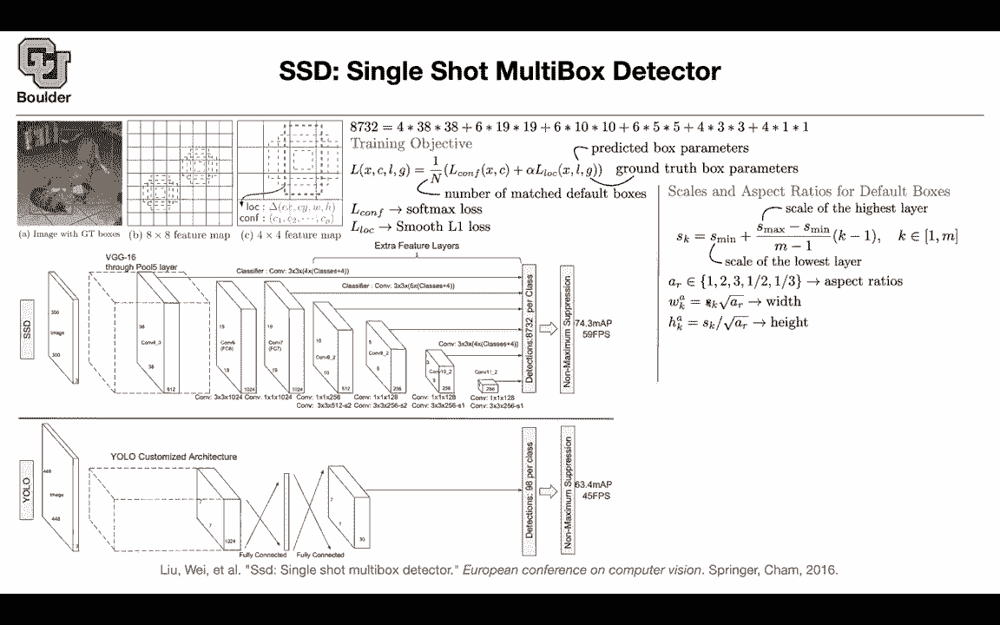

---

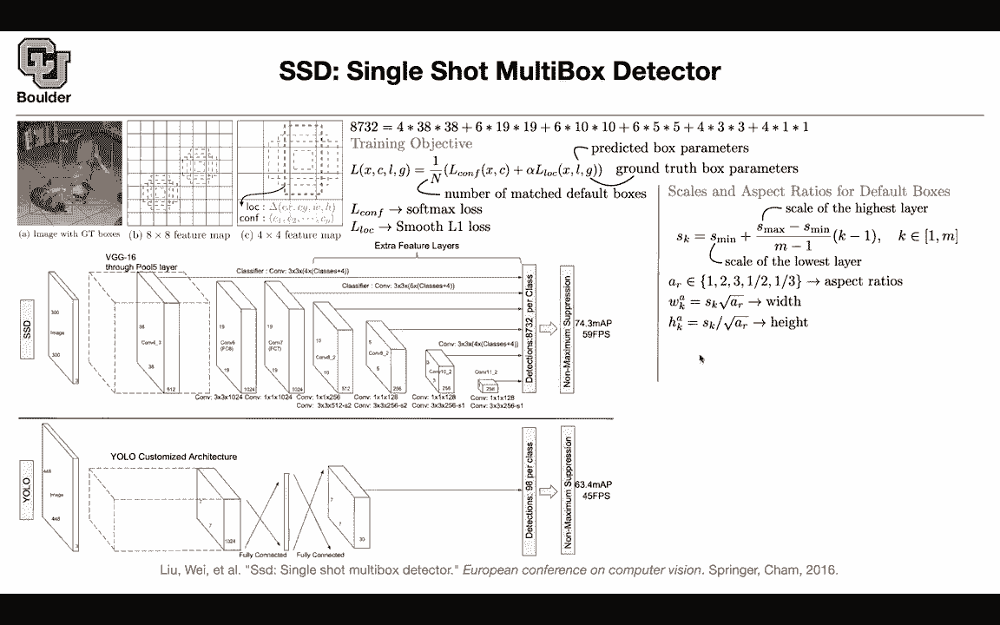

## SSD 的性能对比

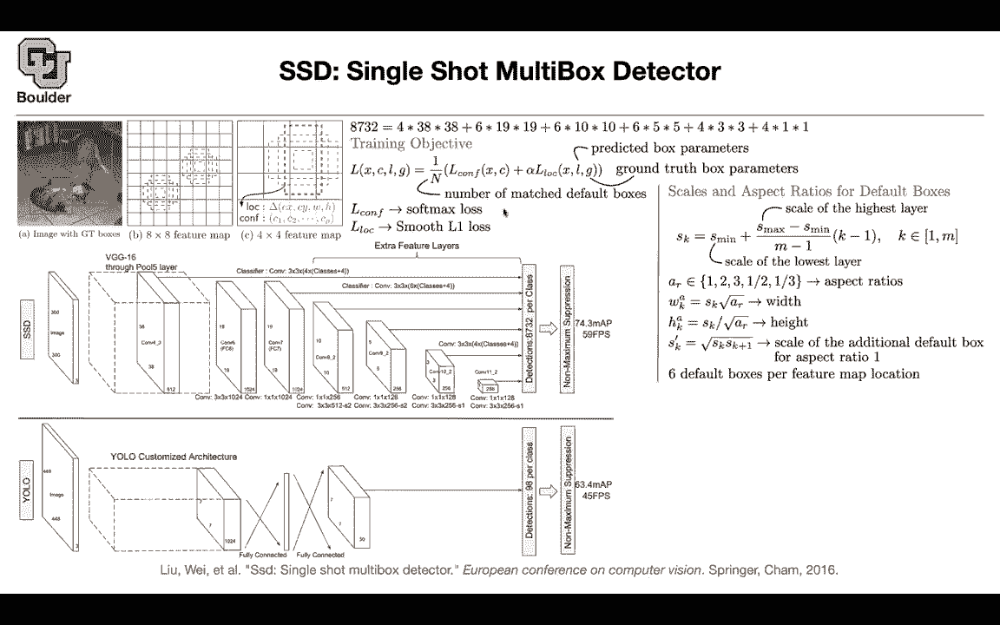

让我们看看 SSD 与当时其他主流算法的性能对比（在 VOC2007 测试集上）：

| 模型 | 骨干网络 | mAP | FPS |
| :--- | :--- | :--- | :--- |
| Faster R-CNN | VGG16 | 73.2 | 7 |
| Faster R-CNN | ZF | 62.1 | 17 |
| YOLO | 定制 | 63.4 | 45 |
| **SSD300** | **VGG16** | **74.3** | **46** |
| **SSD512** | **VGG16** | **76.8** | **19** |

从对比中可以看出：
*   SSD300 在速度上与 YOLO 相当（46 FPS vs 45 FPS），但精度（mAP）显著高于 YOLO，甚至超过了更慢的 Faster R-CNN。
*   SSD512 通过使用更大输入图像获得了更高的精度，速度依然可观。

SSD 的成功在于它巧妙地融合了 YOLO 的单阶段快速思想和 Faster R-CNN 的锚框机制，并通过多尺度特征图预测极大地提升了检测性能。

---

## 总结

本节课中，我们一起学习了 SSD 目标检测算法。

*   我们首先回顾并澄清了 YOLO 算法中网格单元预测的机制。
*   接着，我们了解到 SSD 的核心改进在于**利用多个不同尺度的特征图进行预测**，从而生成大量（如8732个）默认框，以覆盖各种大小和形状的物体。
*   我们分析了 SSD 的损失函数，它由分类损失（交叉熵）和定位损失（Smooth L1）组成。
*   我们还详细讲解了默认框的尺度和长宽比设计原则，这是 SSD 能够有效检测多尺度物体的关键。
*   最后，通过性能对比，我们看到 SSD 在速度和精度之间取得了出色的平衡，实现了其设计目标。

SSD 是目标检测发展史上的一个重要里程碑，它展示了如何通过精妙的系统设计，将已有算法的优点结合起来，推动整个领域向前发展。