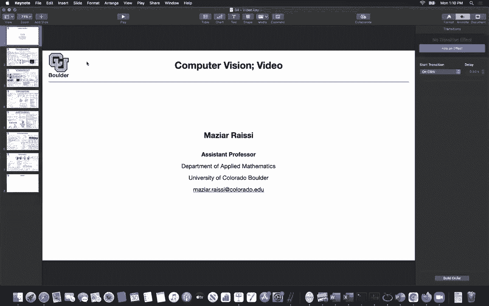
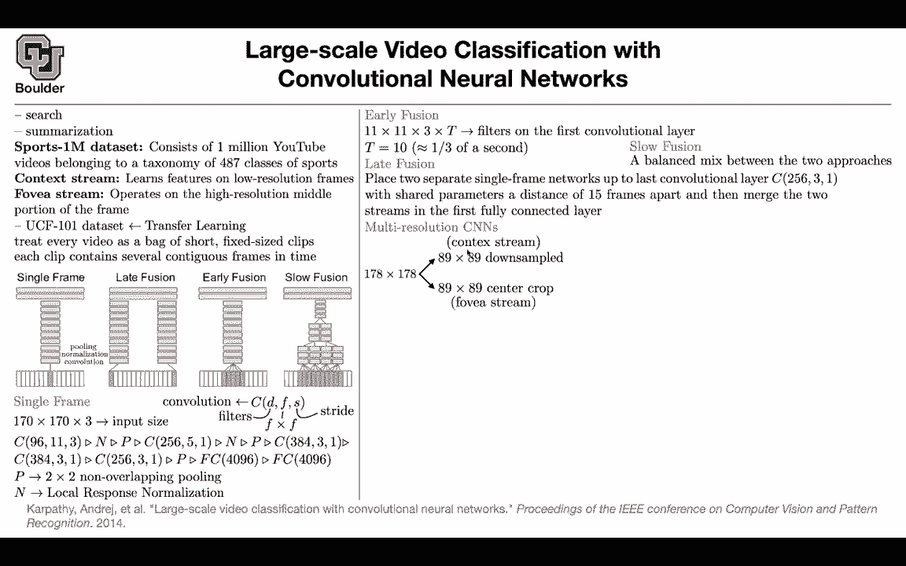

# 88：L40.3 - 视频分类 🎥



在本节课中，我们将学习视频分类的基本概念和方法。视频分类是计算机视觉中的一个重要任务，其目标是对给定的视频内容进行分类，例如识别视频中发生的动作。我们将探讨如何处理视频数据、不同的网络架构设计以及如何通过迁移学习提升模型性能。

---

## 视频分类的重要性与应用

视频分类之所以重要，是因为它有广泛的应用场景。一个主要应用是视频搜索。当视频被正确分类后，用户可以通过文本轻松搜索到特定类别的视频，例如查找所有关于足球或篮球的视频。

另一个应用是视频摘要。通过分类，我们可以了解视频的主要内容，从而生成视频摘要。与图像不同，视频可以视为一系列短片段（clip）的集合，每个片段包含若干连续的帧（frame）。因此，视频数据本质上是时空序列数据，空间维度是图像帧，时间维度是连续的帧序列。

---

## 数据集介绍：Sports-1M

构建数据集是一项艰巨的任务。本课程介绍的数据集是 **Sports-1M**。该数据集包含一百万个从YouTube获取的视频。每个YouTube视频都有其标题，经过数据清洗后，最终确定了 **487** 个体育类别。这个大规模数据集为视频分类研究提供了丰富的资源。

---

## 双流网络架构

我们将使用的网络架构包含两个流（stream）：**上下文流（context stream）** 和 **焦点流（fovea stream）**。

上下文流负责查看低分辨率的完整帧，以捕捉视频的整体背景信息。焦点流则关注高分辨率的帧中心区域，以捕捉空间上的精细细节。这种设计旨在同时利用全局上下文和局部细节信息。稍后我们将详细介绍这两个流的具体实现。

---

## 迁移学习与UCF-101数据集

在Sports-1M数据集上训练网络后，我们可以进行迁移学习，将学到的知识应用到其他数据集上。一个经典的视频动作识别数据集是 **UCF-101**，它包含 **101** 个动作类别，但数据规模远小于Sports-1M。通过迁移学习，我们可以提升模型在UCF-101等较小数据集上的性能。

---

## 视频处理：从视频到片段

一个视频（例如一段5分钟的YouTube视频）可以被视为一系列固定长度的短片段（clip）的集合。如果我们有一个能够对单个片段进行分类的分类器，那么对整个视频进行分类就会变得容易。

具体方法是：首先对视频中的每个片段进行分类，得到一系列预测结果。然后，这些预测结果可以通过投票机制（例如对概率取平均）来决定整个视频的最终类别。每个片段包含若干在时间上连续的帧，因此构成了一个时空序列。

---

## 基线方法：单帧分类

一种简单的视频分类思路是忽略时间信息，只关注视频中的**单个帧**。我们可以从片段中选取一帧图像，然后应用标准的卷积神经网络（CNN）进行预测。

以下是单帧分类网络的一个示例结构：

```python
# 示例：单帧处理流程
输入帧 -> 卷积层(C) -> 归一化层(Norm) -> 池化层(Pool) -> ... -> 全连接层(FC) -> 输出
```

其中，卷积层参数可能为 `C(96, 11, 3, 1)`，表示使用96个大小为11x11的滤波器，步长为3。归一化层可以是局部响应归一化（LRN，源于AlexNet）或更现代的批归一化（BatchNorm）。池化层通常使用2x2的非重叠最大池化。网络的最后是全连接层，输出对应类别的概率。

---

## 融合策略：早期、晚期与慢速融合

除了单帧方法，还有三种主要的融合策略来处理多帧信息：

以下是三种融合策略的简要说明：

1.  **早期融合（Early Fusion）**：在网络的第一层就融合时间信息。具体做法是将连续T帧堆叠在一起，作为网络的输入。第一层卷积核的尺寸变为 `11 x 11 x T`（T为帧数），在空间维度上进行滑动卷积，但在时间维度上不滑动。这类似于3D卷积，但时间维度是固定的输入。
2.  **晚期融合（Late Fusion）**：使用两个独立的单帧网络分别处理不同时间点的帧。在网络的后期（例如全连接层之前），将两个网络的特征进行拼接（concatenate），再送入最终的全连接层进行分类。
3.  **慢速融合（Slow Fusion）**：这是早期融合和晚期融合的折中方案。网络中有多个阶段会进行特征融合，逐步地在时空维度上整合信息。研究表明，在处理片段（clip）时，慢速融合通常能取得最佳效果。

---

## 双流网络的具体实现



现在，让我们详细看看上下文流和焦点流的具体操作。

对于**上下文流**，我们会将完整的帧图像下采样至较低的分辨率（例如89x89），以便网络能够关注整个画面的上下文信息。

对于**焦点流**，我们会从帧的中心裁剪出一块高分辨率区域。这个流专注于图像中心区域的精细空间细节。

这两个流是独立的网络分支，它们处理不同分辨率、不同区域的输入。最终，两个流的特征会被融合，共同用于视频分类决策。

---

## 实验结果与分析

实验结果表明，不同的方法在精度上表现不同。

在仅使用单帧图像进行分类时，采用**多分辨率（双流）** 的方法表现最佳。如果考虑使用多个片段进行投票，并允许真实类别出现在预测概率前五名（Top-5 Accuracy）中，准确率可以达到78%。

在处理整个视频时（即聚合多个片段的预测结果），**慢速融合**策略通常表现最好。这证明了利用时间信息对提升视频分类精度至关重要。

---

## 时间信息的重要性

为什么时间信息如此重要？让我们看一个例子。假设一个视频的真实类别是“杂耍球棒（juggling club）”。如果仅基于单帧图像进行分类，模型可能会错误地预测为“杂技（acrobatic）”或其他不相关的类别。然而，当模型能够分析连续帧之间的运动信息时，它就能做出正确的“杂耍球棒”预测。这个例子清晰地展示了时间上下文对于理解视频内容的必要性。

---

## 总结与展望

本节课中，我们一起学习了视频分类的基础知识。我们了解了视频分类的应用价值，介绍了Sports-1M和UCF-101数据集，探讨了将视频分解为片段进行处理的方法。我们重点分析了单帧分类基线方法，以及早期、晚期、慢速三种融合策略。最后，我们深入讲解了结合全局上下文与局部细节的双流网络架构，并通过实验结果认识到时间信息对于视频理解的關鍵作用。

在接下来的课程中，我们将继续探讨视频相关的主题。之后，我们将开始学习处理**3D数据**（如激光雷达LiDAR采集的点云数据），因为现实世界是三维的，我们需要掌握处理这类数据的方法。关于循环神经网络（RNN/LSTM）在视频序列建模中的应用，我们将在后续学期中深入讨论。目前，由于计算效率等原因，研究社区更倾向于使用注意力机制和Transformer等易于并行化的架构来处理序列数据。

---
**本节课中，我们一起学习了视频分类的核心概念、数据处理方法、不同的网络融合策略以及双流网络的设计思想。**