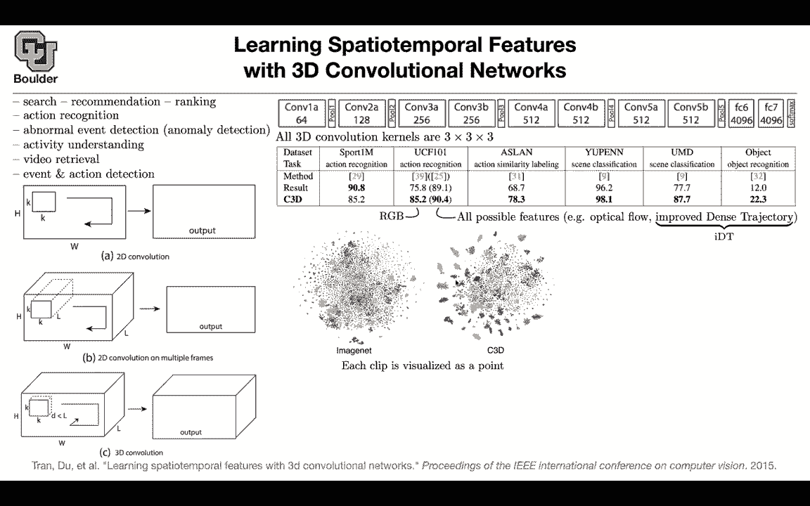

# 90：L41.2 - 三维卷积网络 🎥

在本节课中，我们将要学习三维卷积网络（3D Convolutional Networks）的核心概念、应用场景及其工作原理。我们将探讨如何将时间维度视为额外的空间维度，并利用3D卷积来处理视频等时序数据。

## 概述

上一节我们介绍了处理视频数据的背景，本节中我们来看看如何将时间维度整合到卷积操作中。一个核心想法是使用三维卷积，将时间视为与图像高度和宽度并列的另一个维度。

## 三维卷积的应用场景

三维卷积网络在多个领域有广泛的应用。以下是其主要应用方向：

*   **搜索、推荐与排序**：可以用于视频内容的搜索和推荐系统。
*   **行为识别**：识别视频中人物的动作。
*   **异常检测**：例如，利用城市中已有的道路监控摄像头，检测如醉驾等异常行为。这对于智慧城市建设非常有用，且无需大规模改变现有基础设施。
*   **活动理解**：理解视频中正在发生的活动内容。
*   **视频搜索与相似度比对**：从视频中提取特征后，可以回答“这两个视频有多相似”这类问题，进而用于视频搜索结果的排序。

## 从2D卷积到3D卷积

在标准的2D图像卷积中，我们有一个高度为 `H`、宽度为 `W` 的图像。我们使用一个大小为 `k x k` 的卷积核，在图像的空间维度（高度和宽度）上进行滑动，从而得到卷积输出。

为了处理包含 `L` 帧的视频，一种早期方法是进行**2D卷积跨多状态**。具体操作是，将 `L` 帧时间序列中的所有帧作为输入，但卷积核仅在每一帧的2D空间上滑动。在时间维度上，操作仅仅是输入与滤波器进行点积和平均，这本质上是一个跨帧的简单聚合。

另一种更强大的思路是使用**3D卷积**。此时，卷积核具有三个维度：空间维度（`k x k`）和时间维度（`t`）。因此，一个3D卷积核的大小可以表示为 `k x k x t`。

与2D卷积只在空间维度滑动不同，3D卷积核会在**所有三个维度（高度、宽度、时间）上滑动**。这意味着它同时捕捉了空间和短时序上的局部模式。

## 3D卷积网络的结构与参数

一个完整的3D卷积网络宏观结构通常包含多个3D卷积层和池化层交替堆叠，最后连接全连接层进行分类或回归。

关于参数数量，**3D卷积通常比处理相同长度序列的2D卷积拥有更少的参数**，这使得模型更紧凑。

需要明确的是，在3D卷积中，每个卷积核会同时观察多个连续帧（例如 `t` 帧）。随着网络层数的加深，深层卷积的感受野在时间维度上也会增大。例如，两个连续的 `3x3x3` 卷积层，第二层在时间维度上的有效感受野会覆盖大约5帧。

关于RGB通道的处理，可以将颜色通道（如R、G、B）视为额外的维度（类似于第四维）。在实际实现中，这通常通过让卷积核在输入通道维度上进行扩展来处理。

## 性能对比与可视化

研究人员在多个数据集（如Sports-1M, UCF101等）上对比了不同方法的性能。C3D（即3D卷积网络）作为当时提出的方法，在多个数据集上取得了有竞争力的结果。

特别地，在参数更少的情况下，C3D在较小的数据集上表现优异。而在像Sports-1M这样的大数据集上，参数量更大的2D卷积方法可能因模型容量更大而获得更好结果。此外，如同前一节课所学，在输入中融合光流等特征可以进一步提升模型性能。

通过特征可视化可以直观比较模型的能力。例如，将在ImageNet上预训练的2D网络与C3D网络分别作为特征提取器，处理UCF101数据集的视频片段，并使用t-SNE将高维特征降维至2D进行可视化。

结果显示，**C3D提取的特征能够比ImageNet 2D网络的特征更好地区分不同的动作类别**，各类别的聚类更紧密、分离更清晰。

在运行效率方面，3D卷积因其参数效率和计算效率，通常比其他一些复杂的视频理解方法更快，可以作为高效的基准模型。

## 总结

本节课中我们一起学习了三维卷积网络。我们了解了其将时间作为第三维进行卷积的核心思想，探讨了它在行为识别、异常检测等多个领域的应用。我们对比了2D卷积与3D卷积的差异，明确了3D卷积在参数效率和时空特征联合建模上的优势。最后，通过性能对比和特征可视化，我们看到了C3D模型在实际任务中的有效性和高效性。