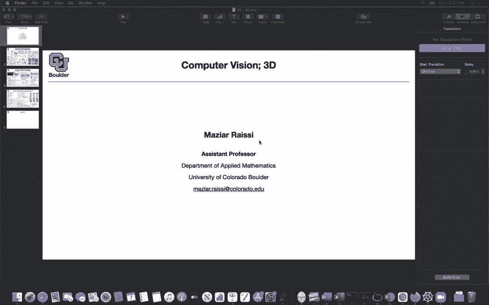
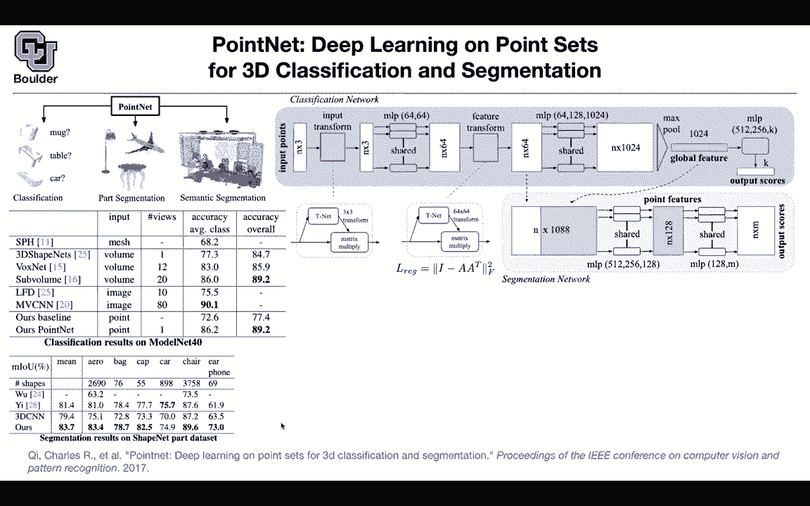

# 94：PointNet 点云处理入门 📦



在本节课中，我们将学习如何利用深度学习处理三维点云数据。点云数据不同于图像，它是一组无序的三维坐标点。我们将探讨如何设计一个能够处理这种无序数据并完成分类与分割任务的神经网络模型。

---

## 🌍 三维世界与点云数据

我们周围的世界是三维的。人类通过眼睛接收光线，并在大脑中形成三维感知。计算机传统上通过图像和卷积神经网络来“看”世界，但更接近人类感知的方式可能是直接处理三维数据。

一种获取三维数据的方式是使用激光雷达或结构光传感器。激光雷达通过发射和接收激光来测量距离，最终生成一组三维点，每个点包含 `(x, y, z)` 坐标。此外，每个点还可以附带颜色、法向量等特征。这些点的集合就构成了点云。

点云数据的关键特性是**无序性**。无论点集中的点如何排列，只要点的集合不变，它描述的就是同一个物体。因此，处理点云的任何方法都必须是**置换不变**的。

---

## 🎯 点云的应用与任务

点云处理在自动驾驶、机器人、室内导航等领域有广泛应用。我们主要关注以下三个任务：

以下是点云处理的三个核心任务：

1.  **分类**：识别整个点云所代表的物体类别（例如，判断是椅子还是桌子）。
2.  **部件分割**：识别物体中各个组成部分（例如，分割出飞机的机翼、机身、尾翼）。
3.  **语义分割**：为场景中的每个点赋予一个语义标签（例如，区分墙、地板、家具）。

---

## 💡 处理点云的思路

上一节我们介绍了点云数据的特性，本节中我们来看看处理它的几种思路。

一种传统思路是将点云**体素化**，即将三维空间划分为规则的小立方体（体素），然后使用三维卷积神经网络进行处理。但这种方法的问题是数据通常非常稀疏，会浪费大量计算资源。

另一种更直接的思路是**直接处理原始点云**。输入是 `N` 个点，每个点有 `C` 个特征（例如 `x, y, z`）。`N` 可以变化，不同物体的点数不同。我们的目标是设计一个网络，能够接受这种可变长度的、无序的点集作为输入，并输出任务所需的结果（如 `K` 个类别的分数）。

---

## 🧠 PointNet 网络架构

PointNet 是一个开创性的、直接处理点云的神经网络。其核心思想是通过共享的多层感知机独立处理每个点，然后使用一个对称函数（如最大值池化）来聚合全局信息，从而保证置换不变性。

### 输入变换

首先，网络学习一个 `3x3` 的变换矩阵，对输入点云的坐标进行对齐或规范化。这类似于空间变换网络中的思想。

```python
# 伪代码表示输入变换
# 输入: points (N x 3)
# 输出: transformed_points (N x 3)
transformation_matrix = learnable_network(points) # 输出 3x3 矩阵
transformed_points = points @ transformation_matrix
```

### 特征提取

接着，每个点独立地通过一个共享权重的多层感知机，将特征维度从 3 提升到更高维度（例如 64）。

```python
# 对每个点独立应用相同的 MLP
# 输入: transformed_points (N x 3)
# 输出: point_features (N x 64)
point_features = shared_mlp(transformed_points)
```

在更高维的特征空间，可以再次应用一个特征变换（例如 `64x64` 的矩阵），以学习更优的特征表示。

### 全局特征聚合

这是保证置换不变性的关键步骤。我们使用一个对称函数（如**最大值池化**）将所有点的特征聚合为一个全局特征向量。

```python
# 使用最大池化聚合全局特征
# 输入: point_features (N x 1024)
# 输出: global_feature (1 x 1024)
global_feature = max_pooling(point_features, dim=0) # 沿 N 个点取最大值
```

无论点的顺序如何排列，最大值池化得到的结果都是相同的。

### 分类输出

最后，将全局特征向量通过另一个 MLP，输出 `K` 个类别的分数，用于分类任务。

```python
# 分类头
# 输入: global_feature (1 x 1024)
# 输出: class_scores (1 x K)
class_scores = mlp_classifier(global_feature)
```

整个分类流程可以概括为：**点云 -> 坐标变换 -> 逐点特征提取 -> 特征变换 -> 全局池化 -> 分类**。

---

## ✂️ 点云分割任务

上一节我们介绍了如何用 PointNet 进行分类，本节中我们来看看如何将其扩展到分割任务。

分割任务需要结合**全局特征**和**局部特征**。全局特征让我们知道“这是什么物体”，局部特征则提供每个点的精细细节。

PointNet 的分割网络在分类网络的基础上进行扩展：

1.  从分类网络中获取中间层的局部特征（例如 `N x 64`）和最终的全局特征（`1 x 1024`）。
2.  将全局特征向量复制 `N` 次，与每个点的局部特征拼接起来，形成 `N x (64+1024)` 的特征。
3.  将这个融合后的特征通过一系列共享的 MLP，最终为每个点输出 `M` 个分数（`M` 是分割类别数）。

```python
# 分割网络结构示意
local_features = get_from_middle_layer() # N x 64
global_feature = get_global_vector() # 1 x 1024
repeated_global = global_feature.repeat(N, 1) # N x 1024
combined_features = concat(local_features, repeated_global) # N x 1088
per_point_scores = shared_mlp(combined_features) # N x M
```

这样，网络就能同时利用场景的全局上下文和每个点的局部信息，为每个点做出精确的预测。

---

## ⚙️ 训练细节与正则化

在特征变换层（如 `64x64` 的变换矩阵），由于参数较多，直接训练可能导致过拟合。一个有效的技巧是添加**正则化损失**，鼓励该变换矩阵接近正交矩阵（如单位矩阵）。



总损失函数由任务损失（如交叉熵损失）和正则化损失共同构成：
`总损失 = 分类/分割损失 + λ * ||I - AA^T||^2`
其中 `A` 是学到的变换矩阵，`I` 是单位矩阵，`λ` 是权重系数。

---

## 📊 性能与总结

PointNet 架构非常简单，但在点云分类和分割任务上取得了当时领先的性能。它在 ModelNet40 数据集上的分类准确率很高，在 ShapeNet 部件分割数据集上的平均交并比也表现优异。

此外，PointNet 对输入点云的**分辨率不敏感**。即使输入的点数大幅减少（下采样），其性能下降也相对平缓，展现了良好的鲁棒性。

**总结**：本节课我们一起学习了 PointNet 这一处理三维点云的基础深度学习模型。我们了解了点云数据的特性（无序、稀疏），掌握了 PointNet 通过共享 MLP 和对称聚合函数实现置换不变性的核心思想，并看到了其如何应用于分类和分割任务。PointNet 以其简洁的架构和强大的性能，为后续的点云处理研究奠定了重要基础。