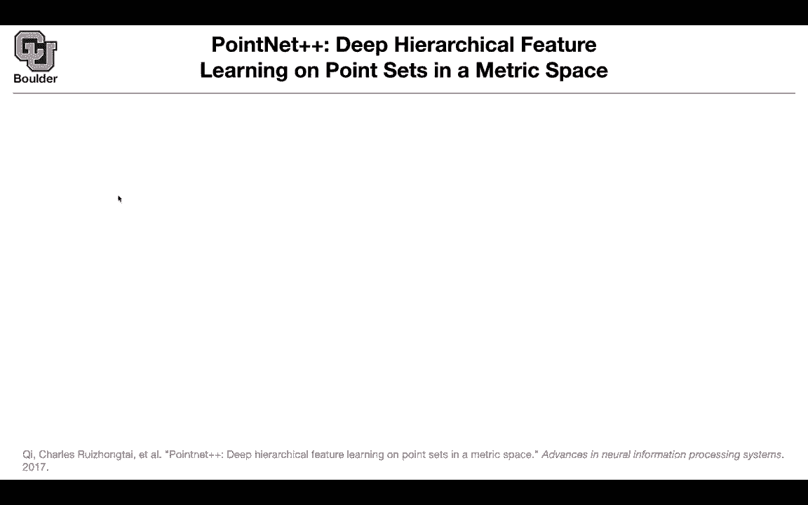
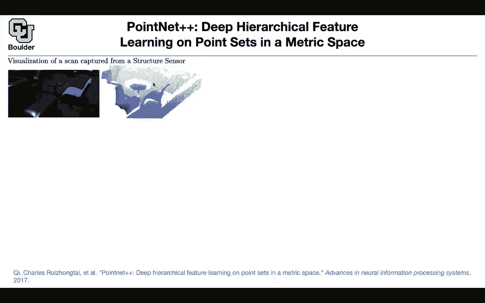
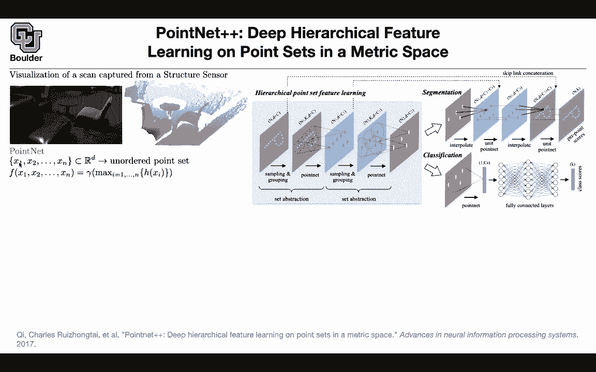
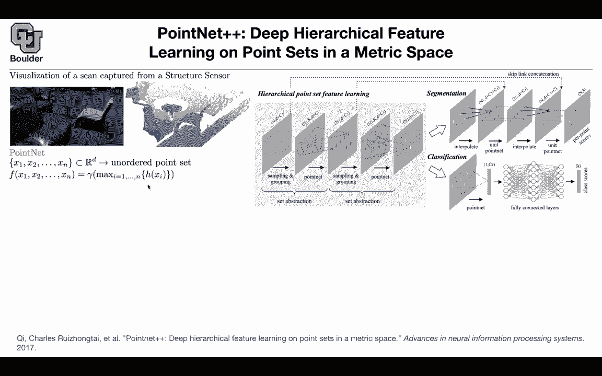
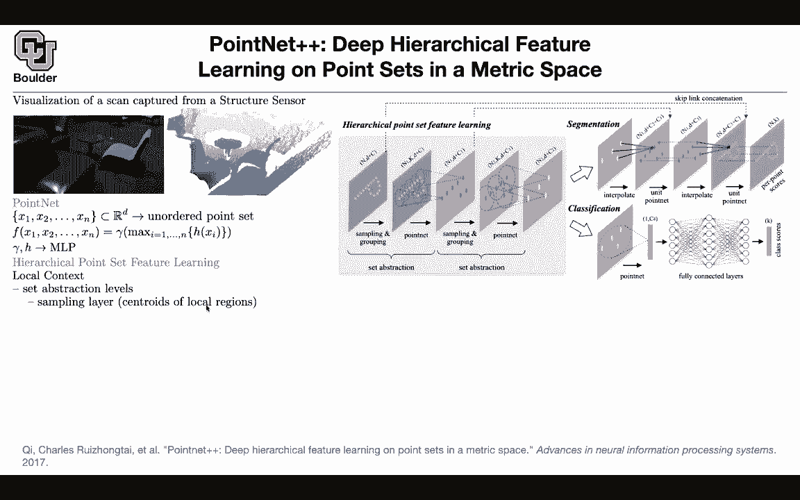
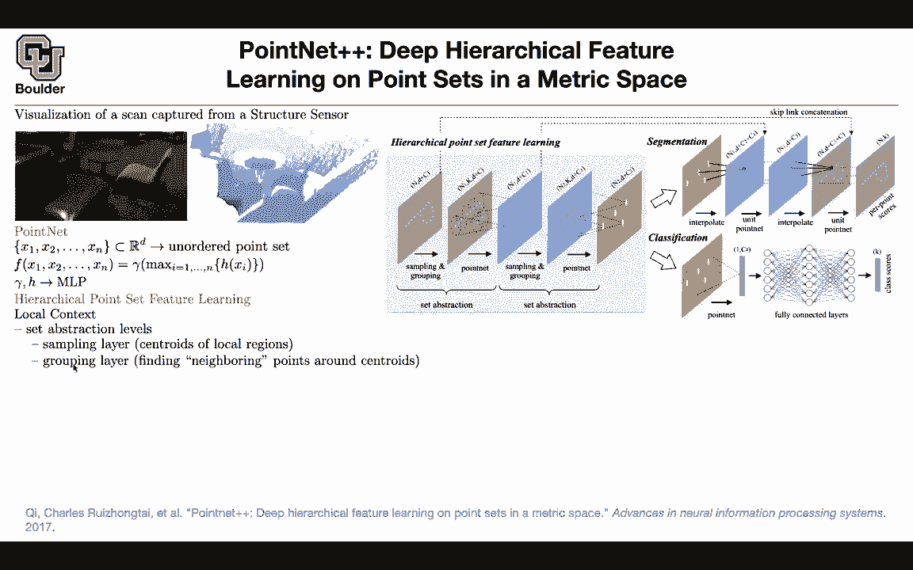
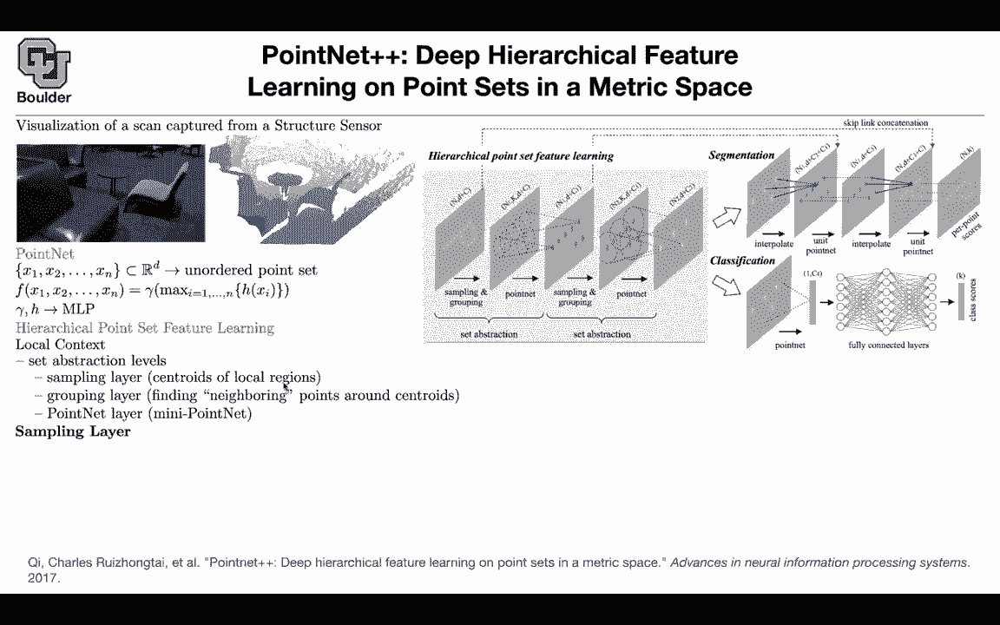
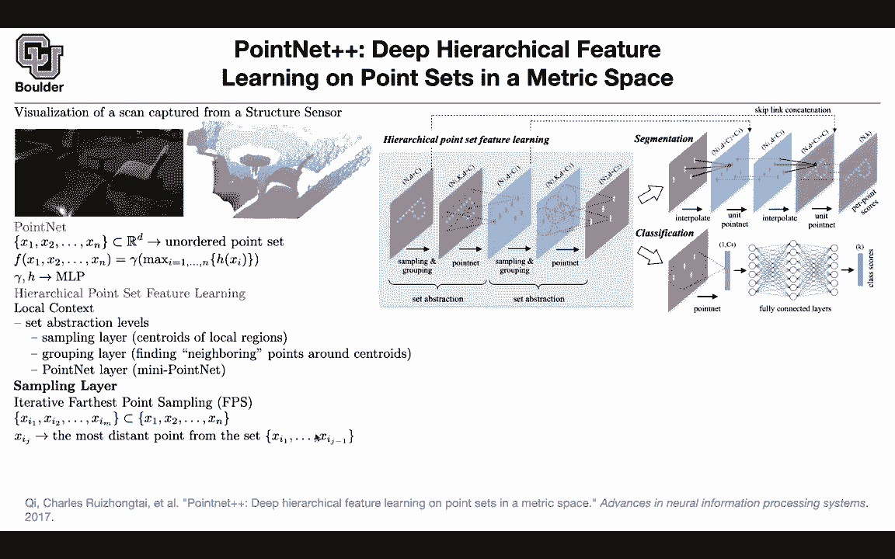

# 95：L43.2 - PointNet++ 详解 📚

在本节课中，我们将学习 PointNet++ 的核心思想与方法。PointNet++ 旨在解决原始 PointNet 模型在处理点云数据时忽略局部特征的问题，通过引入层次化特征学习机制，更好地捕捉点云的局部结构信息。

---

## 🔍 问题背景与动机

上一节我们介绍了 PointNet 的基本原理。PointNet 虽然能有效处理无序点集，但它对每个点独立应用相同的函数，缺乏对局部邻域信息的利用。PointNet++ 正是为了弥补这一不足而设计的。

点云数据通常由深度传感器（如结构光传感器）采集。下图展示了同一场景的两种传感器视图：

然而，点云数据存在一些固有挑战：

*   局部点缺失：某些区域可能没有采集到点。
*   分辨率不均：点云密度在不同区域差异很大，有些区域非常密集，有些则非常稀疏。

我们设计的方法必须能够处理这种非均匀采样的点云数据。

---

## 🏗️ PointNet++ 核心架构

PointNet++ 的核心思想是**层次化点集特征学习**。其基本构建模块是 **集合抽象层**。

下图展示了 PointNet++ 与 PointNet 的对比：

在 PointNet 中，输入是 `N × (3+C)` 的点集（N 个点，每个点有 3 维坐标和 C 维额外特征）。每个点独立通过一个多层感知机（MLP），然后对所有点的特征进行最大池化，最后再通过一个 MLP 得到全局特征。

PointNet++ 的集合抽象层包含三个关键步骤，我们将逐一详解。

### 步骤一：采样层

采样层的目标是找到局部区域的**中心点**（或称质心）。

以下是采样层的具体操作：

*   **输入**：点集 `{x1, x2, ..., xN}`。
*   **目标**：从中选出 `M` 个点作为局部区域的中心。
*   **方法**：使用**最远点采样**算法。
    *   算法从一个随机点开始。
    *   每次迭代，选择距离当前已选点集**最远**的点加入集合。
    *   重复直到选出 `M` 个点。
*   **优势**：这种方法能更好地覆盖整个空间，通常比聚类方法效果更好。

### 步骤二：分组层

分组层的目标是为每个上一步找到的中心点，找出其**邻域内的点**。

以下是分组层的具体操作：

*   **输入**：`N` 个原始点和 `M` 个中心点。
*   **目标**：为每个中心点构建一个局部点集。
*   **方法**：使用**球查询**。
    *   为每个中心点设定一个搜索半径 `r`。
    *   将所有与中心点距离小于 `r` 的点归入其邻域。
    *   邻域内点的数量 `K` 是可变的，取决于该区域的点密度。
*   **对比**：与固定 `K` 的 K-最近邻方法相比，球查询能更好地适应点云密度变化，避免将不同物体的点错误地归入同一组。

**关于超参数 `r` 的说明**：搜索半径 `r` 是一个需要调整的超参数。通常使用验证集来微调这个参数，并研究模型对 `r` 的敏感性。

### 步骤三：PointNet 层

此步骤将一个小型的 PointNet 网络应用于每个局部点集，以提取局部特征。

以下是 PointNet 层的具体操作：

*   **输入**：`M` 个局部点集，每个集合包含 `K` 个点，每个点为 `(3+C)` 维。
*   **关键技巧**：使用**相对坐标**以实现参数共享。
    *   将每个邻域内点的坐标减去其中心点的坐标：`x_i^{(l)} = x_i^{(l-1)} - \hat{x}^{(l)}`。
    *   这使得网络能够像卷积神经网络一样，在不同局部区域共享权重。
*   **处理**：每个归一化后的局部点集通过一个共享权重的 MLP（小型 PointNet）。
*   **输出**：得到 `M` 个新的特征点，每个点代表其对应局部区域的特征。

通过重复堆叠多个集合抽象层，PointNet++ 能够构建一个层次化的特征表示，从局部到全局逐步抽象。

---

## 🛠️ 处理非均匀密度的策略

点云数据的密度通常是非均匀的。PointNet++ 提出了两种主要策略来处理这个问题。

### 策略一：多尺度分组

以下是多尺度分组的具体操作：

*   **思路**：在同一层级，使用多个不同尺寸（半径）的球查询来分组。
*   **操作**：对每个中心点，分别用半径 `r1, r2, ...` 进行分组，得到多个不同尺度的局部点集。
*   **处理**：每个尺度的点集分别通过一个 PointNet 层提取特征。
*   **融合**：将不同尺度提取的特征连接起来，作为该中心点的最终特征。
*   **缺点**：计算量较大，因为需要处理多个尺度的数据。

### 策略二：多分辨率分组

以下是多分辨率分组的具体操作：

*   **思路**：借鉴图像金字塔思想，从低分辨率（大尺度）和高分辨率（小尺度）两个层面提取特征并融合。
*   **操作**：
    1.  从原始点云提取一组低分辨率特征（使用较大的半径）。
    2.  同时，对原始点云应用一个集合抽象层，得到一组高分辨率特征点。
    3.  将低分辨率特征通过插值上采样到高分辨率点的位置。
    4.  将上采样后的低分辨率特征与高分辨率特征连接起来。
*   **优点**：相比多尺度分组，这种方法通常计算效率更高。

此外，还可以使用**数据增强**来提升模型对密度变化的鲁棒性。

以下是具体的数据增强方法：

*   **随机输入丢弃**：对于每个训练样本，随机丢弃一定比例的点。
*   **操作**：
    1.  从均匀分布 `U(0, p)` 中采样一个随机数 `θ`。
    2.  以概率 `θ` 随机丢弃点云中的点，只保留大约 `θ` 比例的点。
*   **作用**：模拟不同采样密度，迫使模型学习更鲁棒的特征。

---

## 🎯 任务扩展：分类与分割

PointNet++ 可以用于点云分类和分割任务。

### 点云分类

对于分类任务，流程相对直接：

1.  输入点云通过多个集合抽象层，逐步抽象，最终得到一组数量较少的特征点。
2.  对这组特征点应用一个全局的 PointNet（或 MLP）进行聚合。
3.  最后通过全连接层输出分类得分。

### 点云分割

分割任务需要为**每个原始点**分配一个标签，因此需要将特征上采样回原始分辨率。

以下是分割网络的关键步骤：

1.  **编码路径**：与分类网络相同，通过集合抽象层进行下采样和特征提取。
2.  **解码路径**：通过**特征传播层**进行上采样。
    *   **目标**：将低分辨率 `L` 层的特征 `(N_l × (3+C))` 传播到高分辨率 `L-1` 层的点 `(N_{l-1} × 3)` 上。
    *   **方法**：使用**逆距离加权插值**。
        *   对于 `L-1` 层的每个点 `x`，找到 `L` 层中距离它最近的 `k` 个点。
        *   插值特征 `f(x)` 由这 `k` 个点的特征加权平均得到，权重 `w_i` 与距离成反比：

        `f^{(l-1)}(x) = \frac{\sum_{i=1}^{k} w_i(x) f^{(l)}(x_i)}{\sum_{i=1}^{k} w_i(x)}`，其中 `w_i(x) = \frac{1}{d(x, x_i)^p}`

        *   所有权重之和为 1，保证了插值的稳定性。
3.  **跳跃连接**：将上采样后的特征与编码路径中对应层级的特征连接起来，以恢复细节信息。
4.  **逐点预测**：最后通过共享的 MLP 为每个点预测类别标签。

---

## 📝 总结

本节课我们一起学习了 PointNet++ 模型。作为 PointNet 的改进，PointNet++ 通过引入层次化的集合抽象层，巧妙地结合了采样、分组和小型 PointNet 处理，有效捕捉了点云的局部结构特征。我们还探讨了其处理非均匀密度点云的策略（多尺度/多分辨率分组、数据增强），以及如何将其应用于分类和分割任务。PointNet++ 为直接在点集上进行深度学习提供了更强大的框架。