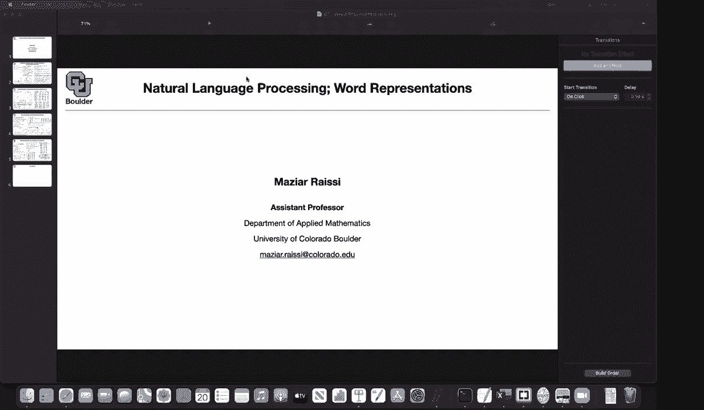
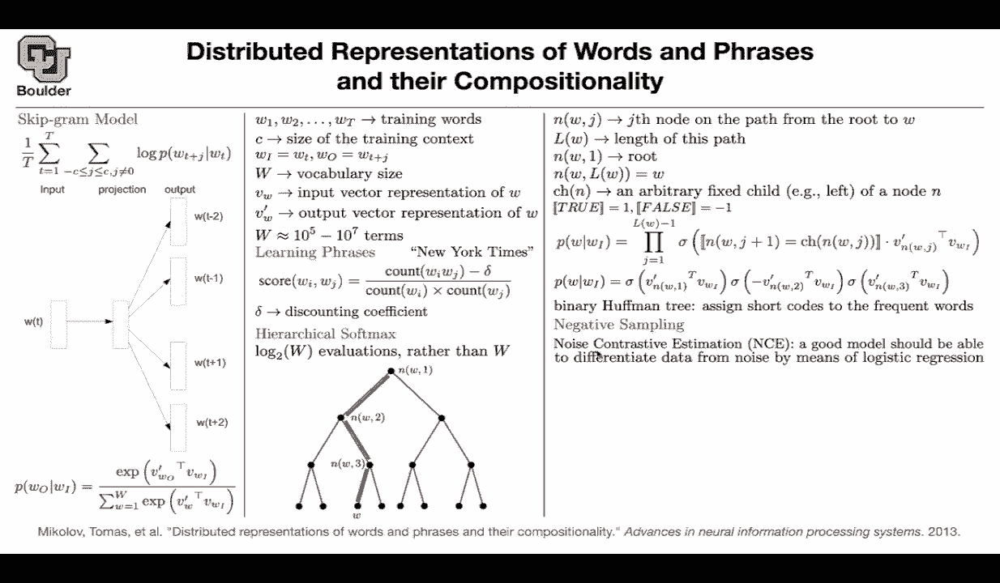

# 97：L44&L45 - Word2Vec 教程 📚



在本节课中，我们将学习自然语言处理中的一个核心概念：如何让计算机理解并“表示”词语。我们将从最基础的问题出发，探讨如何将词语转化为计算机可以处理的数字形式（即向量），并详细介绍 **Word2Vec** 模型，特别是其 **Skip-gram** 架构。我们将学习模型的构建、训练、优化以及评估方法。

---

## 🤔 如何表示词语？

上一节我们提出了核心问题：如何为计算机表示词语？人类可以直观地理解词语，但计算机只理解数字。

一种简单的方法是为词汇表中的每个词分配一个编号，例如“分布式”是1，“表示”是2。但这存在严重问题：数字本身不包含任何语义信息，计算机无法理解编号1和2之间是否存在关联。

另一种常见方法是使用 **独热编码**。假设词汇表大小为100万，每个词对应一个100万维的向量，只有该词对应的位置是1，其余全为0。例如：
```python
“分布式” = [1, 0, 0, 0, ..., 0]
“表示” = [0, 1, 0, 0, ..., 0]
```
这种方法同样存在问题：
1.  向量维度极高且稀疏，计算效率低。
2.  任意两个词向量的点积都为0，无法体现词语间的语义关联。

因此，我们的目标是寻找一种更好的表示方法，它需要满足：
*   **包含上下文信息**：词语的含义与其周围的词相关。
*   **向量维度较低且稠密**：便于计算和存储。

---

## 🧠 Skip-gram 模型框架

为了解决上述问题，我们引入 **Skip-gram** 模型。在机器学习中，一个完整的框架通常包含四个部分：**数据**、**模型**、**损失函数**和**评估**。

### 数据
我们的数据是大量的文本语料，例如维基百科文章、新闻或产品评论。这些数据由一系列句子组成，每个句子是词语的序列。

### 模型
模型的目标是为词汇表中的每个词学习一个向量表示（词嵌入）。在Skip-gram中，我们为每个词准备**两个**向量：
*   **输入向量** (`v_w`): 当词作为中心词时使用。
*   **输出向量** (`v‘_w`): 当词作为上下文词时使用。
这为模型提供了更大的灵活性。

### 损失函数（目标函数）
Skip-gram的核心思想是：**用一个词语来预测其上下文中的其他词语**。

给定一个中心词 `w_t`，我们希望模型能最大化其上下文窗口内（例如前后各2个词）所有词语出现的概率。同时，模型应降低不在上下文中的词出现的概率。

我们的目标函数是最大化平均对数概率：
**公式：**
`(1/T) * Σ_{t=1}^{T} Σ_{-c≤j≤c, j≠0} log p(w_{t+j} | w_t)`
其中：
*   `T`: 语料库中的总词数。
*   `c`: 上下文窗口大小（超参数）。
*   `w_t`: 第t个词（中心词）。
*   `w_{t+j}`: 上下文窗口内的词。

**为什么使用对数？**
1.  将连乘的概率转换为求和，便于计算和优化。
2.  在后续使用Softmax时，对数可以抵消指数运算，使目标函数更稳定。
3.  便于使用随机梯度下降进行小批量训练。

---

## 🔢 从概率到向量计算

现在我们需要定义概率 `p(w_o | w_i)`，即给定中心词 `w_i` 时，上下文词 `w_o` 出现的概率。

我们使用中心词的**输入向量** `v_{wi}` 和上下文词的**输出向量** `v‘_{wo}` 的点积来衡量两者的相关性，然后通过 **Softmax** 函数将其转化为概率：

**公式：**
`p(w_o | w_i) = exp(v‘_{wo}^T · v_{wi}) / Σ_{w=1}^{W} exp(v‘_w^T · v_{wi})`

**解释：**
*   `v‘_{wo}^T · v_{wi}`: 计算中心词与某个上下文词的相关性得分（标量）。
*   `exp(...)`: 将得分转换为正数。
*   `Σ_{w=1}^{W} exp(...)`: 对词汇表中所有词（共W个）的指数得分求和，作为归一化分母。
*   最终结果是一个介于0到1之间的概率值，且所有上下文词的概率之和为1。

**参数与超参数：**
*   **参数**：所有词的输入向量 `v` 和输出向量 `v‘`，通过训练得到。
*   **超参数**：上下文窗口大小 `c`、词向量维度（如100、256）、词汇表大小 `W`。

---

## ⚙️ 优化挑战与改进

将Softmax公式代入目标函数后，我们面临一个巨大的计算挑战：**归一化分母需要对整个词汇表（W可能高达百万级）进行计算**。对于每个训练样本，这都需要一个O(W)复杂度的循环，极其缓慢。

以下是两种主要的优化方案：

### 1. 分层Softmax
这种方法用一棵二叉树（通常是哈夫曼树）来表示词汇表。每个叶子节点代表一个词，每个内部节点都有一个向量表示。

**计算过程：**
从根节点到目标叶子节点有一条路径。预测一个词的概率转化为预测沿着这条路径每一步是向左走还是向右走的概率的乘积。每一步的概率通过Sigmoid函数计算：
`σ(v‘_n · v_{wi})` 表示向左走的概率，`1 - σ(v‘_n · v_{wi}) = σ(-v‘_n · v_{wi})` 表示向右走的概率。

**优势：**
将计算复杂度从 **O(W)** 降低到 **O(log₂W)**，因为路径长度约为树的高度。

**注意：**
*   更频繁出现的词被赋予更短的路径，进一步提升了效率（哈夫曼编码）。
*   需要为树中的每个节点学习输出向量 `v‘_n`，增加了参数量，但换来了计算效率。

### 2. 负采样（实践中更常用）
这是一种更简单高效的近似方法。它不再计算完整的Softmax，而是将问题转化为一个**二元分类任务**：区分真实上下文词（正样本）和随机采样的噪声词（负样本）。

**新的目标函数（对于一对中心词和上下文词）：**
`log σ(v‘_{wo}^T · v_{wi}) + Σ_{i=1}^{k} E_{w_i ~ P_n(w)}[log σ(-v‘_{wi}^T · v_{wi})]`

**解释：**
*   第一项：最大化正样本（真实上下文词）的概率。
*   第二项：最小化k个负样本（从噪声分布 `P_n(w)` 中随机采样）的概率。噪声分布通常按词频的3/4次方采样，以降低高频但信息量少的词（如“的”、“和”）的权重。

**优势：**
*   计算复杂度仅为 **O(k)**，k通常很小（5-20）。
*   训练速度快，效果与分层Softmax相当甚至更好，是Word2Vec的默认实现方式。



---

## 🛠️ 其他技巧与预处理

### 短语识别
像“New York Times”这样的短语具有独立含义，不应被拆开。我们可以通过一个预处理步骤将其识别为单个“词”：
1.  扫描语料，计算每对相邻词共现的分数。
2.  如果分数超过阈值，则将这对词合并为一个新短语加入词汇表。
3.  重复此过程多次，可以识别更长的短语。

### 高频词下采样
像“the”、“a”这样的高频词提供的信息很少，但出现频繁。在训练时，我们以一定概率 `P(w_i)` 丢弃这些词：
**公式：**
`P(w_i) = 1 - sqrt(t / f(w_i))`
其中 `f(w_i)` 是词频，`t` 是一个阈值（如10⁻⁵）。词频越高，被丢弃的概率越大。

---

## 📊 如何评估词向量？

训练出词向量后，我们需要评估其质量。一个经典的方法是进行**词语类比任务**。

**任务示例：**
*   **语义类比**：“柏林”之于“德国”，犹如“法国”之于？ (答案：巴黎)
*   **句法类比**：“快”之于“快速地”，犹如“慢”之于？ (答案：慢慢地)

**计算方法：**
使用向量运算寻找最接近 `vec(“柏林”) - vec(“德国”) + vec(“法国”)` 的词向量，理想情况下应该是 `vec(“巴黎”)`。

通过计算模型在大量此类类比问题上的准确率，我们可以定量评估词向量的语义和句法捕捉能力。

---

## 🎯 总结

本节课我们一起学习了 **Word2Vec** 的核心思想与实现细节：
1.  **目标**：将词语转化为富含语义信息的低维稠密向量。
2.  **模型**：Skip-gram模型通过用中心词预测上下文词来学习词向量。
3.  **计算**：使用点积和Softmax计算概率，但原始Softmax计算开销大。
4.  **优化**：引入了**分层Softmax**和**负采样**两种技术来大幅提升训练效率，其中负采样因其简单高效成为实践标准。
5.  **技巧**：通过短语识别和高频词下采样提升模型效果。
6.  **评估**：使用词语类比任务来定量评估学习到的词向量的质量。

通过学习Word2Vec，我们掌握了为自然语言构建分布式表示的基础，这是进入更复杂NLP领域的基石。