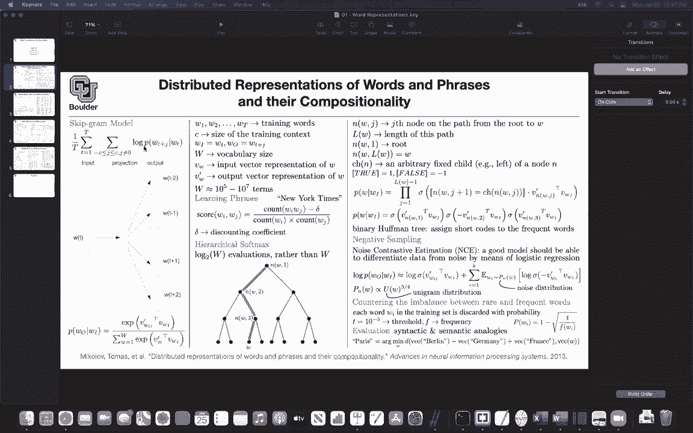

# 98：L46.1 - Word2vec 详解 🧠

在本节课中，我们将学习 Word2vec 的核心概念，这是一种将单词表示为向量的技术。我们将重点介绍两种主要模型：Skip-gram 和 Continuous Bag of Words，并解释它们的工作原理、优缺点以及实际应用。

## 概述

我们的目标是为词典中的每个单词找到一个向量表示。最终，我们希望语义或句法相似的单词在向量空间中彼此靠近。这是单词表示法的最终目标，也是检验模型是否学到含义的一种方式。

为了实现这一目标，我们使用了 Skip-gram 模型。

## Skip-gram 模型

上一节我们介绍了单词表示的目标，本节中我们来看看 Skip-gram 模型的具体实现。

Skip-gram 模型接收一个单词作为输入，并预测其上下文单词。整个损失函数如下所示：

现在的问题是，如何表示概率或其对数。我们有三种选择来表示它。

以下是三种损失函数表示方法：

1.  **Softmax**：速度非常慢，因为词汇量通常在千万级别以上。
2.  **分层 Softmax**：这是另一种选择，成本稍低，为 `log2(W)`，而不是 `W`。
3.  **负采样**：成本是 `k`，`k` 是一个可选择的较高参数（例如 10）。这是最快的方法，在实践中，Word2vec 算法正是使用这种方法。

因此，对于 Word2vec 算法，负采样是实践中使用的方法。

## Continuous Bag of Words 模型

在了解了 Skip-gram 模型后，我们来看看另一种方法：Continuous Bag of Words 模型。

除了使用 Skip-gram 模型，还有一种替代方法，即 Continuous Bag of Words 模型。它与 Skip-gram 模型的方向完全相反。对于 CBOW 模型，我提供上下文，任务是让你告诉我该上下文中的目标词是什么。

其工作原理是：如果你将这些视为 one-hot 向量，你将乘以一个矩阵（即你的词嵌入矩阵），然后将其投影到较低的维度。但这样做，你会得到多个向量。最后你只需要一个向量，所以你只需将它们相加。这些向量具有相同的维度，因此可以相加。相加后，你将得到一个投影后的向量。然后，你将进行另一个矩阵向量乘法，以回到原始的 one-hot 向量维度。基本上，这就是你的词汇表大小，这就是你的 Continuous Bag of Words。

我们称之为“词袋”是因为你只是将它们相加，把所有东西放在一个袋子里，然后求和。这就是为什么它被称为词袋模型。其余部分就是写下概率的对数，然后最大化它。这与之前非常相似。

## 模型评估与应用

现在我们已经了解了两种模型，本节中我们来看看如何评估它们的性能以及它们的实际应用。

我们感兴趣的是类似以下的任务。这是一个句法任务：给定“biggest”和“big”的关系，“small”和什么的关系类似？然后你将能够回答这样的问题，答案将是“smallest”。这些在句法上是正确的。

我们将使用的距离是余弦相似度距离。这就是余弦相似度距离。

另一个例子是语义任务：这意味着你的算法理解了单词的含义。“Berlin”到“Germany”等于“Paris”到什么？这将给出“France”。这被称为：只要你有单词的向量，你就可以进行加法、减法，我们可以计算距离。这就是为什么对于计算机来说，将单词视为向量很重要，这样它们就能够处理这些单词。

以下是语义和句法的其他示例：

*   **语义**：“Athens”到“Greece”类似于“Oslo”到“Norway”。你将创建一个类似这样的数据集，然后将其作为测试数据集来评估算法的性能。它正确得到这些结果的次数有多少？“Norway”是一个真实的例子等。它会犯错误，因为这是一个统计框架，但平均而言，它在解决该问题上有多少次是成功的？
*   **句法**：例如，从形容词到副词的转换：“apparent”到“apparently”类似于“rapid”到“rapidly”等。“easy”到“easiest”，“lucky”到“luckiest”，“work”到“works”，“speak”到“speaks”。

现在我们有了测试数据，让我们评估 Continuous Bag of Words 和 Skip-gram 的性能，并与之前的一些先进技术进行比较。但对我们来说，更重要的是比较 CBOW 和 Skip-gram。

对于语义准确性（上述任务是语义任务），Continuous Bag of Words 在 24% 的情况下是正确的。也就是说，每 100 个例子中，它给出正确答案的次数是 24 次。而 Skip-gram 模型给你的是 55%。因此，对于解决语义任务，Skip-gram 模型表现更好。

但是，当涉及到句法准确性时，Continuous Bag of Words 比 Skip-gram 做得更好。考虑到这两种方法相当不同（例如，一个在这种情况下有四个输入，另一个只有一个），比较它们似乎有些奇怪。你正在正确的轨道上，你隐含地告诉我，如果我给你四个上下文来预测中间的单词，与如果我给你一个单词来预测上下文相比，是一个更容易的任务。所以，是的，这是正确的。这就是为什么与句法相比，Skip-gram 模型给你的单词带来了更多含义。

总体而言，这两种模型的表现远优于之前的先进技术，如 RNN 语言模型和神经网络语言模型。还有其他一些例子，例如：“France”到“Paris”类似于“Italy”到“Rome”，“Japan”到“Tokyo”。“Florida”到“Tallahassee”。所以你给它“France”、“Paris”、“Italy”，它会给出“Rome”；你给它“France”、“Paris”、“Japan”，它会给出“Tokyo”等。

## 常见问题与总结

在本节中，我们将解答一些关于 Word2vec 的常见问题，并对本节课内容进行总结。

人们今天仍然使用 Continuous Bag of Words 和 Skip-gram 吗？还是有更好的方法？因为这篇论文来自 2013 年。不，人们实际上今天仍然使用 Continuous Bag of Words 和 Skip-gram 模型。我们稍后将介绍语言模型，然后你将看到功能上的差异，为什么人们使用语言模型，以及为什么人们使用词向量表示。所以，不，人们实际上今天仍然使用词向量。不，你不能用语言模型来替代它。即使对于像 BERT 和 GPT 这样的语言模型，第一层总是将 one-hot 向量转换为词向量表示，这可以即时训练，也可以用这些词向量初始化。所以，我们将介绍这些内容。是的，人们使用它，我希望你学习它，不，它并不过时。

这种模型更多地用于，比如当你在搜索中输入时，预测的下一个单词会出现，而不是解释一大段文本。你解释的更多是语言模型。你给它前面的单词，任务是预测下一个单词，这些是序列语言模型，但 BERT 是一种去噪语言模型，你将学习它。我们将深入细节，但我所介绍的关于 Continuous Bag of Words 和 Skip-gram 的这些论文在各个地方都有应用。所以它们非常重要。

Continuous Bag of Words 的损失与 Skip-gram 的损失非常相似，所以它将是完全一样的，但现在你没有那个上下文，你以多个输入为条件：`W_{t-1}`, `W_{t-2}`, `W_{t+1}`, `W_{t+2}`。所以你以多个单词为条件，因此求和部分会消失，然后其余部分就是它的对数。

训练 Skip-gram 是否更难，因为你试图预测四个不同的单词，而 CBOW 只预测一个单词？这似乎是一个更困难的任务，因为你只有一个输入，却要预测四个上下文单词。这似乎是一个更困难的任务。那么，训练模型达到类似精度是否需要花费更多时间？不，我不这么认为，因为最终你要做的是获取单词对：`(W_t, W_{t-1})`, `(W_t, W_{t+1})` 等。

Skip-gram 模型的测试输出是什么样的？这正是我在这里解释的内容。它将单词转换为向量，然后它在各个地方都有应用。我们将使用词嵌入，我们将使用词嵌入，我们将使用词嵌入。

它将成为你读到的每一篇论文的第一句话，它是基础。

---

**本节课总结**

在本节课中，我们一起学习了 Word2vec 的核心思想，即将单词表示为向量。我们深入探讨了两种主要模型：**Skip-gram**（通过中心词预测上下文）和 **Continuous Bag of Words**（通过上下文预测中心词）。我们比较了它们在语义和句法任务上的性能差异，并了解了评估词向量质量的常用方法（如类比任务）。最后，我们明确了词嵌入作为自然语言处理基础组件的重要性，它至今仍被广泛使用和应用在各种模型中。