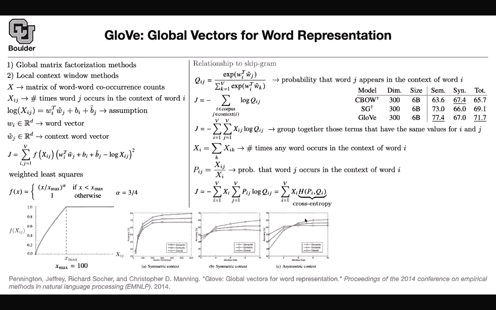

# 99：L46.2 - GloVe 词向量模型详解 🧤


在本节课中，我们将要学习一种强大的词向量模型——GloVe。我们将了解它的核心思想、如何将全局统计信息与局部上下文窗口方法相结合，以及它与其他模型（如Skip-gram）的关联。


## 概述


GloVe是Word2Vec的一个有力竞争者。它的核心思想非常简单，即通过最小化平方误差来学习词向量，但其效果却非常强大。GloVe旨在结合**全局矩阵分解方法**和**局部上下文窗口方法**的优点。


上一节我们介绍了基于局部上下文的Skip-gram模型，本节中我们来看看如何融入全局统计信息。


## GloVe的核心思想


GloVe的基本思路是创建一个**词-词共现计数矩阵**。这个矩阵的行和列都是词汇表中的单词，矩阵中的每个元素 `X_ij` 记录了单词 `j` 出现在单词 `i` 的上下文中的次数。这是一种统计方法，本质上就是计数。


**公式**：`X_ij` = 单词 `j` 出现在单词 `i` 上下文中的次数。


然后，GloVe模型做出一个关键假设：单词 `i` 和 `j` 的共现概率的对数，可以通过它们对应词向量的点积，再加上两个偏置项来近似表示。


**公式**：`log(X_ij) ≈ w_i^T · w̃_j + b_i + b̃_j`


其中：
*   `w_i` 是单词 `i` 的**输入词向量**。
*   `w̃_j` 是单词 `j` 的**上下文词向量**。
*   `b_i` 和 `b̃_j` 是偏置项，为模型提供更多灵活性，可以理解为处理对数共现计数的均值。


## 损失函数


基于上述假设，GloVe的损失函数旨在让公式左右两边尽可能接近。它使用**加权最小二乘**作为目标。


**公式**：`J = Σ_{i,j=1}^{V} f(X_ij) (w_i^T · w̃_j + b_i + b̃_j - log(X_ij))^2`


以下是该损失函数的关键组成部分：


*   **加权项 `f(X_ij)`**：这是一个权重函数，用于平衡不同频率词对的影响。词汇分布通常遵循幂律分布（长尾分布），即少数高频词出现次数极多。如果不加权重，模型会过度关注高频词，而忽略重要的低频词。
*   **求和范围**：对词汇表 `V` 中的所有单词对 `(i, j)` 进行求和。


### 权重函数的设计

权重函数 `f(x)` 的设计至关重要。其目的是为共现次数设定一个上限，避免高频词对主导训练过程。


**代码/公式描述**：
```
            (x / x_max)^α,   if x < x_max
f(x) = {
            1,               otherwise
```


其中 `x_max` 和 `α` 是超参数。经验表明，`α = 3/4` 通常能取得很好的效果。这个函数赋予低频词相对更高的权重，确保模型能充分学习到它们的信息。


## 与Skip-gram模型的关联


为了理解GloVe，我们可以将其与熟悉的Skip-gram模型联系起来。Skip-gram的损失函数（经过简化）可以重写为以下形式：


**公式**：`J = -Σ_{i,j} X_ij log(Q_ij)`


其中 `Q_ij` 是Skip-gram中通过softmax计算得到的单词 `j` 出现在单词 `i` 上下文中的预测概率。


如果我们定义 `P_ij = X_ij / X_i` 为实际的共现概率（`X_i` 是单词 `i` 的所有上下文词频次总和），那么Skip-gram的损失函数可以看作是**加权交叉熵**：


**公式**：`J = -Σ_{i,j} X_ij log(Q_ij) = Σ_i X_i * H(P_i, Q_i)`

这里 `H(P_i, Q_i)` 是分布 `P_i` 和 `Q_i` 的交叉熵，`X_i` 是权重。


由此可见，GloVe（加权最小二乘）和Skip-gram（加权交叉熵）在思想上是相似的。它们都试图让模型预测的“关系”与实际的统计量（GloVe用对数共现次数，Skip-gram用概率分布）相匹配，并且都使用了加权策略来处理词频不平衡问题。主要区别在于它们衡量“差距”的方式不同（平方误差 vs 交叉熵）。


## 模型表现与选择


GloVe、Skip-gram和CBOW在不同任务上各有优劣：




*   **语义任务**：GloVe通常表现最佳。
*   **句法任务**：CBOW可能表现更好。
*   **综合表现**：GloVe总体上有优势。

在实际应用中，需要根据下游任务的需求（更注重语义还是句法）来选择合适的模型。例如，自动补全可能更关注句法，而情感分析可能更关注语义。

关于模型训练，还有一些重要的考量因素：

*   **词向量维度**：随着维度增加，模型性能会提升并逐渐饱和。通常维度设置在300-600之间是常见的，超过600后收益可能不明显。
*   **上下文窗口**：可以使用对称窗口（考虑左右两侧的单词）或非对称窗口（例如只考虑右侧单词）。更大的窗口通常对学习语义信息更有帮助。
*   **训练时间**：更长的训练时间通常会带来更好的词向量质量。研究表明，在相同训练时间下，GloVe往往能获得比CBOW和Skip-gram更好的词向量。

## 总结

本节课中我们一起学习了GloVe词向量模型。我们了解到GloVe通过构建全局的词-词共现矩阵，并利用加权最小二乘损失函数，将单词的共现统计信息有效地编码到低维词向量中。它的核心思想简洁而有力，并且与Skip-gram模型在目标上存在深刻的联系。GloVe在多项任务上，尤其是语义相关任务上，展现了优异的性能，是自然语言处理中一个非常重要的基础工具。