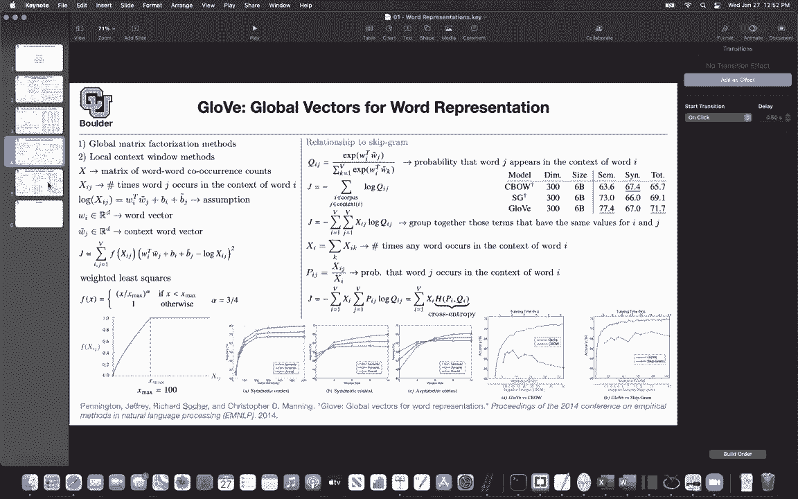
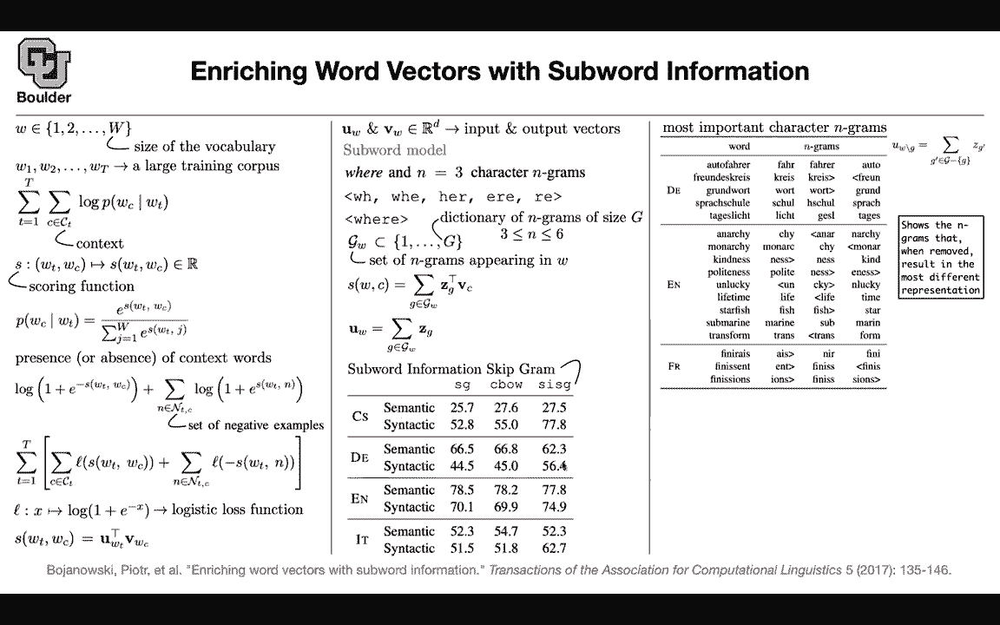

# 100：L47 - 子词模型 🧩

在本节课中，我们将学习如何通过引入子词信息来增强词向量模型，以解决词汇表外词和罕见词的处理问题。我们将回顾Skip-gram模型，并探讨如何将其扩展以纳入子词信息。

---

## 回顾：Skip-gram模型



上一节我们介绍了Word2Vec的两种方法：Skip-gram和CBOW。本节中，我们来看看Skip-gram模型的具体目标函数。

我们有一个大小为 `W` 的词汇表，以及一个更大的语料库，其大小为 `T`（因为单词会重复出现）。Skip-gram模型的目标是最大化一个单词与其上下文单词共现的概率。

其目标函数可以表示为：

$$
\max \sum_{t=1}^{T} \sum_{c \in C_t} \log P(w_c | w_t)
$$

其中，`C_t` 是中心词 `w_t` 的上下文窗口。

为了建模概率 `P(w_c | w_t)`，我们需要一个评分函数 `s(w_t, w_c)`，它将两个词映射为一个分数。然后，我们通过softmax函数将分数转换为概率：

$$
P(w_c | w_t) = \frac{\exp(s(w_t, w_c))}{\sum_{j=1}^{W} \exp(s(w_t, w_j))}
$$

然而，计算整个词汇表的softmax成本很高。因此，我们采用了负采样技术，将问题转化为一个二分类任务（单词是否出现在上下文中），并使用sigmoid函数和逻辑损失。

对于Skip-gram模型，评分函数 `s(w_t, w_c)` 是中心词向量 `v_{w_t}` 和上下文词向量 `u_{w_c}` 的点积：

$$
s(w_t, w_c) = v_{w_t}^T u_{w_c}
$$

我们的损失函数是增加正样本（出现在上下文中的词）的概率，并降低负样本（随机采样的、未出现在上下文中的词）的概率。

---

## 引入子词信息

现在，我们面临一个问题：如果在测试数据中出现一个训练时未见过的罕见词或新词，该如何处理？许多语言（如德语、英语）中存在通过组合多个单词或词根构成新词的现象。

一个很好的思路是关注**子词**，而不仅仅是完整的单词。我们不仅将单词纳入词汇表，还将子词也纳入词汇表。这就是子词模型的核心思想：**用子词信息来丰富词向量**。

那么，在现有框架中，我们可以在哪里进行修改以编码子词信息呢？

*   我们不能改变语料库 `W`。
*   我们不能改变目标函数（最大化共现概率）。
*   我们不能改变softmax或其近似（负采样）。
*   我们不能改变损失函数（逻辑损失）。

**唯一可以改变的地方是评分函数 `s(w_t, w_c)`**。我们将修改评分函数，使其能够利用子词信息。

---

## 子词模型的具体实现

让我们通过一个例子来具体说明。假设我们使用字符级n-gram，并设 `n=3`。我们在单词的开头和结尾添加特殊符号（如 `<` 和 `>`），以标记边界。

以单词 `where` 为例，其3-gram子词如下：

```
<wh, whe, her, ere, re>
```

我们不仅使用一种n-gram长度。通常，我们会使用一个范围，例如从3-gram到6-gram，并且**将单词本身也作为一个特殊的“子词”包含在内**。因此，`where` 的子词集合包括其所有3-gram、4-gram、5-gram、6-gram以及完整的单词 `where`。

以下是这么做的原因：
*   **保留完整单词信息**：单词 `where` 本身可能在测试数据中作为独立单词出现。
*   **增强泛化能力**：测试数据中可能出现由 `where` 的部分子词构成的新词。
*   **扩大词汇表**：通过包含子词，我们有效扩大了模型的词汇表 `G`，其中 `G > W`。

---

## 新的评分函数

在子词模型中，每个单词 `w` 不再只有一个向量，而是表示为其所有子词向量之和。

假设单词 `w` 的子词集合为 `G_w`。那么，该单词的向量表示 `z_w` 为：

$$
z_w = \sum_{g \in G_w} v_g
$$

其中，`v_g` 是子词 `g` 的向量。

相应地，评分函数 `s(w, c)` 被修改为中心词 `w` 的子词向量之和与上下文词 `c` 的向量 `u_c` 的点积：

$$
s(w, c) = z_w^T u_c = (\sum_{g \in G_w} v_g)^T u_c
$$

**模型的训练过程与之前完全相同**。我们仍然使用相同的语料库、相同的负采样目标函数和相同的逻辑损失。唯一的变化就是将评分函数从 `v_w^T u_c` 替换为 `(\sum_{g \in G_w} v_g)^T u_c`。

当遇到一个未知单词时，我们只需将其分解为在训练中见过的n-gram子词，然后将其子词向量相加，即可得到该新词的向量表示。

---

## 模型效果与分析

这种方法的优势在于其强大的泛化能力。例如：
*   即使训练时未见过单词 `politeness`，但只要见过子词 `polite` 和 `ness`，模型就能组合出 `politeness` 的合理表示。
*   对于德语等复合词丰富的语言，效果尤为显著。

为了定性地评估模型学到了什么，我们可以进行一项分析：**计算每个子词对单词整体含义的重要性**。

具体方法是：
1.  计算单词的完整向量表示 `z_w`（包含所有子词）。
2.  对于每个子词 `g`，计算移除该子词后的向量 `z_w - v_g`。
3.  计算 `(z_w - v_g)` 与完整向量 `z_w` 的余弦相似度。
4.  相似度下降最多的子词，就是对单词含义最重要的子词。



例如，对于单词 `anarchy`，最重要的子词可能是 `arch` 和 `anarch`。对于 `kindness`，最重要的子词可能是 `ness` 和 `kind`。这直观地显示了模型如何从组成部分中构建词义。

---

## 总结

本节课中我们一起学习了子词模型。我们首先回顾了Skip-gram模型及其目标函数，然后指出了其在处理未登录词时的局限性。

为了解决这个问题，我们引入了子词信息。具体做法是将单词表示为字符级n-gram（如3-gram到6-gram）的集合，并将单词本身也包含在内。模型的评分函数相应修改为所有子词向量之和与上下文词向量的点积。

这种方法的核心优势在于其泛化能力，它允许模型为训练中未出现但包含已知子词的新词生成合理的向量表示。我们最后还探讨了如何分析子词对词义贡献的重要性。

通过结合单词、短语（如前所述）以及子词信息，我们构建了一个更健壮、更能应对自然语言复杂性的词向量模型。