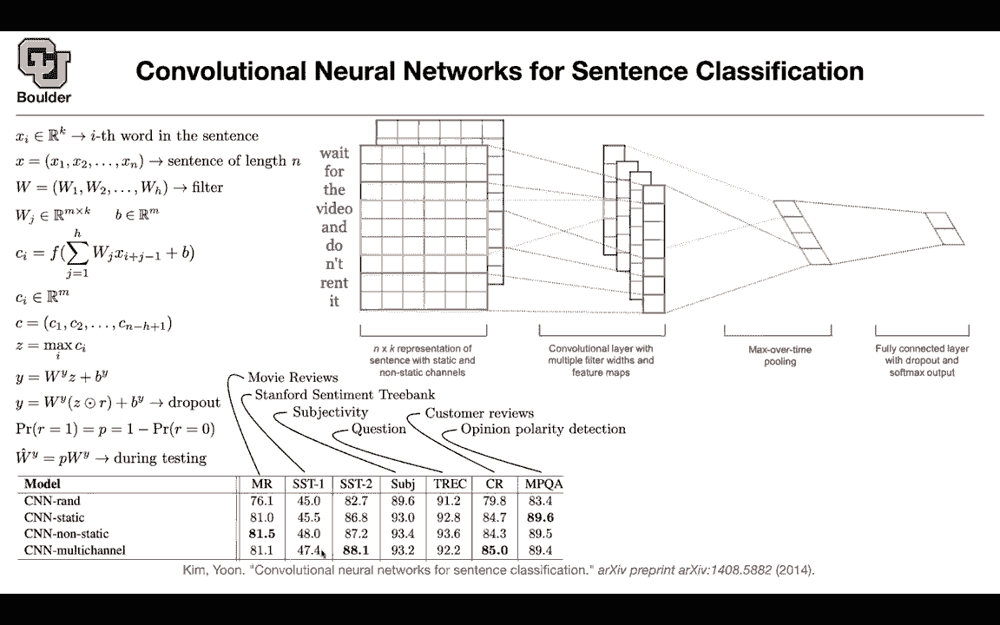

# 102：L49.1- 用于句子分类的CNN 🧠


在本节课中，我们将学习如何将卷积神经网络应用于文本分类任务，特别是句子分类。我们将探讨其核心思想、具体操作步骤，并了解一个重要的正则化技术——Dropout。


## 概述


处理文本时，我们面临多种方法选择：循环神经网络、递归神经网络、卷积网络还是注意力机制。本节将重点介绍用于句子分类的卷积神经网络。卷积操作通常用于图像处理，但我们可以将句子视为一维图像，从而应用卷积。这种方法不需要像递归神经网络那样依赖句子的树状结构，简化了预处理步骤。


## 句子作为一维图像


在卷积神经网络框架中，我们将句子中的每个词视为一个“像素”。每个词由一个向量表示，因此一个句子就是一系列向量的序列。


假设一个句子由 `n` 个词组成：`x1, x2, ..., xn`。每个词向量 `xi` 是 `k` 维的。因此，整个句子可以看作一个形状为 `n × k` 的矩阵，这类似于一个高度为 `n`、宽度为 `k` 的一维图像。


## 一维卷积操作


接下来，我们引入卷积操作。与图像处理中的二维卷积不同，这里我们使用一维卷积。


我们定义一个卷积核（或过滤器），其窗口大小为 `h`。这意味着每次卷积操作会考虑连续的 `h` 个词。对于每个窗口内的词，我们都有一个对应的权重矩阵 `Wj`，用于将 `k` 维的词向量转换为 `m` 维的特征。


**卷积操作的核心公式如下：**


对于一个从位置 `i` 开始的窗口（包含词 `xi, xi+1, ..., xi+h-1`），其卷积输出 `ci` 的计算为：
`ci = f( Σ_{j=1}^{h} Wj * x_{i+j-1} + b )`
其中：
*   `Wj` 是第 `j` 个位置的权重矩阵（维度为 `m × k`）。
*   `b` 是偏置项（维度为 `m`），用于调整输出分布的均值。
*   `f` 是一个非线性激活函数，如 ReLU 或 tanh。


这个操作在句子序列上滑动进行。对于长度为 `n` 的句子，使用窗口大小为 `h` 的卷积核，我们将得到一个长度为 `n - h + 1` 的新序列 `c1, c2, ..., c_{n-h+1}`。新序列中的每个元素 `ci` 都是一个 `m` 维向量。


## 全局最大池化与分类


卷积层输出仍是一个序列，但分类任务通常需要一个固定长度的向量作为输入。因此，我们使用**全局最大池化**操作。


具体来说，对于卷积输出的 `m` 维特征序列，我们在每个特征维度上独立地取最大值。假设卷积输出序列长度为 `L`，对于第 `j` 个特征维度（`j` 从 1 到 `m`），我们计算：
`z_j = max(c1[j], c2[j], ..., cL[j])`
这样，我们就将一个变长的序列压缩成了一个固定的 `m` 维向量 `z`。


最后，为了进行具体的分类（例如情感分析分为5类），我们需要将 `m` 维的向量 `z` 投影到目标类别维度。这通过一个全连接层实现：
`y = softmax(W_y * z + b_y)`
其中 `W_y` 是权重矩阵，`b_y` 是偏置项。


## 网络深度与参数共享


与图像CNN类似，我们可以堆叠多个卷积层和池化层来构建更深的网络，以捕捉更复杂的特征。然而，句子的长度有限，因此可堆叠的层数也受到限制。


卷积操作的一个关键优势是**参数共享**。同一个卷积核（`W1, W2, ..., Wh`）会滑动应用于句子的所有位置，这大大减少了模型参数，并让模型能够学习到与位置无关的特征。


## Dropout 正则化技术


深度神经网络参数众多，容易在训练数据上过拟合。Dropout 是一种有效的正则化技术，旨在提高模型的泛化能力。


Dropout 在训练阶段随机“丢弃”一部分神经元。其操作如下：


对于网络中的某个层（例如池化后得到的向量 `z`，它有 `m` 个神经元），在每次训练迭代中，每个神经元都以概率 `p` 被临时设置为0（即被丢弃），以概率 `1-p` 被保留。


**Dropout 的代码描述如下（训练阶段）：**
```python
# r 是一个与 z 形状相同的掩码向量，元素服从伯努利分布 (1-p, p)
r = np.random.binomial(1, 1-p, size=z.shape)
z_dropped = z * r  # 应用 Dropout
```


这迫使网络不能过度依赖某些特定的神经元，而必须让所有神经元都尽可能独立地发挥作用，从而增强了模型的鲁棒性。


在测试或生产阶段，我们需要一个确定性的预测。此时，我们不再随机丢弃神经元，而是对权重进行缩放。具体做法是，将训练好的权重 `W` 乘以保留概率 `(1-p)`，作为测试时使用的权重。这近似模拟了在训练时平均多个不同子网络的效果。


## 模型变体与实验分析


在实际应用中，我们可以尝试不同的策略来初始化词向量，并观察其对性能的影响：


以下是常见的几种词向量处理方式：
*   **随机初始化**：词向量随机初始化，并在训练中学习。
*   **静态预训练**：使用预训练模型（如 Word2Vec 或 GloVe）初始化词向量，并在整个训练过程中保持固定。
*   **非静态预训练**：使用预训练模型初始化词向量，但在训练过程中允许对其进行微调。
*   **多通道**：使用两组词向量，一组保持静态，一组进行微调，然后将它们拼接起来作为输入，这相当于增加了输入的“通道”数。


实验表明，使用预训练词向量通常能带来性能提升，而多通道策略在一些数据集上能取得最佳或接近最佳的效果。


## 方法特点与局限性


与之前介绍的递归神经网络相比，用于句子分类的CNN具有以下特点：
*   **无需句法树**：不依赖于句子的树状结构，省去了句法解析的预处理步骤。
*   **可并行计算**：卷积操作可以高度并行化，训练速度更快。
*   **局部特征提取**：通过不同大小的卷积核，可以捕捉句子中不同范围的局部依赖关系（如二元词组、三元词组等）。


其局限性在于：
*   **长距离依赖**：由于卷积和池化操作主要关注局部特征，对于理解需要长距离依赖的句子结构可能存在不足。
*   **位置不敏感性**：全局最大池化可能会丢失词序的细微信息，尽管卷积操作本身在一定程度上保留了局部顺序。


## 总结




本节课我们一起学习了用于句子分类的卷积神经网络。我们将句子视为一维图像，通过一维卷积操作提取局部特征，再通过全局最大池化得到句子的固定长度表示，最后进行分类。我们还介绍了Dropout这一重要的正则化技术，它通过在训练中随机丢弃神经元来防止过拟合，提升模型泛化能力。这种方法结构简单、易于并行，是文本分类任务中一个强大且高效的基线模型。