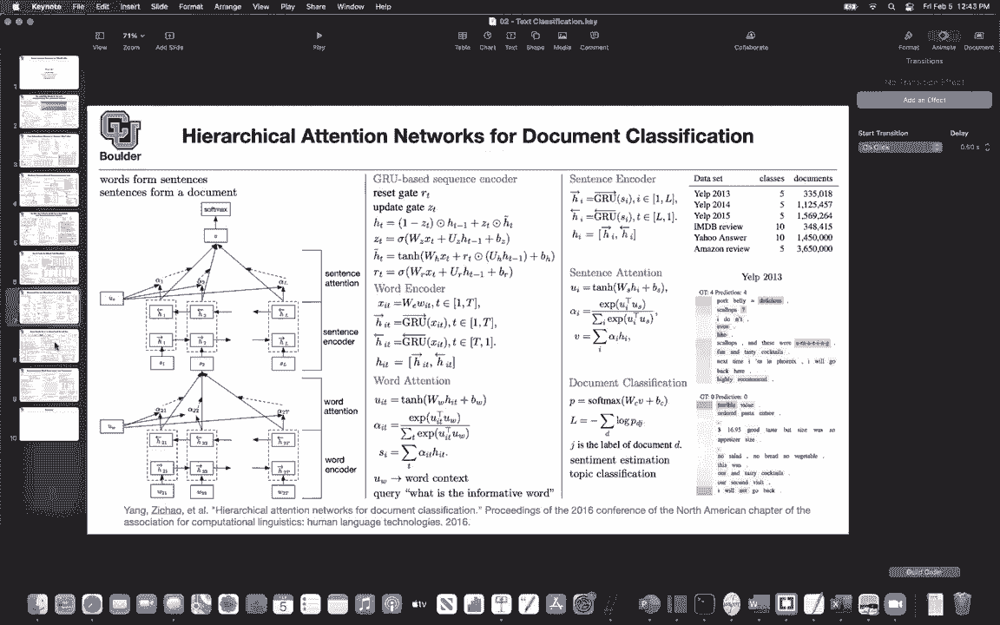
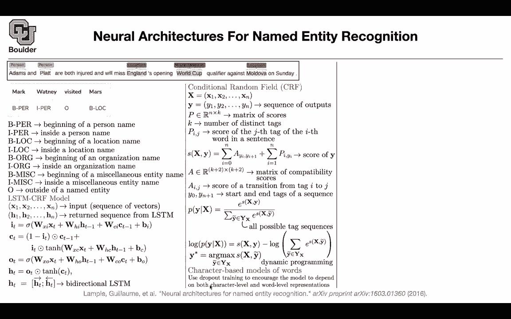

# 107：L51.1 - 命名实体识别 🏷️

在本节课中，我们将学习命名实体识别。这是一种对句子中的每个单词进行分类的任务，类似于图像处理中的语义分割。

## 概述

在之前的课程中，我们学习了用于文档分类的递归神经网络、卷积神经网络，以及门控循环单元和注意力机制。这些方法的目标都是将句子中的单词组合成一个向量，作为逻辑回归的特征。本节课，我们将转向一个新的应用：对句子中的每个单词进行分类，即命名实体识别。

## 什么是命名实体识别？

命名实体识别是一种自然语言处理任务，旨在识别文本中具有特定意义的实体，如人名、地名、组织名等，并为每个单词分配一个类别标签。

例如，在句子 “Adams and Plot are both injured and will miss England's opening World Cup qualifier against Moldova on Sunday” 中，我们需要对每个单词进行分类：“Adams” 是人名，“England” 是地名，“World Cup” 是杂项等。

以下是数据标注的一个例子：
*   Mark (B-PER) 是人名的开始。
*   Watney (I-PER) 是人名的一部分。
*   visited (O) 是其他词。
*   Mars (B-LOC) 是地名的开始。

标签中的 “B-” 表示实体的开始，“I-” 表示实体内部，“O” 表示非实体。这种标注方式有助于将多个单词合并为一个完整的实体。

## 如何解决问题：LSTM 与条件随机场

我们将使用长短期记忆网络和条件随机场来解决这个问题。LSTM 适合处理序列数据，而 CRF 能帮助我们考虑标签之间的依赖关系。

### LSTM 模型

LSTM 接收一个向量序列（即句子中每个单词的词向量）作为输入，并输出另一个向量序列。其核心公式如下：

这是一个简化的 LSTM 单元公式：
*   **输入门**：`i_t = σ(W_i · [h_{t-1}, x_t] + b_i)`，决定保留多少新信息。
*   **遗忘门**：`f_t = 1 - i_t`（在简化版本中），决定遗忘多少旧信息。
*   **候选记忆**：`C̃_t = tanh(W_C · [h_{t-1}, x_t] + b_C)`。
*   **记忆更新**：`C_t = f_t ⊙ C_{t-1} + i_t ⊙ C̃_t`。
*   **输出门**：`o_t = σ(W_o · [h_{t-1}, x_t] + b_o)`，决定输出多少记忆。
*   **隐藏状态**：`h_t = o_t ⊙ tanh(C_t)`。

其中，`⊙` 表示逐元素相乘（Hadamard 积），`σ` 是 sigmoid 函数。LSTM 的参数在时间步之间共享，因此效率很高。

为了捕捉上下文信息，我们使用双向 LSTM。一个 LSTM 从左到右处理序列，另一个从右到左处理。每个时间步的输出是这两个方向隐藏状态的拼接。

### 从输出到概率

LSTM 的输出 `h_1, h_2, ..., h_n` 是隐藏状态向量。我们需要将它们转换为每个单词的类别概率。

首先，通过一个线性层将隐藏状态向量的维度转换为类别数量 K：
`z_t = W · h_t + b`

然后，对每个 `z_t` 应用 softmax 函数，得到概率分布：
`P(y_t = k | x) = softmax(z_t)_k`

这样，对于一个长度为 N 的句子，我们得到一个 N × K 的概率矩阵 P，其中 `P_{i,j}` 表示第 i 个单词属于第 j 个类别的概率。

### 条件随机场

然而，直接对每个单词的概率求和作为损失函数存在一个问题：它假设每个单词的标签是独立的。但实际上，标签之间存在依赖关系（例如，“I-PER”后面不太可能是“B-PER”）。

条件随机场通过引入一个转移分数矩阵 A 来建模标签之间的依赖关系。`A_{i,j}` 表示从标签 i 转移到标签 j 的分数。

对于一个给定的句子 x 和其标签序列 y，我们定义其分数为：
`score(x, y) = Σ_{t=1}^{N} P_{t, y_t} + Σ_{t=1}^{N-1} A_{y_t, y_{t+1}}`

这个分数结合了每个单词被分类为正确标签的置信度（来自 LSTM）和标签序列的合理性（来自 CRF 转移矩阵）。

我们的目标是最大化正确标签序列的分数相对于所有可能标签序列总分的概率。这通过以下 softmax 实现：
`P(y | x) = exp(score(x, y)) / Σ_{y'} exp(score(x, y'))`

对应的负对数似然损失函数为：
`L = -log P(y | x) = -score(x, y) + log( Σ_{y'} exp(score(x, y')) )`

其中，`y'` 遍历所有可能的标签序列。虽然序列总数是 K^N，但可以通过动态规划算法（如前向-后向算法）高效计算分母的对数和以及进行预测时的解码（使用维特比算法）。

模型参数包括 LSTM 的权重 W、偏置 b 以及 CRF 的转移矩阵 A，它们通过梯度下降共同学习。

## 字符级模型

对于罕见词或未登录词，仅使用词向量可能不够。我们可以引入字符级模型来增强单词表示。

具体方法是：对每个单词的字符序列（例如 “M-a-r-s”）运行一个双向 LSTM。将前向和后向 LSTM 的最终隐藏状态拼接起来，作为该单词的字符级嵌入向量。

然后，将这个字符级嵌入向量与预训练的词向量拼接，共同作为单词的最终表示，输入到主 LSTM 中进行句子级别的处理。这种层次化模型（字符→单词→句子）能更好地处理形态学丰富的语言和未知词汇。

为了防止模型过度依赖某一种表示（词向量或字符向量），可以在拼接后使用 Dropout 技术。

## 总结

本节课我们一起学习了命名实体识别任务。我们首先了解了其目标是对句子中的每个单词进行分类。接着，我们介绍了使用双向 LSTM 来获取每个单词的上下文相关表示。然后，我们指出了独立分类的局限性，并引入了条件随机场来建模标签序列间的依赖关系，定义了包含转移分数的损失函数。最后，为了提升对罕见词的处理能力，我们补充了基于字符的双向 LSTM 模型来构建更健壮的单词嵌入。这套结合了 LSTM、CRF 和字符级表示的模型，是解决命名实体识别等序列标注问题的有效框架。