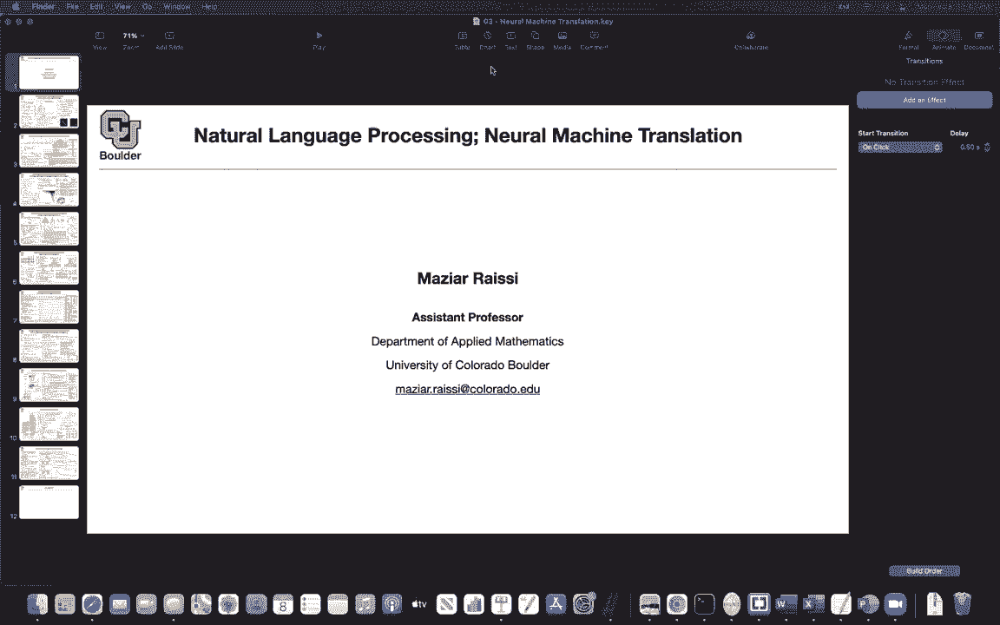
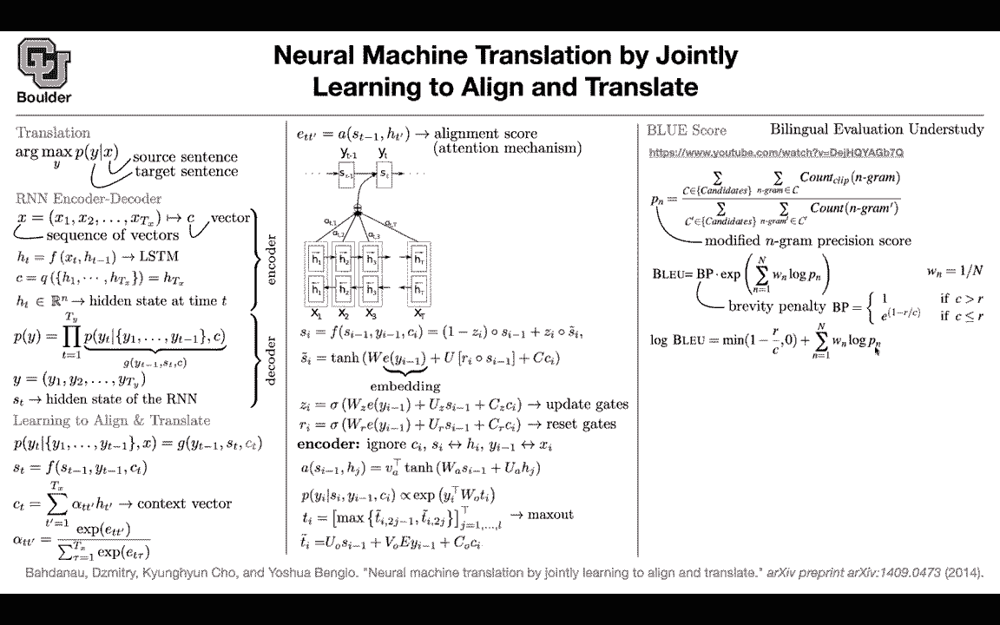

# 109：L52.1 - 神经机器翻译 🧠➡️🗣️

在本节课中，我们将学习如何使用神经网络来完成机器翻译任务。我们将从基础的编码器-解码器架构开始，并重点介绍一个革命性的改进：注意力机制。

## 概述

机器翻译是自然语言处理中的一项核心任务。我们的目标是构建一个模型，能够将一种语言的句子（源语言）自动翻译成另一种语言的句子（目标语言）。与分类任务类似，推理过程可以看作是在给定源句子的条件下，寻找概率最大的目标句子。然而，翻译任务的一个关键挑战是，对于一个源句子，可能存在多个同样优秀的目标翻译。因此，我们需要对条件概率 **P(目标句子 | 源句子)** 进行建模，而不仅仅是寻找一个单一答案。

## 编码器-解码器架构

上一节我们提到了建模概率的重要性。本节中，我们来看看如何用循环神经网络（RNN）来构建这个概率模型。我们将采用**编码器-解码器**架构。

这个架构的核心思想是：首先，使用一个**编码器**将可变长度的源句子序列编码成一个固定长度的上下文向量 **C**。然后，使用一个**解码器**，基于这个上下文向量 **C**，逐个单词地生成目标句子。

以下是该架构的关键组成部分：

*   **编码器**：通常使用LSTM或GRU等循环神经网络。输入是源句子的词向量序列，输出是最后一个时间步的隐藏状态 **h_Tx**，我们将其作为整个句子的表示，即上下文向量 **C = h_Tx**。
*   **解码器**：同样是一个循环神经网络（如LSTM/GRU）。它的初始隐藏状态 **s_0** 通常被设置为编码器的最终状态 **C**。在每个时间步 **t**，解码器根据前一个隐藏状态 **s_{t-1}**、前一个生成的单词 **y_{t-1}** 以及上下文信息，来预测当前单词 **y_t** 的概率分布。

通过链式法则，我们可以将生成整个目标句子的概率分解为一系列条件概率的乘积：
**P(y|x) ≈ Π_t P(y_t | y_1, ..., y_{t-1}, C)**
这里，我们用上下文向量 **C** 近似代表整个源句子 **x**，并用解码器的隐藏状态 **s_{t-1}** 来总结之前已生成的所有单词 **y_1, ..., y_{t-1}**。

## 引入注意力机制 ⚡

上一节介绍的基础编码器-解码器架构存在一个明显缺陷：它要求将所有源信息压缩到单个固定长度的向量 **C** 中。这对于长句子来说非常困难，并且忽略了单词在翻译时可能发生的顺序调整（例如，英语的“European economic area”翻译成法语时顺序可能变为“zone économique européenne”）。

为了解决这个问题，我们引入**注意力机制**。注意力机制允许解码器在生成每一个目标单词时，“有选择地”查看编码器所有时间步的隐藏状态，而不是仅仅依赖一个固定的 **C**。

具体来说，我们为解码器的每个时间步 **t** 动态计算一个独特的上下文向量 **c_t**。**c_t** 是编码器所有隐藏状态 **h_1, ..., h_Tx** 的加权和：
**c_t = Σ_{t‘} α_{t, t’} * h_{t‘}**
其中，权重 **α_{t, t’}** 被称为“注意力权重”，它表示在生成第 **t** 个目标词时，模型对源句子第 **t‘** 个词的关注程度。这些权重通过一个可学习的对齐模型计算，并经过softmax归一化，确保所有权重之和为1：
**α_{t, t’} = softmax( score(s_{t-1}, h_{t‘}) )**
评分函数 **score** 的一个常见实现是加性注意力：
**score(s_{t-1}, h_{t‘}) = v_a^T * tanh(W_a * s_{t-1} + U_a * h_{t’})**
这里，**W_a**, **U_a**, **v_a** 都是可学习的参数。

现在，解码器在时间步 **t** 的更新公式变为：
**s_t = f(s_{t-1}, y_{t-1}, c_t)**
其中 **f** 是RNN（如GRU）的更新函数。

## 模型具体组件与训练

我们已经了解了注意力机制的思想。现在，我们来具体看看模型中的各个函数和训练过程。

以下是模型中关键函数的具体形式：

*   **编码器函数 f_enc**：通常使用GRU或LSTM，输入是前一个隐藏状态 **h_{t-1}** 和当前输入词向量 **x_t**，输出新的隐藏状态 **h_t**。公式与标准GRU相同，但没有来自解码器的上下文输入。
*   **注意力对齐函数 a**：如上文所述，用于计算注意力权重 **α**。
*   **解码器函数 f_dec**：同样使用GRU或LSTM，但输入包含三部分：前一个隐藏状态 **s_{t-1}**、前一个输出词的嵌入 **E*y_{t-1}** 以及当前时间步的上下文向量 **c_t**。
*   **输出函数 g**：用于计算下一个单词的概率分布。首先，将解码器隐藏状态 **s_t**、上下文向量 **c_t** 和前一个词的嵌入进行线性变换和组合，然后通过一个非线性激活函数（如 `tanh` 或论文中使用的 `maxout`），最后通过一个线性层和softmax函数，得到词汇表上的概率分布：
    **P(y_t | y_{<t}, x) = softmax( W_o * ( maxout( W_s * s_t + W_c * c_t + W_y * E*y_{t-1} ) ) + b_o )**
    其中 **W_o**, **W_s**, **W_c**, **W_y**, **b_o** 为可学习参数。

模型通过最大化训练数据（源-目标句子对）的似然概率来训练，即最小化负对数似然损失：
**Loss = - Σ log P( target_sentence | source_sentence )**
使用随机梯度下降法优化所有参数，包括词嵌入矩阵、RNN权重、注意力参数和输出层参数。

## 评估指标：BLEU 分数 📈

训练好模型后，我们需要一个客观的指标来评估翻译质量。机器翻译领域最常用的自动评估指标是 **BLEU**。

BLEU 的核心思想是比较机器翻译的输出（候选翻译）与一个或多个人工翻译的参考译文之间的相似度。它通过计算**修正的 n-gram 精度**来实现。简单的 n-gram 精度（候选翻译中出现在参考译文中的 n-gram 比例）会鼓励生成非常短的句子（因为这样更容易匹配）。因此，BLEU 引入了**长度惩罚因子**来惩罚过短的输出。

BLEU 分数的计算公式如下：
**BLEU = BP * exp( Σ_{n=1}^N w_n log p_n )**
其中：
*   **p_n** 是 n-gram（如 1-gram, 2-gram, …）的修正精度。
*   **w_n** 是各 n-gram 精度的权重，通常取均匀权重 **w_n = 1/N**。
*   **BP** 是简短惩罚因子：
    **BP = 1， if c > r**
    **BP = exp(1 - r/c)， if c ≤ r**
    **c** 是候选翻译的长度，**r** 是参考翻译的有效长度（通常是多个参考译文长度的平均值）。

BLEU 分数越高，表示翻译质量越好。通常我们报告的是 BLEU-4 分数（即 N=4）。

## 注意力机制可视化示例 👁️

理论描述了注意力如何工作，一个直观的例子能让我们更好地理解。下图展示了一个从英语翻译成法语的例子中，注意力权重的热力图。

源句子（英语）：“The agreement on the European economic area was signed in August 1992.”
目标句子（法语）：“L’accord sur la zone économique européenne a été signé en août 1992.”

在热力图中，x轴是源句子单词，y轴是生成的目标句子单词。颜色越亮（如黄色），表示在生成某个法语单词时，模型对对应的英语单词关注度越高。我们可以观察到：
*   “zone économique européenne” 关注的是 “European economic area”，词序发生了交换。
*   大部分单词（如 “The agreement” -> “L’accord”）存在清晰的对齐。
*   像 “was signed” 和 “a été signé” 这样的短语，注意力分布可能更分散一些，体现了翻译的非严格逐词对应性。

这生动地展示了注意力机制如何帮助模型处理词序重组和短语对齐问题。

## 总结

本节课中，我们一起学习了神经机器翻译的核心内容。我们从**编码器-解码器**这一基础架构出发，理解了如何用RNN将源句子编码并解码为目标句子。接着，我们深入探讨了**注意力机制**，它通过允许解码器动态地关注源句子的不同部分，显著提升了模型处理长句子和复杂词序的能力。我们详细剖析了模型中的各个组件（编码器、注意力、解码器、输出层）及其数学形式，并介绍了模型的训练目标（最大似然估计）。最后，我们学习了使用 **BLEU 分数** 来客观评估翻译质量的方法，并通过可视化示例直观感受了注意力机制的工作方式。神经机器翻译，尤其是引入注意力机制的模型，为后续许多NLP任务（如文本摘要、对话生成）奠定了重要基础。