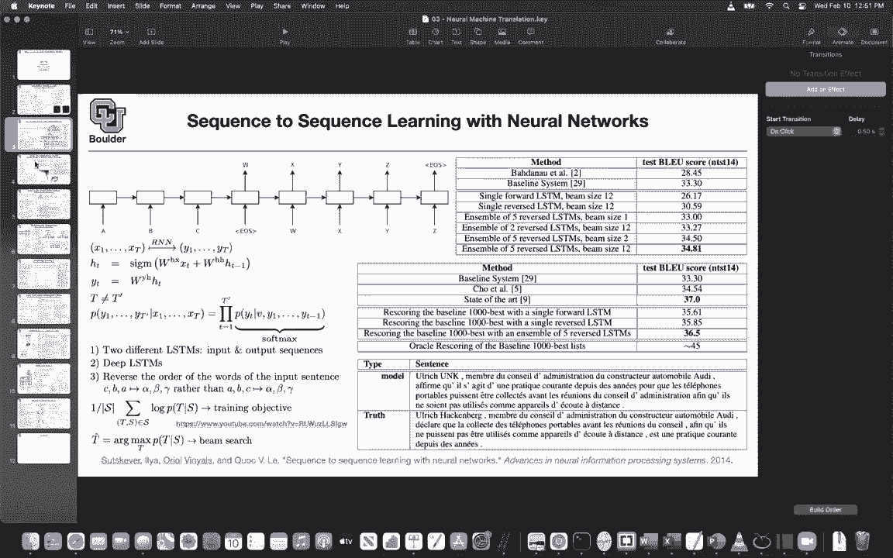
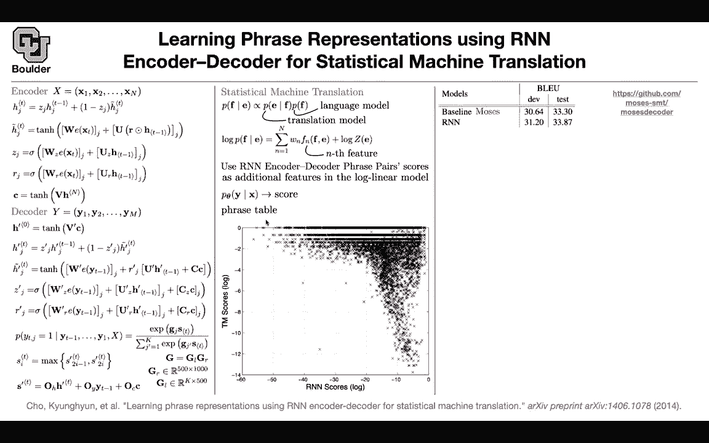

# 111：L53.1 - 短语表征 🧠

## 概述

在本节课中，我们将学习如何将神经网络应用于机器翻译任务，以提升传统统计机器翻译系统的性能。我们将回顾编码器-解码器架构，并探讨如何将神经网络的输出作为特征，整合到统计机器翻译框架中。

---

## 回顾：神经机器翻译基础

上一节我们介绍了机器翻译，特别是神经机器翻译。我们讨论了机器翻译任务的定义、如何建模、如何训练模型、损失函数是什么，以及如何使用BLEU分数进行评估。我们还学习了GRU和注意力机制，并尝试了反转输入序列顺序的技巧，发现这有助于提升翻译效果。

此外，我们使用了一个与深度学习无关的基线翻译器，然后利用神经网络对基线翻译器给出的候选翻译进行重新评分，从而获得了更好的翻译结果。这表明我们可以用神经网络来补充统计机器翻译的结果。

---

## 编码器-解码器架构回顾

本节中，我们来看看编码器-解码器架构的细节。我们将使用神经网络以另一种方式来帮助统计机器翻译，但首先需要快速回顾一下该架构。

一个句子（实际上是词向量序列）输入编码器。我们知道以下公式代表一个GRU（门控循环单元）：

$$
\tilde{h}_j = \tanh(W x_j + U (r_j \odot h_{j-1}))
$$

其中，新信息 $\tilde{h}_j$ 进入，$h_j$ 是隐藏状态向量的第 $j$ 个条目。更新过程是逐元素进行的：新信息被嵌入，乘以矩阵，并通过重置门和更新门与先前隐藏状态的信息结合。

句子经过循环神经网络处理后，最终会得到一个单一的上下文向量 $C$（这里我们暂不考虑注意力机制）。对于解码器，我们有一个输出句子，需要逐个单词生成。

解码器首先用 $C$ 初始化其隐藏状态 $h‘_0$（之前我们称之为 $S$）。解码器同样是一个GRU，新信息（即刚输出的单词）被嵌入并乘以矩阵，然后通过重置门和更新门与过去的信息结合。

最后，我们需要输出翻译中下一个单词的概率。由于输出是独热向量，问题在于输出向量中第 $j$ 个条目为1、其余为0的概率是多少。我们通过一系列矩阵向量乘法来建模这个概率，并使用softmax函数。

$$
P(y_t | y_{<t}, C) = \text{softmax}(G \cdot h‘_t)
$$

这里 $G$ 是一个巨大的矩阵，其维度是词汇表大小乘以隐藏状态维度，这在参数和计算上都不高效。

为了解决这个问题，我们可以将 $G$ 分解为两个矩阵 $G_L$ 和 $G_R$：

$$
G = G_R \cdot G_L
$$

$G_L$ 将维度从隐藏状态大小（例如1000）映射到一个较低的维度（例如500），然后 $G_R$ 再映射到词汇表大小。这可以节省计算量和参数。

此外，我们使用 **maxout** 激活函数进行非线性变换，它取向量中元素对的最大值，有助于正则化网络输出。

$$
\text{maxout}(z)_i = \max_{j \in [1, k]} z_{i, j}
$$

而解码器的隐藏状态 $S$（即 $h‘_t$）取决于解码器自身的隐藏状态、前一个输出的单词以及编码器的上下文 $C$。这就是编码器-解码器架构，我们之前已经见过，这里只是引入了分解矩阵以节省计算的新表示法。

---

## 结合神经网络与统计机器翻译

我们知道，在当时，纯粹的神经网络自身还不足以提供高质量的翻译。因此，我们将利用神经网络来提高经典统计机器翻译的性能。

那么，机器翻译的一般形式是什么？给定一个英语句子 $E$，我们想知道其法语翻译 $F$ 的概率。根据贝叶斯规则，我们可以写出：

$$
P(F|E) \propto P(E|F) \cdot P(F)
$$

这里，$P(F)$ 是语言模型，给出了目标语言中每个句子的概率；$P(E|F)$ 是翻译模型。整个表达式与 $P(E, F)$ 这个联合分布成比例。

在统计机器翻译中，我们通过手工设计的一系列特征来建模这个联合分布。它接受输入句子和输出翻译，将其特征化，并表示为这些特征的线性组合。

$$
\log P(E, F) \approx \sum_{i} w_i \phi_i(E, F)
$$

我们如何利用神经网络来帮助这个过程呢？我们将使用刚刚复习过的循环神经网络编码器-解码器。训练完成后，它会输出一个概率值，这个概率值由神经网络的参数高度参数化，可以用来对输入-输出句子对进行评分。

以下是具体步骤：
我们将神经网络输出的这些评分数字，作为新的特征，添加到统计机器翻译原有的特征词典中。原有的特征可能来自经典的机器学习方法。

这些神经网络特征是在独立的训练过程中优化得到的。一旦训练完成，我们就得到一组来自神经网络的特征，将它们与手工设计的特征一起，加入到统计机器翻译系统中。然后，我们像训练线性回归一样，训练这些组合特征的权重参数 $w_i$。

---

## 新特征的有效性与效果

有人可能会问：你添加的这些特征，是否独立于统计机器翻译中已有的特征？答案是肯定的，我们确实在学习一些新的、独立的信息。

如何验证这一点呢？我们可以观察神经网络输出的评分与统计机器翻译系统原有评分之间的关系。如果它们完全相同，我们会看到强烈的相关性，但实际数据点分布分散，表明没有明显的相关性。这证明我们通过神经网络这一不同视角，为问题添加了新的信息。

那么，这样做能带来多少提升呢？基线系统（代码可在GitHub找到）在开发集和测试集上有一定的BLEU分数。通过添加神经网络特征，BLEU分数得到了显著提高。

从定性分析来看，基线翻译中可能存在一些随机或无意义的词（例如出现问号）。加入RNN编码器-解码器特征后，大部分这类问题得以消除，翻译结果更加通顺合理。无论是常见短语还是罕见短语，翻译质量都有所改善。

---

## 附加收获：通过翻译学习词嵌入

在这个过程中，我们还有一个额外收获：可以学习词嵌入。我们知道词嵌入的概念，而通过从一种语言到另一种语言的翻译任务，我们实际上可以学习到有意义的词向量。

如果我们使用PCA或t-SNE等方法将这些词向量可视化，会发现语义相近的单词会聚集在一起。例如，在一个聚类中，我们可以看到许多国家名称（如法国、中国、俄罗斯、英国、德国等）彼此靠近。这表明通过翻译任务，我们能够自动学习到高质量的词语表征。

---

## 问答环节澄清

在进入下一个主题之前，我们对一些关键点进行澄清。

**问题：** 为什么要分解矩阵 $G$？这不会导致参数数量相同吗？它们在数学上等价吗？
**回答：** 这样做主要是出于计算效率的考虑。分解后参数数量会少得多，计算循环也更小，因此在计算和内存方面都更高效。这类似于进行奇异值分解（SVD），但参数是通过学习得到的。

**问题：** 我们学习了哪两种利用神经网络提升翻译系统质量的方法？
**回答：** 第一种是让基线系统生成候选翻译，然后用神经网络对其重新评分。第二种是将神经网络的评分作为特征，直接添加到统计机器翻译的特征集中。第二种方法需要稍微修改统计机器翻译算法，加入新特征并学习其权重。

**问题：** 公式中的 $w_i$ 是什么？
**回答：** $w_i$ 是权重。在任何统计机器翻译框架（如Moses）中，特征化之后的部分本质上就是一个线性回归，我们需要学习这些权重。

**问题：** 编码器-解码器输出的分数可以看作是向量嵌入吗？
**回答：** 是的，这些概率输出是一个词汇表大小的向量，它在某些重要的单词上有较高的权重。这个向量依赖于输入数据（$E$ 和 $F$），我们可以将其作为一系列特征添加到特征词典中。

**问题：** 根据上面的贝叶斯规则，$P(E)$ 在分母中，取对数后不会是负值吗？
**回答：** 是的，取对数后会有负号。但最终在优化目标函数时，$P(E)$ 相当于一个常数，我们最大化的是关于权重 $w$ 的部分，常数项不影响优化。

---

## 总结

本节课中，我们一起学习了如何将神经网络的强大表征能力与经典的统计机器翻译框架相结合。我们回顾了编码器-解码器架构，并详细介绍了将神经网络输出作为附加特征集成到统计系统中的方法。这种方法不仅从定量指标（BLEU分数）上提升了翻译质量，也从定性上使翻译结果更加准确和流畅。同时，我们还看到，翻译任务本身也能帮助我们学习到有价值的词嵌入表示。