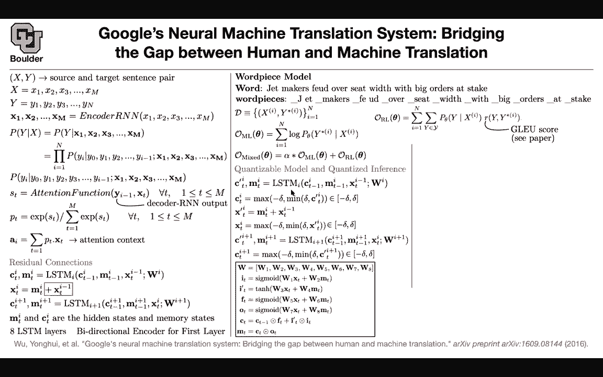

# 115：L55.1- 谷歌神经机器翻译系统 🚀

在本节课中，我们将要学习谷歌神经机器翻译系统。这是首个在性能上超越传统统计机器翻译的神经机器翻译模型，它通过集成多种先进技术，显著提升了翻译质量。我们将详细解析其核心架构、数据处理方法、损失函数设计以及推理优化策略。

## 概述


神经机器翻译在早期阶段，其性能落后于统计机器翻译。相关研究指出，这主要源于两个问题：**句子长度**和**词汇量大小**。注意力机制能有效缓解长句翻译的性能下降问题，而子词单元（如BPE算法）则能解决词汇量过大导致的未知词问题。谷歌的这篇论文采用了一种工程化的方法，集成了当时已知的多种有效技术，最终实现了性能的超越。


## 模型架构：编码器-解码器与注意力机制


上一节我们介绍了神经机器翻译面临的核心挑战，本节中我们来看看谷歌系统的基础模型架构。


神经机器翻译通常基于编码器-解码器框架。给定源语言句子 **X**（长度为 **M**）和目标语言句子 **Y**（长度为 **N**），模型的目标是建模条件概率 **P(Y|X)**。


我们可以使用链式法则将其分解为逐个单词的预测：
```
P(Y|X) = ∏_{i=1}^{N} P(y_i | y_1, ..., y_{i-1}, X)
```


以下是模型的核心组件：


*   **编码器**：通常使用循环神经网络（RNN，如LSTM或GRU）处理输入句子 **X**，将其编码为一系列隐藏状态向量 **h_t**。
*   **解码器**：另一个RNN，用于生成目标句子。在生成第 **i** 个词 **y_i** 时，解码器会参考其自身的当前状态 **s_i** 以及来自编码器的信息。
*   **注意力机制**：这是提升长句翻译性能的关键。解码器在生成每个词时，会计算一个注意力分布 **α_{i,t}**，该分布决定了解码器应该“关注”编码器隐藏状态序列 **h_t** 中的哪些部分。上下文向量 **c_i** 是编码器状态的加权和：
    ```
    c_i = ∑_{t=1}^{M} α_{i,t} h_t
    ```
    注意力分数通常由解码器状态 **s_i** 和编码器状态 **h_t** 通过一个可学习函数（如点积或一个小型神经网络）计算，再经过Softmax归一化得到注意力权重。


## 深层模型与残差连接


仅仅使用基础的编码器-解码器加注意力模型还不够。为了提升模型容量，谷歌系统堆叠了多层网络，并引入了残差连接。


我们了解到注意力机制解决了信息传递的问题，但要构建更强大的模型，还需要解决深度网络中的梯度消失问题。谷歌系统堆叠了**8层LSTM**。


对于深度LSTM，直接训练非常困难。因此，论文借鉴了计算机视觉中ResNet的思想，为LSTM加入了**残差连接**。其核心思想是让网络层学习输出与输入之间的残差（差异），这比学习一个完整的映射函数更容易。


带有残差连接的LSTM层计算如下：
```
# 假设输入是 x_t^i， 第 i 层的LSTM函数是 LSTM^i
h_t^i, c_t^i = LSTM^i(x_t^i, (h_{t-1}^i, c_{t-1}^i)) # 标准LSTM计算
x_t^{i+1} = clip( h_t^i + x_t^i, [-δ, δ] ) # 残差连接与裁剪
```
其中，`clip` 操作将值限制在 `[-δ, δ]` 范围内，这是为后续的模型量化做准备。此外，编码器的第一层是**双向LSTM**，使其能够同时捕获上下文信息。


## 数据处理：子词单元（WordPiece）


解决了模型深度问题后，我们还需要解决词汇量过大导致的未知词问题。谷歌系统采用了**WordPiece模型**（基于BPE算法）。


其核心流程如下：
1.  初始化词汇表为所有字符。
2.  在训练语料中统计所有相邻符号对的频率。
3.  将频率最高的符号对合并成一个新的符号，加入词汇表。
4.  重复步骤2和3，直到词汇表达到预定大小或迭代次数。


例如，句子 “jet makers viewed over seat with big orders” 可能被分割为 “_jet _makers _view ed _over _seat _with _big _orders”。下划线 “_” 表示一个词的开头。这种方法能有效减少未知词，实现**开放词汇表**翻译。


## 损失函数：混合训练目标


我们改进了模型和处理了数据，接下来需要优化训练目标。传统的神经机器翻译使用**最大似然估计（MLE）** 作为损失函数：
```
L_{ML} = - ∑ log P(y_i | y_{<i}, X)
```
但MLE目标与最终评估翻译质量的指标（如**BLEU分数**）并不直接一致。BLEU分数基于n-gram匹配，是不可微的。




为了解决这个问题，谷歌系统引入了**强化学习**的思想。它将整个翻译模型视为一个智能体（agent），将生成翻译句子的过程视为一个动作序列，并将句子级别的BLEU分数（或相关变体）作为奖励（reward）。最终，系统使用一个混合目标函数进行训练：
```
L = (1 - λ) * L_{ML} + λ * L_{RL}
```
其中，`L_{RL}` 是基于奖励的强化学习损失（如策略梯度方法），`λ` 是一个超参数。这种混合目标鼓励模型在保持语言流畅性（MLE）的同时，生成更符合评估标准的高分翻译。

## 推理优化：模型量化与集束搜索

模型训练完成后，为了在实际应用中高效部署，还需要对推理过程进行优化。谷歌系统主要采用了**模型量化**和**改进的集束搜索**。

**模型量化**旨在将训练好的浮点数模型（如FP32）转换为低精度整数模型（如INT8, INT16），从而大幅减少模型存储空间和计算开销，提升推理速度。量化过程包括：
1.  **权重量化**：将浮点权重矩阵 **W** 按行量化为8位整数矩阵 **W_q** 和一个缩放因子。
2.  **激活值量化**：在训练时，通过裁剪（clipping）将LSTM的激活值（如细胞状态 **c_t** 和隐藏状态 **h_t**）限制在固定范围 `[-δ, δ]` 内，使其在推理时可被量化为16位整数。
3.  **整数运算**：在推理时，用整数矩阵乘法代替浮点矩阵乘法，用定点运算近似Sigmoid、Tanh等非线性函数。

**改进的集束搜索**：在解码生成翻译时，标准的集束搜索（Beam Search）直接使用对数概率作为得分，这会导致模型偏向生成更短的句子。谷歌系统引入了**长度惩罚**和**覆盖惩罚**来改进：
```
score = log P(Y|X) / LP(Y) + CP(Y, X)
```
*   **长度惩罚 LP(Y)**：例如 `(5+|Y|)^α / (5+1)^α`，用于缓解对短句的偏好。
*   **覆盖惩罚 CP(Y, X)**：基于注意力权重 **α**，惩罚那些未能充分关注源句子所有部分的翻译假设，鼓励注意力覆盖更全面。

## 总结

本节课中我们一起学习了谷歌神经机器翻译系统。该系统通过集成多种关键技术，首次让神经机器翻译的性能超越了统计机器翻译。我们回顾了其核心组成部分：
1.  **深层LSTM编码器-解码器**与**注意力机制**，解决了长距离依赖问题。
2.  **残差连接**，使得训练多达8层的深度LSTM网络成为可能。
3.  **WordPiece子词单元**，有效处理了开放词汇表问题，消除了未知词。
4.  **混合训练目标**（MLE + 强化学习），使模型优化方向与最终评估指标（BLEU）对齐。
5.  **模型量化**与**改进的集束搜索**，优化了推理速度和解码质量。

这套工程化的解决方案标志着神经机器翻译走向成熟，并为后续更强大的模型（如Transformer）奠定了基础。