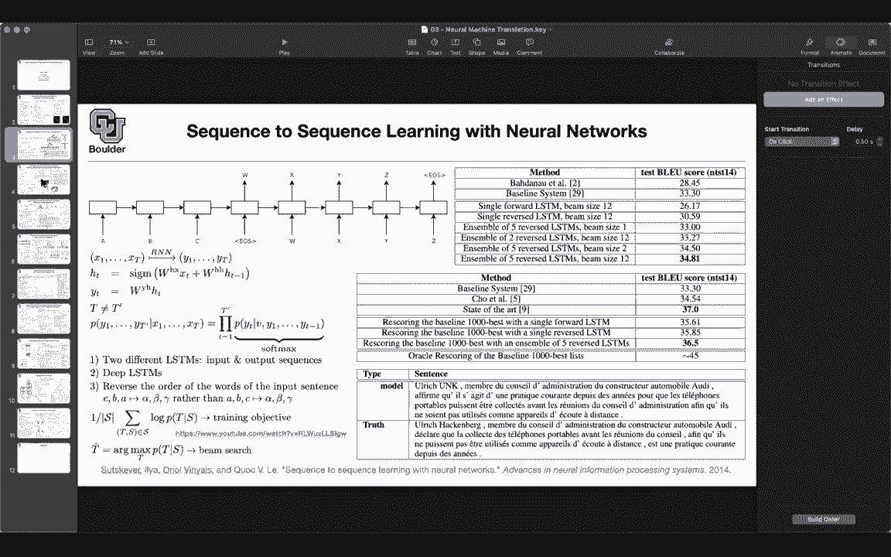
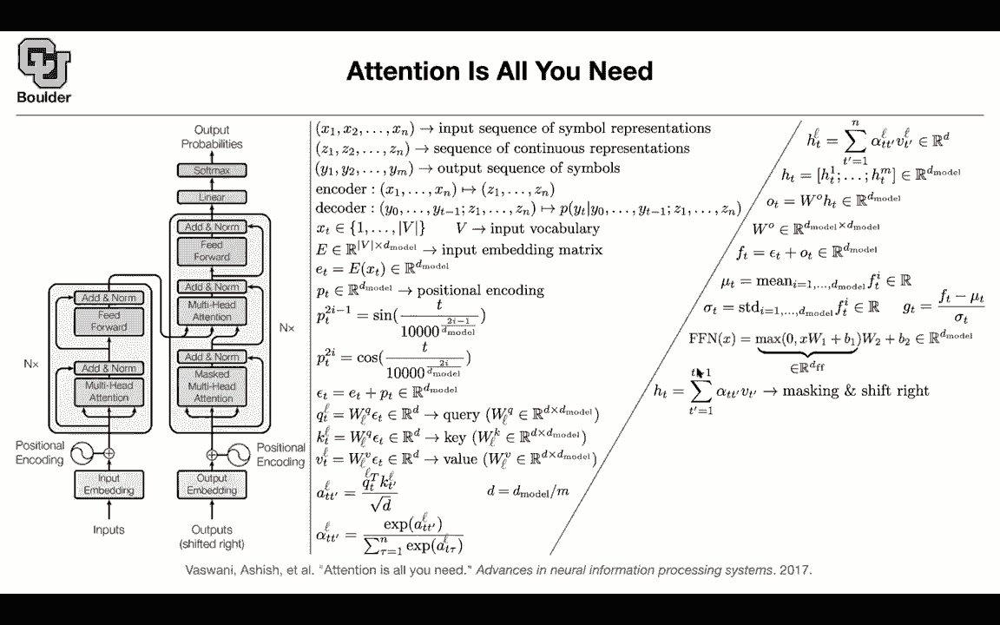

# 117：L56.1 - Transformer 详解 🧠

在本节课中，我们将学习 Transformer 模型的核心架构和工作原理。Transformer 是机器翻译领域的一个重要里程碑，它完全摒弃了循环神经网络（RNN）和卷积神经网络（CNN），仅依靠注意力机制就取得了卓越的性能。

## 概述

在深入 Transformer 之前，我们先快速回顾机器翻译的发展历程。我们最初使用基于 RNN 的编码器-解码器架构，并引入了注意力机制。随后，研究者们尝试仅用序列到序列建模，但性能未能超越传统的统计机器翻译方法。为了解决序列长度和未登录词的问题，注意力机制被重新引入，并结合了字节对编码等技术。最终，Transformer 模型的出现，通过完全依赖注意力机制，成功超越了统计机器翻译的性能，并因其并行处理能力而备受青睐。

## Transformer 整体架构

Transformer 模型依然遵循编码器-解码器架构。输入一个句子（例如英文），编码器将其编码为一系列连续的向量表示。解码器则接收这些编码表示以及已生成的部分目标句子，来预测下一个词的概率。

*   **输入**：一个句子，可以看作是一系列数字 `X1, X2, ..., Xn`，每个数字对应词汇表中的一个词。
*   **编码器**：接收输入序列 `X1...Xn`，输出连续向量表示序列 `Z1...Zn`。
*   **解码器**：接收编码器输出 `Z1...Zn` 以及已生成的目标序列 `y0...y(t-1)`，输出下一个词 `y_t` 的概率。

## 输入表示

输入 `X_t` 是词汇表中的索引。第一步是词嵌入，我们通过一个嵌入矩阵 `E` 将每个索引 `X_t` 转换为一个向量 `e_t`。公式为：`e_t = E[X_t]`。

由于 Transformer 并行处理整个句子，失去了词序信息，因此需要引入位置编码 `P_t` 来告知模型每个词在序列中的位置。位置编码可以通过学习得到，也可以使用正弦和余弦函数生成：

*   在位置 `pos` 的向量中，对于偶数维度 `i`，使用 `sin(pos / 10000^(i/d_model))`。
*   对于奇数维度 `i`，使用 `cos(pos / 10000^(i/d_model))`。

最终，词的输入表示是词嵌入向量和位置编码向量的和：`ε_t = e_t + P_t`。

## 注意力机制

注意力机制是 Transformer 的核心。我们为每个输入 `ε_t` 生成三个向量：查询（Query）、键（Key）和值（Value）。这是通过乘以三个不同的权重矩阵实现的：
`Q_t = ε_t * W_Q`, `K_t = ε_t * W_K`, `V_t = ε_t * W_V`。

接下来是自注意力计算：
1.  **计算注意力分数**：通过计算查询向量 `Q_t` 与所有键向量 `K_{t'}` 的点积，来衡量 `t` 位置与 `t'` 位置的相关性。分数为：`score(Q_t, K_{t'}) = Q_t · K_{t'}^T`。
2.  **缩放**：为了防止点积结果过大，将分数除以键向量维度的平方根 `√d_k`。
3.  **归一化**：使用 softmax 函数将分数转换为概率分布（所有权重和为1），得到注意力权重 `α_{t,t'}`。
4.  **加权求和**：用注意力权重对值向量 `V_{t'}` 进行加权求和，得到 `t` 位置的输出表示：`h_t = Σ_{t'} α_{t,t'} * V_{t'}`。

## 多头注意力

为了增强模型关注不同信息的能力，我们使用多头注意力。简单来说，就是将上述注意力过程并行执行 `h` 次（即 `h` 个头），每次使用不同的 `W_Q, W_K, W_V` 矩阵，产生 `h` 个输出向量。最后，将这 `h` 个向量拼接起来，再通过一个线性层 `W_O` 进行变换，得到最终输出。这类似于分组卷积的思想。

## 前馈网络与层归一化

在注意力层之后，每个位置的输出会经过一个前馈神经网络。这是一个简单的两层全连接网络，对每个位置独立处理（类似于 1x1 卷积）。公式为：`FFN(x) = max(0, xW_1 + b_1)W_2 + b_2`。

Transformer 还使用了残差连接和层归一化来稳定训练：
*   **残差连接**：将子层（如注意力层或前馈层）的输入加到其输出上，即 `LayerOutput(x) = LayerNorm(x + Sublayer(x))`。
*   **层归一化**：对每个位置的向量独立进行归一化，计算其均值和方差，然后进行标准化。这与批归一化不同，不依赖于批次内其他样本。

编码器由多个相同的层堆叠而成，每层都包含一个多头自注意力子层和一个前馈网络子层，每个子层后都接有残差连接和层归一化。

## 解码器

解码器的结构与编码器类似，但包含三层：
1.  **掩码多头自注意力层**：对目标序列进行自注意力计算。为了防止模型在预测当前位置时“偷看”未来的词，使用了掩码机制，确保在计算 `t` 位置的注意力时，只考虑 `1` 到 `t-1` 位置的词。
2.  **编码器-解码器注意力层**：查询（Query）来自解码器上一层的输出，而键（Key）和值（Value）来自编码器的输出。这使得解码器在生成每个词时，可以关注输入序列的相关部分。
3.  **前馈网络层**：与编码器中的相同。

解码器的每个子层后面同样有残差连接和层归一化。最后，解码器的输出通过一个线性层和 softmax 函数，转换为目标词汇表上的概率分布。

## 性能与总结

Transformer 模型（特别是更大的版本）在机器翻译任务上取得了当时最好的性能（BLEU 分数）。尽管模型参数量大，但由于其高度并行性，训练效率很高，收敛速度可能更快。

本节课我们一起学习了 Transformer 模型。它彻底改变了序列建模的方式，证明了**注意力机制本身足以构建强大的模型**。其核心在于：
1.  使用**自注意力**和**多头注意力**来捕获序列内部及序列间的复杂依赖关系。
2.  引入**位置编码**来弥补并行处理带来的词序信息缺失。
3.  通过**残差连接**和**层归一化**来构建非常深的网络并稳定训练。
4.  解码器使用**掩码注意力**以确保自回归生成过程的正确性。

Transformer 的设计简洁而强大，为后续如 BERT、GPT 等预训练模型奠定了基础。