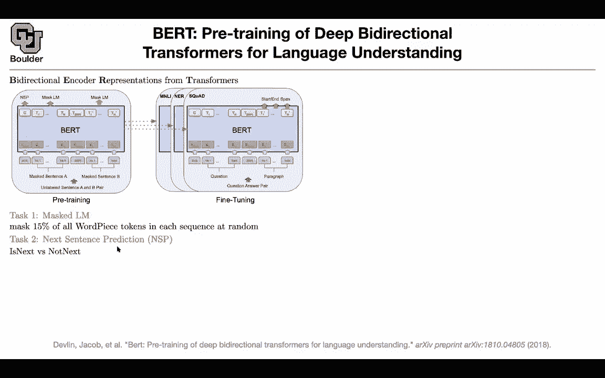
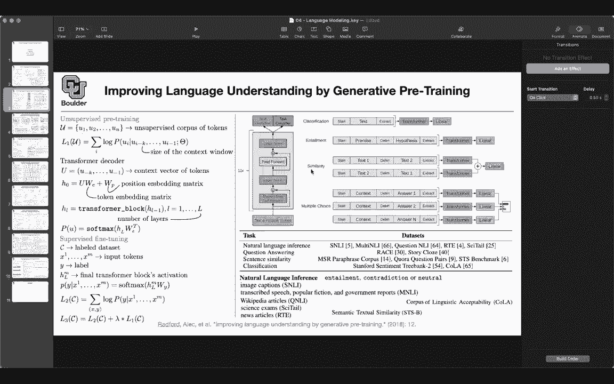
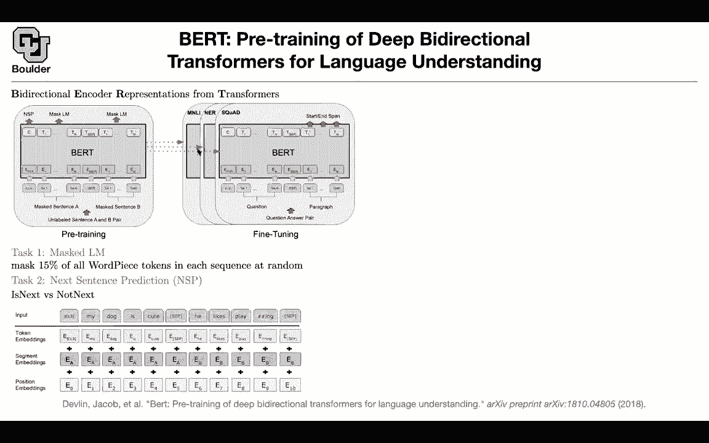

# 121：L58.1 - BERT 🧠

在本节课中，我们将学习BERT模型。BERT是“来自Transformer的双向编码器表示”的缩写。我们将了解BERT如何利用Transformer的编码器部分，以及它如何通过两种新颖的预训练任务来学习通用的语言表示，从而在下游任务上取得优异表现。

---

## 从语言建模到BERT

上一节我们介绍了语言建模和GPT模型。本节中我们来看看BERT模型。BERT的核心思想依然是**预训练-微调**范式。但与GPT使用Transformer的解码器进行自回归预测不同，BERT使用了Transformer的**编码器**，并设计了两种新的预训练任务。

BERT的全称是 **Bidirectional Encoder Representations from Transformers**。其中的“双向”是关键，因为编码器允许每个词关注句子中所有其他词（包括前后的词），而不仅仅是左侧的上下文。

---

## BERT的预训练任务

BERT通过两个任务在大量无标签文本上进行预训练，以学习通用的语言表示。

以下是BERT的两个核心预训练任务：

1.  **掩码语言模型**
    *   在输入句子中，随机遮盖（用`[MASK]`标记替换）约15%的词。
    *   模型的任务是预测这些被遮盖的原始词是什么。
    *   例如，句子“New York is a city”可能被处理为“New `[MASK]` is a city”，模型需要预测出“York”。

2.  **下一句预测**
    *   模型接收两个句子作为输入。
    *   任务是判断第二个句子是否是第一个句子的实际下一句（是/否）。
    *   这有助于模型理解句子间的关系，对问答、推理等下游任务有益。

BERT的总损失函数是这两个任务损失的和：`L_total = L_MLM + L_NSP`。

---

## BERT的输入与架构

BERT的输入经过精心设计，以同时支持上述两个任务。

以下是BERT输入的处理步骤：

*   **词嵌入**：每个词被转换为一个向量。BERT可以随机初始化这些向量，无需依赖预训练的词向量（如GloVe）。
*   **句子嵌入**：添加一个额外的向量来标识一个词属于句子A还是句子B。
*   **位置嵌入**：由于Transformer并行处理所有词，会丢失顺序信息，因此需要添加位置编码向量来恢复词序。这些位置向量可以是可学习的参数。
*   **特殊标记**：
    *   `[CLS]`：位于序列开头，其对应的输出向量用于分类任务（如NSP）。
    *   `[SEP]`：用于分隔两个句子。

所有这些嵌入向量会**相加**，形成每个输入词的最终表示，然后送入Transformer编码器堆栈。

---

## 从预训练到下游任务微调

预训练完成后，我们得到一个充满语言知识的BERT模型。接下来，我们可以针对特定的下游任务对其进行微调。

以下是针对不同下游任务的微调方式：

*   **句子对分类**（如自然语言推理、语义相似度）：
    *   输入两个句子，用`[SEP]`分隔。
    *   使用`[CLS]`位置的输出向量，接上一个任务特定的小型分类层（称为“头”）进行预测。
*   **单句分类**（如情感分析）：
    *   输入单个句子。
    *   同样使用`[CLS]`位置的输出向量进行分类。
*   **序列标注**（如命名实体识别）：
    *   输入一个句子。
    *   使用**每个词**对应的输出向量（而非`[CLS]`）进行分类，判断每个词的实体类型。
*   **问答任务**（如SQuAD）：
    *   输入一个问题和一段包含答案的文本。
    *   模型需要预测答案在文本中的**起始位置**和**结束位置**。
    *   具体做法：为整个序列的每个输出向量计算两个分数（与可学习的“起始向量”和“结束向量”的相似度），然后通过softmax分别得到每个位置作为起始或结束的概率。最终答案是在所有可能的连续片段中，选择“起始概率 × 结束概率”得分最高的片段。

在微调时，通常会在BERT模型顶部添加一个简单的任务特定层，然后**联合微调所有参数**（包括BERT主体和新添加的层）。

---

## 总结

本节课中我们一起学习了BERT模型。我们了解到BERT通过使用Transformer的**编码器**实现了**双向**的上下文理解。它通过**掩码语言模型**和**下一句预测**这两个任务进行预训练，从而学习到强大的通用语言表示。最后，我们可以通过简单的**微调**，将预训练好的BERT模型轻松适配到各种下游NLP任务中，如分类、标注和问答。BERT的成功证明了在大规模无监督数据上进行预训练，再进行有监督微调这一范式的巨大潜力。