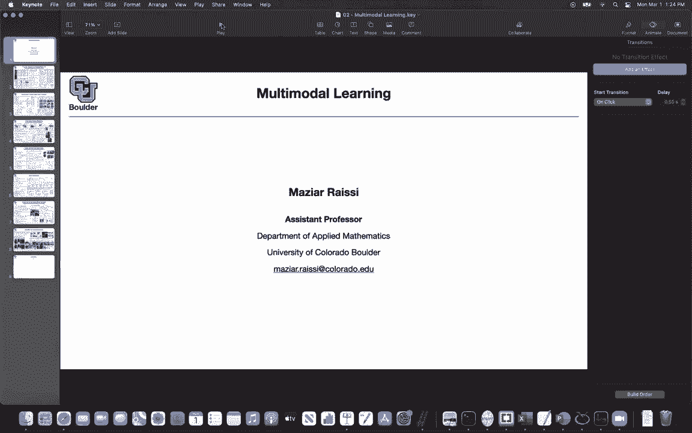
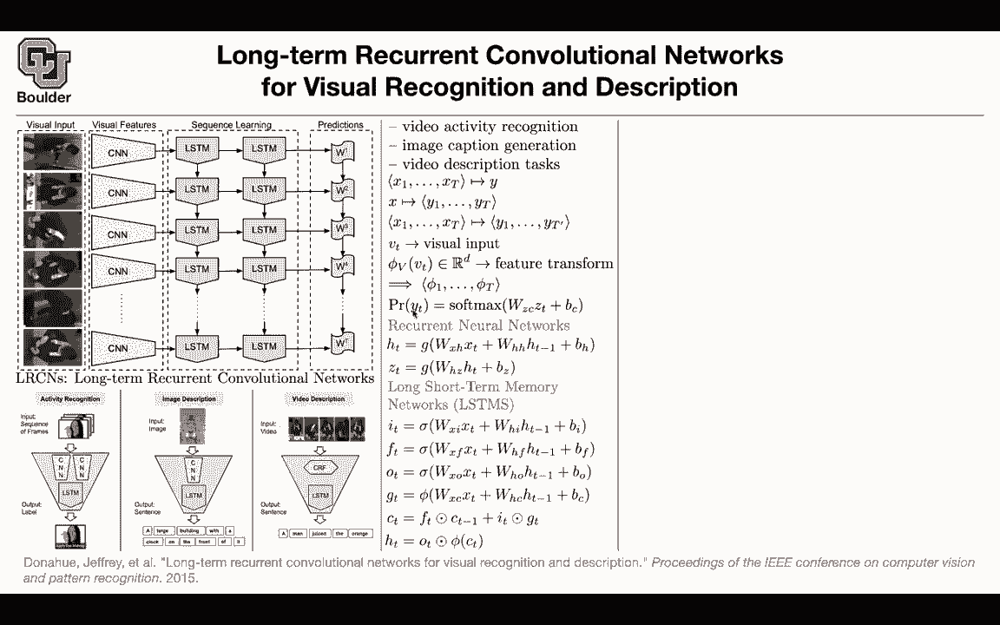
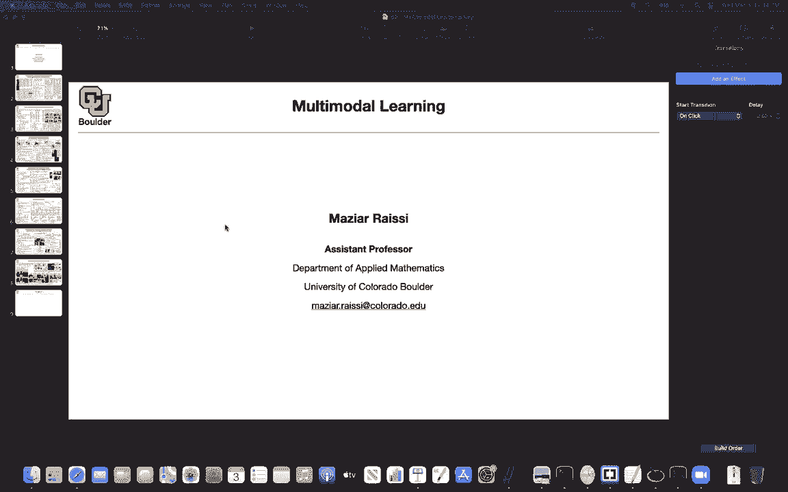
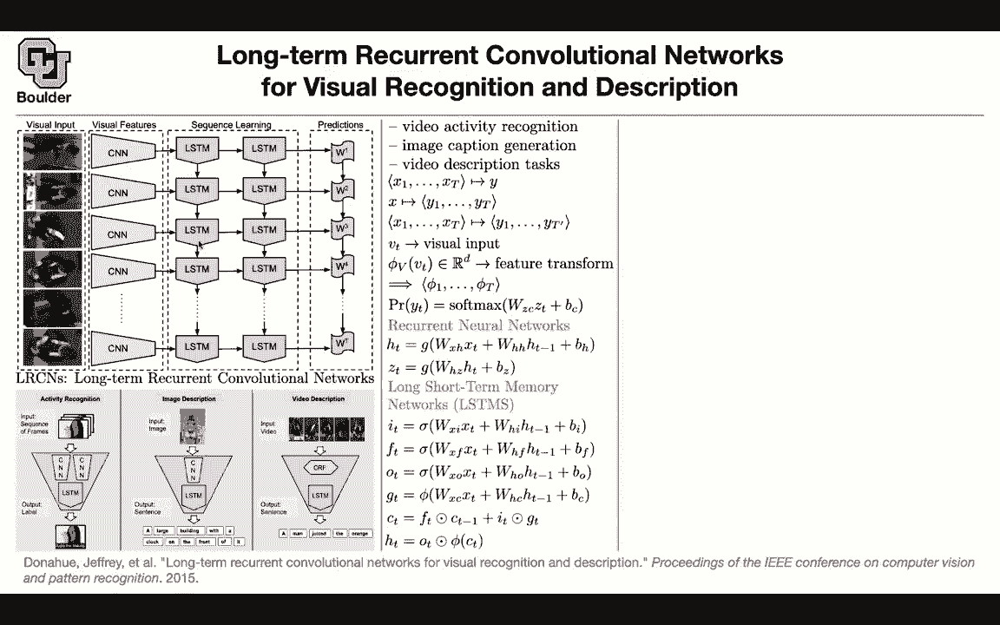

# 128：L61.1 - 视觉识别与描述 📹📝

在本节课中，我们将要学习多模态学习。我们希望通过结合视频、图像和语音来“接地”语言模型，使模型在谈论某事物时，至少“见过”该事物。我们正朝着通用人工智能迈进，但步伐很小。让我们从这篇名为《用于视觉识别与描述的长短期循环卷积网络》的论文开始，它被称为LRCN。

## 任务概述 🎯

上一节我们介绍了多模态学习的目标，本节中我们来看看LRCN论文试图解决的具体任务。

以下是LRCN可以处理的几种任务类型：

*   **活动识别**：输入一段视频，输出对该视频内容的描述。例如，输入一段视频，模型判断出“此人正在画眼妆”。
*   **图像描述**：输入一张图像，输出一句描述它的句子。例如，输入一张建筑图片，模型输出“一栋正面有时钟的大型建筑”。
*   **视频描述**：输入一段视频，输出一句描述它的句子。

这些任务涉及图像和语言两种模态，因此称为多模态。视频可以看作是一系列连续的图像快照。所以，这些任务的输入和输出可以概括为：

*   **活动识别**：输入是图像序列（视频），输出是一个标签（分类任务）。
*   **图像/视频描述**：输入是图像或图像序列，输出是词序列（序列生成任务）。

本质上，这是一个序列到序列的框架，只不过第一个序列是图像序列，第二个序列是词序列。多模态框架也可以是反向的，例如输入句子生成图像。

## 模型框架解析 🏗️

了解了任务类型后，我们来看看LRCN模型是如何构建的。

设视觉输入为 `V_T`，即一系列图像 `V1, V2, ..., VT`。处理流程如下：

1.  **特征提取**：将每张图像 `V_t` 输入一个卷积神经网络。你可以暂时将CNN视为一个特征提取器：图像输入，一个 `D` 维向量输出。公式表示为：`x_t = CNN(V_t)`，其中 `x_t ∈ R^D`。这样，图像序列就被转换成了向量序列。
2.  **序列建模**：现在我们可以用向量工作了。我们将这些向量序列 `{x_1, x_2, ..., x_T}` 输入一个循环神经网络进行处理。RNN可以是简单的版本，也可以是更复杂的版本，如LSTM。
3.  **输出预测**：RNN在每个时间步会输出一个隐藏状态 `z_t`。对于不同的任务，我们使用不同的输出层参数 `W_t` 来处理 `z_t`。
    *   对于**分类任务**（如活动识别），通常在最后一个时间步的 `z_T` 后接一个Softmax层来预测类别。公式为：`P(class) = softmax(W * z_T)`。
    *   对于**序列生成任务**（如图像描述），每个时间步的 `z_t` 都会通过一个Softmax层来预测下一个词，其参数可能是共享的 `W` 或特定的 `W_t`。公式为：`P(word_t | x_{<t}) = softmax(W_t * z_t)`。

在这个框架中，CNN的权重在所有时间步是共享的，RNN/LSTM的权重也是共享的，但输出层的参数 `W` 可能因任务而异。

## 数据集与评估指标 📊

我们已经了解了模型框架，现在需要知道如何训练和评估它。这离不开合适的数据集和评估标准。

### 活动识别数据集

一个常用的数据集是UCF101，它包含101类人类活动。对于视频任务，一个简单的基线方法是只取视频的**单帧**图像，用CNN进行分类。更高级的方法会利用多帧信息（如LRCN）或**光流**信息。光流描述了相邻帧之间像素的运动，包含X和Y两个方向的分量。

模型输入可以是RGB图像、光流图，或者两者的加权组合。在UCF101上，LRCN通过处理多帧信息，性能超越了单帧基线模型。

### 图像描述数据集与指标

常用的数据集有Flickr30k和MS COCO。对于图像描述任务，由于对同一张图像可能存在多个同样正确的描述，我们使用**BLEU分数**来评估生成句子与参考句子的相似度。`B1, B2, B3, B4` 分别代表考虑1到4元语法（n-gram）的BLEU分数。

另一个相关任务是**检索任务**：给定一张图像，从候选句子库中找出最匹配的描述。常用指标有：
*   **召回率@K**：正确描述出现在前K个检索结果中的比例。`R@1` 比 `R@5` 或 `R@10` 要求更严格。
*   **中位数排名**：正确描述在所有结果中排名的中位数。数值越低越好。

检索任务的评分基于模型计算出的条件概率：`P(句子|图像)` 或 `P(图像|句子)`。

## 视频描述的挑战与处理 🎥

最后，我们探讨一下视频描述任务。当时面临的主要挑战是**标注数据不足**，因为为视频生成描述需要大量人工。

论文中采用了一种折中方案：
1.  首先，使用传统的机器学习方法（如条件随机场）对视频中的每一帧进行分析，生成一系列描述性的短语（例如：“人”、“砧板”、“切割”）。
2.  然后，将这些短语作为序列输入LSTM。
3.  LSTM学习将这些短语组织成一句通顺的完整描述（例如：“一个人在砧板上切东西”）。

这种方法虽然不是端到端的纯视觉输入，但在数据有限的情况下提供了一种可行的解决方案。

## 总结 📝

本节课中我们一起学习了多模态学习中的视觉识别与描述任务。我们从LRCN模型框架出发，了解了它如何利用CNN提取图像特征，并用RNN处理序列信息，以完成活动识别、图像描述和视频描述等任务。我们还介绍了相关的数据集（如UCF101、Flickr30k、MS COCO）和评估指标（如BLEU分数、召回率@K）。最后，我们讨论了视频描述任务的数据挑战及其一种解决思路。通过结合视觉与语言，我们正在让人工智能模型更贴近真实世界的感知与表达。