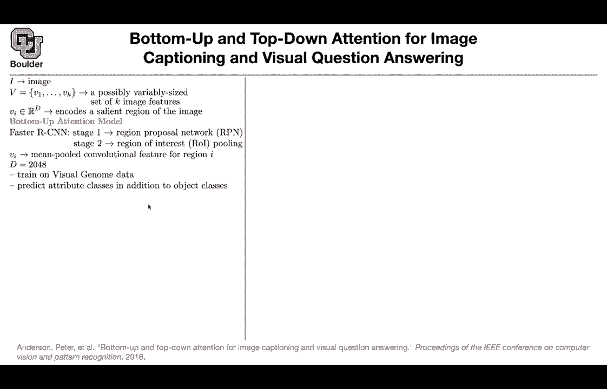
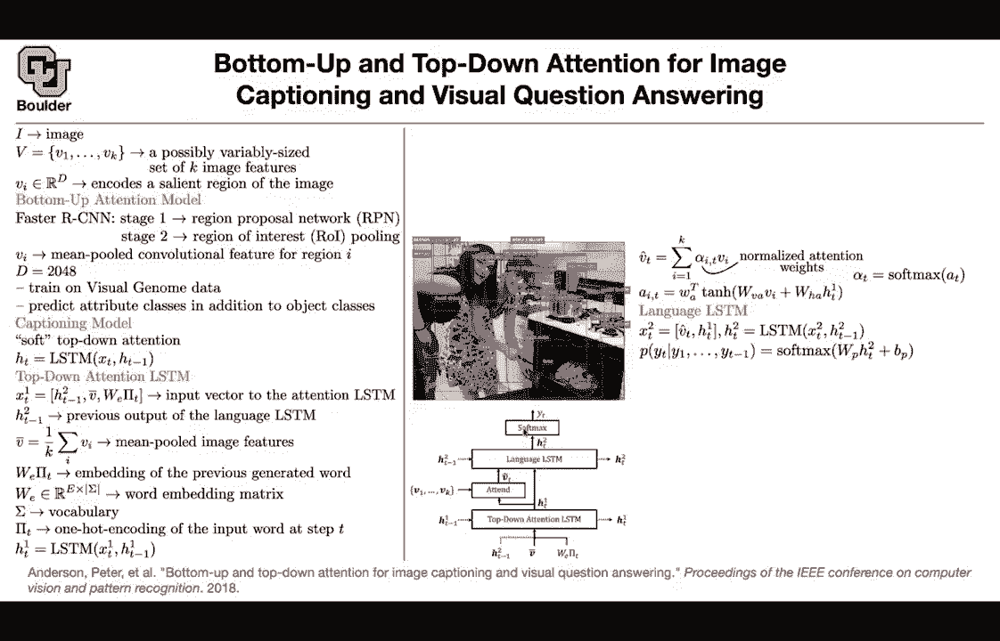
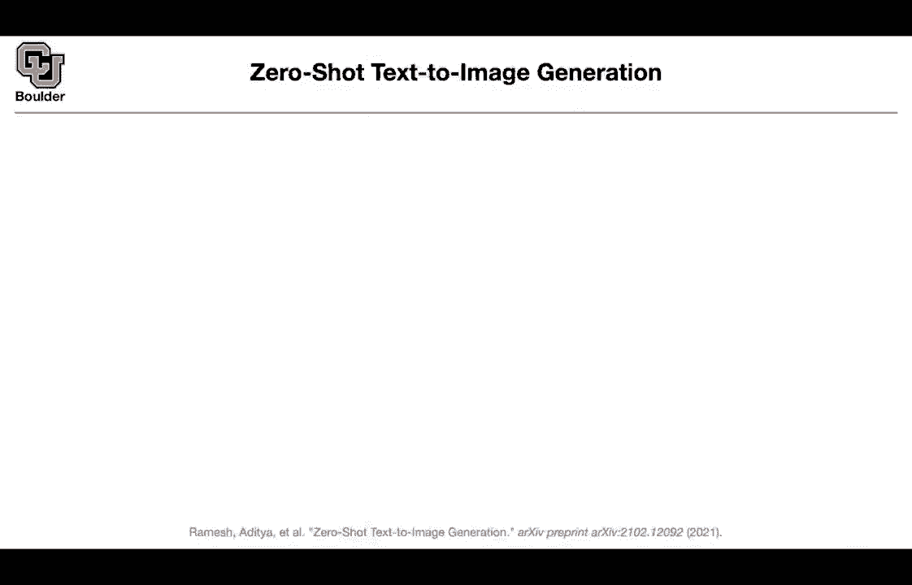

# 133：视觉问答 (Visual Question Answering) 🖼️❓ 📚

在本节课中，我们将学习视觉问答任务。我们将了解如何结合图像和文本信息，让模型能够回答关于图像内容的问题。课程将涵盖从图像中提取特征（自底向上）到生成答案（自顶向下）的完整流程，并解释其中的注意力机制。

---

## 🖼️ 图像特征提取：自底向上方法

上一节我们介绍了视觉任务的基本概念，本节中我们来看看如何从图像中提取用于问答的特征。我们不再使用传统的卷积神经网络输出固定网格特征图的方法，而是采用一种不同的方法将图像转化为一组向量。

我们采用一个物体检测系统来处理图像。在课程第一部分我们曾介绍过，例如Faster R-CNN。它包含两个组件：区域提议网络和区域特征提取。我们将其视为一个黑盒，它能为我们提供图像中物体的边界框。

以下是处理步骤：

1.  系统为图像中的物体生成边界框。
2.  对于每个边界框（例如一个24x12像素的区域），我们提取其对应的特征（这些特征通常是高维向量，例如d维）。
3.  我们计算该边界框内所有特征向量的平均值，从而得到代表该物体的一个向量。
4.  每张图像会产生多个这样的边界框，因此我们最终得到一组向量（K个向量）。每个向量可能具有248个维度，这来自用于训练的神经网络。

这个系统在Visual Genome数据集上进行训练。它的预测不仅包括物体类别（例如“人”、“杯子”），还包括物体的属性（例如“长发”、“黑色杯子”、“白色插座”、“绿色瓶子”）。

因此，每张图像输入后，我们通过这个自底向上的框架，得到一组代表图像中各个物体及其属性的向量（K个向量）。

---

## 🤖 生成模型：结合自顶向下注意力

现在我们已经有了从图像中提取出的一组向量，接下来我们构建用于生成描述的模型。我们的目标是输入图像，输出对应的文本描述。

我们将使用LSTM模型，但LSTM的输入会有所不同。模型分为两个阶段：一个语言LSTM和一个自顶向下注意力的LSTM。

以下是模型的核心组件与流程：

*   **语言LSTM**：它有自己的隐藏状态，我们记为 `h_t^2`。
*   **输入 `x_t`**：它由三部分组成：
    1.  `v̄`：图像中所有特征向量的平均值。
    2.  `E * y_{t-1}`：前一个预测单词的词嵌入。其中 `E` 是词嵌入矩阵，`|Σ|` 是词汇表大小，`d` 是嵌入维度（超参数），`π_t` 是输入单词的编码。
    3.  `h_t^1`：来自下方自顶向下注意力LSTM的前一个隐藏状态。
*   **注意力机制**：这是关键部分。语言LSTM的隐藏状态 `h_t^2` 需要关注图像的那组向量 `V`。注意力机制会计算 `h_t^2` 与每个图像向量 `v_i` 的相关性得分，然后通过Softmax函数将这些得分转化为权重 `α_{ti}`（所有权重之和为1）。这决定了在生成当前单词时，模型应该“看”图像的哪个部分。
    *   **公式**：`α_t = softmax( score( h_t^2, V ) )`
    *   加权的图像特征 `v̂_t = Σ_i ( α_{ti} * v_i )`
*   **语言LSTM的输入与输出**：语言LSTM的输入是加权后的图像特征 `v̂_t` 和来自下方LSTM的隐藏状态 `h_t^1`。其输出经过一个Softmax层（大小等于词汇表），用于预测下一个单词的概率。
*   **训练目标**：对于给定的图像和真实描述 `y`，模型的目标是最大化生成正确描述序列的似然概率。这通过最小化交叉熵损失函数来实现。
    *   **公式**：`L = - Σ_t log( p( y_t | y_{<t}, image ) )`

通过这种方式，模型可以生成如“两个男人在昏暗的场地上玩飞盘”这样的描述。我们还可以可视化注意力：当模型生成“飞盘”这个词时，权重 `α_{ti}` 最大的那个边界框，就是模型最关注的地方（即图像中的飞盘）。

---

## ❓ 扩展到视觉问答任务

视觉问答任务与图像描述不同。在图像描述中，输入是图像，输出是描述。而在视觉问答中，输入是图像和一个问题，输出是对应问题的答案（或答案的概率）。

以下是视觉问答模型的构建步骤：

1.  **处理问题**：问题是一个句子（例如14个单词）。我们首先将其标记化为整数序列，然后通过词嵌入层转化为一个向量序列（例如14个300维向量）。
2.  **处理图像**：图像通过Faster R-CNN等检测器，得到K个特征向量。
3.  **编码问题**：将问题词嵌入序列输入一个GRU网络，得到另一个向量序列（例如14x512）。我们通常取最后一个时间步的输出或所有时间步输出的平均值，得到一个单一的512维向量 `q`，它代表了整个问题的语义。
4.  **计算图像注意力**：将问题向量 `q` 与每个图像特征向量 `v_i` 结合，计算注意力权重。这通常通过以下步骤实现：
    *   将 `q` 和每个 `v_i` 分别通过线性层和非线性激活函数进行变换。
    *   计算变换后的 `q` 和每个 `v_i` 之间的相关性得分。
    *   对得分应用Softmax，得到每个图像区域的注意力权重 `α_i`。
5.  **生成答案**：使用注意力权重对图像特征向量进行加权求和，得到一个聚焦于问题相关区域的图像上下文向量 `c`。
    *   **公式**：`c = Σ_i ( α_i * v_i )`
6.  **预测答案**：将问题向量 `q` 和图像上下文向量 `c` 融合（例如拼接或逐元素相乘），然后通过一系列全连接层和最终的Softmax层，预测出答案的概率分布。在这个简化模型中，答案通常从一个固定的候选答案集合（多选题）中选择。

**与生成式问答的区别**：上述方法是一个判别式模型，从固定选项中选择答案。我们也可以构建生成式模型，像图像描述任务一样，逐词生成答案序列。这需要更大的词汇表和更复杂的训练，但能处理开放域问答。

---

## 📝 课程总结

本节课中我们一起学习了视觉问答的核心技术。

我们首先介绍了**自底向上的图像特征提取方法**，使用物体检测系统（如Faster R-CNN）将图像转化为一组包含物体和属性的特征向量。

接着，我们探讨了结合**自顶向下注意力的序列生成模型**，详细说明了如何利用LSTM和注意力机制，根据图像特征生成描述文本，并可视化了注意力的聚焦过程。

最后，我们将框架扩展到**视觉问答任务**，解释了如何处理问题和图像，通过注意力机制关联两者，并最终预测出答案。我们比较了基于固定选项的判别式方法和开放域生成的生成式方法。

通过本课，你应该对如何让机器“看懂”图像并回答相关问题有了基本的理解。