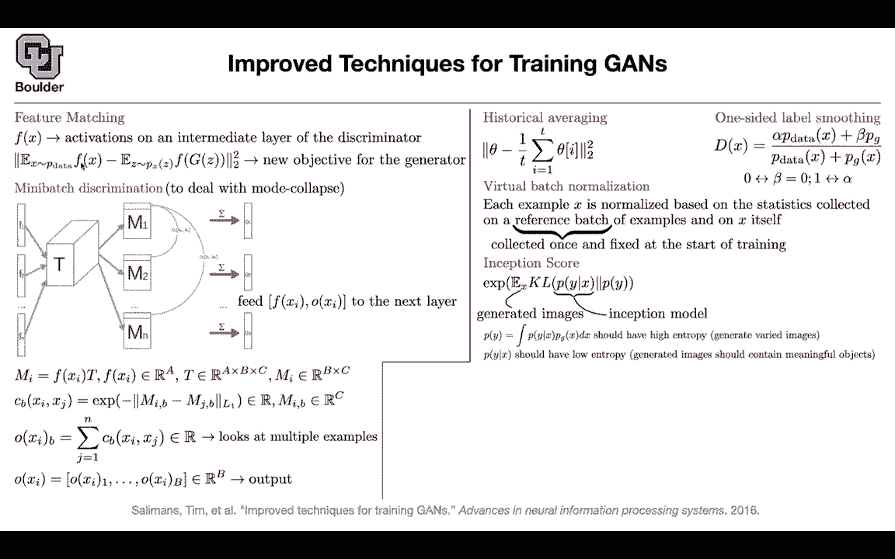

# 139：L65.2 - 对抗生成网络改进与Inception Score评估 🧠

在本节课中，我们将学习如何改进生成对抗网络的训练，并介绍一个用于评估生成图像质量的量化指标——Inception Score。我们将探讨模式崩溃问题及其解决方案，并详细解释Inception Score的计算方法和直观理解。

上一节我们介绍了通过改变网络架构来帮助GAN收敛。本节中我们来看看其他改进方法，例如改变损失函数或引入其他启发式技巧。

## 模式崩溃问题与特征匹配 🎯

GAN训练中存在一个常见问题：**模式崩溃**。在训练过程中，生成器学到的分布可能会坍缩到真实数据分布的单一模式上，而忽略其他模式。

为了解决这个问题，一个思路是改变判别器的使用方式。我们不再将判别器的最后一层输出视为一个概率，而是**使用其内部特征层**。具体做法是：取一张图像，通过判别器网络，在最终分类层之前停止，得到一个特征向量。然后，我们比较真实数据特征向量的平均值和生成器生成数据特征向量的平均值，并使用L2范数作为目标函数进行优化。

以下是特征匹配目标函数的简化表示：
`L_feat = || E_{x~p_data}[f(x)] - E_{z~p_z}[f(G(z))] ||^2`
其中，`f(x)` 表示判别器在特征层的输出。

这是一种启发式的改进方法。

## 小批量判别 👥

另一种应对模式崩溃的策略是**小批量判别**。其核心思想是：在训练时，不是独立地看待每个数据点，而是考虑一个小批量数据中的所有样本。这样，批次中的其他数据可以帮助网络避免坍缩到单一模式。

具体操作如下：假设一个小批次中有 `n` 张图像。每张图像 `x_i` 通过判别器网络得到一个特征向量 `f_i`。我们引入一个可学习的张量 `T`，其尺寸为 `A x B x C`，其中 `A` 是特征向量的维度。通过 `f_i` 与 `T` 的运算，我们得到一组矩阵 `M_i`，其尺寸为 `B x C`。

对于第 `i` 个样本，我们计算其输出向量 `o_i` 的第 `b` 个元素，公式如下：
`o_{i,b} = sum_{j=1}^{n} exp(-|| M_{i,b} - M_{j,b} ||_{L1})`
这里，`M_{i,b}` 是矩阵 `M_i` 的第 `b` 行向量。这个计算让每个样本的输出 `o_i` 都“关注”了批次中所有其他样本的信息。最终，我们将原始的独立特征 `f_i` 与这个具有依赖关系的输出 `o_i` 拼接起来，作为下一层的输入。

## 其他训练技巧 🛠️

以下是几种有助于GAN稳定训练的其他技巧：

*   **历史参数平均**：在梯度下降过程中，由于数据噪声，参数可能会振荡。保持参数的一个移动平均值有助于稳定训练。
*   **单侧标签平滑**：在训练判别器时，我们不使用硬标签（如真实数据标签为1，生成数据标签为0），而是使用平滑后的标签（例如，将真实数据标签设为0.9，生成数据标签仍为0）。这可以使判别器不那么敏感。需要注意的是，通常只平滑真实数据的标签（单侧），以避免生成器的错误将判别器拉向错误预测。
*   **虚拟批量归一化**：标准批量归一化的统计量依赖于当前批次，可能不稳定。我们可以固定一个参考批次，在训练开始时选定并保持不变。每个新样本的归一化统计量都基于这个固定参考批次和当前样本计算，从而减少统计量的波动。

## Inception Score：生成图像的量化评估 📊

即使GAN成功收敛，我们如何客观地比较不同生成器生成的图像质量呢？一种方法是人工评估，但这很主观。Inception Score 提供了一个**定量评估指标**。

其基本思想是：使用一个在大型数据集（如ImageNet）上预训练好的分类网络（例如Google的Inception网络）。我们将生成器产生的图像输入这个网络，得到图像属于各个类别的概率分布 `p(y|x)`。

Inception Score 的计算公式如下：
`IS(G) = exp(E_{x~p_g}[ KL( p(y|x) || p(y) ) ])`
其中：
*   `p(y|x)`：单张生成图像 `x` 的类别概率分布（由Inception网络给出）。
*   `p(y)`：所有生成图像的边缘类别概率分布，即 `p(y) = ∫ p(y|x) p_g(x) dx`，在实际中通过对一批生成图像的 `p(y|x)` 求平均来近似。
*   `KL` 表示KL散度，用于衡量两个分布的差异。

**直观理解**：
1.  **清晰度**：对于一张高质量的生成图像，Inception网络应该能以很高的置信度将其归类到某个特定类别，即 `p(y|x)` 的熵应该很低（概率集中在一个类上）。
2.  **多样性**：一个好的生成器应该能生成多种类别的图像，即所有生成图像的类别分布 `p(y)` 应该是均匀的，其熵应该很高。

KL散度 `KL( p(y|x) || p(y) )` 恰恰衡量了这两个分布之间的差异。当每个 `p(y|x)` 都很尖锐（清晰），且整体的 `p(y)` 很平坦（多样）时，KL散度值会很大，从而Inception Score也会很高。指数运算只是为了将通常很小的KL散度值放大，便于比较。

---

本节课中我们一起学习了对抗生成网络的几种改进方法，包括应对模式崩溃的特征匹配与小批量判别，以及稳定训练的历史平均、标签平滑和虚拟批量归一化等技巧。最后，我们深入探讨了用于评估生成图像质量的量化指标——Inception Score，理解了其通过衡量生成图像的清晰度和多样性来给出评分的原理。掌握这些内容将有助于你更好地训练和评估GAN模型。