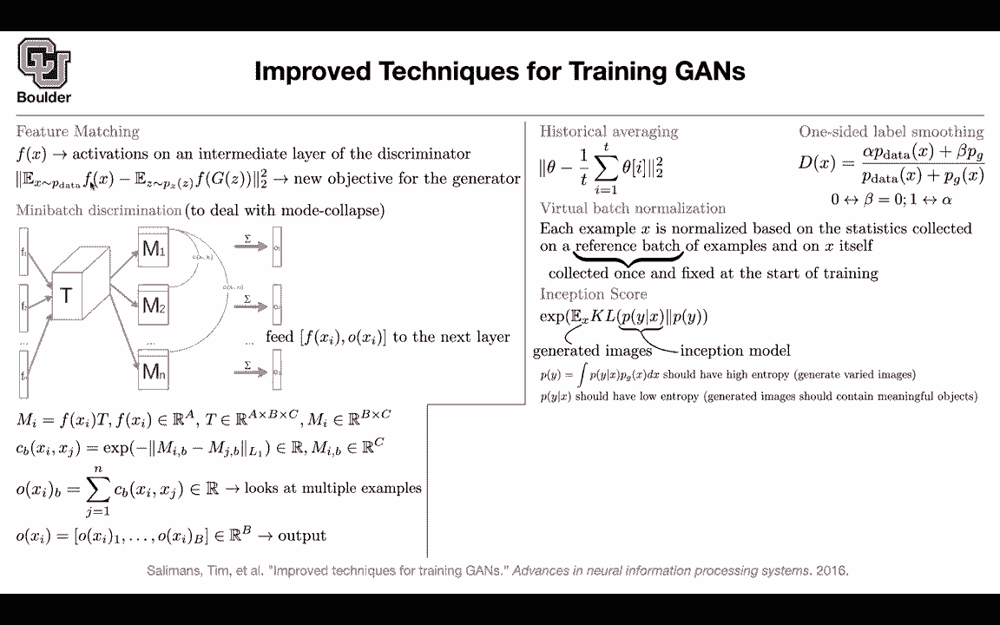
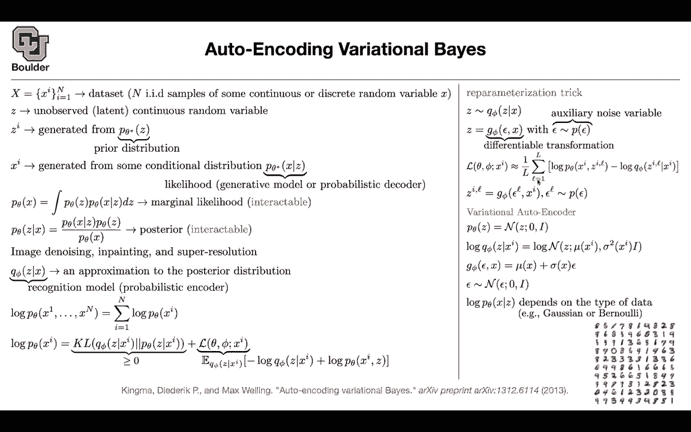
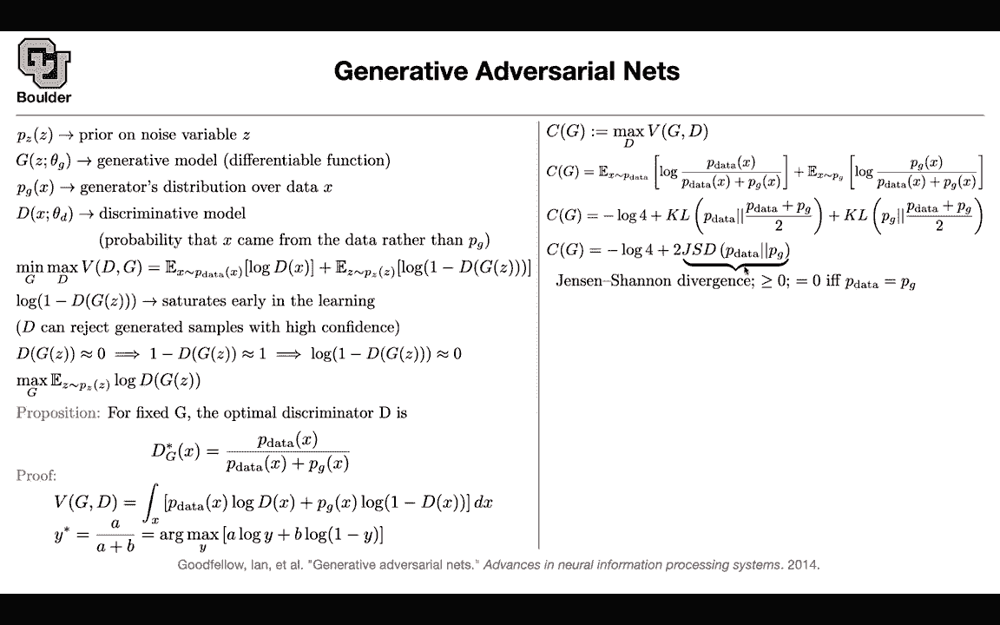
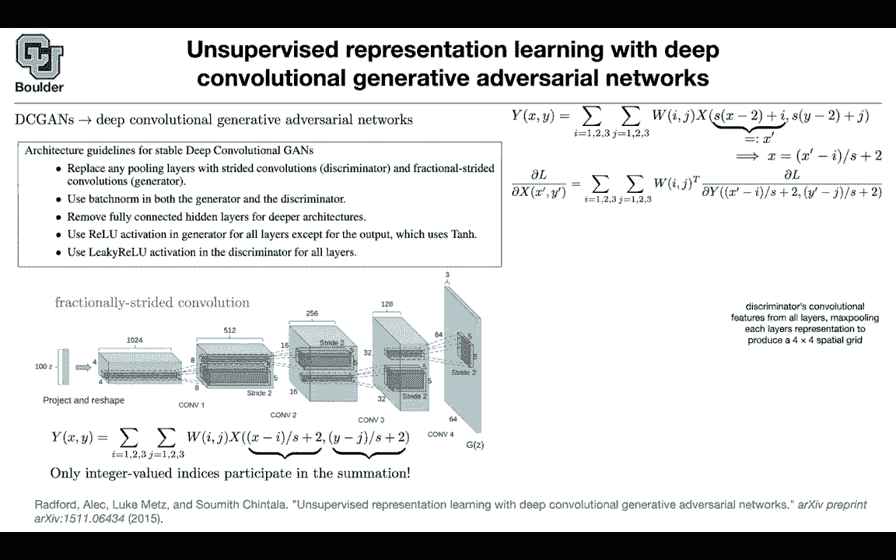

# 140：L65.3 - VAE 与 GAN 对比 🧠

在本节课中，我们将深入探讨变分自编码器与生成对抗网络的核心概念，特别是它们背后的概率模型思想。我们将解释“数据分布为正态分布”的含义，并对比两种模型在目标函数和训练范式上的根本区别。

---

## 数据与潜在空间

上一节我们介绍了生成模型的基本思想，本节中我们来看看数据是如何被表示的。

首先，我们需要理解数据本身。假设我们有一组图像数据，例如手写数字MNIST。这些图像 `X` 是由一个我们未知的真实数据分布 `P_data(X)` 生成的。我们只能看到从这个分布中采样出的样本（即一张张具体的图片）。

直接在高维的像素空间（如图像）中建模非常困难。因此，我们引入一个低维的**潜在空间**，其中的向量用 `Z` 表示。`Z` 是一个没有明确物理意义的向量（例如100维），但它能简洁地编码图像的高级特征。

为了能方便地从潜在空间采样，我们对其施加一个简单的先验分布，通常是标准正态分布：
`Z ~ N(0, I)`

这里的 `I` 是单位矩阵。这意味着 `Z` 的每个维度都独立且服从均值为0、方差为1的正态分布。

---

## 生成过程：从潜在变量到图像

理解了潜在空间后，我们来看看如何利用它生成图像。

无论是VAE还是GAN，其核心的**生成过程**是相同的：我们将一个从简单分布（如正态分布）中采样的潜在向量 `Z`，输入到一个非线性函数 `G`（通常是一个神经网络，如反卷积网络）中，从而生成一张图像 `X`。

用公式表示这个过程为：
`X = G_θ(Z)`
其中 `θ` 代表生成网络 `G` 的参数。

初始时，参数 `θ` 是随机的，因此生成的图像 `X` 看起来像噪声。模型训练的目标就是找到一组好的参数 `θ`，使得 `G_θ(Z)` 生成的图像分布 `P_model(X)` 尽可能接近真实的图像数据分布 `P_data(X)`。

---

## 训练范式一：变分自编码器与最大似然估计

VAE采用了一种基于概率的、可解释的训练范式。

VAE的训练目标是**最大化真实数据 `X` 的边际似然**。由于我们引入了潜在变量 `Z`，数据的似然需要通过对 `Z` 积分（即“边缘化”）得到：
`P_θ(X) = ∫ P_θ(X|Z) P(Z) dZ`

然而，这个积分因为神经网络的非线性而难以直接计算（**intractable**）。VAE的解决方案是引入一个**变分分布** `Q_φ(Z|X)`（通常也是一个神经网络，即编码器）来近似真实的后验分布 `P(Z|X)`。

通过数学推导（如Jensen不等式），我们可以得到对数似然的一个**下界**，称为证据下界：
`ELBO(θ, φ) = E_{Z~Q_φ} [log P_θ(X|Z)] - KL[ Q_φ(Z|X) || P(Z) ]`

以下是VAE的核心训练步骤：
1.  **重构项**：让解码器 `P_θ(X|Z)` 能根据 `Z` 较好地重建输入 `X`。
2.  **正则项**：让编码器输出的分布 `Q_φ(Z|X)` 尽量接近我们预设的先验分布 `P(Z)`（标准正态分布）。

通过最大化ELBO，我们间接地最大化了数据的似然，同时确保了潜在空间的规整性，便于后续的采样和插值。

---

## 训练范式二：生成对抗网络与分布距离最小化

与VAE基于似然的框架不同，GAN采用了一种基于博弈对抗的训练范式。

GAN的核心思想是避免直接处理难以计算的似然函数。它引入了一个**判别器** `D`，其任务是区分“真实图像”（来自 `P_data`）和“生成图像”（来自 `P_model`）。与此同时，生成器 `G` 的目标是生成足以“欺骗”判别器的图像。

从理论上看，这个博弈过程最终等价于**最小化生成分布 `P_model` 与真实分布 `P_data` 之间的某种距离或散度**，例如Jensen-Shannon散度。

以下是GAN的核心训练步骤：
1.  **固定生成器 `G`，训练判别器 `D`**：最大化其区分真假图像的能力。
2.  **固定判别器 `D`，训练生成器 `G`**：最小化判别器对生成图像的判别准确率（或等价地，让生成图像被判别为“真”的概率最大化）。

这种交替训练的过程，就是生成器和判别器之间的“对抗”。当训练达到平衡时，生成器产生的图像分布将非常接近真实数据分布。

---

## VAE与GAN的关键对比

现在，让我们系统地对比一下这两种流行的生成模型。

以下是VAE与GAN的主要区别：

*   **目标函数**：
    *   VAE：最大化证据下界，是一种**近似最大似然估计**。
    *   GAN：最小化生成分布与真实分布之间的**散度**。
*   **训练稳定性**：
    *   VAE：训练相对稳定，有明确的损失函数。
    *   GAN：训练可能不稳定，容易出现模式崩溃等问题。
*   **生成图像质量**：
    *   VAE：生成的图像有时较模糊（由于似然函数中的像素级重构误差）。
    *   GAN：通常能生成更清晰、更逼真的图像。
*   **潜在空间特性**：
    *   VAE：通过KL散度正则项，潜在空间具有较好的**连续性**和**插值性**。
    *   GAN：潜在空间的规整性没有明确约束，但可以通过设计改进。

---

## 模型应用与样本生成

训练完成后，我们如何使用这些生成模型呢？

无论VAE还是GAN，其**采样生成**的方式是一致的：
1.  从一个简单的分布（如标准正态分布）中采样一个潜在向量 `Z`。
2.  将 `Z` 输入到训练好的生成器（解码器）`G` 中。
3.  生成器输出一张图像 `X = G(Z)`。

对于VAE，由于其编码器的存在，我们还可以实现**图像编辑**。例如，可以将两张图像编码到潜在空间，得到 `Z1` 和 `Z2`，然后对潜在向量进行插值（如 `Z' = α*Z1 + (1-α)*Z2`），再将插值后的 `Z'` 解码，就能得到两张图像之间平滑过渡的结果。

---

## 如何为任务选择模型？

面对具体任务时，我们该如何在VAE和GAN之间做选择呢？

在深度学习中，选择模型通常需要回答以下几个问题：
1.  **数据形式**：我的数据是什么？是图像、文本还是语音？是连续的还是离散的？（例如，文本生成是离散的，通常使用基于似然的方法，如语言模型）。
2.  **任务目标**：我需要模型做什么？是生成高质量样本，还是需要一个结构化的潜在空间用于插值或编辑？
3.  **训练资源与稳定性**：我是否能承受GAN可能带来的不稳定训练？还是更需要VAE的稳定训练过程？
4.  **评估标准**：我如何评估模型的好坏？是看生成图像的逼真度，还是看重构误差或下游任务的表现？

理解这些问题的答案，将帮助你为特定应用选择合适的生成模型框架。

---

## 总结

本节课中我们一起学习了变分自编码器和生成对抗网络的核心原理与对比。

*   **VAE** 建立在**最大似然估计**框架上，通过优化证据下界来学习数据分布，其潜在空间规整，适合插值和结构化生成。
*   **GAN** 则另辟蹊径，通过**对抗训练**来最小化生成分布与真实分布间的距离，通常能生成更逼真的样本，但训练过程更具挑战性。

两者都通过将简单分布（如正态分布）映射到复杂数据分布（如图像）来工作，但定义了截然不同的训练目标和学习范式。理解它们的异同，是掌握现代生成模型的关键。