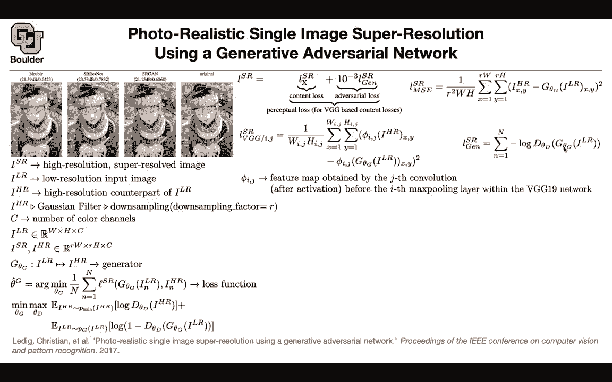

# 148：L68.2 - 基于GAN的单图像超分辨率变换 🖼️

在本节课中，我们将学习如何利用生成对抗网络（GAN）来实现单图像超分辨率（Super-Resolution， SR）变换。我们将探讨该任务的问题设定、数据准备、网络架构设计以及核心的损失函数构成。

## 问题设定与应用背景

上一节我们介绍了GAN的基本原理，本节中我们来看看GAN的一个具体应用：单图像超分辨率。

假设你有一张低分辨率图像，目标是将其转换为高分辨率图像。这是一个“一对多”的问题，因为一张低分辨率图像可能对应多个合理的高分辨率版本。这是一个不适定问题，没有唯一正确答案。一旦图像被下采样，信息就永久丢失了。

以下是几种传统方法的对比：

*   **双三次插值**：会产生模糊的图像。
*   **普通神经网络（无GAN）**：性能有所提升，但仍不完美。
*   **超分辨率生成对抗网络（SRGAN）**：能够“想象”并生成精细的细节，虽然不一定是原始图像的确切细节，但视觉效果更好。

## 数据与数学表示

超分辨率任务的一个优势是可以轻松生成大量训练数据。

以下是数据生成流程：

1.  获取一张原始高分辨率图像 `I_HR`（真实值）。
2.  使用高斯滤波器对图像进行模糊处理。
3.  以因子 `R`（如2、3、4）对模糊后的图像进行下采样，得到低分辨率图像 `I_LR`。
4.  这样，我们就得到了一个配对数据 `(I_LR, I_HR)`。

在数学上，我们的目标是训练一个生成器 `G`，它以低分辨率图像 `I_LR` 为条件输入，输出一张高分辨率图像 `I_SR`。公式表示为：
`I_SR = G(I_LR)`

其中：
*   `I_LR` 的尺寸为 `W × H × C`（宽、高、通道数，例如RGB三通道）。
*   `I_SR` 和 `I_HR` 的尺寸为 `(s*W) × (s*H) × C`，`s` 是放大倍数。

## 网络架构与训练目标

生成器 `G` 是一个条件生成网络，其结构通常包含一系列卷积层和残差连接。我们不过多讨论网络结构细节，只需知道它是一个包含卷积、批归一化和激活函数的深度网络。

训练的核心在于损失函数的设计。如果使用原始GAN框架，判别器 `D` 用于区分真实高分辨率图像 `I_HR` 和生成的高分辨率图像 `I_SR`。生成器的目标是生成能“欺骗”判别器的图像。

对于SRGAN，其总损失函数是多种损失的加权组合：
`L_total = L_GAN + λ * L_content`

其中：
*   `L_GAN` 是对抗损失，来自判别器。
*   `L_content` 是内容损失，用于保证生成图像的内容保真度。
*   `λ` 是一个超参数，用于平衡两项损失。

## 内容损失详解

内容损失 `L_content` 有多种设计方式，目的是让生成图像在感知上与真实图像相似，而不仅仅是像素级相似。

以下是两种常见的内容损失形式：

1.  **基于像素的均方误差（MSE）**：
    计算生成图像 `I_SR` 与真实图像 `I_HR` 之间每个像素的差异平方和。公式为：
    `L_MSE = 1/(W*H*C) * Σ (I_SR - I_HR)^2`
    这种方法倾向于生成平滑但可能缺乏纹理细节的结果。

2.  **基于感知的特征重建损失（VGG损失）**：
    使用一个预训练的图像分类网络（如VGG）。将 `I_SR` 和 `I_HR` 分别输入该网络，提取某一中间层（例如第j层卷积后、第i层池化前）的特征图 `φ_{i,j}`。然后计算这两个特征图之间的MSE。公式为：
    `L_VGG = 1/(W_j*H_j*C_j) * Σ (φ_{i,j}(I_SR) - φ_{i,j}(I_HR))^2`
    这种方法鼓励生成图像在“语义”或“感知”层面与真实图像相似，能产生视觉上更逼真的纹理。

## 模型评估与总结

本节课中我们一起学习了基于GAN的单图像超分辨率方法。

我们定义了数据集（通过下采样高分辨率图像获得配对数据），设定了模型先验（生成器和判别器神经网络），并设计了复合损失函数（结合对抗损失和内容损失）来优化模型。

在评估方面，超分辨率任务缺乏完美的客观评价指标。常用的指标包括：

*   **峰值信噪比（PSNR）**：与MSE损失高度相关。
*   **结构相似性指数（SSIM）**：衡量图像结构相似性。
*   **平均意见得分（MOS）**：通过人类主观评价来评估图像视觉质量。

一个重要的洞见是，我们可以利用预训练的神经网络（如用于Inception Score的Inception网络，或用于感知损失的VGG网络）来构建评估指标或损失函数本身，这极大地提升了生成模型的性能。