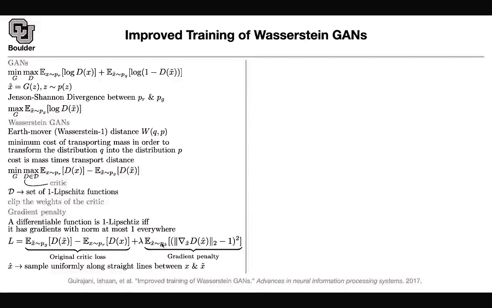

# 149：L68.3 - 梯度惩罚 🧠

在本节课中，我们将学习如何通过引入**梯度惩罚**来改进Wasserstein GAN的训练过程，以更稳定地强制判别器满足Lipschitz连续性约束。

---

上一节我们介绍了Wasserstein GAN的基本思想。本节中，我们来看看如何通过修改损失函数来具体实现并改进其训练。

首先，让我们回顾一下原始GAN的目标。GAN包含一个判别器D和一个生成器G。判别器用于区分真实图像和生成图像，而生成器则试图生成以假乱真的图像。其目标函数与Jensen-Shannon散度相关。

原始GAN的目标函数在训练初期容易饱和，导致收敛困难。因此，一个改进方案是将其转换为一个更易于优化的形式。具体来说，对于生成器，我们不是最小化某个目标，而是最大化另一个等价的目标。

Wasserstein GAN的核心思想是使用**Earth Mover距离**（或Wasserstein距离）来衡量两个分布之间的差异。其直观理解是，将一个分布（如一堆土）移动到另一个分布所需的最小“工作量”，其中工作量等于移动的“土方量”（概率）乘以移动距离。

在数学上，WGAN的判别器（此时更准确地应称为“评论家”Critic）的目标函数与原始GAN有所不同。以下是WGAN评论家的目标函数：

$$L_{WGAN}(D) = \mathbb{E}_{x \sim P_{data}}[D(x)] - \mathbb{E}_{z \sim P_{z}}[D(G(z))]$$

可以看到，它去除了原始GAN目标函数中的对数log和Sigmoid函数，形式更为简洁。

然而，为了确保该距离的有效计算，需要强制评论家函数D满足**1-Lipschitz连续性**。这意味着函数梯度的范数几乎处处不超过1：

$$||\nabla_{x} D(x)|| \leq 1$$

在原始WGAN论文中，一种简单的方法是**权重裁剪**，即将评论家网络的权重限制在一个固定区间内（如[-c, c]）。但这种方法可能导致网络容量利用不足或梯度消失/爆炸。

因此，我们引入**梯度惩罚**作为一种更好的替代方案。其依据是一个数学定理：一个可微函数是1-Lipschitz连续的，当且仅当其梯度的范数几乎处处小于等于1。

基于这一定理，我们可以在损失函数中直接添加一个惩罚项，来约束评论家函数梯度的范数。以下是带有梯度惩罚的WGAN评论家损失函数：

$$L = \underbrace{\mathbb{E}_{\tilde{x} \sim P_g}[D(\tilde{x})] - \mathbb{E}_{x \sim P_{data}}[D(x)]}_{\text{WGAN Critic Loss}} + \underbrace{\lambda \mathbb{E}_{\hat{x} \sim P_{\hat{x}}}[(||\nabla_{\hat{x}} D(\hat{x})||_2 - 1)^2]}_{\text{Gradient Penalty}}$$

以下是该公式中各项的解释：

*   $\mathbb{E}_{\tilde{x} \sim P_g}[D(\tilde{x})]$：对生成数据分布$P_g$的期望，$\tilde{x} = G(z)$。
*   $\mathbb{E}_{x \sim P_{data}}[D(x)]$：对真实数据分布$P_{data}$的期望。
*   $\lambda$：梯度惩罚项的权重系数，是一个超参数。
*   $\hat{x}$：在真实数据点$x$和生成数据点$\tilde{x}$的连线上随机采样得到的点。即 $\hat{x} = \epsilon x + (1 - \epsilon) \tilde{x}$，其中 $\epsilon$ 服从[0,1]上的均匀分布。
*   $(||\nabla_{\hat{x}} D(\hat{x})||_2 - 1)^2$：惩罚项，旨在让评论家在$\hat{x}$处的梯度范数尽可能接近1。

关于采样点$\hat{x}$，你可能会问为什么只在真实数据和生成数据的连线上采样，而不是在整个数据空间。这是因为高维数据空间极其庞大，无法进行有效采样。在两点连线上采样是一种高效且经验上有效的近似方法，它足以在关键区域施加Lipschitz约束。

你可能会注意到，惩罚项是双向的$(||\nabla D|| - 1)^2$，它同时惩罚梯度范数大于1和小于1的情况。理论上，我们只需要惩罚大于1的情况。然而，使用平方形式的惩罚项能使损失函数处处可微，这更有利于基于梯度的优化算法（如SGD）进行稳定训练。使用如$max(||\nabla D|| - 1, 0)$这样的单向惩罚函数，会在$||\nabla D|| = 1$处不可微，可能给训练带来困难。

最后，我们来梳理一下完整的训练流程。WGAN-GP的训练是交替进行的：

1.  **训练评论家 (Critic)**：使用上面定义的包含梯度惩罚的损失函数$L$来更新评论家网络的参数$\theta_D$。通常，每次迭代生成器前，会先更新评论家多次（例如5次）。
2.  **训练生成器 (Generator)**：固定评论家，使用以下损失函数更新生成器参数$\theta_G$：
    $$L_G = -\mathbb{E}_{z \sim P_z}[D(G(z))]$$
    这等价于最小化Wasserstein距离。

通过这种交替优化的方式，最终我们能得到一个训练稳定的生成器。

---

本节课中，我们一起学习了如何通过**梯度惩罚**来改进Wasserstein GAN。我们回顾了原始GAN的不足，引入了Wasserstein距离和Lipschitz连续性的概念，并详细解释了梯度惩罚项的原理、数学形式及其在实现上的考量。与简单的权重裁剪相比，梯度惩罚能更柔和、更有效地约束评论家网络，从而带来更稳定、更高质量的生成对抗网络训练。