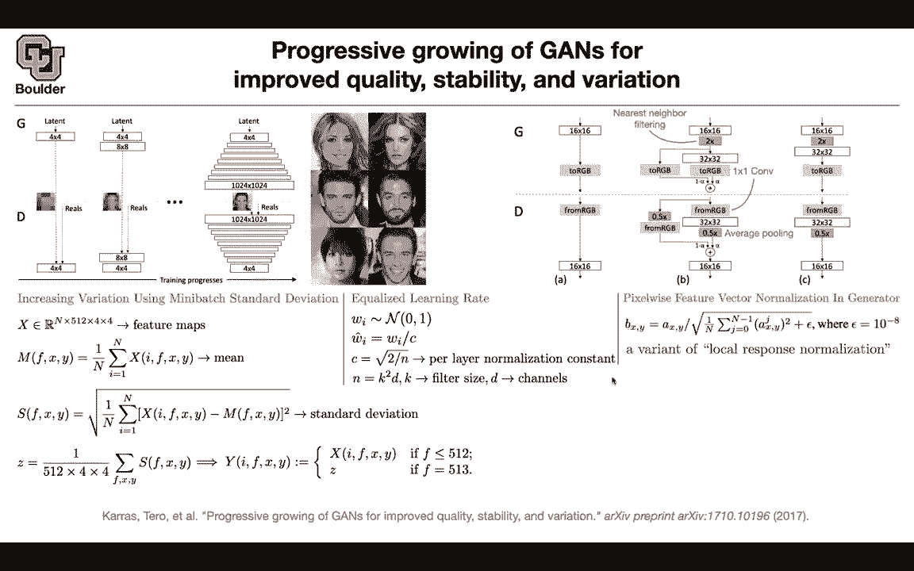

# 151：L69.2 - GAN的渐进学习 🎨

在本节课中，我们将学习如何通过渐进式增长（Progressive Growing）的方法来训练生成对抗网络（GAN），以生成高分辨率、高质量的图像。我们将探讨为什么直接训练高分辨率GAN会失败，并详细介绍渐进式增长的核心思想、平滑过渡技巧以及一系列稳定训练的关键技术。

## 概述

之前我们接触的GAN大多生成64x64或256x256等低分辨率图像。我们的目标是生成如1024x1024这样的高清图像。理论上，我们可以设计一个生成器，从潜在向量开始，通过转置卷积逐步上采样到1024x1024，再配合一个判别器进行对抗训练。然而，直接实现这样的模型在实践中往往无法收敛，无法生成高质量图像。

因此，问题的关键不在于损失函数或网络结构，而在于**如何训练**。我们需要一种逐步、渐进的方式来训练网络。

## 渐进式增长的核心思想

上一节我们明确了直接训练高分辨率GAN的困难。本节中，我们来看看渐进式增长的具体策略。

其核心思想是：**从低分辨率开始训练，稳定后逐步增加网络层以提高分辨率**。

以下是实现步骤：
1.  首先训练网络生成极低分辨率（如4x4）的图像。此时，生成器和判别器都只处理4x4的图像。
2.  当4x4图像的训练稳定后，我们向生成器和判别器中**同时添加新的层**，使它们能够处理8x8的图像。
3.  继续训练，使网络适应8x8的分辨率。
4.  重复此过程，逐步将分辨率翻倍至16x16、32x64、128x256，最终达到1024x1024。

这样，网络总是在已经学习到的、相对稳定的低层次特征基础上，学习更高分辨率的新细节。

## 实现平滑过渡：Alpha混合

从低分辨率过渡到高分辨率时，如果直接插入新的卷积层，会导致训练过程不稳定。我们需要一种平滑的过渡机制。

假设我们当前在16x16分辨率上训练稳定，希望过渡到32x32。我们引入一个权重参数 **`α`** （alpha），其值在训练中从0线性变化到1。

以下是过渡期的网络行为：
*   当 **`α = 0`** 时：
    *   生成器输出：对16x16特征图进行最近邻上采样至32x32，然后通过1x1卷积输出RGB图像。这相当于跳过了新增的高分辨率层。
    *   判别器输入：将32x32的真实图像下采样至16x16，再进行判别。这也相当于跳过了新增的层。
    *   此时，网络行为与过渡前一模一样，训练保持稳定。
*   当 **`α`** 逐渐从0增大到1时：
    *   生成器的输出是两条路径的加权和：`输出 = (1 - α) * [上采样路径] + α * [新卷积层路径]`。
    *   判别器的输入也是两条路径的加权和。
    *   随着 **`α`** 增大，网络越来越依赖新添加的层来处理高分辨率信息。
*   当 **`α = 1`** 时：
    *   网络完全通过新增的层进行前向传播，平滑地过渡到了更高分辨率的训练阶段。

通过控制 **`α`** 的变化，我们实现了分辨率增长的无缝衔接。**`α`** 的变化策略（如变化速度）需要根据实验经验调整。

## 稳定训练的关键技巧

除了渐进式增长，论文中还采用了几种重要的技巧来稳定GAN训练，防止模式崩溃（Mode Collapse）并提升生成质量。

### 1. 小批量标准差（Mini-batch Standard Deviation）

我们曾介绍过“小批量判别”技术来增加生成样本的多样性。这里介绍一个更简单的替代方法：小批量标准差。

其操作如下：
1.  在判别器的某个中间层（例如特征图形状为 `[N, 512, 4, 4]`），我们计算该批次（N个样本）在每个空间位置（4x4）、每个通道（512）上的**标准差**。
2.  将所有位置和通道的标准差**求平均**，得到一个单一的标量值。
3.  将这个标量值**复制扩展**成一张 `[1, 1, 4, 4]` 的特征图。
4.  将这张额外的特征图**拼接（Concatenate）** 到原始特征图（`[N, 512, 4, 4]`）的通道维度上，得到 `[N, 513, 4, 4]` 的新特征图。

这样，判别器不仅能看单个样本的特征，还能感知到当前批次样本的整体统计特性，有助于鼓励生成器产生更多样的样本。其核心公式可表示为：
`y = concat(x, broadcast(mean(std(x, dim=0))))`
其中 `x` 是输入特征，`std` 计算小批量标准差，`mean` 进行空间和通道上的平均，`broadcast` 将其扩展为与 `x` 空间维度相同的张量，最后进行通道拼接。

### 2. 均衡学习率（Equalized Learning Rate）

传统的权重初始化方法（如He初始化）可能在不同层导致梯度尺度差异巨大，使得统一的学习率对某些层太大（导致不稳定），对另一些层又太小（导致学习缓慢）。

均衡学习率的做法是：
1.  在初始化时，我们从标准正态分布 `N(0,1)` 中采样权重 `w`。
2.  在训练时，我们将这个权重 `w` 除以一个与层相关的常数 `c` 来使用，即 `w_used = w / c`。其中 `c` 的计算通常与滤波器的尺寸和输入通道数有关，例如 `c = sqrt(2.0 / (k * k * fan_in))`。
3.  由于所有可训练参数 `w` 都来自 `N(0,1)`，它们具有相同的尺度。优化器（如Adam）为它们更新的步长（学习率）也因此被“均衡化”，使得训练更加稳定。

### 3. 像素级特征向量归一化（Pixelwise Feature Vector Normalization）

在生成器的每个卷积层之后，我们使用一种类似“局部响应归一化（LRN）”的变体。其思想是**让不同特征通道之间产生竞争**。

对于每个像素位置 `(x, y)` 的特征向量（包含C个通道值），我们进行如下归一化：
`b_{x,y,c} = a_{x,y,c} / sqrt( (1/N) * sum_{c'} (a_{x,y,c'})^2 + epsilon )`
其中，`a` 是原始激活值，`b` 是归一化后的值，`N` 是通道数，`epsilon` 是一个小常数防止除零。

这意味着，如果某个通道的激活值突然增大，为了在归一化后保持相对强度，其他通道的激活值也需要相应增大。这种竞争机制能防止某些特征通道独大，有助于稳定训练并提升生成质量。

## 损失函数的选择

在渐进式GAN中，可以选择多种对抗损失函数：
*   **Wasserstein GAN (WGAN)** 及其变体（如WGAN-GP）的损失函数。
*   **最小二乘GAN (LSGAN)** 的损失函数。

对于低分辨率图像，这两种损失函数效果都很好。当结合渐进式增长和上述训练技巧后，它们都能成功地扩展到生成1024x1024的高分辨率图像。

## 总结

本节课中，我们一起学习了生成高分辨率GAN图像的核心方法——**渐进式增长（Progressive Growing）**。我们了解到：
1.  直接训练高分辨率GAN极其困难，关键在于训练策略。
2.  渐进式增长通过从低分辨率开始，逐步添加网络层来提高分辨率。
3.  使用 **`α`** 混合技术可以实现不同分辨率训练阶段之间的平滑过渡。
4.  结合**小批量标准差**、**均衡学习率**和**像素级特征归一化**等技巧，可以显著稳定训练过程，提升生成图像的质量和多样性。
5.  最终，我们可以使用WGAN或LSGAN等损失函数，成功生成1024x1024的高质量图像。