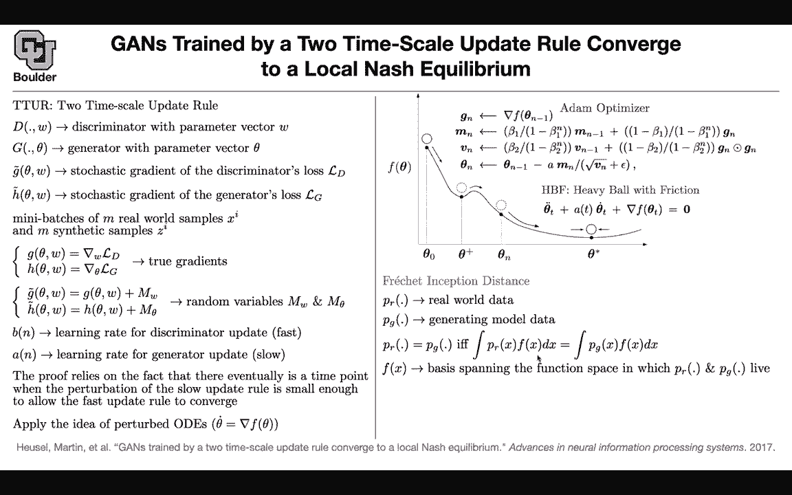

# 152：L69.3 - 双时间尺度更新规则与FID 🧠

在本节课中，我们将学习如何通过**双时间尺度更新规则**来改进生成对抗网络的训练，并了解一个重要的生成图像质量评估指标——**Fréchet Inception Distance**。

---


## 回顾与改进目标


上一节我们探讨了GAN的一个应用。现在，让我们回到基础，尝试改进GAN的训练过程。


如果你听到 **TTR** 这个词，它代表 **Two Time-scale Update Rule**。这是一篇理论性论文，其核心思想是为判别器和生成器设置不同的学习速度。


## 双时间尺度更新规则详解

### 模型参数与损失函数

假设你的判别器由参数 **W** 参数化，生成器由参数 **θ** 参数化。将所有权重和偏置放入一个列表，就得到了你的 **θ** 和 **W**。


你需要为判别器写一个损失函数，也为生成器写一个损失函数。在数据的一个小批量上计算判别器损失函数的导数，得到一个随机梯度，我们称之为 **G̃**。


**G̃** 是判别器损失函数的导数。请注意不要将此处的 **G** 与生成器混淆。**G̃** 对应判别器 **D**，而 **H̃** 将对应生成器损失函数的导数。


```math
G̃ ≈ ∇_w L_D
H̃ ≈ ∇_θ L_G
```

### 真实梯度与随机梯度

如果你有足够的计算资源在整个数据集上计算损失，那么得到的梯度将是**真实梯度**，没有噪声。

*   判别器损失的真实梯度：**G**
*   生成器损失的真实梯度：**H**


但由于内存和速度的限制，我们通常使用小批量数据进行处理。因此，我们处理的是带有随机性的**随机梯度**。


```math
G̃ = G + 随机噪声
H̃ = H + 随机噪声
```


### 更新策略与等效学习率

在训练GAN时，常见的做法是：先更新几次判别器的参数，然后更新一次生成器的参数（例如，5次对1次）。

这等效于为两个网络设置不同的学习率：
*   **判别器**：使用**较大的学习率**，更新更快。
*   **生成器**：使用**较小的学习率**，更新更慢。

这种设置不同的更新步数，最终可以归结为设置不同的学习率。


## 理论依据与收敛性


论文中有一个定理指出，使用**双时间尺度**有助于算法收敛到一个局部纳什均衡。其证明依赖于以下观察：


在训练后期，生成器参数（慢更新规则）的更新幅度会变得足够小。因为此时梯度本身在变小，同时生成器的学习率也很小。这意味着生成器参数的更新是微小的。


这种微小的更新使得判别器（快更新规则）能够先收敛。一旦判别器收敛，生成器随后也会收敛。这就是该定理背后的直观理解。


证明过程依赖于应用数学中的**摄动理论**。你需要对这个常微分方程进行摄动分析，因为它对应的是梯度下降。之所以是“摄动”，是因为你在真实梯度上添加了随机扰动。

## 扩展到Adam优化器

你可能会问：我能否使用其他类型的优化算法，比如Adam？如果我为两个网络设置不同的学习率，Adam还能收敛吗？

答案是肯定的。你仍然可以使用摄动理论，但需要分析一个不同的常微分方程。


### Adam优化器原理


Adam优化器的步骤如下：
1.  计算损失函数的梯度 **g_t**。
2.  **m_t** 项是梯度的移动平均，它有两个作用：**对梯度去噪**和**充当动量**。
3.  **v_t** 是梯度平方的移动平均（逐元素计算），它用于实现**自适应学习率**。


你的学习率将变为 **α / (√(v_t) + ε)**，其中 **ε** 是一个很小的数（如1e-8），用于防止除零错误。因此，你的学习率会根据梯度的大小进行自适应调整，同时还拥有动量。


```python
# Adam更新规则伪代码
m_t = β1 * m_{t-1} + (1 - β1) * g_t  # 一阶矩估计（动量）
v_t = β2 * v_{t-1} + (1 - β2) * (g_t ** 2) # 二阶矩估计
m_hat = m_t / (1 - β1^t) # 偏差校正
v_hat = v_t / (1 - β2^t)
θ_t = θ_{t-1} - α * m_hat / (√(v_hat) + ε)
```


### Adam对应的动力学

我们知道，对于随机梯度下降，其动力学对应一个常微分方程。而Adam优化器对应的则是**带摩擦的重球**的动力学方程。


这为理解Adam为何能收敛以及为何能逃离局部极小值提供了一个很好的直觉：
想象一个重球在寻找最小值。如果没有动量和自适应梯度，它可能会陷入局部极小值。但Adam优化器由于动量和“摩擦”的存在，能够**逃离某些局部极小点**。


## 生成图像质量评估：Fréchet Inception Distance

介绍这篇论文的主要目的，不仅仅是上述理论和观察，更在于它提供了另一种衡量生成图像质量的方法——**Fréchet Inception Distance**。

### 核心思想


假设你有真实数据分布 **P_r** 和生成模型分布 **P_g**。你想知道这两个分布是否相等。


从理论上看，你可以用一组**测试函数 f** 乘以你的分布并计算积分。如果对于所有能张成你函数空间的 **f**，这两个积分都相等，那么你的分布就是相等的。**f** 可以是基函数，例如多项式。


在实际操作中，我们无法计算所有函数。一个常见的简化是只考虑到一阶和二阶矩（即均值和方差）。而唯一一个仅由均值和方差就能完全确定的分布是**高斯分布**。因此，我们将在这个框架下使用高斯分布。

### FID计算步骤

以下是计算FID的具体步骤：


1.  **特征提取**：将真实图像和生成图像输入一个预训练好的神经网络（通常是Inception模型），获取图像的特征编码。
2.  **统计计算**：分别计算真实图像特征和生成图像特征的**均值**和**协方差**。
3.  **距离计算**：计算两个高斯分布（分别由上述均值和协方差定义）之间的Fréchet距离。


公式如下：


```math
FID = ||μ_r - μ_g||^2 + Tr(Σ_r + Σ_g - 2(Σ_r Σ_g)^{1/2})
```
其中：
*   **μ_r, μ_g** 分别是真实和生成特征的均值向量。
*   **Σ_r, Σ_g** 分别是它们的协方差矩阵。
*   **Tr** 表示矩阵的迹。

“Inception”来源于使用的Inception模型，“Distance”指距离，“Fréchet”指所使用的Fréchet距离。

### 双时间尺度的效果

回到双时间尺度规则，实验表明：如果只使用单一学习率（如1e-5, 1e-4），在FID指标上的表现可能不稳定。但如果使用**双时间尺度更新规则**（一快一慢），训练过程会收敛得更好，FID分数也更优。



---

## 总结

本节课我们一起学习了：
1.  **双时间尺度更新规则**的理论基础：通过为判别器和生成器设置不同的学习率（快、慢），可以促进GAN训练收敛到局部纳什均衡。
2.  该规则的直观理解：慢更新的生成器参数变化微小，允许快更新的判别器先收敛，进而带动生成器收敛。
3.  **Adam优化器**在GAN训练中的应用及其对应的动力学解释。
4.  评估生成图像质量的重要指标——**Fréchet Inception Distance** 的原理与计算方法，它通过比较真实图像与生成图像在特征空间中的统计特性（视为高斯分布）来计算距离。

通过结合改进的训练策略和可靠的评估指标，我们可以更有效地训练和评估生成对抗网络。