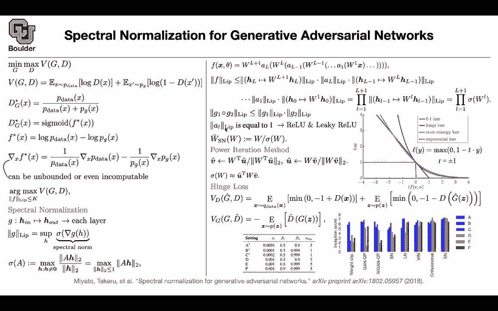

# 153：L70.1- 谱归一化 📊

在本节课中，我们将要学习一种名为“谱归一化”的技术，它是确保生成对抗网络中判别器满足利普希茨连续性的第三种方法。我们将从理论推导开始，解释为何需要这种约束，然后介绍如何通过谱归一化在神经网络中实现它，并最终了解其在实际训练中的应用和优势。

## 概述

上一节我们介绍了双时间尺度更新规则和弗雷歇起始距离。本节中，我们来看看另一篇理论性论文——谱归一化。我们知道，对于Wasserstein GAN，需要判别器属于1-利普希茨连续函数空间。之前我们学习了两种实现方法：权重裁剪和梯度惩罚。谱归一化是第三种方法，它通过控制神经网络权重矩阵的谱范数来直接约束网络的利普希茨常数。

## 为何需要利普希茨连续性？

让我们回顾原始GAN的目标函数。判别器D试图区分真实图像和生成图像。最优判别器D*的形式为 `D*(x) = p_data(x) / (p_data(x) + p_g(x))`。如果我们用sigmoid函数表示，即 `D*(x) = sigmoid(f*(x))`，那么可以解出 `f*(x)`。

通过推导可得：
`f*(x) = log(p_data(x)) - log(p_g(x))`

现在，考虑 `f*(x)` 对 `x` 的梯度：
`∇f*(x) = (∇p_data(x))/p_data(x) - (∇p_g(x))/p_g(x)`

这里存在一个问题：当生成分布 `p_g(x)` 在某些点接近或等于零时，公式中的 `1/p_g(x)` 项会变得非常大甚至无法计算，导致梯度爆炸或变得无界。为了避免这种情况，我们需要对函数 `f` 进行正则化，限制其变化速度。利普希茨连续性正是提供了这样的约束，它确保函数梯度的上界是有限的。

因此，在优化GAN时，我们通常在利普希茨连续的函数族中进行极大极小博弈，这有助于训练的稳定性。

## 神经网络的利普希茨常数

神经网络是多个函数的复合。对于一个单层变换 `h_{l} = ϕ(W_l * h_{l-1})`，其中 `ϕ` 是激活函数（如ReLU），`W_l` 是权重矩阵。

复合函数的利普希茨常数有一个重要性质：**复合函数的利普希茨常数不超过各组成部分利普希茨常数的乘积**。

对于一个L层的神经网络 `f(x) = ϕ(W_L * ... ϕ(W_2 * ϕ(W_1 * x))...)`，其利普希茨常数满足：
`Lip(f) ≤ Lip(ϕ) * σ(W_L) * ... * Lip(ϕ) * σ(W_1)`
其中 `σ(W)` 表示权重矩阵 `W` 的**谱范数**（即最大奇异值）。

对于常用的ReLU或Leaky ReLU激活函数，其利普希茨常数恰好为1。因此，上式可以简化为：
`Lip(f) ≤ ∏_{l=1}^{L} σ(W_l)`

这个不等式表明，**整个神经网络的利普希茨常数可以被各层权重矩阵的谱范数的乘积所控制**。

## 谱归一化的核心思想

基于上面的分析，要控制网络的利普希茨常数，一个直接的想法是控制每一层权重矩阵的谱范数。谱归一化的做法非常直观：

对于每一层的权重 `W`，我们将其归一化：
`Ŵ = W / σ(W)`

其中 `σ(W)` 是 `W` 的谱范数。经过这样的归一化后，新权重 `Ŵ` 的谱范数 `σ(Ŵ) = σ(W)/σ(W) = 1`。

如果将网络中每一层的权重都进行这样的归一化，那么根据之前的乘积公式，整个网络的利普希茨常数上界将被控制为1（即 `1 * 1 * ... * 1 = 1`）。这就确保了判别器满足1-利普希茨连续性。

## 实践中的挑战与解决方案：幂迭代法

理论上很完美，但实践中存在一个挑战：**如何高效地计算权重矩阵的谱范数 `σ(W)`？** 对于大型神经网络，直接计算奇异值分解（SVD）来获取最大奇异值的计算开销非常大。

幸运的是，线性代数中的**幂迭代法**可以高效地近似计算矩阵的最大奇异值。我们可以在训练过程中动态地更新这个近似值。

以下是谱归一化层的训练流程：

1.  **初始化额外参数**：为每一层初始化两个随机向量 `ũ` 和 `ṽ`。
2.  **迭代更新**：在每次参数更新前或更新后，执行以下幂迭代步骤：
    *   `ṽ ← W^T * ũ / ||W^T * ũ||_2` （归一化）
    *   `ũ ← W * ṽ / ||W * ṽ||_2` （归一化）
3.  **计算谱范数近似值**：`σ(W) ≈ ũ^T * W * ṽ`
4.  **归一化权重**：在正向传播时，使用归一化的权重 `Ŵ = W / σ(W)` 进行计算。
5.  **梯度更新**：像往常一样通过反向传播计算梯度并更新原始权重 `W`。注意，`ũ` 和 `ṽ` 不通过梯度下降更新，仅通过上述幂迭代更新。

通过几次幂迭代（通常1次就足够），`ũ` 和 `ṽ` 会收敛到对应最大奇异值的左右奇异向量方向，从而给出 `σ(W)` 的良好近似。随着训练的进行，这个近似会越来越准。

## 损失函数：合页损失

谱归一化论文中使用了**合页损失** 作为目标函数，它通常能带来更稳定的训练。

对于判别器 `D(x)`，其损失函数为：
`L_D = E_{x~p_data} [max(0, 1 - D(x))] + E_{z~p_z} [max(0, 1 + D(G(z)))]`

对于生成器 `G(z)`，其损失函数为：
`L_G = - E_{z~p_z} [D(G(z))]`

合页损失的含义是，判别器不仅希望正确分类，还希望分类的“置信度”有一个边界（margin）。例如，对于真实数据，判别器输出 `D(x)` 不仅希望大于0（正确），更希望大于1，否则就会受到惩罚。这为训练提供了更强的梯度信号。

## 与其他方法的比较

以下是谱归一化与其他几种稳定GAN训练的方法在CIFAR-10数据集上的性能对比（使用Inception Score评估，越高越好）。实验测试了多组超参数配置（A-F）。

| 方法 | 描述 | 对超参数的敏感性 | 平均性能 |
| :--- | :--- | :--- | :--- |
| **Weight Clipping** | 权重裁剪 | **高** | 较低且不稳定 |
| **Gradient Penalty** | 梯度惩罚 | 中 | 高 |
| **Spectral Norm** | **谱归一化** | **低** | **高且稳定** |
| Batch Norm | 批归一化 | 中 | 中 |
| Layer Norm | 层归一化 | 中 | 中 |
| Weight Norm | 权重归一化 | 中 | 中 |
| Orthonormal | 正交正则化 | 中 | 中 |

从结果可以看出，**谱归一化在取得高性能的同时，对超参数的选择最不敏感**，这使得它非常实用且鲁棒。

## 总结

本节课我们一起学习了谱归一化技术。我们从原始GAN目标函数需要利普希茨连续性的理论动机出发，推导出神经网络的利普希茨常数由其各层权重矩阵的谱范数乘积决定。谱归一化的核心思想是通过将每一层的权重除以其谱范数，强制使每一层的利普希茨常数为1，从而控制整个网络的变化幅度。在实践中，我们使用幂迭代法来高效近似谱范数，并将其融入训练流程。最后，我们看到谱归一化配合合页损失函数，能显著提升GAN训练的稳定性和生成质量，并且对超参数设置具有很好的鲁棒性。