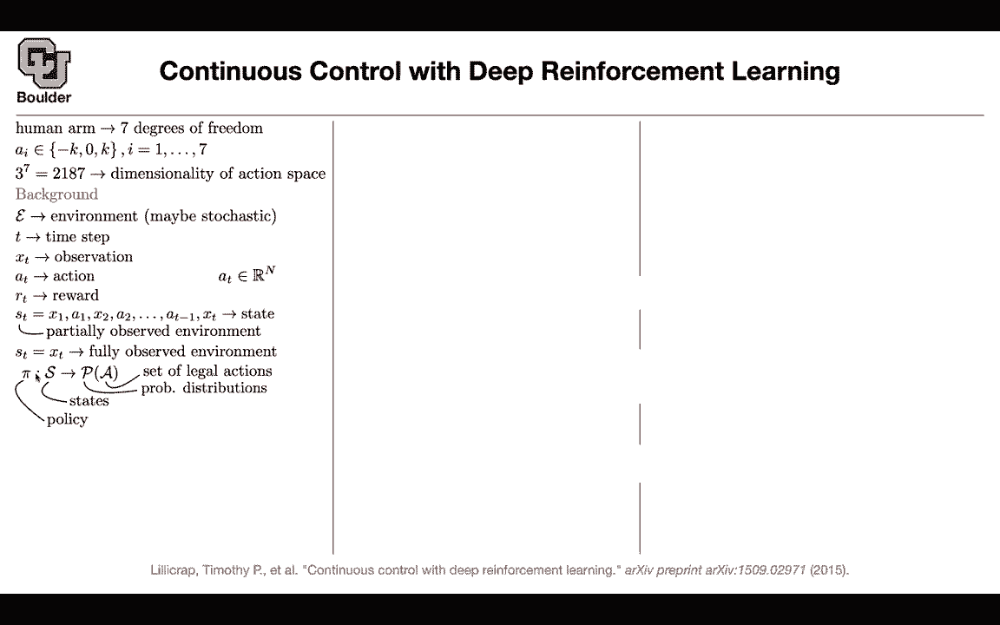
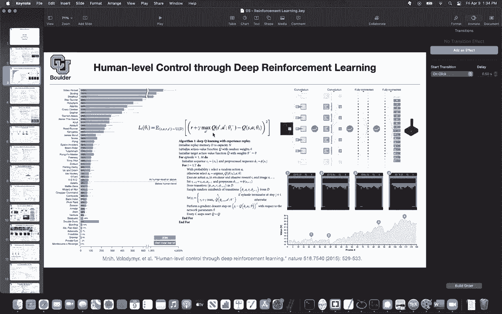

# 175：L77.3 - 深确定性策略梯度 🧠

在本节课中，我们将学习深度强化学习中的一个重要算法——深确定性策略梯度（Deep Deterministic Policy Gradient, DDPG）。我们将重点探讨为何在处理连续动作空间（例如机器人控制）时，传统的离散动作方法不再适用，并初步了解DDPG的基本框架和核心概念。

---

## 🌍 现实世界中的连续动作空间

在现实世界中，当你进行机器人学设计，例如设计一个仿人手臂时，动作空间通常是连续的。假设你的手臂有七个自由度，每个关节都有几个自由度。简化模型后，空间是连续的，因为你可以连续地转动手腕。这是一个连续变量，动作不再是离散的。

即使你尝试将其量化，例如为手腕动作设定三个状态（负向、不动、正向），动作空间的维度也会达到 `3^7 = 2187`。这将导致高维输出，并显著增加神经网络的参数数量，因为网络最后一层通常是全连接层，其大小取决于动作空间的维度。因此，这种方法不可行，我们需要寻找替代方案。

---

## 🔄 强化学习框架回顾

在强化学习中，你有一个环境，它可能是随机的。在时间步 `T`，你从环境中获得一个观测值，然后采取一个动作。我们不希望量化动作，而是希望在一个连续空间中操作。因此，动作将是一个向量。例如，一个七维的连续动作向量，相比于之前量化后的2187维，维度大大降低。

采取动作后，你会获得一个奖励，并观察到新的状态。状态通常是观测值和动作的串联序列。如果你处于一个完全可观测的环境，那么状态 `S` 可能只是最新的观测值。策略 `π` 依赖于当前状态，它定义了在给定状态下可能动作的概率分布。你可以将其视为一个条件分布，并从中采样以做出决策。

---

## ❓ 经验回放的原理与作用

以下是关于经验回放（Experience Replay）的一个常见问题：**我们为什么需要经验回放？**

如果不使用经验回放，你采样的数据将严重依赖于当前Q函数的参数。在优化过程中，我们采取微小的梯度步长，这意味着参数 `θ_i` 与 `θ_{i-1}` 非常接近。因此，基于这些相似参数生成的动作将高度相关，并且集中在空间的一个小区域内。

这些样本并不是从一个分布中独立同分布（IID）采样得到的，它们缺乏多样性。然而，多样性对于学习至关重要。在监督学习和无监督学习中，一个基本假设是数据是从某个分布中IID采样的。如果数据不满足IID条件，学习过程可能无法收敛，神经网络将难以有效学习。

因此，经验回放通过存储过去的经验并随机从中采样，打破了样本之间的相关性，使数据更接近IID，从而稳定和加速了学习过程。

---

## 📝 本节课总结

本节课中，我们一起探讨了在处理连续动作空间时传统方法的局限性，并引入了深确定性策略梯度（DDPG）的基本概念。我们了解到，连续动作空间的处理需要不同的策略，而经验回放是确保学习稳定性和效率的关键技术之一。在接下来的课程中，我们将深入探讨DDPG算法的具体实现细节。