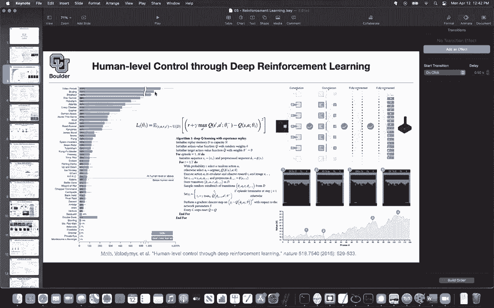
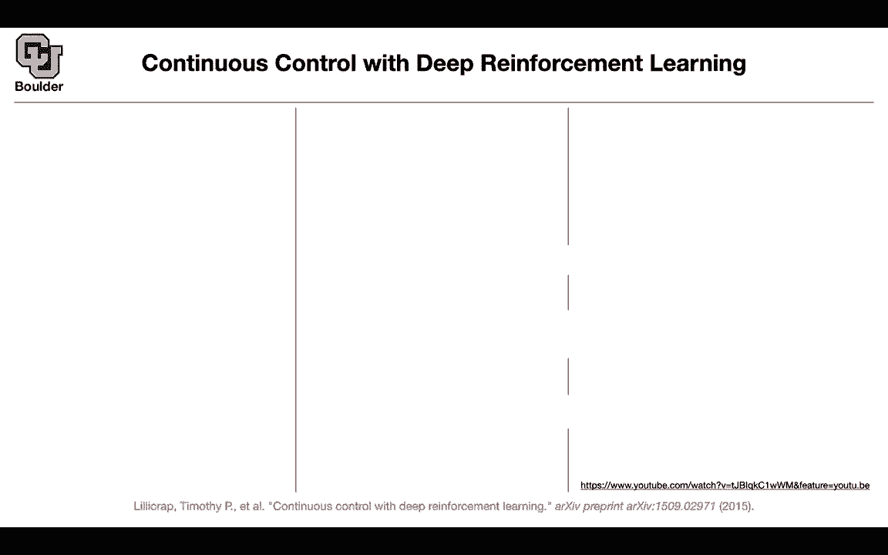
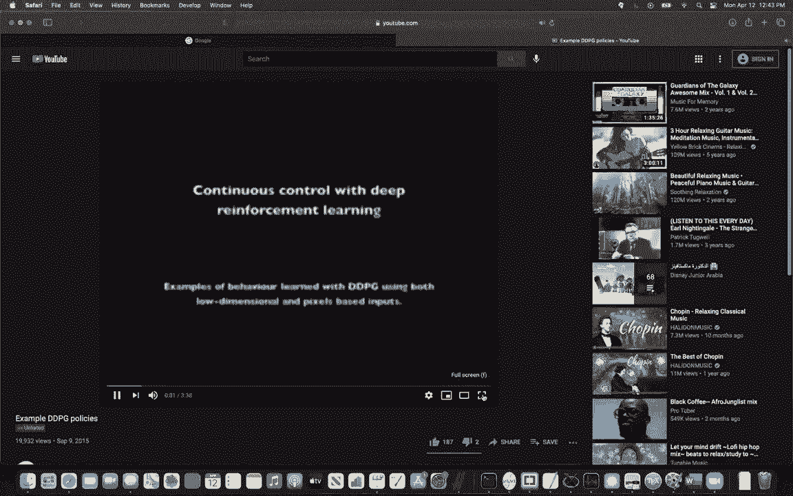
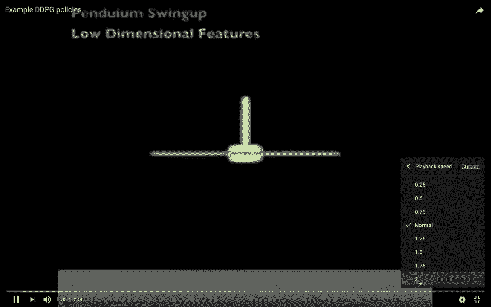
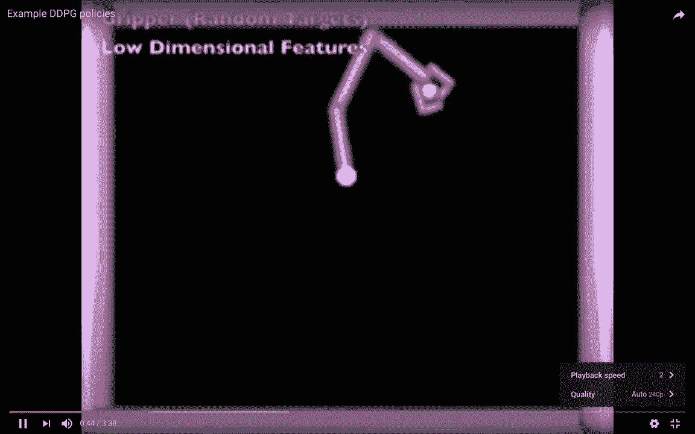
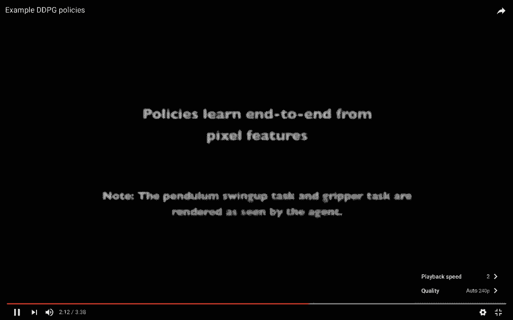
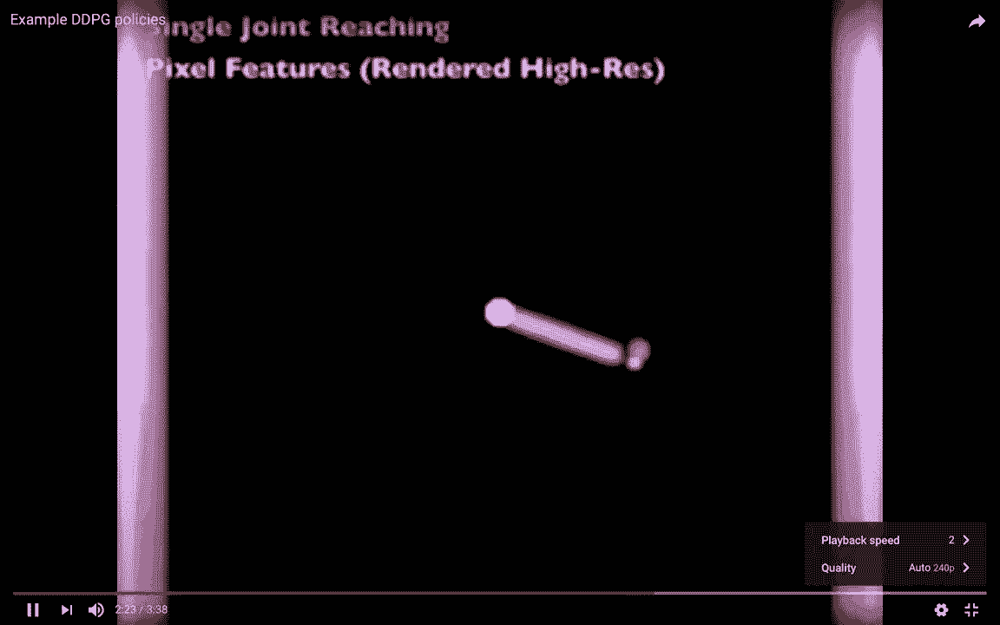
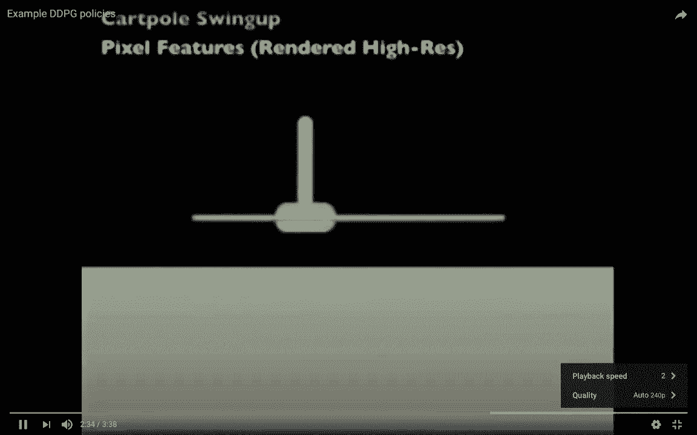
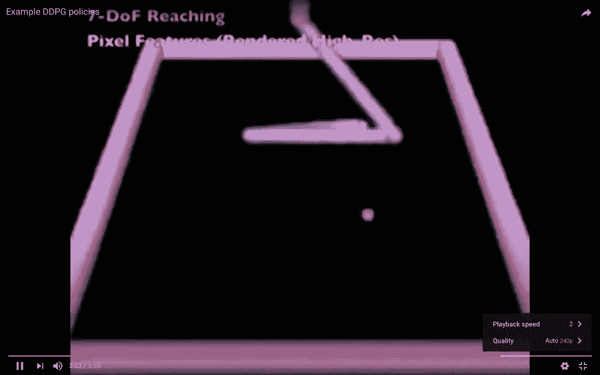
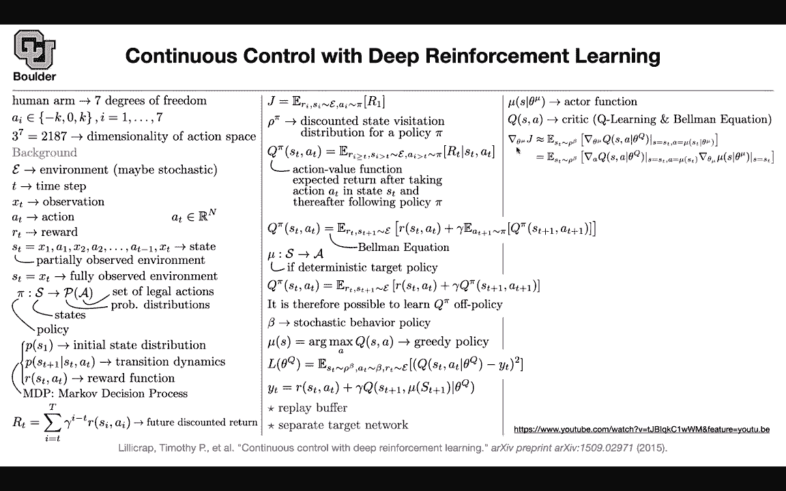

# 176：L78.1 - 深度确定性策略梯度 (DDPG) 教程 🎓

在本节课中，我们将学习深度确定性策略梯度算法。上一节我们介绍了强化学习的基础，并学习了如何通过经验回放玩转Atari游戏。本节中，我们将探讨当动作空间从离散变为连续时，如何解决更复杂的控制问题，例如机器人抓取和行走任务。

## 从离散到连续动作空间

上一节我们学习了强化学习的基础，特别是如何玩Atari游戏。我们学习了带经验回放的Q学习算法，它使用一个回放缓冲区。我们发现，将此算法应用于Atari等游戏时，能够实现超越人类的表现。

然而，在这些案例中，我们的状态和动作是离散的。玩Atari游戏时，你只有K个选择。当我们希望处理更现实的问题，并最终迈向机器人领域时，决策将变得连续。因此，你的控制也将变得连续。

让我们看一个我们想要解决的问题类型的例子。这是一个抓取任务，有一个机械手。

你有一个随机目标，然后你想控制机械手将其放入正确的位置。这些是低维特征。所谓低维，是指你用关节的扭矩来参数化你的模型。这是一个移动抓取任务，同样是低维特征。这是一个行走者任务，这个环境是一个物理模拟器。你将拥有多种不同类型的物理模拟器，例如Unity、NVIDIA或OpenAI提供的模拟器。这些通常被称为OpenAI Gym、TensorFlow Gym或MuJoCo。这些是高维的，旨在模仿人类的操作方式。它将看到图像并在像素级别工作。

现在，这是DDPG算法学习到的策略类型。

这些是高维且连续的。例如，人类手臂可以有七个自由度。如果你想将其量化并使其离散，假设每个自由度只有三个选择，那么你的动作空间维度将是3的7次方，这非常巨大。是否存在一种方法可以直接处理连续变量？

## 背景回顾与问题定义

回顾上一节的内容，你有一个环境。这个环境可能是随机的。在特定时间，你有一些观察结果。你将采取一些动作，现在这些动作不是离散的，而是连续的，并且属于R^N空间，即它们是n维的。在这个例子中，有七个自由度，所以n是7，而不是2187。你会获得一些奖励，与环境互动，环境会给你一些奖励。你有一个状态，它可能是直到该时间点为止你所做的观察和动作的串联。如果最终的观察结果不足以让你了解系统的整个状态，这意味着你需要串联你之前的决策和观察结果，这被称为部分可观察环境。另一方面，如果Xt足以提供关于系统当前状态的足够信息，那将被称为完全可观察环境。

我们通常有一个策略，它将你从系统的状态空间映射到动作的概率分布。你可以将此策略视为一个条件分布，条件是你知道你当前处于什么状态。基于你知道D的事实，你有一个关于你可以采取的动作类型的分布。

上一节我承诺会给你一个更详细的马尔可夫决策过程的定义。以下是定义：你有一个初始状态分布。你有一些转移动态，它不仅取决于先前的状态，还取决于你采取的动作。这是马尔可夫过程，因为你唯一依赖的输入是前一个时间步，所以你不依赖于ST-1、ST-2等，你依赖于直接的过去，这就是为什么它是一个马尔可夫过程。它是一个马尔可夫决策过程，因为你的决策将改变你未来将看到的状态。然后你有一些奖励来帮助你做出更明智的决策，决定采取什么动作。

我们上一节也定义了未来折扣回报。你只是将未来的回报累积起来。假设你当前处于时间T，你正在展望未来，但今天的回报比明天的相同回报更有价值。实际上，这个伽马值在某种程度上模拟了智能体可能无法存活到明天的概率，所以你将其折现。你在经济学中有相同的概念，它说今天的钱比明天的钱更有价值，所以你将其折现。到目前为止，我们还没有做任何特别的事情，我们只是在写定义和引入符号。

但我们想要最大化什么目标函数？因为是奖励，你想最大化它。你想最大化你的奖励。这是期望奖励，因为这里的一切都是随机的。你的决策、你的策略是随机的，它实际上是一个随机变量。你的环境是一个随机变量，它是一个随机过程。所以你要对你的环境取期望，你的奖励也不是确定性的。你的奖励和状态将来自你的环境和你的动作。这是你的目标函数，你想相对于π最大化它。

我们上一节也看到了这个概念。这是一个抽象概念，所以当你在计算机上实现算法时，你永远不会看到它，但在数学上你会看到它。每个状态根据你采取的策略和你的环境都有一定的访问概率。我们为其关联一个分布，这是一个折扣分布，你通过这个折扣因子对其进行折现。之前我们定义了最优动作价值函数，我们定义了π*，实际上是Q*，你相对于π最大化它。但现在让我们将π保持在相同的位置，我们应保持它并为该特定π定义一个动作价值。这基本上是在状态S中采取动作A之后，然后遵循策略π的期望回报。所以你的动作将在未来发生。你刚刚在时间T采取了一个动作，你正在根据你的策略对未来将要采取的动作取期望。所以i大于T。你的环境状态，你刚刚看到了今天的状态，但对于未来，你从你的环境中采样。但今天的回报也是一个随机变量。所以这大于或等于T，这是我们的动作价值函数。

然后我们可以为它写下一个贝尔曼方程。这个贝尔曼方程与我们上一节看到的不同。上一节你这里有Q*，然后你在这里对动作进行最大化。现在你将那个最大化部分替换为一个期望，你正在对你的策略取期望，这不一定是最优策略。但其余部分与之前非常相似。这应该是ST和A的函数。右边的项是Rt+1和S+1的函数，所以我们必须去掉S+1和A+1以及Rt。所以你对你的环境取一个期望，然后为了去掉A，你对你的策略取另一个期望。

但使用随机策略有点困难，因为当你取期望时，如果你想最大化你的策略，没有办法从这个策略中采样然后最大化它，因为你正在对策略取期望。因为在一天结束时，你想对这些进行蒙特卡洛估计，这是可以的，你将能够做到，然后使用我们在做硬注意力论文时使用的技巧。这是可行的，但那将是一个近似，利用函数的导数是函数本身乘以其对数的导数这一事实。我相信你还记得，但我们不打算在这里使用它。我们将在这里做一个简化假设。我们将假设我们的策略是确定性的。如果它是确定性的，你可以立即摆脱那个期望，然后我们将在其上动态地添加随机性。如果π是确定性的，你可以摆脱那个期望，然后你可以将A+1设置为来自你的策略，该策略现在是确定性的。

请记住，我们在这里所做的是我们想要返回，我们想要最终写下一个损失函数。所有这些麻烦都是为了给我们一个好的损失函数。所以我们在这里做了一个简化假设，即这是确定性的。如果它是确定性的，你可以摆脱那个期望。现在你可以像我们在前两张幻灯片中所做的那样进行Q学习。因为这将给你一个可以优化的损失函数。我们可以在上面进行Q学习。顺便说一下，动态地，是的，我们假设我们的策略是确定性的，有一个确定性的策略函数。但随后动态地，你可以添加噪声或鼓励噪声行为，鼓励探索。但很酷的是，没有导数通过这个随机行为。我将更详细地介绍这一点。这只是为了符号表示，请记住β是一个随机行为。

但一旦你知道了你的Q，就像我们上一节所做的那样，你将通过某种最大化来知道你的策略，给定S，对所有动作进行最大化，最好的一个将给你你的μ。但有一个问题。以前解决这个最大化问题非常容易，为什么？因为你的动作有有限多个选择，你可以立即选择最好的一个，比较所有，选择最好的一个。但现在解决这个最大化问题并不容易，为什么？因为你不想等待一个可能基于梯度下降的优化器收敛，以便它只为一个状态给出正确的动作。这成本太高了。但现在，假设你有一个μ函数，让我们走理论路线，你以某种方式神奇地能够解决这个最大化问题，只是为了取得一些进展。

## 构建损失函数与网络架构

如果你假设你知道μ，你将能够写下你的损失函数。它与我们上一节所做的Q学习非常相似。你最大化的是你的Q函数的参数。你处于状态S，你采取动作A，然后你将其与Yt进行比较，Yt将来自你的贝尔曼方程。所以Yt是回报加上折扣后的Q。但让我们更详细地了解一下这个符号。你在这里看到ST，你在上面看到ST+1，在下面看到S+1，然后你的动作是基于μ的。写下这个损失函数需要你知道你的μ，知道你的策略。一旦你知道你的μ，你将能够写下这个损失函数。但这是一个很大的假设。找到μ并不容易，你不想解决那个最大化问题。但最终，你拥有的是一个函数。一旦你知道S，μ(S)只是一个函数。每当你看到一个函数，并且你已经学习了深度学习，你将用一个神经网络来近似那个函数，这就是我们要做的。我们将为μ放置一个神经网络，我们为Q放置另一个神经网络，它们将互相帮助。这与你使用生成对抗网络所做的非常相似。所以你有两个函数互相帮助。其中一个帮助为另一个家伙写一个损失函数。所以同样的事情，μ将帮助我们为Q写一个损失函数。一旦你有了Q的损失函数，你可以做回放缓冲区，你可以用一个带有参数θQ或θQ'的目标网络分离，然后你可以优化这个。这取决于你知道μ。但我们如何学习你放在策略上的神经网络的参数？所以现在你放了两个神经网络，一个在你的策略上，一个在Q上。你放在μ上的神经网络将有自己的参数，它将是一个演员函数。这是一个演员-评论家框架。所以这是演员，另一个是评论家Q。到目前为止一切顺利。评论家我们知道如何学习它。一旦你知道μ，一旦你知道你的演员的参数θμ，你将把它插入到这个损失中，你将有一个可以优化的损失函数，该损失函数基于贝尔曼方程，就像我们上面所做的数学一样，在一些假设下，这是确定性的。方程是我们将如何学习μ。到目前为止，μ帮助我们学习Q，同样地，Q将帮助我们学习μ。所以评论家将帮助我们学习演员。但损失函数将从何而来？

所以μ的损失函数，μ基本上是您的确定性策略，应该有一些您想要最大化的东西。如果我们回到这里我们开始的数学中，我们想要最大化的是J，但您将用您的Q函数来近似最大化那个J。因为Q函数，如果你看它的公式，它与您的回报、您的未来折扣回报有直接关系。让我们看看。

所以我们想取这个J关于我们演员参数的导数。我们将使用Q来近似Rt。所以Q正在近似Rt，然后您处于状态ST，所以您的S将等于ST，您的动作将基于您的演员。所以您将采取的动作将取决于您的μ，然后取这个家伙的导数并不难，为什么？因为Q是可微的，所以您可以通过Q传递梯度。所以您正在取Q关于μ参数的导数。您可以从这个公式中取a，将其插入到这里，并使用链式法则。所以这将是Q关于a的导数，在我们的演员在该状态下的评估值，乘以我们演员的导数。所以这只是链式法则。一旦您知道了梯度，您将能够优化您的演员。这里的客观函数是什么？也许看梯度很难，在现代深度学习框架如TensorFlow或PyTorch中，您通常不写下您的梯度，您只写下一个损失函数，然后TensorFlow将负责反向传播和链式法则，所以您不必自己做那个链式法则。

我们在做什么？忘记这个负号，假设这不是一个损失函数，您正在最大化这个，所以您正在最大化J。假设这是时间t的j，您将用您的Q函数来近似那个时间t的j。您处于状态S，因为您在时间T，您看到了状态，然后您的动作基于您的演员，现在这是您的损失函数。一旦您将其乘以负号，那将给您一个损失函数。所以现在这里有两个损失函数，一个用于Q，一个用于μ。要写下Q的损失函数，您需要知道您的μ。要写下μ的损失函数，您需要知道您的Q。所以Q和μ互相帮助优化，就像您用GAN的判别器和生成器所做的那样。对于这个家伙，θQ是已知的，所以您停止梯度，而θQ在这里，θμ是已知的。但在所有这些麻烦之后，这只不过是强化学习中一个著名的经典算法，即确定性策略梯度算法。它是确定性的，因为您假设您的策略是确定性的以摆脱这个期望。但这个算法将被称为深度确定性策略算法。所以如果您听说过DDPG，这就是它。

## DDPG算法流程

它是如何工作的？您初始化您的评论家网络Q，您用一些初始权重初始化您的演员网络。所以最初一切都是随机的，所以您的Q和μ最初非常愚蠢。您将初始化一些目标Q'和μ'。您需要目标，因为您想为您的损失函数写下目标，并且您希望使您的数据看起来尽可能独立同分布。所以您分离，您制作θQ和θμ的副本。您初始化一个缓冲区，所以您将在该缓冲区中收集数据，就像我们上一节所做的那样。我们将在我们的模拟环境中进行M轮模拟，也就是M轮情节。您将有一个随机过程，所以您将在每个时间采取一些随机动作。您将采取一些随机动作，这就是β出现的地方。所以您将有一些随机行为来帮助您探索您的空间。所以有时您会采取一些随机动作，然后最初您将观察系统的初始状态S1。然后您将进行迭代，您将与您的环境互动最多T个时间步。也许在这个过程中，如果您有一个步行者，那个步行者会摔倒，您的算法将在达到最大T之前停止，或者您将强制您在T停止。

您将选择一个动作，您基于您的策略加上一些随机行为来选择动作，而μ因为我们用神经网络建模它，给定状态我们可以评估它，它将给我们一个动作。我们将在环境中执行该动作，获得一些奖励，进入下一个状态，这将是我们要存储的数据：当前状态、我们采取的动作、我们收集的奖励和下一个状态。我们将把它放入我们的缓冲区中。现在是时候进行梯度下降和优化了。我们将从我们的数据集中采样一个随机小批量。这些是状态、动作、奖励、下一个状态对。我们需要这里损失函数的目标，我们将需要Yt，我们将在这里构建它。它将是R_I加上伽马乘以Q'。这是目标网络将出现的地方，S_I+1假设您知道μ，您可以写下您的y。一旦您写下您的y，这只是负的平方误差，这是来自您的贝尔曼方程的损失函数，它将给您一些关于θQ的梯度，您可以优化。现在是演员的优化时间。我们要做什么？我们将查看这个目标，这里的这些梯度，我们将在刚刚从数据中采样的小批量下评估它们。所以这将是1/N乘以对I的求和。这是为了期望值。现在您明白为什么我不那么强调ρ_β或ρ_π了，因为当您实现算法时，您永远不会看到它们。您将使用采样、蒙特卡洛方法来实现它们，您将从数据集中采样，它们将变成求和。您取Q的梯度，因为这个项在这里，然后取μ的梯度，那将给您关于演员参数的损失梯度，您将使用它来优化您的演员。

但最终，之前我们的目标网络，我们每隔几步更新一次。在这里，您将动态地保持更新它们，这些是平均网络。所以您对Q的参数和μ的参数进行移动平均，这些将给您您的目标。我认为现在是提问的好时机。

## 问答与总结

**问：** 当我们更新演员和评论家时，那些成为我们的θQ和θμ，然后我们在这里更新θQ'和θμ'吗？
**答：** 是的，所以您将使用这里的这个梯度和这个损失函数的梯度来更新，采取一个步长并更新θQ和θμ，然后您将使用这两个来更新θQ'和θμ'，这些只是移动平均。

**问：** 在这种情况下我们需要这个μ的主要原因是动作的搜索空间太高，所以我们需要用神经网络来近似，对吗？
**答：** 完全正确。因为这个优化非常昂贵，所以从简单的角度讲，您正在为这个优化问题制作一个目标，以便评估起来更便宜。而以前我们只是评估像左、右、上、下这样的动作，那非常小，我们只是确定性地做。

**问：** 所以您有一个有限的选择集，您只需评估您的网络一次，然后如果您记得，我们将动作转换为输出，所以您将读取您的输出，然后如果您的动作空间是离散的，则选择一个最大值。但这里您的动作空间是连续的，这说得通。

**问：** 还有其他问题吗？
**答：** 到目前为止，我知道您习惯于做数据探索，比如语音、文本、图像。您在这里的数据探索任务或您的家庭作业是探索模拟器环境，探索给您数据的环境。有多种选择，只需谷歌OpenAI Gym或TensorFlow Gym，您将找到一些非常好的模拟器，或者MuJoCo，只需玩玩那些。

---

在本节课中，我们一起学习了深度确定性策略梯度算法。我们从回顾离散动作空间的Q学习开始，然后探讨了在连续动作空间（如机器人控制）中应用强化学习所面临的挑战。我们定义了马尔可夫决策过程、未来折扣回报等关键概念，并推导了确定性策略下的贝尔曼方程。核心在于，我们引入了演员-评论家框架，使用两个神经网络分别近似确定性策略μ和动作价值函数Q。它们通过互相提供损失函数进行协同优化：评论家Q帮助优化演员μ，而演员μ又为评论家Q的更新提供目标。最后，我们详细介绍了DDPG算法的具体步骤，包括经验回放、目标网络和探索噪声的使用。